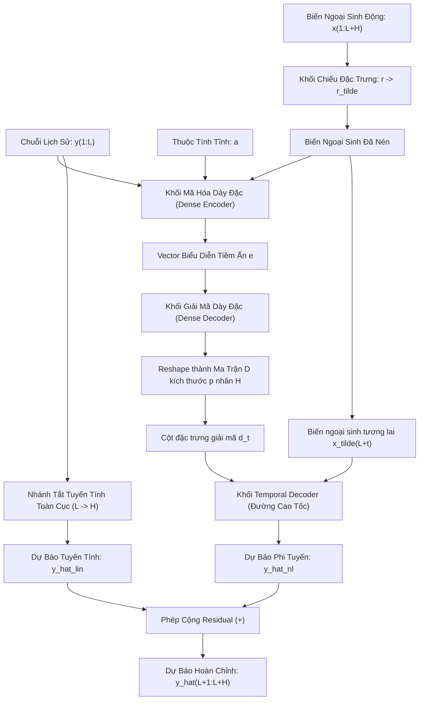

# Project-Experimental-TiDE: Long-term Time-Series Forecasting with TiDE

Dự án nghiên cứu, thực nghiệm và triển khai mô hình **TiDE (Time-series Dense Encoder)** cho bài toán dự báo chuỗi thời gian dài hạn (**Long-term Time-Series Forecasting - LTTF**).

Dựa trên công trình nghiên cứu của Google Research & University of California, San Diego (2023):  
*Abhimanyu Das, Weihao Kong, Andrew Leach, Shaan Mathur, Rajat Sen, Rose Yu.*

---

## 🌟 Điểm Nổi Bật Của Mô Hình TiDE

- **Kiến trúc thuần MLP (Multi-Layer Perceptron)**: Không sử dụng cơ chế Attention phức tạp hay mạng hồi quy RNN, giúp tối ưu hóa phần cứng vượt bậc.
- **Độ phức tạp tuyến tính $O(L + H)$**: Tốc độ suy luận và huấn luyện nhanh hơn **5 - 10 lần** so với PatchTST, không bị tràn bộ nhớ GPU (OOM) khi cửa sổ quá khứ $L$ kéo dài lên tới hàng nghìn điểm.
- **Tận dụng tối đa Covariates**: Tích hợp toàn diện các biến ngoại sinh động (dynamic covariates) và thuộc tính tĩnh (static attributes) thông qua khối **Feature Projection** và cơ chế "đường cao tốc" **Temporal Decoder**.
- **Global Linear Skip Connection**: Đảm bảo mô hình tuyến tính tối ưu luôn là một trường hợp con của TiDE.
- **Độ chính xác SOTA**: Đạt kết quả tương đương hoặc vượt trội PatchTST, N-HiTS, FEDformer trên 7 bộ benchmark lớn và vượt DeepAR 20% trên bài toán M5.

---

## 📚 Tài Liệu Chi Tiết Theo Từng Chương (Documentation)

Toàn bộ nội dung bài báo khoa học đã được dịch nghĩa, tổng hợp và phân tích chi tiết trong thư mục [`doc/`](./doc):

| STT | File Tài Liệu | Tiêu Đề | Tóm Tắt Nội Dung |
|:---:|:---|:---|:---|
| 00 | [`doc/00_tong_quan_tai_lieu.md`](./doc/00_tong_quan_tai_lieu.md) | **Tổng Quan Tài Liệu** | Tóm tắt cốt lõi bài báo, thông tin tác giả, sơ đồ kiến trúc tổng thể Mermaid. |
| 01 | [`doc/01_introduction.md`](./doc/01_introduction.md) | **Chương 1: Giới Thiệu** | Bối cảnh bài toán LTTF, nghịch lý DLinear vs Transformer, đóng góp của TiDE. |
| 02 | [`doc/02_background_and_related_work.md`](./doc/02_background_and_related_work.md) | **Chương 2: Cơ Sở Lý Thuyết** | Lịch sử mô hình: ARIMA, RNN, Transformers, Linear, N-HiTS, S4. |
| 03 | [`doc/03_problem_setting.md`](./doc/03_problem_setting.md) | **Chương 3: Thiết Lập Bài Toán** | Ký hiệu toán học, định nghĩa dynamic/static covariates, Channel Independence, hàm loss. |
| 04 | [`doc/04_model_architecture.md`](./doc/04_model_architecture.md) | **Chương 4: Kiến Trúc Mô Hình** | Chi tiết các khối: Residual Block, Feature Projection, Dense Encoder, Dense Decoder, Temporal Decoder, RevIN. |
| 05 | [`doc/05_experimental_results.md`](./doc/05_experimental_results.md) | **Chương 5: Kết Quả Thực Nghiệm** | Bảng đối chuẩn trên 7 benchmark LTTF, M5 forecasting, tốc độ huấn luyện/suy luận, GPU memory, Ablation. |
| 06 | [`doc/06_conclusion.md`](./doc/06_conclusion.md) | **Chương 6: Kết Luận** | Đánh giá ưu điểm, hạn chế và các định hướng nghiên cứu tương lai. |
| 07 | [`doc/07_theoretical_analysis.md`](./doc/07_theoretical_analysis.md) | **Phụ Lục A: Phân Tích Lý Thuyết** | Chứng minh toán học trên Hệ động lực tuyến tính (LDS), chặn Rademacher, thực nghiệm synthetic data. |
| 08 | [`doc/08_experimental_details.md`](./doc/08_experimental_details.md) | **Phụ Lục B: Chi Tiết Thực Nghiệm** | So sánh với S4, thiết kế Data Loader, bảng siêu tham số chuẩn cho từng dataset. |

---

## 💡 Từ Điển Thuật Ngữ (Feynman Glossary)

Giải thích các khái niệm cốt lõi bằng **phương pháp Feynman** (ngắn gọn, trực quan, dùng ẩn dụ đời thực, không dùng thuật ngữ rườm rà):

- [`glossary/RULE.md`](./glossary/RULE.md): **Quy chuẩn xây dựng Glossary** – Nguyên tắc bắt buộc đọc khi viết giải thích thuật ngữ theo phương pháp Feynman.
- [`glossary/dynamic_covariates.md`](./glossary/dynamic_covariates.md): **Dynamic Covariates là gì?** – Câu chuyện quầy bán kem của bác Ba, bóc tách thuật ngữ, bảng dữ liệu mẫu và bí quyết giúp TiDE vượt trội.
- [`glossary/feature_projection.md`](./glossary/feature_projection.md): **Feature Projection là gì?** – Chiếc balo đi cắm trại và túi hút chân không, phép chiếu giảm chiều không gian và giải bài toán bùng nổ số chiều.
- [`glossary/overfitting.md`](./glossary/overfitting.md): **Overfitting là gì?** – Người học sinh học vẹt đề thi, nhận biết qua biểu đồ phân kỳ Loss và 5 tầng phòng thủ của TiDE.
- [`glossary/residual_block.md`](./glossary/residual_block.md): **Residual Block là gì?** – Người thợ sửa tranh trên tấm kính trong suốt, cơ chế học phần dư và giải quyết triệt tiêu gradient.
- [`glossary/temporal_decoder.md`](./glossary/temporal_decoder.md): **Temporal Decoder là gì?** – Người đưa thư hỏa tốc trong tiệm pizza, làn đường cao tốc (Covariate Highway) giúp phản ứng tức thì với sự kiện tương lai.
- [`glossary/hadamard_product.md`](./glossary/hadamard_product.md): **Ký hiệu phép nhân Hadamard $\odot$ là gì?** – Chiếc máy tính tiền siêu thị, phép nhân từng phần tử tương ứng và vai trò nút vặn âm lượng trong Layer Normalization.
- [`glossary/revin.md`](./glossary/revin.md): **RevIN là gì?** – Chuyện đổi tiền khi đi du lịch nước ngoài, cơ chế chuẩn hóa đảo nghịch 2 chiều và trị căn bệnh trôi dạt phân phối (Non-stationarity).

---

## 🔍 Chuyên Đề Phân Tích Kỹ Thuật (Technical Deep-Dive Explanations)

Các bài viết giải thích chi tiết từng phần kỹ thuật, toán học và mã nguồn triển khai:

- [`explanation/section_4_1_residual_block.md`](./explanation/section_4_1_residual_block.md): **Giải thích chi tiết Phần 4.1: Khối Residual Block** – Cơ chế biến đổi số chiều $d_{\text{in}} \to d_{\text{hidden}}$, hàm kích hoạt phi tuyến tính ReLU, vai trò của Dropout, Skip Connection, Layer Normalization và mã nguồn PyTorch minh họa.

---

## 🏛️ Sơ Đồ Kiến Trúc TiDE



---

## 📄 Bản Quyền & Trích Dẫn

Tài liệu tham khảo:
```bibtex
@article{das2023long,
  title={Long-term Forecasting with TiDE: Time-series Dense Encoder},
  author={Das, Abhimanyu and Kong, Weihao and Leach, Andrew and Mathur, Shaan and Sen, Rajat and Yu, Rose},
  journal={Transactions on Machine Learning Research (TMLR)},
  year={2023}
}
```