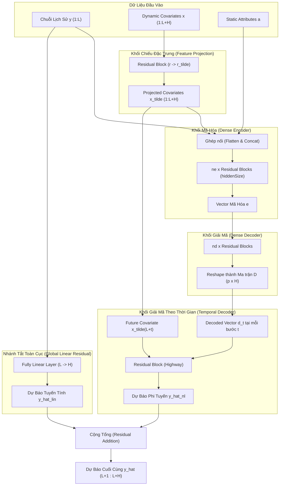

# Tổng Quan Nghiên Cứu: Mô Hình TiDE (Time-series Dense Encoder)

> **Tên bài báo gốc**: *Long-term Forecasting with TiDE: Time-series Dense Encoder*  
> **Tác giả**: Abhimanyu Das, Weihao Kong, Andrew Leach, Shaan Mathur, Rajat Sen (Google Research & Google Cloud), Rose Yu (University of California, San Diego)  
> **Năm xuất bản**: 2023  
> **File PDF gốc**: [`project/Hieu_paper_TiDE-Time-series-Dense-Encoder.pdf`](../Hieu_paper_TiDE-Time-series-Dense-Encoder.pdf)

---

## 1. Tóm Tắt Cốt Lõi (Executive Summary)

Trong bài toán dự báo chuỗi thời gian dài hạn (**Long-term Time-Series Forecasting - LTTF**), các nghiên cứu giai đoạn 2020-2022 chủ yếu tập trung vào việc áp dụng kiến trúc **Transformer** phức tạp (Informer, Autoformer, FEDformer). Tuy nhiên, nghiên cứu gần đây (**DLinear**, 2023) đã chỉ ra một nghịch lý: các mô hình tuyến tính cực kỳ đơn giản lại vượt trội hơn nhiều mô hình Transformer trên các tập benchmark tiêu chuẩn.

Mặc dù vậy, mô hình tuyến tính thuần túy gặp phải những hạn chế nghiêm trọng:
1. Không mô hình hóa được **mối quan hệ phi tuyến tính** phức tạp giữa quá khứ và tương lai.
2. Không thể tích hợp và tận dụng các **biến ngoại sinh động** (dynamic covariates - như ngày lễ, thời tiết, giá cả) và **thuộc tính tĩnh** (static attributes - như nhóm sản phẩm, vị trí cửa hàng).

Để giải quyết mâu thuẫn này, nhóm tác giả từ **Google Research** và **UCSD** đề xuất mô hình **TiDE (Time-series Dense Encoder)**:
- **Kiến trúc hoàn toàn dựa trên MLP (Multi-Layer Perceptron)**: Không dùng Self-Attention, không dùng RNN, không dùng Convolution.
- **Độ phức tạp tính toán tuyến tính $O(L + H)$**: Tốc độ huấn luyện và suy luận nhanh hơn **5 - 10 lần** so với mô hình Transformer tốt nhất (PatchTST), tiết kiệm bộ nhớ GPU vượt bậc.
- **Xử lý toàn diện Covariates**: Tích hợp cả biến quá khứ, biến tương lai và thuộc tính tĩnh vào quy trình dự báo thông qua các khối Feature Projection và Temporal Decoder độc đáo.
- **Hiệu năng vượt trội**: Đạt kết quả tương đương hoặc tốt hơn các mô hình SOTA (PatchTST, N-HiTS, FEDformer) trên 7 tập dữ liệu chuẩn và vượt DeepAR tới **20%** trên bài toán dự báo bán lẻ thực tế (M5 Competition).

---

## 2. Mục Lục Tài Liệu Chi Tiết

Bộ tài liệu này được cấu trúc theo từng chương của bài báo gốc, giải thích chi tiết lý thuyết, công thức toán học và kết quả thực nghiệm:

| STT | Tên File | Tiêu Đề Chương | Nội Dung Chính |
|:---:|:---|:---|:---|
| 01 | [`01_introduction.md`](./01_introduction.md) | **Chương 1: Giới Thiệu (Introduction)** | Đặt vấn đề LTTF, nghịch lý Transformer vs Linear, các đóng góp cốt lõi của bài báo. |
| 02 | [`02_background_and_related_work.md`](./02_background_and_related_work.md) | **Chương 2: Cơ Sở Lý Thuyết & Nghiên Cứu Liên Quan** | Phân loại các trường phái mô hình: Thống kê cổ điển, RNN/DeepAR, Transformers, Tuyến tính, N-HiTS, S4. |
| 03 | [`03_problem_setting.md`](./03_problem_setting.md) | **Chương 3: Thiết Lập Bài Toán & Ký Hiệu Toán Học** | Khung bài toán dự báo đa biến, định nghĩa biến mục tiêu, covariates động/tĩnh, chiến lược Channel Independence. |
| 04 | [`04_model_architecture.md`](./04_model_architecture.md) | **Chương 4: Kiến Trúc Chi Tiết Mô Hình TiDE** | Phân tích sâu các khối: Residual Block, Feature Projection, Dense Encoder, Dense Decoder, Temporal Decoder, Global Skip Connection. |
| 05 | [`05_experimental_results.md`](./05_experimental_results.md) | **Chương 5: Kết Quả Thực Nghiệm & Đánh Giá** | Đánh giá trên 7 tập benchmark LTTF, bài toán M5 Demand Forecasting, tốc độ huấn luyện/suy luận, Ablation study. |
| 06 | [`06_conclusion.md`](./06_conclusion.md) | **Chương 6: Kết Luận & Hướng Phát Triển** | Tổng kết ưu điểm, đánh giá hạn chế và các hướng mở rộng tiềm năng trong tương lai. |
| 07 | [`07_theoretical_analysis.md`](./07_theoretical_analysis.md) | **Phụ Lục A: Phân Tích Lý Thuyết Trên Hệ LDS** | Phân tích toán học trên Linear Dynamical Systems, xấp xỉ tự hồi quy, độ phức tạp Rademacher, thực nghiệm synthetic data. |
| 08 | [`08_experimental_details.md`](./08_experimental_details.md) | **Phụ Lục B: Chi Tiết Thực Nghiệm & Siêu Tham Số** | So sánh với mô hình S4, thiết kế Data Loader, bảng thông số siêu tham số (Hyperparameters) chuẩn cho từng dataset. |

---

## 3. Kiến Trúc Tổng Thể Ở Một Cái Nhìn

