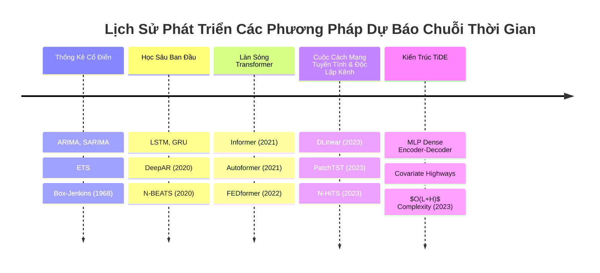

# Chương 2: Cơ Sở Lý Thuyết & Các Nghiên Cứu Liên Quan (Background and Related Work)

Để hiểu rõ vị trí của TiDE trong bức tranh toàn cảnh của lĩnh vực dự báo chuỗi thời gian, chương này phân tích sự tiến hóa của các phương pháp qua từng giai đoạn và so sánh kiến trúc của TiDE với các dòng mô hình chủ đạo.

---

## 2.1. Tiến Trình Phát Triển Của Các Mô Hình Dự Báo

### 1. Phương pháp thống kê cổ điển (Classical Statistical Methods)
- **ARIMA, SARIMA, Box-Jenkins**: Xây dựng dựa trên giả định tính dừng (stationarity), tương quan tự hồi quy (AR), sai phân tích hợp (I) và trung bình trượt (MA).
- **Hạn chế**: Khó mở rộng cho hàng nghìn chuỗi cùng lúc, không học được biểu diễn chia sẻ toàn cục (global representations), xử lý covariates phức tạp rất hạn chế.

### 2. Mạng nơ-ron hồi quy & Mô hình xác suất (RNNs & Probabilistic Models)
- **LSTM / GRU**: Mô hình hóa trạng thái ẩn tuần tự qua từng bước thời gian.
- **DeepAR (Salinas et al., 2020)**: Sử dụng autoregressive RNN để dự báo phân phối xác suất tham số, có khả năng xử lý covariates và học biểu diễn trên quy mô lớn.
- **Hạn chế**: Việc tính toán tuần tự khiến quá trình huấn luyện chậm, dễ gặp hiện tượng triệt tiêu gradient trên khoảng nhìn lại dài ($L > 100$), và lỗi tích lũy (error accumulation) khi suy luận tự hồi quy bước dài.

### 3. Làn sóng Transformer trong Chuỗi thời gian (Transformers for Time-Series)
- **Informer (Zhou et al., 2021)**: Đề xuất *ProbSparse Attention* giảm độ phức tạp từ $O(L^2)$ xuống $O(L \log L)$, cùng cơ chế chắt lọc (distillation) nhằm giảm kích thước đặc trưng.
- **Autoformer (Wu et al., 2021)**: Thay thế cơ chế Attention truyền thống bằng khối *Auto-Correlation* dựa trên biến đổi Fourier nhanh (FFT), kết hợp phân rã xu hướng và mùa vụ (trend-seasonal decomposition).
- **FEDformer (Zhou et al., 2022)**: Áp dụng biến đổi Fourier và Wavelet để thực hiện phép chú ý trong miền tần số, giúp nắm bắt cấu trúc toàn cục với độ phức tạp $O(L)$.
- **PatchTST (Nie et al., 2022)**: Chia chuỗi thời gian thành các đoạn nhỏ (patches) tương tự như Vision Transformer, kết hợp với chiến lược độc lập kênh (**Channel-Independent**). PatchTST đã đạt hiệu năng SOTA vượt trội so với các Transformer trước đó.

### 4. Mô hình tuyến tính & MLP phân cấp (Linear & Hierarchical MLP Models)
- **DLinear & NLinear (Zeng et al., 2023)**: Thách thức tính hiệu quả của Transformer bằng cách phân rã chuỗi thành Trend và Seasonal, sau đó dùng 2 lớp Linear đơn giản để dự báo. Đạt kết quả vượt trội Informer, Autoformer trên nhiều benchmark.
- **N-BEATS (Oreshkin et al., 2020) & N-HiTS (Challu et al., 2023)**: Sử dụng các khối MLP phân cấp với phép nội suy đa tỉ lệ (multi-rate interpolation) để nắm bắt các tần số khác nhau. N-HiTS giảm đáng kể số lượng tham số và tăng tốc độ xử lý so với N-BEATS.

### 5. Mô hình Không gian trạng thái có cấu trúc (Structured State-Space Models - S4)
- **S4 (Gu et al., 2021)**: Sử dụng hệ phương trình vi phân liên tục được rời rạc hóa với ma trận trạng thái có cấu trúc HiPPO để xử lý các chuỗi cực dài.

---

## 2.2. So Sánh Bản Chất Kiến Trúc Giữa TiDE Và Các Đối Thủ

Bảng so sánh tổng hợp các đặc tính kỹ thuật cốt lõi:

| Đặc tính | Informer / Autoformer | DLinear | PatchTST | N-HiTS | TiDE (Đề xuất) |
|:---|:---:|:---:|:---:|:---:|:---:|
| **Khối kiến trúc cơ bản** | Self-Attention / Auto-Corr | Single Linear Layer | Patch Transformer | Multi-rate MLPs | **Dense MLP Residual** |
| **Độ phức tạp thời gian** | $O(L \log L)$ | $O(L \cdot H)$ | $O((L/P)^2)$ | $O(L + H)$ | **$O(L + H)$** |
| **Xử lý phi tuyến tính** | Có | **Không** | Có | Có | **Có** |
| **Hỗ trợ Dynamic Covariates** | Hạn chế | **Không hỗ trợ** | Không (nguyên bản) | Hạn chế | **Có (Covariate Highway)** |
| **Hỗ trợ Static Attributes** | Không rõ ràng | **Không** | Không | Không | **Có (Direct Concat)** |
| **Tốc độ huấn luyện** | Rất chậm | Cực nhanh | Trung bình | Nhanh | **Rất nhanh (5-10x PatchTST)** |
| **Nguy cơ tràn bộ nhớ GPU** | Cao | Rất thấp | Cao khi $L \ge 1440$ | Thấp | **Rất thấp** |
| **Chiến lược kênh** | Kênh phụ thuộc | Kênh độc lập | Kênh độc lập | Kênh phụ thuộc/độc lập | **Kênh độc lập (Channel-Indep)** |

---

## 2.3. Định Vị Điểm Khác Biệt Của TiDE

TiDE định vị mình là giải pháp thực tế nhất cho bài toán dự báo chuỗi thời gian:
1. **Không phức tạp hóa**: Loại bỏ hoàn toàn cơ chế Attention vốn tốn kém tài nguyên và không đem lại lợi thế rõ rệt trên chuỗi liên tục.
2. **Khắc phục nhược điểm của DLinear**: Giữ lại nhánh tắt tuyến tính (linear skip) để hưởng trọn ưu điểm của DLinear, đồng thời bổ sung các tầng MLP phi tuyến để học các quy luật phức tạp.
3. **Tận dụng tối đa Covariates**: Trong các bài toán thực tế (như chuỗi bán lẻ M5), thông tin khuyến mãi hay ngày nghỉ lễ quan trọng hơn bản thân lịch sử bán hàng. TiDE là mô hình hiếm hoi thiết kế cơ chế riêng (**Temporal Decoder**) để khai thác thông tin này một cách triệt để.
