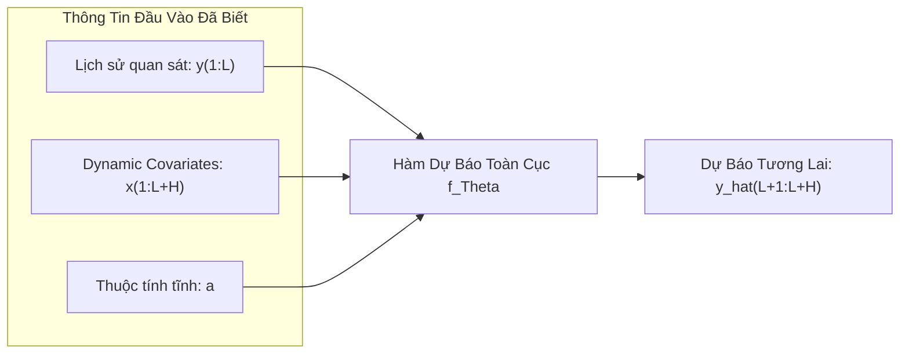

# Chương 3: Thiết Lập Bài Toán & Ký Hiệu Toán Học (Problem Setting & Notation)

Chương này trình bày khuôn khổ hình thức hóa toán học cho bài toán dự báo chuỗi thời gian đa biến dài hạn (**Long-term Time-Series Forecasting - LTTF**), các tập biến đầu vào, và chiến lược xử lý độc lập kênh (**Channel Independence**) được áp dụng trong mô hình TiDE.

---

## 3.1. Các Ký Hiệu Toán Học Chuẩn (Notation)

Giả sử chúng ta có một tập dữ liệu gồm $N$ chuỗi thời gian riêng biệt (hoặc $N$ kênh trong một hệ thống đa biến).
- Mỗi chuỗi thời gian được đánh chỉ số $i \in \{1, 2, \dots, N\}$.
- Trục thời gian được rời rạc hóa thành các bước $t \in \{1, 2, \dots, T\}$.

Tại mỗi bước thời gian $t$, chuỗi thứ $i$ được liên kết với ba loại thông tin:

### 1. Biến Mục Tiêu (Target Time-Series)
- Ký hiệu là $y_t^{(i)} \in \mathbb{R}$. Đây là giá trị số thực cần quan sát trong quá khứ và dự đoán trong tương lai.
- **Chuỗi lịch sử quan sát quá khứ (Look-back window có độ dài $L$):**

$$
y_{1:L}^{(i)} = \begin{bmatrix} y_1^{(i)}, y_2^{(i)}, \dots, y_L^{(i)} \end{bmatrix}^\top \in \mathbb{R}^L
$$

- **Chuỗi giá trị thực tế tương lai cần dự báo (Forecast Horizon có độ dài $H$):**

$$
y_{L+1:L+H}^{(i)} = \begin{bmatrix} y_{L+1}^{(i)}, y_{L+2}^{(i)}, \dots, y_{L+H}^{(i)} \end{bmatrix}^\top \in \mathbb{R}^H
$$

- **Giá trị dự báo tương lai do mô hình sinh ra:**

$$
\hat{y}_{L+1:L+H}^{(i)} = \begin{bmatrix} \hat{y}_{L+1}^{(i)}, \hat{y}_{L+2}^{(i)}, \dots, \hat{y}_{L+H}^{(i)} \end{bmatrix}^\top \in \mathbb{R}^H
$$

### 2. Biến Ngoại Sinh Động Theo Thời Gian (Dynamic Covariates)
- Ký hiệu là $x_t^{(i)} \in \mathbb{R}^r$, biểu diễn một vector $r$ chiều tại bước thời gian $t$.
- Các biến này có đặc điểm là **đã biết trước trên toàn bộ khoảng thời gian** bao gồm cả quá khứ và tương lai: $t \in \{1, 2, \dots, L+H\}$.
- **Ma trận dynamic covariates cho chuỗi $i$:**

$$
x_{1:L+H}^{(i)} = \begin{bmatrix} x_1^{(i)}, x_2^{(i)}, \dots, x_{L+H}^{(i)} \end{bmatrix}^\top \in \mathbb{R}^{(L+H) \times r}
$$

- *Ví dụ*: Các biến thời gian tuần hoàn (giờ trong ngày, ngày trong tuần, tháng trong năm), sự kiện ngày lễ (Tết, Giáng Sinh), thông tin thời tiết dự báo, kế hoạch giảm giá khuyến mãi trong tương lai.

### 3. Biến Ngoại Sinh Tĩnh (Static Attributes)
- Ký hiệu là $a^{(i)} \in \mathbb{R}^{r_{stat}}$, biểu diễn đặc trưng cố định không thay đổi theo thời gian của chuỗi thứ $i$.
- *Ví dụ*: ID nhận dạng cảm biến, vị trí địa lý của trạm quan trắc, mã danh mục sản phẩm (đồ gia dụng, thực phẩm), quy mô siêu thị.

---

## 3.2. Phát Biểu Bài Toán Dự Báo Tổng Quát

Mục tiêu của mô hình dự báo là học một hàm ánh xạ $f_\Theta$ (với tập tham số $\Theta$ được tối ưu hóa toàn cục trên toàn bộ tập dữ liệu) từ các thông tin đã biết sang chuỗi dự báo tương lai:

$$
\hat{y}_{L+1:L+H}^{(i)} = f_\Theta \left( y_{1:L}^{(i)}, \, x_{1:L+H}^{(i)}, \, a^{(i)} \right)
$$

---

## 3.3. Chiến Lược Kênh Độc Lập (Channel-Independent Strategy)

Một điểm thiết kế then chốt của TiDE (kế thừa từ quan sát của Nie et al., 2022 trong PatchTST) là **Channel Independence**:

1. **Áp dụng theo từng kênh riêng lẻ**: Thay vì đưa toàn bộ $N$ chuỗi vào mô hình cùng một lúc để học ma trận tương quan chéo $N \times N$, mô hình chỉ nhận đầu vào là thông tin của **một chuỗi đơn lẻ** $i$ tại một thời điểm:

$$
\text{Input}^{(i)} = \left( y_{1:L}^{(i)}, \, x_{1:L+H}^{(i)}, \, a^{(i)} \right)
$$

2. **Chia sẻ trọng số toàn cục (Globally Shared Weights)**: Bộ tham số $\Theta$ của mạng nơ-ron được chia sẻ chung cho tất cả $N$ chuỗi thời gian trong tập dữ liệu.

### Lợi ích của Channel Independence:
- **Tránh hiện tượng quá khớp (Overfitting)**: Giảm đột biến số lượng tham số của mô hình so với việc mô hình hóa trực tiếp tương tác $N \times N$, đặc biệt khi $N$ lớn (như Traffic với $N=862$ hay Electricity với $N=321$).
- **Tăng số lượng mẫu huấn luyện hiệu dụng**: Với $N$ chuỗi và $T$ bước thời gian, số lượng mẫu huấn luyện tăng lên $N$ lần, giúp mô hình học được các biểu diễn tổng quát và chống nhiễu tốt hơn.
- **Linh hoạt và dễ mở rộng**: Có thể dễ dàng suy luận cho các chuỗi mới mà không cần huấn luyện lại toàn bộ mạng.

---

## 3.4. Hàm Mất Mát (Loss Function) & Quy Trình Đánh Giá

### Hàm Mất Mát Huấn Luyện (Training Loss)
Mô hình TiDE được huấn luyện bằng thuật toán Mini-batch Stochastic Gradient Descent (Adam optimizer), sử dụng hàm tổn thất **Sai số bình phương trung bình (Mean Squared Error - MSE)**:

$$
\mathcal{L}_{\text{MSE}}(\Theta) = \frac{1}{B \cdot H} \sum_{i=1}^{B} \sum_{t=1}^{H} \left( y_{L+t}^{(i)} - \hat{y}_{L+t}^{(i)} \right)^2 = \frac{1}{B \cdot H} \sum_{i=1}^{B} \left\| y_{L+1:L+H}^{(i)} - \hat{y}_{L+1:L+H}^{(i)} \right\|_2^2
$$

Trong đó:
- $B$ là kích thước mini-batch (`batchSize`).
- Mỗi epoch bao gồm tất cả các cặp $(y_{1:L}, y_{L+1:L+H})$ có thể trích xuất được từ tập huấn luyện thông qua kỹ thuật cửa sổ trượt (sliding window).

### Quy Trình Đánh Giá (Rolling Evaluation)
Khi kiểm thử trên tập Test, mô hình áp dụng cơ chế **Rolling Evaluation**:
- Cửa sổ trượt qua từng bước thời gian trên tập kiểm tra, mỗi bước trích xuất cửa sổ $L$ và dự báo cho $H$ bước tiếp theo.
- Tính trung bình **MSE** và **Sai số tuyệt đối trung bình (MAE)**:

$$
\text{MAE} = \frac{1}{N_{\text{test}} \cdot H} \sum_{i=1}^{N_{\text{test}}} \sum_{t=1}^{H} \left| y_{L+t}^{(i)} - \hat{y}_{L+t}^{(i)} \right|
$$
