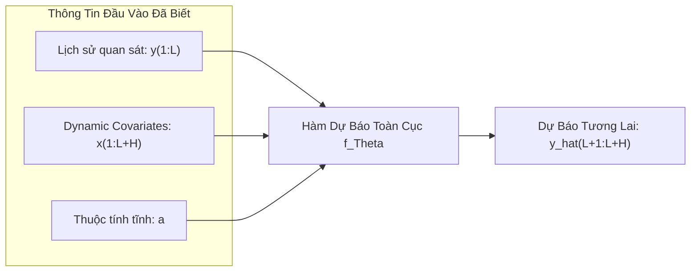
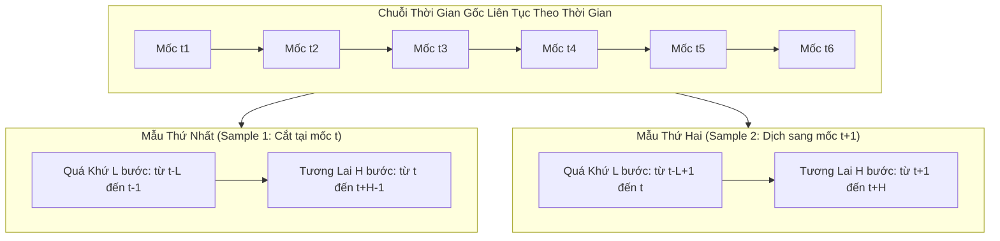

# Chương 3: Thiết Lập Bài Toán & Ký Hiệu Toán Học (Problem Setting & Notation)

Chương này trình bày khuôn khổ hình thức hóa toán học cho bài toán dự báo chuỗi thời gian đa biến dài hạn (**Long-term Time-Series Forecasting - LTTF**), các tập biến đầu vào, và chiến lược xử lý độc lập kênh (**Channel Independence**) được áp dụng trong mô hình TiDE.

---

## 3.1. Các Ký Hiệu Toán Học Chuẩn (Notation)

Giả sử chúng ta có một tập dữ liệu gồm $N$ chuỗi thời gian riêng biệt (hoặc $N$ kênh trong một hệ thống đa biến).
- Mỗi chuỗi thời gian được đánh chỉ số $i \in \{1, 2, \dots, N\}$.
- Trục thời gian được rời rạc hóa thành các bước $t \in \{1, 2, \dots, T\}$.

Tại mỗi bước thời gian $t$, chuỗi thứ $i$ được liên kết với ba loại thông tin:

### 1. Biến Mục Tiêu (Target Time-Series)
- Ký hiệu là $y_t^{(i)} \in \mathbb{R}$. Đây là giá trị số thực cần quan sát trong quá khứ và dự đoán trong tương lai.
- **Chuỗi lịch sử quan sát quá khứ (Look-back window có độ dài $L$):**

$$
y_{1:L}^{(i)} = \begin{bmatrix} y_1^{(i)}, y_2^{(i)}, \dots, y_L^{(i)} \end{bmatrix}^\top \in \mathbb{R}^L
$$

- **Chuỗi giá trị thực tế tương lai cần dự báo (Forecast Horizon có độ dài $H$):**

$$
y_{L+1:L+H}^{(i)} = \begin{bmatrix} y_{L+1}^{(i)}, y_{L+2}^{(i)}, \dots, y_{L+H}^{(i)} \end{bmatrix}^\top \in \mathbb{R}^H
$$

- **Giá trị dự báo tương lai do mô hình sinh ra:**

$$
\hat{y}_{L+1:L+H}^{(i)} = \begin{bmatrix} \hat{y}_{L+1}^{(i)}, \hat{y}_{L+2}^{(i)}, \dots, \hat{y}_{L+H}^{(i)} \end{bmatrix}^\top \in \mathbb{R}^H
$$

> 💡 **Xem giải thích chi tiết:** [Giải phẫu từng ký hiệu toán học trong vector nhãn tương lai $y_{L+1:L+H}^{(i)}$ và Case study thực tế](../explanation/target_horizon_vector.md).

### 2. Biến Ngoại Sinh Động Theo Thời Gian (Dynamic Covariates)
- Ký hiệu là $x_t^{(i)} \in \mathbb{R}^r$, biểu diễn một vector $r$ chiều tại bước thời gian $t$.
- Các biến này có đặc điểm là **đã biết trước trên toàn bộ khoảng thời gian** bao gồm cả quá khứ và tương lai: $t \in \{1, 2, \dots, L+H\}$.
- **Ma trận dynamic covariates cho chuỗi $i$:**

$$
x_{1:L+H}^{(i)} = \begin{bmatrix} x_1^{(i)}, x_2^{(i)}, \dots, x_{L+H}^{(i)} \end{bmatrix}^\top \in \mathbb{R}^{(L+H) \times r}
$$

- *Ví dụ*: Các biến thời gian tuần hoàn (giờ trong ngày, ngày trong tuần, tháng trong năm), sự kiện ngày lễ (Tết, Giáng Sinh), thông tin thời tiết dự báo, kế hoạch giảm giá khuyến mãi trong tương lai.

### 3. Biến Ngoại Sinh Tĩnh (Static Attributes)
- Ký hiệu là $a^{(i)} \in \mathbb{R}^{r_{\text{stat}}}$, biểu diễn đặc trưng cố định không thay đổi theo thời gian của chuỗi thứ $i$.
- *Ví dụ*: ID nhận dạng cảm biến, vị trí địa lý của trạm quan trắc, mã danh mục sản phẩm (đồ gia dụng, thực phẩm), quy mô siêu thị.

---

## 3.2. Phát Biểu Bài Toán Dự Báo Tổng Quát

Mục tiêu của mô hình dự báo là học một hàm ánh xạ $f_\Theta$ (với tập tham số $\Theta$ được tối ưu hóa toàn cục trên toàn bộ tập dữ liệu) từ các thông tin đã biết sang chuỗi dự báo tương lai:

$$
\hat{y}_{L+1:L+H}^{(i)} = f_\Theta \left( y_{1:L}^{(i)}, \, x_{1:L+H}^{(i)}, \, a^{(i)} \right)
$$

---

## 3.3. Chiến Lược Kênh Độc Lập (Channel-Independent Strategy)

Một điểm thiết kế then chốt của TiDE (kế thừa từ quan sát của Nie et al., 2022 trong PatchTST) là **Channel Independence**:

1. **Áp dụng theo từng kênh riêng lẻ**: Thay vì đưa toàn bộ $N$ chuỗi vào mô hình cùng một lúc để học ma trận tương quan chéo $N \times N$, mô hình chỉ nhận đầu vào là thông tin của **một chuỗi đơn lẻ** $i$ tại một thời điểm:

$$
\text{Input}^{(i)} = \left( y_{1:L}^{(i)}, \, x_{1:L+H}^{(i)}, \, a^{(i)} \right)
$$

2. **Chia sẻ trọng số toàn cục (Globally Shared Weights)**: Bộ tham số $\Theta$ của mạng nơ-ron được chia sẻ chung cho tất cả $N$ chuỗi thời gian trong tập dữ liệu.

### Lợi ích của Channel Independence:
- **Tránh hiện tượng quá khớp (Overfitting)**: Giảm đột biến số lượng tham số của mô hình so với việc mô hình hóa trực tiếp tương tác $N \times N$, đặc biệt khi $N$ lớn (như Traffic với $N=862$ hay Electricity với $N=321$).
- **Tăng số lượng mẫu huấn luyện hiệu dụng**: Với $N$ chuỗi và $T$ bước thời gian, số lượng mẫu huấn luyện tăng lên $N$ lần, giúp mô hình học được các biểu diễn tổng quát và chống nhiễu tốt hơn.
- **Linh hoạt và dễ mở rộng**: Có thể dễ dàng suy luận cho các chuỗi mới mà không cần huấn luyện lại toàn bộ mạng.

---

## 3.4. Hàm Mất Mát (Loss Function) & Cơ Chế Huấn Luyện - Đánh Giá Chi Tiết

Phần này phân tích sâu về hàm mục tiêu toán học, cơ chế tạo mẫu huấn luyện qua cửa sổ trượt, và phương pháp đánh giá cuốn chiếu (**Rolling Evaluation**) chuẩn xác.

---

### 3.4.1. Bản Chất Toán Học Của Hàm Mất Mát Huấn Luyện (Training Loss)

Mô hình TiDE được huấn luyện bằng thuật toán tối ưu hóa Gradient Descent theo mini-batch (cụ thể là Adam Optimizer). Hàm mất mát được sử dụng trong suốt quá trình tối ưu hóa là **Sai số bình phương trung bình (Mean Squared Error - MSE)**:

$$
\mathcal{L}_{\text{MSE}}(\Theta) = \frac{1}{B \cdot H} \sum_{i=1}^{B} \sum_{t=1}^{H} \left( y_{L+t}^{(i)} - \hat{y}_{L+t}^{(i)} \right)^2
$$

Biểu diễn dưới dạng chuẩn Euclidean ($L_2$-norm) bình phương:

$$
\mathcal{L}_{\text{MSE}}(\Theta) = \frac{1}{B \cdot H} \sum_{i=1}^{B} \left\| y_{L+1:L+H}^{(i)} - \hat{y}_{L+1:L+H}^{(i)} \right\|_2^2
$$

Trong đó:
- $B$ là kích thước mini-batch (`batchSize`): Số lượng lát cắt chuỗi thời gian được đưa vào mạng trong một lần tính gradient.
- $H$ là chiều dài khoảng dự báo tương lai (`horizon`): Mô hình dự báo đồng thời toàn bộ $H$ bước thay vì từng bước một (Non-autoregressive direct multi-step forecasting).
- Phép chia cho $B \cdot H$ đảm bảo giá trị hàm tổn thất được chuẩn hóa trung bình theo từng điểm thời gian, không phụ thuộc vào quy mô batch hay độ dài horizon.

#### Tại sao bài báo sử dụng MSE làm hàm mục tiêu?

1. **Ước lượng kỳ vọng có điều kiện**: Về mặt lý thuyết xác suất thống kê, việc tối thiểu hóa hàm mất mát MSE buộc mô hình nơ-ron xấp xỉ giá trị **kỳ vọng có điều kiện (Conditional Expectation)** của tương lai:

$$
\hat{y} \approx \mathbb{E}\left[ y_{L+1:L+H} \mid y_{1:L}, x_{1:L+H}, a \right]
$$

Đây là điểm ước lượng tối ưu không thiên lệch trong các bài toán hồi quy khi nhiễu tuân theo phân phối chuẩn Gaussian.

2. **Đạo hàm trơn tru**: Hàm MSE có đạo hàm bậc một liên tục và trơn tru khắp mọi nơi, giúp thuật toán lan truyền ngược (backpropagation) tính gradient mượt mà và hội tụ ổn định hơn so với MAE (vốn không có đạo hàm tại điểm sai số bằng 0).

3. **Phạt nặng sai số lớn**: Do sai số được bình phương lên $(y - \hat{y})^2$, các dự báo lệch quá xa thực tế sẽ bị phạt rất nặng, ép mô hình phải bám sát những thời điểm có biến động mạnh.

---

### 3.4.2. Cơ Chế Trích Xuất Dữ Liệu Qua Cửa Sổ Trượt (Sliding Window & Overlapping Pairs)

Một thách thức lớn trong dữ liệu chuỗi thời gian là: làm thế nào để biến một chuỗi liên tục dài hàng nghìn điểm thành các cặp mẫu (Sample) độc lập cho mạng nơ-ron học?

TiDE áp dụng kỹ thuật **Cửa sổ trượt (Sliding Window)**:

#### Quy trình chi tiết:
1. Tổng chiều dài một cửa sổ hoàn chỉnh là $W = L + H$ (gồm $L$ điểm nhìn lại và $H$ điểm tương lai).
2. Với một chuỗi thời gian có độ dài $T_{\text{train}}$, cửa sổ trượt dịch chuyển từng bước thời gian (stride = 1) từ đầu đến cuối tập huấn luyện.
3. Số lượng mẫu huấn luyện tối đa có thể tạo ra từ một chuỗi đơn lẻ là:

$$
M = T_{\text{train}} - (L + H) + 1
$$

Với $N$ chuỗi thời gian trong tập dữ liệu, tổng số cặp mẫu có sẵn trong một epoch lên tới $N \times M$ mẫu.

4. **Hiện tượng Chồng lấn thời gian (Overlapping Time-points)**:
- Hai mẫu liên tiếp $S_t$ và $S_{t+1}$ sẽ chia sẻ chung phần lớn các điểm dữ liệu lịch sử và tương lai (chỉ lệch nhau 1 bước thời gian).
- Tác giả nhấn mạnh: Việc các mini-batch chứa các cặp điểm thời gian chồng lấn là **tiêu chuẩn khoa học bắt buộc** trong cộng đồng LTTF (áp dụng tương tự trong Autoformer, PatchTST, DLinear). Điều này giúp tối đa hóa số lượng mẫu huấn luyện, dạy cho mô hình tính bất biến tịnh tiến theo thời gian (time-translation invariance) và học được mọi trạng thái chuyển đổi chu kỳ.

---

### 3.4.3. Quy Trình Đánh Giá Cuốn Chiếu (Rolling Evaluation / Walk-Forward Validation)

Trong học máy thông thường (Tabular Data), ta thường chia ngẫu nhiên (K-fold Cross Validation). Nhưng trong chuỗi thời gian, việc xáo trộn ngẫu nhiên là **điều tối kỵ** vì sẽ làm rò rỉ thông tin tương lai về quá khứ (**Look-ahead bias / Data leakage**).

TiDE áp dụng quy trình kiểm định khoa học nghiêm ngặt nhất: **Đánh Giá Cuốn Chiếu (Rolling Evaluation hay Walk-Forward Validation)** trên tập Test độc lập:

#### Các bước thực hiện Rolling Evaluation:
1. Tập Test được giữ nguyên theo thứ tự thời gian tự nhiên, nằm hoàn toàn sau tập Train và Validation.
2. Mô hình bắt đầu tại mốc thời gian kiểm thử đầu tiên, đọc $L$ bước quá khứ và sinh ra dự báo $\hat{y}_{L+1:L+H}$.
3. Dự báo này được so sánh trực tiếp với giá trị thực tế $y_{L+1:L+H}$ để tính sai số.
4. Cửa sổ dịch chuyển sang bước thời gian tiếp theo (cuốn chiếu bước 1) và thực hiện lại toàn bộ quá trình dự báo cho đến khi trượt hết tập Test.
5. **Ưu điểm**: Đánh giá cuốn chiếu phản ánh trung thực 100% cách mô hình vận hành trong đời thực: mỗi ngày trôi qua, ta có thêm dữ liệu thực tế mới, trượt cửa sổ nhìn lại và tiếp tục dự báo cho $H$ ngày tới.

---

### 3.4.4. Các Chỉ Số Đo Lường Hiệu Năng (Evaluation Metrics)

Khi đánh giá trên toàn bộ tập Test gồm $N_{\text{test}}$ chuỗi và tất cả các cửa sổ cuốn chiếu, TiDE sử dụng hai thang đo tiêu chuẩn chính:

#### 1. Sai Số Bình Phương Trung Bình (Mean Squared Error - MSE)

$$
\text{MSE} = \frac{1}{N_{\text{test}} \cdot K \cdot H} \sum_{i=1}^{N_{\text{test}}} \sum_{k=1}^{K} \sum_{t=1}^{H} \left( y_{L+t}^{(i, k)} - \hat{y}_{L+t}^{(i, k)} \right)^2
$$

- Đo lường phương sai sai số của mô hình.
- Phản ánh mức độ nhạy cảm của mô hình đối với các dự báo lệch lớn (outliers).

#### 2. Sai Số Tuyệt Đối Trung Bình (Mean Absolute Error - MAE)

$$
\text{MAE} = \frac{1}{N_{\text{test}} \cdot K \cdot H} \sum_{i=1}^{N_{\text{test}}} \sum_{k=1}^{K} \sum_{t=1}^{H} \left| y_{L+t}^{(i, k)} - \hat{y}_{L+t}^{(i, k)} \right|
$$

- Đo lường độ lệch tuyệt đối trung bình giữa giá trị dự báo và thực tế.
- MAE có cùng đơn vị đo lường với biến mục tiêu (ví dụ: kWh điện, lưu lượng xe/giờ, độ C nhiệt độ), giúp người vận hành hệ thống dễ dàng hình dung và giải thích trực quan.

#### So sánh sự khác biệt bản chất giữa MSE và MAE:

| Tiêu chí | MSE | MAE |
|:---|:---|:---|
| **Độ nhạy với sai số lớn** | Rất cao (phạt bình phương sai số) | Tuyến tính (phạt đều mọi mức sai số) |
| **Giá trị trung tâm tối ưu** | Tiệm cận **Giá trị trung bình (Mean)** | Tiệm cận **Giá trị trung vị (Median)** |
| **Đơn vị đo** | Bình phương đơn vị gốc (ví dụ: $\text{kWh}^2$) | Đúng bằng đơn vị gốc (ví dụ: $\text{kWh}$) |
| **Mục đích chính** | Tối ưu hóa trong quá trình Backprop | Đánh giá trực quan mức độ lệch thực tế |

---

### 3.4.5. Chỉ Số Đánh Giá Chuyên Biệt Cho Bán Lẻ: WRMSSE (M5 Competition)

Đối với bài toán dự báo nhu cầu bán lẻ quy mô lớn M5 (Walmart), bài báo sử dụng chỉ số chính thức của cuộc thi là **WRMSSE (Weighted Root Mean Squared Scaled Error)**:

$$
\text{WRMSSE} = \sum_{i=1}^{N} W_i \sqrt{ \frac{\frac{1}{H} \sum_{t=1}^{H} \left( y_{L+t}^{(i)} - \hat{y}_{L+t}^{(i)} \right)^2}{\frac{1}{T-1} \sum_{t=2}^{T} \left( y_t^{(i)} - y_{t-1}^{(i)} \right)^2} }
$$

Ý nghĩa của các thành phần trong WRMSSE:
1. **Chuẩn hóa tỷ lệ (Scaled Error)**: Mẫu số bên trong căn là sai số của phương pháp Naive Benchmark (lấy hôm trước đoán hôm sau). Chuẩn hóa này giúp so sánh công bằng giữa mặt hàng bán chạy (doanh số hàng nghìn cái) và mặt hàng bán chậm (doanh số vài cái mỗi tuần).
2. **Trọng số đóng góp $W_i$ (Weighted)**: Được tính dựa trên tổng giá trị doanh thu bằng tiền ($) của sản phẩm $i$ trong 28 ngày gần nhất. Các sản phẩm mang lại doanh thu cao cho siêu thị sẽ có trọng số $W_i$ lớn hơn, buộc mô hình phải ưu tiên dự báo thật chuẩn cho nhóm mặt hàng chủ lực.

---

### 3.4.6. Phân Chia Tập Dữ Liệu & Dừng Sớm (Validation & Early Stopping)

Để đảm bảo mô hình không bị quá khớp (overfitting) và chọn ra bộ siêu tham số tối ưu:
- **Tập Validation (Kiểm định)**: Nằm ngay giữa tập Train và tập Test. Mô hình được đánh giá trên tập Validation sau mỗi epoch huấn luyện.
- **Chiến lược Early Stopping**: Nếu sai số MSE trên tập Validation không giảm trong một số epoch liên tiếp (patience = 5 đến 10 epochs), quá trình huấn luyện sẽ dừng lại và lưu checkpoint có loss nhỏ nhất để đem đi đánh giá trên tập Test.
