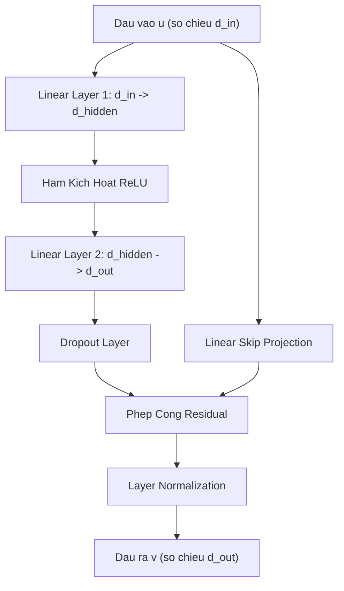
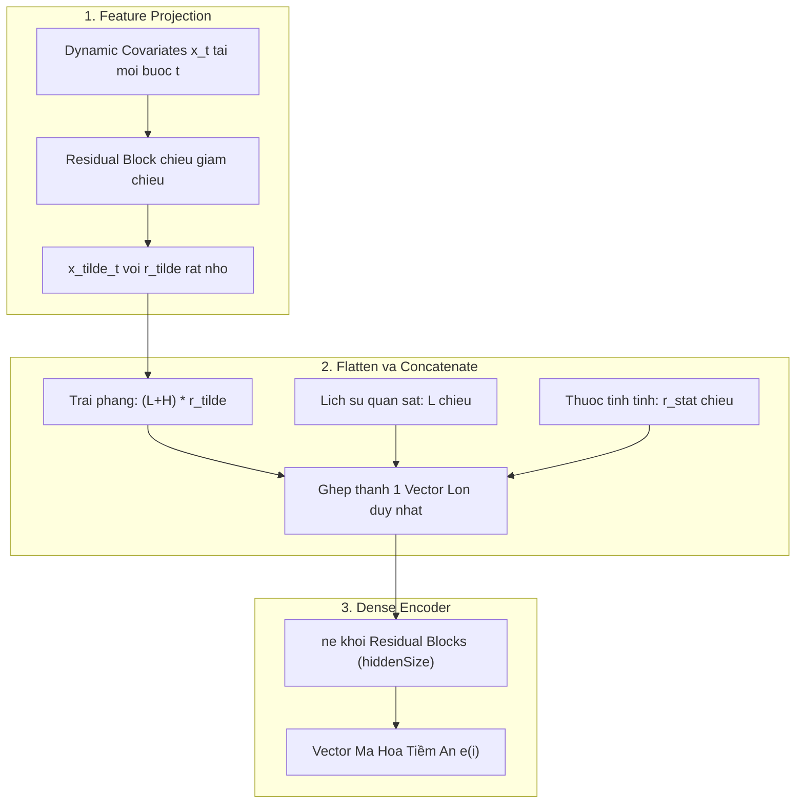
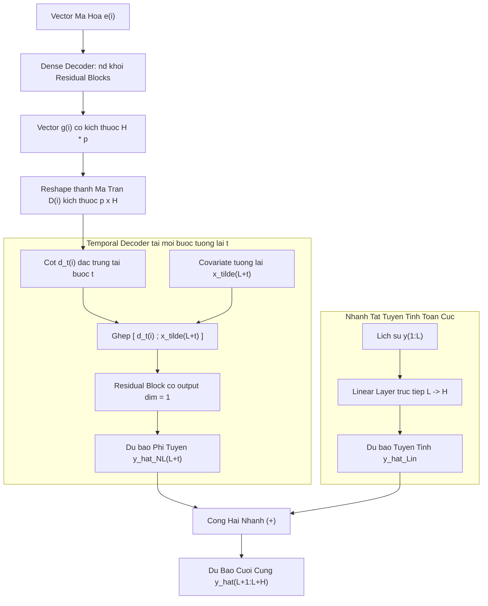

# Chương 4: Kiến Trúc Chi Tiết Mô Hình TiDE (Model Architecture)

Mô hình **TiDE (Time-series Dense Encoder)** được thiết kế theo nguyên lý tối giản nhưng hiệu quả cao. Toàn bộ kiến trúc được cấu thành từ các khối nơ-ron dày đặc (**MLP Residual Blocks**), kết hợp với quy trình nén đặc trưng và đường dẫn tắt (**highway / skip connection**).

---

## 4.1. Khối Xây Dựng Cơ Bản: Residual Block

Khối **Residual Block** là đơn vị xử lý cốt lõi xuất hiện xuyên suốt các tầng của TiDE. Cấu trúc của nó gồm:
1. Một tầng tuyến tính thứ nhất (Linear Layer) đưa số chiều từ $d_{\text{in}} \to d_{\text{hidden}}$.
2. Hàm kích hoạt phi tuyến tính **ReLU**.
3. Một tầng tuyến tính thứ hai đưa từ $d_{\text{hidden}} \to d_{\text{out}}$.
4. Tầng **Dropout** để chống hiện tượng quá khớp (overfitting).
5. Nhánh tắt **Skip Connection** tuyến tính thuần túy từ đầu vào tới đầu ra (nếu $d_{\text{in}} \neq d_{\text{out}}$, sử dụng một ma trận chiếu tuyến tính để khớp số chiều).
6. Tầng chuẩn hóa lớp **Layer Normalization** đặt tại đầu ra của phép cộng residual.

Công thức toán học của Residual Block:

$$
v = \text{LayerNorm} \left( \text{Dropout} \left( W_2 \cdot \text{ReLU}(W_1 u + b_1) + b_2 \right) + W_{\text{skip}} u \right)
$$

---

## 4.2. Khối Mã Hóa (Encoding Section)

Nhiệm vụ của khối mã hóa là tiếp nhận chuỗi lịch sử $y_{1:L}^{(i)}$, toàn bộ dynamic covariates $x_{1:L+H}^{(i)}$ và thuộc tính tĩnh $a^{(i)}$, sau đó biến đổi chúng thành một vector biểu diễn tiềm ẩn dày đặc $e^{(i)}$.

### Bước 1: Chiếu Giảm Chiều Đặc Trưng (Feature Projection)
- **Vấn đề**: Dynamic covariates $x_t^{(i)}$ có số chiều $r$. Nếu ta trải phẳng (flatten) toàn bộ covariates trên cả đoạn nhìn lại và đoạn tương lai $(L + H)$, số chiều sẽ là $(L + H) \times r$. Khi $L, H$ lớn, kích thước vector này sẽ bùng nổ, gây nghẽn cổ chai tính toán và dễ overfitting.
- **Giải pháp**: Áp dụng một Residual Block độc lập theo từng bước thời gian $t \in \{1, \dots, L+H\}$ để chiếu $x_t^{(i)} \in \mathbb{R}^r$ xuống không gian có số chiều nhỏ hơn nhiều $\tilde{r} \ll r$ (`temporalWidth`):

$$
\tilde{x}_t^{(i)} = \text{FeatureProjection}(x_t^{(i)}) \in \mathbb{R}^{\tilde{r}}
$$

- Nhờ vậy, kích thước sau khi trải phẳng giảm xuống chỉ còn $(L + H) \times \tilde{r}$.

### Bước 2: Mã Hóa Dày Đặc (Dense Encoder)
- Toàn bộ vector sau khi giảm chiều được xếp chồng và trải phẳng: $\tilde{x}_{1:L+H}^{(i)} \in \mathbb{R}^{(L+H)\tilde{r}}$.
- Ghép nối vector này với chuỗi quá khứ $y_{1:L}^{(i)} \in \mathbb{R}^L$ và thuộc tính tĩnh $a^{(i)} \in \mathbb{R}^{r_{stat}}$:

$$
u_{\text{enc}}^{(i)} = \begin{bmatrix} y_{1:L}^{(i)} \\ \tilde{x}_{1:L+H}^{(i)} \\ a^{(i)} \end{bmatrix} \in \mathbb{R}^{L + (L+H)\tilde{r} + r_{stat}}
$$

- Đưa qua chuỗi gồm $n_e$ (`numEncoderLayers`) khối Residual Block với kích thước ẩn `hiddenSize` để tạo ra vector mã hóa:

$$
e^{(i)} = \text{DenseEncoder}(u_{\text{enc}}^{(i)}) \in \mathbb{R}^{\text{hiddenSize}}
$$

---

## 4.3. Khối Giải Mã (Decoding Section)

Khối giải mã chuyển đổi vector tiềm ẩn $e^{(i)}$ thành chuỗi dự báo tương lai $\hat{y}_{L+1:L+H}^{(i)}$. Quá trình này chia làm hai giai đoạn tinh tế:

### Bước 1: Giải Mã Dày Đặc (Dense Decoder)
- Nhận vector mã hóa $e^{(i)}$, đi qua $n_d$ (`numDecoderLayers`) khối Residual Block.
- Tầng cuối cùng ánh xạ ra một vector $g^{(i)}$ có kích thước $H \times p$, trong đó $p$ là siêu tham số `decoderOutputDim`:

$$
g^{(i)} = \text{DenseDecoder}(e^{(i)}) \in \mathbb{R}^{H \cdot p}
$$

- Sau đó, vector $g^{(i)}$ được reshape lại thành một ma trận đặc trưng tương lai $D^{(i)} \in \mathbb{R}^{p \times H}$:

$$
D^{(i)} = \begin{bmatrix} d_1^{(i)}, d_2^{(i)}, \dots, d_H^{(i)} \end{bmatrix}
$$

Mỗi cột $d_t^{(i)} \in \mathbb{R}^p$ đại diện cho vector đặc trưng được giải mã riêng cho bước dự báo thứ $t$ trong horizon.

### Bước 2: Giải Mã Theo Thời Gian & Đường Dẫn Tắt Covariates (Temporal Decoder & Covariate Highway)
- Để dự đoán giá trị tại bước tương lai $t \in \{1, \dots, H\}$, mô hình kết hợp thông tin giải mã $d_t^{(i)}$ với chính đặc trưng ngoại sinh của thời điểm đó $\tilde{x}_{L+t}^{(i)}$:

$$
\hat{y}_{L+t,\text{NL}}^{(i)} = \text{TemporalDecoder} \left( \begin{bmatrix} d_t^{(i)} \\ \tilde{x}_{L+t}^{(i)} \end{bmatrix} \right) \in \mathbb{R}
$$

- **Ý nghĩa sống còn của Temporal Decoder**:
  - Tạo ra một **"đường cao tốc" (highway)** kết nối trực tiếp thông tin ngoại sinh tại thời điểm $L+t$ tới kết quả dự báo tại chính thời điểm $L+t$.
  - Trong thực tế, các sự kiện đột biến như ngày Lễ hội mua sắm, ngày mất điện cục bộ hay thời tiết xấu cực đoan tác động tức thời lên giá trị của thời điểm đó. Nếu không có Temporal Decoder, tín hiệu này dễ bị hòa tan và thất thoát khi nén qua Encoder.

---

## 4.4. Nhánh Tắt Toàn Cục (Global Linear Residual Connection)

Song song với toàn bộ luồng mạng nơ-ron sâu phi tuyến ở trên, TiDE thiết lập một **nhánh tắt tuyến tính trực tiếp**:

$$
\hat{y}_{\text{Linear}}^{(i)} = W_{\text{global}} \cdot y_{1:L}^{(i)} + b_{\text{global}} \in \mathbb{R}^H
$$

Dự báo cuối cùng là tổng của nhánh phi tuyến và nhánh tuyến tính:

$$
\hat{y}_{L+1:L+H}^{(i)} = \hat{y}_{\text{NL}}^{(i)} + \hat{y}_{\text{Linear}}^{(i)}
$$

### Tầm quan trọng của Global Skip Connection:
1. **Bảo toàn tính tối ưu của mô hình tuyến tính**: Nếu bài toán thực tế có bản chất thuần tuyến tính (như các benchmark DLinear đã chỉ ra), mạng chỉ cần đưa trọng số của các khối MLP về gần 0, khi đó TiDE tự động thoái hóa về một mô hình Linear tối ưu.
2. **Hỗ trợ tối ưu hóa gradient**: Giúp luồng gradient từ hàm mất mát truyền thẳng ngược lại những bước thời gian đầu vào mà không bị triệt tiêu qua nhiều tầng sâu.

---

## 4.5. Chuẩn Hóa Đảo Nghịch (Reversible Instance Normalization - RevIN)

Để xử lý hiện tượng trôi phân phối thời gian (**distribution shift / non-stationarity**), TiDE tích hợp tùy chọn kỹ thuật **RevIN** (Kim et al., 2021):

1. **Normalize trước khi vào mạng**: Tính giá trị trung bình $\mu^{(i)}$ và độ lệch chuẩn $\sigma^{(i)}$ của chuỗi quan sát $y_{1:L}^{(i)}$, sau đó chuẩn hóa:

$$
y_{\text{norm}}^{(i)} = \frac{y_{1:L}^{(i)} - \mu^{(i)}}{\sigma^{(i)}}
$$

2. **Denormalize sau khi dự báo**: Sau khi mạng nơ-ron tạo ra kết quả dự báo chuẩn hóa $\hat{y}_{\text{norm}}^{(i)}$, áp dụng phép biến đổi ngược để đưa về thang đo gốc:

$$
\hat{y}_{\text{final}}^{(i)} = \hat{y}_{\text{norm}}^{(i)} \cdot \sigma^{(i)} + \mu^{(i)}
$$
