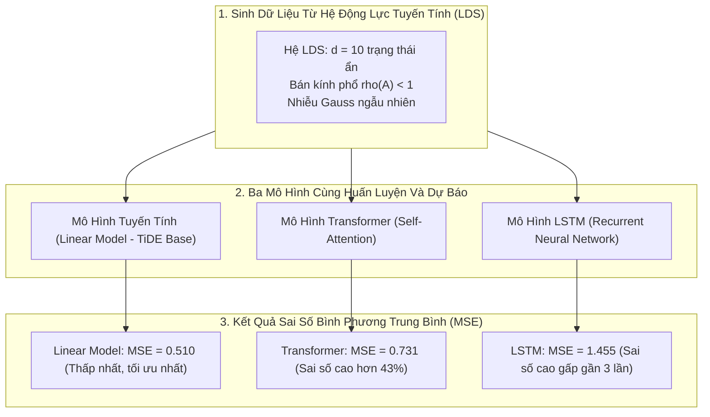

# Phụ Lục A: Phân Tích Lý Thuyết Trên Hệ Động Lực Tuyến Tính (Theoretical Analysis under LDS)

Để cung cấp nền tảng toán học vững chắc cho kiến trúc TiDE, nhóm tác giả Google Research và UCSD phân tích phiên bản tuyến tính tối giản của TiDE trên dữ liệu được sinh ra từ **Hệ động lực tuyến tính (Linear Dynamical System - LDS)**.

---

## A.1. Thiết Lập Hệ Động Lực Tuyến Tính (Linear Dynamical Systems - LDS)

Hệ động lực tuyến tính là mô hình toán học kinh điển (Kalman, 1963) được sử dụng rộng rãi để mô tả quy luật biến thiên của các hệ thống vật lý, khí tượng và kinh tế theo thời gian.

Một hệ LDS thời gian rời rạc được xác định bởi hệ phương trình trạng thái:

$$
\begin{aligned}
h_{t+1} &= A h_t + B u_t + w_t \quad &&\text{(Phương trình trạng thái ẩn)} \\
y_t &= C h_t + D u_t + v_t \quad &&\text{(Phương trình quan sát thực tế)}
\end{aligned}
$$

Trong đó:
- $h_t \in \mathbb{R}^d$ là vector trạng thái ẩn tại thời điểm $t$ (nội lực của hệ thống).
- $u_t \in \mathbb{R}^r$ là vector đầu vào ngoại sinh (dynamic covariates).
- $y_t \in \mathbb{R}$ là giá trị mục tiêu quan sát được tại bước $t$.
- $A \in \mathbb{R}^{d \times d}$ là ma trận chuyển trạng thái (State Transition Matrix).
- $B \in \mathbb{R}^{d \times r}$ là ma trận tác động của biến ngoại sinh vào trạng thái ẩn.
- $C \in \mathbb{R}^{1 \times d}$ là ma trận ánh xạ từ trạng thái ẩn ra giá trị quan sát.
- $D \in \mathbb{R}^{1 \times r}$ là ma trận tác động trực tiếp của biến ngoại sinh ra quan sát.
- $w_t \sim \mathcal{N}(0, \Sigma_w)$ và $v_t \sim \mathcal{N}(0, \sigma_v^2)$ là các vector nhiễu trắng Gaussian độc lập.

### Giả Định Ổn Định Tiệm Cận (Stability Assumption)
Hệ thống được giả định là ổn định tiệm cận (Asymptotically Stable), nghĩa là bán kính phổ (Spectral Radius) của ma trận chuyển trạng thái $A$ nghiêm ngặt nhỏ hơn 1:

$$
\rho(A) = \max_{j} |\lambda_j(A)| \le \gamma < 1
$$

**Ý nghĩa vật lý**: Giả định này đảm bảo rằng các cú sốc hoặc nhiễu động từ quá khứ xa sẽ bị tiêu tán dần theo hàm mũ $\gamma^k$ với tốc độ phân rã nhanh, hệ thống không bị nổ tung giá trị ra vô cùng theo thời gian.

---

## A.2. Các Kết Quả Lý Thuyết Chính

Nhóm tác giả chứng minh rằng: Một mô hình tự hồi quy tuyến tính với cửa sổ nhìn lại hữu hạn hoàn toàn có thể đạt được độ chính xác tối ưu tiệm cận với bộ lọc tối ưu Kalman Filter.

### Định Lý A.1: Xấp Xỉ Tối Ưu Bằng Cửa Sổ Hữu Hạn (Approximation Bound)
Khi hệ LDS ổn định tiệm cận với $\rho(A) \le \gamma < 1$, trạng thái ẩn $h_t$ có thể được xấp xỉ tốt bằng tổ hợp tuyến tính của một số lượng hữu hạn các quan sát quá khứ $y_{t-k:t-1}$ và biến ngoại sinh $u_{t-k:t}$.

Cụ thể, với bất kỳ mức sai số mong muốn $\varepsilon > 0$, chỉ cần chọn độ dài cửa sổ nhìn lại $k$ thỏa mãn:

$$
k = \Omega \left( \log \frac{1}{\varepsilon} \right)
$$

thì luôn tồn tại một mô hình hồi quy tuyến tính đạt sai số xấp xỉ không vượt quá $\varepsilon$ so với bộ lọc tối ưu Kalman Filter.

### Bổ Đề A.2: Độ Phức Tạp Rademacher & Sai Số Tổng Quát Hóa (Generalization Bound)
Nhóm tác giả phân tích độ phức tạp Rademacher thực nghiệm $\mathcal{R}_N(\hat{\mathcal{H}})$ của lớp hàm tự hồi quy tuyến tính trên tập dữ liệu gồm $N$ mẫu, với chuẩn ma trận bị chặn $\|M\| \le O(1)$:

$$
\mathcal{R}_N(\hat{\mathcal{H}}) \le O\left( \frac{1}{\sqrt{N}} \right)
$$

Từ đó, áp dụng lý thuyết học thống kê (Bartlett and Mendelson, 2002), với xác suất ít nhất $1 - \delta$, khoảng cách giữa sai số kiểm tra thực tế $\mathcal{L}_{\mathcal{D}}(\hat{h})$ và mô hình tối ưu $\mathcal{L}_{\mathcal{D}}(\hat{h}^*)$ bị chặn bởi:

$$
\mathcal{L}_{\mathcal{D}}(\hat{h}) - \mathcal{L}_{\mathcal{D}}(\hat{h}^*) \le G_{\max} \mathcal{R}_N(\hat{\mathcal{H}}) + \ell_{\max} \sqrt{\frac{8 \ln(2/\delta)}{N}} \le O\left( \frac{k}{\sqrt{N}} \right)
$$

**Đúc kết lý thuyết**:
1. Để đạt sai số xấp xỉ $\varepsilon$, chiều dài cửa sổ quá khứ chỉ cần tăng theo hàm $\log(1/\varepsilon)$ (tăng rất chậm).
2. Với kích thước mẫu huấn luyện $N$ lớn, sai số tổng quát hóa suy giảm theo tốc độ tối ưu $O(1/\sqrt{N})$.
3. Do đó, một mô hình tuyến tính đơn giản kết hợp cửa sổ nhìn lại hữu hạn là hoàn toàn đủ năng lực để xấp xỉ tối ưu nghiệm của một hệ động lực phức tạp.

---

## A.3. Thực Nghiệm Trên Dữ Liệu Tổng Hợp (Synthetic Experiments)

Để kiểm chứng lý thuyết trên trong thực tế, nhóm tác giả sinh dữ liệu mô phỏng từ một hệ LDS với $d = 10$ chiều trạng thái ẩn và so sánh độ chính xác dự báo giữa 3 dòng mô hình:

### Bảng Kết Quả Chi Tiết (Mean Squared Error - MSE):

| Mô Hình | Trung Bình Test MSE ± Độ Lệch Chuẩn | So Sánh Tương Quan Với Mô Hình Tuyến Tính |
|:---|:---:|:---|
| **Mô hình Tuyến Tính (Linear - TiDE Analogue)** | **0.510 ± 0.001** | 🟢 **Tối ưu nhất**: Ổn định tuyệt đối (độ lệch chuẩn chỉ $0.001$). |
| **Transformer (Attention)** | $0.731 \pm 0.041$ | 🟡 Kém hơn **43%**, dễ bị nhiễu loạn bởi cơ chế Attention. |
| **LSTM (Recurrent)** | $1.455 \pm 0.455$ | 🔴 Kém hơn gần **3 lần**, dao động bất ổn định qua các lần chạy. |

### Phân Tích Thực Nghiệm:
1. **Tại sao mô hình Tuyến tính chiến thắng thuyết phục?**  
   Dữ liệu xuất phát từ hệ động lực tuyến tính, do đó một phép ánh xạ tuyến tính trực tiếp từ quá khứ sang tương lai học được đúng nghiệm giải tích của hệ phương trình mà không bị phân tâm.
2. **Tại sao Transformer và LSTM lại thất bại?**  
   Các kiến trúc phức tạp (cơ chế Attention và các cổng Forget/Input của LSTM) có quá nhiều tham số tự do, dễ rơi vào các điểm cực tiểu cục bộ (local minima) và bị đánh lừa bởi các nhiễu Gaussian ngẫu nhiên $w_t, v_t$.
3. **Ý nghĩa thiết kế đối với TiDE**:  
   Thực nghiệm lý thuyết này giải thích lý do vì sao nhóm tác giả thiết kế nhánh **Global Linear Skip Connection** nối thẳng từ quá khứ sang tương lai trong TiDE: Nó đảm bảo nền tảng tuyến tính tối ưu luôn được bảo tồn, giúp TiDE vững vàng trước các quy luật hệ động lực mà không bị các tầng sâu làm nhiễu loạn.
