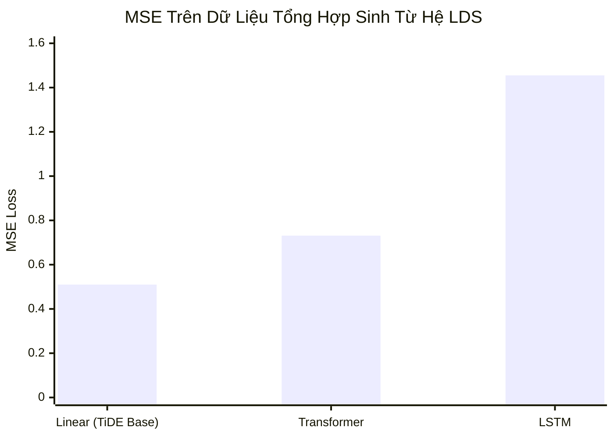

# Phụ Lục A: Phân Tích Lý Thuyết Trên Hệ Động Lực Tuyến Tính (Theoretical Analysis under LDS)

Để cung cấp nền tảng toán học vững chắc cho kiến trúc TiDE, nhóm tác giả phân tích phiên bản tuyến tính tối giản của TiDE trên dữ liệu được sinh ra từ **Hệ động lực tuyến tính (Linear Dynamical System - LDS)**.

---

## A.1. Thiết Lập Hệ Động Lực Tuyến Tính (LDS)

Hệ động lực tuyến tính là mô hình toán học kinh điển (Kalman, 1963) mô tả sự tiến hóa của các hệ thống vật lý và kinh tế theo thời gian.

Một hệ LDS thời gian rời rạc được xác định bởi:
$$\begin{aligned}
h_{t+1} &= A h_t + B u_t + w_t \quad &\text{(Phương trình trạng thái ẩn)} \\
y_t &= C h_t + D u_t + v_t \quad &\text{(Phương trình quan sát)}
\end{aligned}$$

Trong đó:
- $h_t \in \mathbb{R}^d$ là vector trạng thái ẩn tại thời điểm $t$.
- $u_t \in \mathbb{R}^r$ là vector đầu vào ngoại sinh (covariates).
- $y_t \in \mathbb{R}$ là giá trị quan sát được (chuỗi mục tiêu).
- $A \in \mathbb{R}^{d \times d}, B \in \mathbb{R}^{d \times r}, C \in \mathbb{R}^{1 \times d}, D \in \mathbb{R}^{1 \times r}$ là các ma trận hệ thống.
- $w_t, v_t$ là các nhiễu Gauss độc lập có kỳ vọng bằng 0.

### Giả định ổn định (Stability Assumption):
Hệ được giả định là ổn định tiệm cận, tức là tất cả các giá trị riêng của ma trận chuyển trạng thái $A$ đều có độ lớn nhỏ hơn 1:
$$\rho(A) = \max_{j} |\lambda_j(A)| < 1$$
Điều này đảm bảo ảnh hưởng của các trạng thái quá khứ xa sẽ suy giảm theo hàm mũ $\gamma^k$ với $\gamma < 1$.

---

## A.2. Các Kết Quả Lý Thuyết Chính

### Định Lý A.1: Xấp Xỉ Tối Ưu Bằng Cửa Sổ Hữu Hạn
Khi hệ LDS ổn định, trạng thái ẩn $h_t$ có thể được xấp xỉ tốt bằng tổ hợp tuyến tính của một số hữu hạn các quan sát quá khứ $y_{t-k:t-1}$ và biến ngoại sinh $u_{t-k:t}$.

Cụ thể, với bất kỳ mức sai số mong muốn $\varepsilon > 0$, chỉ cần chọn độ dài cửa sổ nhìn lại:
$$k = \Omega \left( \log \frac{1}{\varepsilon} \right)$$
thì tồn tại một mô hình tự hồi quy tuyến tính đạt sai số xấp xỉ không vượt quá $\varepsilon$ so với bộ lọc tối ưu Kalman Filter.

### Bổ Đề A.2: Độ Phức Tạp Rademacher (Generalization Bound)
Nhóm tác giả phân tích độ phức tạp Rademacher của lớp hàm tuyến tính trên $N$ mẫu dữ liệu.
- Giới hạn chuẩn của ma trận trọng số: $\|M\| \le O(1)$.
- Độ phức tạp Rademacher thực nghiệm thỏa mãn:
  $$\mathcal{R}_N(\hat{\mathcal{H}}) \le O\left( \frac{1}{\sqrt{N}} \right)$$

Từ đó, với xác suất ít nhất $1 - \delta$, sai số tổng quát hóa trên tập kiểm tra bị chặn bởi:
$$\mathcal{L}_{\mathcal{D}}(\hat{h}) - \mathcal{L}_{\mathcal{D}}(\hat{h}^*) \le G_{\max} \mathcal{R}_N(\hat{\mathcal{H}}) + \ell_{\max} \sqrt{\frac{8 \ln(2/\delta)}{N}} \le O\left( \frac{k}{\sqrt{N}} \right)$$

**Kết luận lý thuyết**: Một mô hình hồi quy tuyến tính với cửa sổ quan sát $k$ đủ lớn ($O(\log(1/\varepsilon))$) hoàn toàn có khả năng học được nghiệm tối ưu của hệ động lực với tốc độ hội tụ mẫu tối ưu $O(1/\sqrt{N})$.

---

## A.3. Thực Nghiệm Trên Dữ Liệu Tổng Hợp (Synthetic Experiments)

Để kiểm chứng lý thuyết trên, nhóm tác giả sinh dữ liệu mô phỏng từ một hệ LDS với $d=10$ trạng thái ẩn và kiểm tra khả năng dự báo của 3 mô hình:
1. **Linear Model** (Đại diện cho nhánh tuyến tính của TiDE).
2. **LSTM** (Đại diện cho mạng hồi quy).
3. **Transformer** (Đại diện cho mô hình cơ chế Attention).

### Kết quả sai số bình phương trung bình (MSE):

| Mô Hình | Test MSE (Trung bình ± Độ lệch chuẩn) |
|:---|:---:|
| **Linear Model (TiDE Analogue)** | **0.510 ± 0.001** |
| Transformer | 0.731 ± 0.041 |
| LSTM | 1.455 ± 0.455 |

### Phân tích:
- Mô hình tuyến tính học quy luật của LDS nhanh và chính xác nhất với độ ổn định cực cao (độ lệch chuẩn chỉ $0.001$).
- Transformer và LSTM bị nhiễu và dễ rơi vào các điểm tối ưu cục bộ, cho kết quả kém hơn hẳn.
- Thực nghiệm này chứng minh tại sao nhánh **Global Linear Skip Connection** trong TiDE lại mang lại hiệu quả vượt trội đến vậy.
