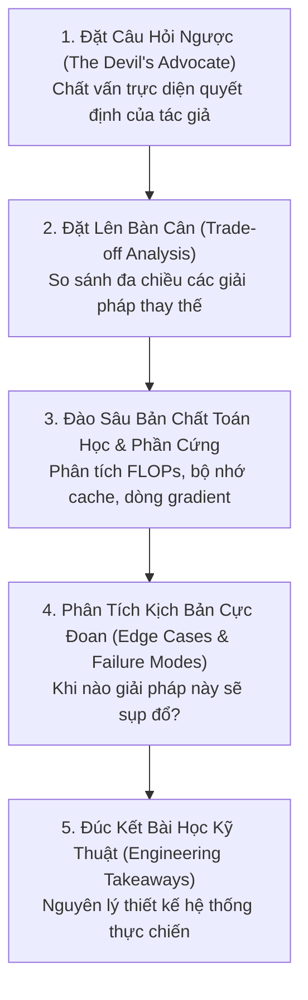

# Chuyên Mục: Tư Duy Phản Biện Trong Thiết Kế Mô Hình TiDE (Critical Thinking)

> **Triết lý của chuyên mục**:  
> *"Đừng chỉ hỏi mô hình làm cái gì (What) hay làm như thế nào (How). Hãy luôn chất vấn: Tại sao tác giả lại chọn cách này mà không phải cách khác (Why), cái giá phải đánh đổi là gì (Trade-offs), và trong điều kiện nào thì giả định này sẽ bị phá vỡ?"*

---

## 1. Mục Đích & Tinh Thần Cốt Lõi

Khi tiếp cận một công trình nghiên cứu khoa học như **TiDE (Time-series Dense Encoder - Google Research, 2023)**, một kỹ sư hay nhà nghiên cứu AI không nên chấp nhận các lựa chọn kiến trúc một cách thụ động. 

Mọi lựa chọn của tác giả (từ việc dùng MLP thay vì Transformer, chọn hàm kích hoạt ReLU thay vì GELU, dùng Channel Independence thay vì Cross-Channel Attention...) đều là kết quả của các cuộc tranh biện kỹ thuật gay gắt giữa:
- **Năng lực biểu diễn (Representational Capacity)** vs. **Chi phí tính toán (Computational Budget)**.
- **Tính tổng quát hóa (Generalization)** vs. **Nguy cơ quá khớp (Overfitting)**.
- **Tính thanh thoát toán học (Mathematical Elegance)** vs. **Khả năng tối ưu phần cứng (Hardware Optimization)**.

Thư mục `doc/critical-thinking/` được thiết kế để **"mổ xẻ"** các câu hỏi phản biện hóc búa nhất đằng sau từng quyết định thiết kế của TiDE.

---

## 2. Danh Mục Các Chuyên Đề Phản Biện (Critical Thinking Catalog)

| STT | Chuyên Đề | File Tài Liệu | Câu Hỏi Phản Biện Cốt Lõi Đặt Ra |
|:---:|:---|:---|:---|
| **01** | **Tại sao TiDE chọn ReLU?** | [`why_use_relu.md`](./why_use_relu.md) | Tại sao một mô hình năm 2023 lại dùng hàm kích hoạt cổ điển năm 2010 (ReLU) thay vì GELU/SiLU của Transformer? TiDE giải quyết căn bệnh "Dying ReLU" như thế nào? Tại sao không dùng mô hình tuyến tính thuần như DLinear? |

---

## 3. Khung Phương Pháp Tiếp Cận Phản Biện (The 5-Step Critical Framework)

Mỗi bài phân tích trong thư mục này đều được xây dựng dựa trên khung 5 bước tư duy phản biện:

---

> [!TIP]
> Bạn đọc nên đọc qua các bài giới thiệu khái niệm cơ bản tại [`doc/glossary/`](../glossary/README.md) trước khi bước vào các chuyên đề đào sâu tại thư mục này.
