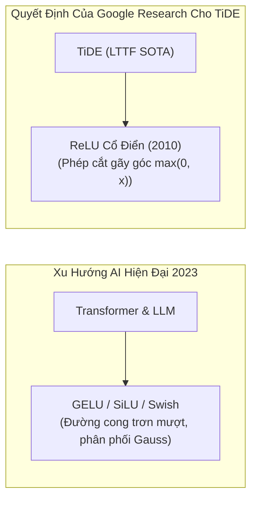
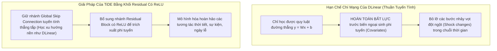
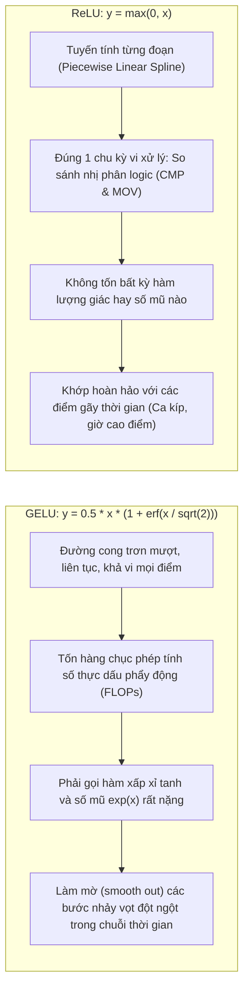
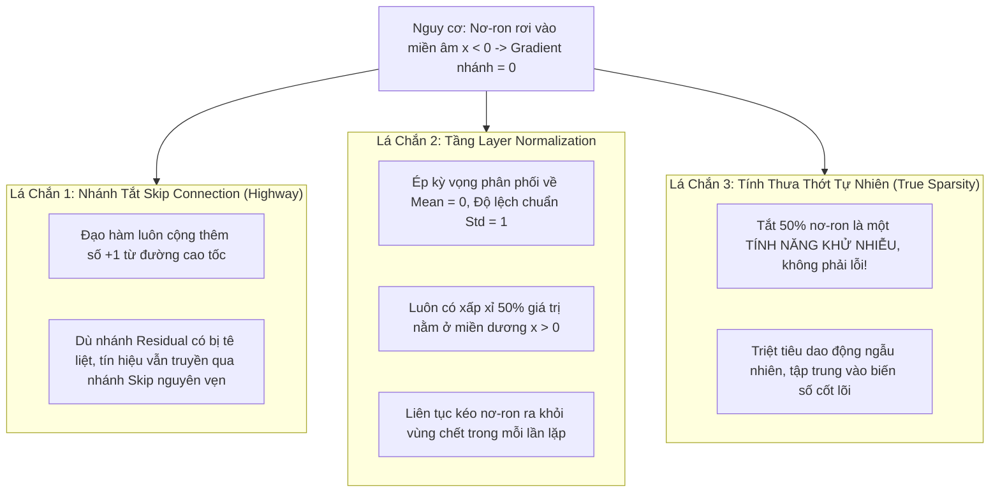

# Chuyên Đề Phản Biện: Tại Sao TiDE Lại Dùng ReLU Mà Không Phải Các Lựa Chọn Khác?

> **Tư duy phản biện (Critical Thinking)**:  
> *"Một kỹ sư giỏi biết cách dùng một công cụ. Một kiến trúc sư trưởng xuất sắc hiểu rõ vì sao phải dùng công cụ đó, cái giá phải đánh đổi là gì, và tại sao tất cả các giải pháp thay thế khác đều bị loại bỏ."*

---

## 1. Đặt Câu Hỏi Ngược (The Provocation)

Bài báo **TiDE (Time-series Dense Encoder)** được công bố vào năm **2023** bởi nhóm nghiên cứu tại **Google Research & UCSD**. 

Tại thời điểm năm 2023:
- Các mô hình Ngôn ngữ lớn (LLM) và Thị giác máy tính (Vision Transformer) đều đã hoàn toàn chuyển dịch sang sử dụng các hàm kích hoạt tân tiến mượt mà như **GELU** (chuẩn mực của BERT, GPT-2, GPT-3, ViT) hay **SiLU / Swish** (chuẩn mực của LLaMA, Chinchilla).
- Trong khi đó, nhóm tác giả TiDE lại quyết định sử dụng **ReLU (Rectified Linear Unit)** — một hàm kích hoạt cực kỳ đơn giản đã ra đời từ năm 2010 (Nair & Hinton)!

> ❓ **Câu hỏi phản biện hóc búa được đặt ra:**  
> 1. Phải chăng các tác giả Google Research chỉ tiện tay dùng ReLU vì thói quen cũ?  
> 2. Tại sao không dùng mô hình tuyến tính thuần túy như **DLinear** (vốn đã chứng minh không cần bất kỳ hàm kích hoạt nào vẫn đánh bại Transformer)?  
> 3. Tại sao không dùng **GELU/SiLU** để có bề mặt tối ưu mượt mà hơn?  
> 4. Làm thế nào TiDE sống sót qua thảm họa **"Dying ReLU" (Nơ-ron chết lâm sàng)** mà mọi sách giáo khoa học sâu đều cảnh báo?

Hãy cùng mổ xẻ từng tầng lập luận kỹ thuật đằng sau quyết định này.

---

## 2. Chất Vấn 1: Đối Đầu DLinear — Tại Sao Cần Phi Tuyến? Sao Không Tuyến Tính Thuần Túy?

Vào đầu năm 2023, bài báo **DLinear (Are Transformers Effective for Time Series? - AAAI 2023)** đã tạo nên một cơn địa chấn trong cộng đồng AI khi chứng minh: **Một tầng Linear duy nhất (không có bất kỳ hàm kích hoạt nào) lại đánh bại một loạt mô hình Transformer đồ sộ như Informer, Autoformer, FEDformer**.

Nếu tuyến tính thuần túy đã tốt như vậy, việc TiDE chèn ReLU vào khối Residual Block có phải là "vẽ rắn thêm chân", làm tăng chi phí và nguy cơ Overfitting không?

### Lập luận phản biện:
1. **Biến ngoại sinh (Covariates) trong đời thực luôn phi tuyến tính**:
   - Hãy xét bài toán dự báo tải điện: Khi nhiệt độ ngoài trời từ $25^\circ\text{C}$ tăng lên $30^\circ\text{C}$, nhu cầu điện tăng nhẹ. Nhưng khi nhiệt độ từ $35^\circ\text{C}$ vọt lên $40^\circ\text{C}$, nhu cầu điện tăng vọt gấp 4 lần do toàn bộ máy lạnh công suất lớn hoạt động hết công suất!
   - Đây là quan hệ phi tuyến hình chữ U hoặc bậc thang gập khúc. Một hàm thuần tuyến tính như DLinear **về mặt toán học không bao giờ mô hình hóa được hiện tượng này**.
2. **ReLU mở khóa khả năng kết hợp đa biến**:
   - Nhờ có ReLU trong khối Feature Projection và Residual Block, TiDE vừa bảo tồn được tính thanh thoát (nhờ Global Skip học xu hướng nền tuyến tính), vừa học trọn vẹn sự bùng nổ của các biến ngoại sinh trong tương lai.

---

## 3. Chất Vấn 2: Đối Đầu GELU & SiLU — Tại Sao Không Dùng Tiêu Chuẩn Vàng Của Transformer?

Nếu cần phi tuyến, tại sao tác giả không chọn **GELU (Gaussian Error Linear Unit)** — hàm kích hoạt được chứng minh vượt trội hơn hẳn ReLU trong BERT, GPT, Vision Transformer?

Hãy đặt hai hàm số này lên bàn cân phần cứng và toán học:

### 1. Phân Tích Chi Phí Phần Cứng (Hardware Latency & Memory Throughput)
- Trong bài toán chuỗi thời gian dài hạn (LTTF), độ dài ngữ cảnh thường lên đến $L = 720$ bước và dự báo $H = 720$ bước, qua hàng nghìn chuỗi kênh biến khác nhau.
- **ReLU**: Chỉ là phép toán logic nhị phân cực tiểu: `x if x > 0 else 0`. Trên GPU NVIDIA (CUDA Core) hoặc TPU, phép toán này được ánh xạ trực tiếp thành một lệnh máy `max(0, x)` chạy trong **đúng 1 chu kỳ xung nhịp (clock cycle)**.
- **GELU**: Đòi hỏi tính hàm lỗi Gauss $\text{erf}(x)$ hoặc xấp xỉ đa thức bậc 3 phức tạp:
  $$
  \text{GELU}(x) \approx 0.5x \cdot \left(1 + \tanh\left(\sqrt{\frac{2}{\pi}} \left(x + 0.044715 x^3\right)\right)\right)
  $$
  Phép tính này tiêu tốn hàng chục chu kỳ xung nhịp của đơn vị tính toán số thực (ALU/FPU), gây nghẽn cổ chai băng thông bộ nhớ khi phải duyệt qua hàng triệu tensor trong mỗi epoch huấn luyện.
- **Kết quả thực tế**: Mục tiêu cốt lõi của TiDE là **đạt tốc độ siêu tốc gấp 5 - 10 lần Transformer**. Việc dùng GELU sẽ hủy hoại lợi thế tốc độ này mà không đem lại cải thiện đáng kể nào cho độ chính xác dự báo chuỗi thời gian!

### 2. Bản Chất Hình Học Của Chuỗi Thời Gian: Tính Tuyến Tính Từng Đoạn (Piecewise Linear Splines)
- Ngôn ngữ tự nhiên (NLP) hay hình ảnh (CV) là các phân phối xác suất trơn mượt trên không gian đa tạp (manifold).
- Ngược lại, **chuỗi thời gian thực tế thường có các điểm gập khúc sắc nhọn (sharp kinks)**:
  - 06:00 sáng: Còi nhà máy reo, dây chuyền sản xuất đồng loạt bật $\to$ Phụ tải điện gập góc đi lên tức thì.
  - 17:00 chiều: Tan sở $\to$ Lưu lượng xe cộ trên đường cao tốc tăng vọt theo dạng bậc thang.
  - 23:00 đêm: Tắt đèn đi ngủ $\to$ Nhu cầu giảm gãy khúc.
- **ReLU tự nhiên tạo ra các điểm gãy khúc (hinge points)** hoàn hảo để xấp xỉ dạng hình học này. GELU vô tình làm tròn và làm mờ (smooth out) các góc gập nhọn tự nhiên của chuỗi thời gian!

---

## 4. Chất Vấn 3: Nỗi Ám Ảnh "Dying ReLU" — TiDE Tồn Tại Như Thế Nào Khi Nơ-ron Bị Liệt?

Một trong những lời chỉ trích lớn nhất nhắm vào ReLU trong sách giáo khoa là **Hiện tượng Nơ-ron chết (Dying ReLU Problem)**:
- Khi giá trị đầu vào $x < 0$, đạo hàm của ReLU bằng đúng $0$.
- Nếu một nơ-ron nhận một bước cập nhật trọng số quá lớn khiến toàn bộ đầu vào rơi vào miền âm vĩnh viễn, gradient tại nơ-ron đó sẽ luôn bằng $0$. Nơ-ron bị "chết lâm sàng", không bao giờ học được nữa!

Tại sao các mô hình khác phải chế ra **LeakyReLU** (cho gradient âm đi qua với hệ số $0.01$) hoặc **PReLU**, còn TiDE vẫn ung dung dùng ReLU nguyên bản?

TiDE sở hữu **3 cơ chế phòng thủ thép** giúp triệt tiêu hoàn toàn hiểm họa Dying ReLU:

### 1. Sự Bảo Hộ Tuyệt Đối Của Đường Tắt Skip Connection
Bên trong mỗi Residual Block của TiDE, đầu ra được tính bằng:
$$
v = \text{LayerNorm}\Big( F(u) + \text{Skip}(u) \Big)
$$
Khi tính đạo hàm theo quy tắc chuỗi, nhánh tắt Skip Connection luôn đóng góp một lượng đạo hàm $\mathbf{+1}$ độc lập với $F(u)$. Dù cho một vài nơ-ron bên trong nhánh $F(u)$ có bị rơi vào miền $0$ của ReLU, toàn bộ khối vẫn nhận được gradient từ nhánh skip, đảm bảo mạng sâu không bao giờ bị đóng băng.

### 2. Tầng Layer Normalization Liên Tục "Hồi Sinh" Nơ-ron
Ngay sau mỗi phép cộng dồn, TiDE áp dụng **Layer Normalization**. 
LayerNorm cưỡng chế chuẩn hóa vector ẩn về phân phối chuẩn có $\text{Mean} = 0$ và $\text{Variance} = 1$.  
Về mặt xác suất thống kê, điều này đảm bảo rằng ở bước lan truyền tiếp theo, **luôn luôn có xấp xỉ một nửa số phần tử mang giá trị dương ($x > 0$)**. LayerNorm đóng vai trò như chiếc máy sốc tim, liên tục hồi sinh và kéo các nơ-ron trở lại trạng thái hoạt động!

### 3. "Dying ReLU" Thực Chất Là Cơ Chế Lọc Nhiễu Thưa Thớt (True Sparsity) Cực Kỳ Quý Giá!
- Chuỗi thời gian chứa rất nhiều biến số ngoại sinh gây nhiễu (gió giật nhẹ, dao động ngẫu nhiên vài watt điện).
- Nếu dùng LeakyReLU hay GELU, các tín hiệu nhiễu âm này vẫn được nhân với một hệ số nhỏ và tiếp tục lan truyền lên các tầng sau, làm ô nhiễm biểu diễn đặc trưng.
- ReLU dập tắt không khoan nhượng mọi tín hiệu $\le 0$ thành đúng con số $0$ tròn trĩnh. Việc tạo ra một biểu diễn thưa thớt (Sparse Representation) với $\approx 50\%$ giá trị bằng 0 giúp mô hình:
  - Khử bỏ hoàn toàn nhiễu ngẫu nhiên.
  - Tiết kiệm năng lượng và chống lại hiện tượng quá khớp (Overfitting) trên tập dữ liệu nhỏ một cách tự nhiên mà không cần đến các cơ chế phạt trọng số rườm rà.

---

## 5. Bảng Ma Trận Phản Biện Đa Chiều (The Multi-Dimensional Critical Matrix)

Dưới đây là bảng phân tích so sánh toàn diện giữa ReLU và các ứng viên thay thế trong bài toán dự báo chuỗi thời gian dài hạn TiDE:

| Tiêu Chí Kỹ Thuật | Linear Thuần (DLinear) | **ReLU (Lựa Chọn TiDE)** | LeakyReLU | GELU / SiLU (Transformer) | Sigmoid / Tanh Cổ Điển |
|:---|:---:|:---:|:---:|:---:|:---:|
| **Tốc độ tính toán trên GPU** | ⚡ Cực nhanh | ⚡ **Siêu tốc ($O(1)$ chu kỳ)** | ⚡ Nhanh | ⏳ Chậm (tốn hàm $\text{exp}$, $\text{tanh}$) | ⏳ Rất chậm |
| **Bảo tồn tính thưa thớt (Khử nhiễu)** | ❌ Không có | 🟢 **Tuyệt vời ($50\%$ giá trị $= 0$)** | ⚠️ Thấp (vẫn rò rỉ âm $0.01x$) | ❌ Không có (miền âm mượt) | ❌ Không có |
| **Xấp xỉ góc gập nhọn thời gian** | ❌ Bất lực | 🟢 **Hoàn hảo (Piecewise Linear)** | 🟢 Tốt | ⚠️ Kém (bị làm mượt góc nhọn) | ❌ Kém |
| **Mô hình hóa Covariates phi tuyến** | ❌ Không thể | 🟢 **Cực tốt** | 🟢 Cực tốt | 🟢 Rất tốt | ⚠️ Dễ bão hòa biên |
| **Triệt tiêu Vanishing Gradient** | ✅ Không bị | 🟢 **Gradient $= 1$ khi $x > 0$** | 🟢 Gradient $\neq 0$ | 🟢 Tốt | ❌ Bị triệt tiêu nghiêm trọng |
| **Độ phức tạp lập trình & Phần cứng** | Tối thiểu | **Tối ưu chuẩn IEEE-754** | Thấp | Phức tạp | Trung bình |

---

## 6. Kịch Bản Cực Đoan (Edge Cases): Khi Nào ReLU Sẽ Thất Bại Trong TiDE?

Một nhà tư duy phản biện luôn phải biết giới hạn của giải pháp mình lựa chọn. ReLU trong TiDE có thể gặp vấn đề trong những điều kiện cực đoan nào?

1. **Learning Rate quá cao ($\eta > 0.01$) mà không có Warmup**:
   - Nếu khởi đầu với tốc độ học quá lớn, gradient bùng nổ có thể kéo một lượng lớn trọng số về miền âm quá sâu, vượt quá khả năng cân bằng của LayerNorm, dẫn đến tình trạng hàng loạt nơ-ron bị tê liệt cùng lúc (*Catastrophic Dying ReLU*).
   - *Cách TiDE phòng ngừa*: Bài báo sử dụng bộ tối ưu hóa **Adam** với learning rate nhỏ ($10^{-4}$ đến $10^{-3}$) kết hợp lịch trình giảm dần Learning Rate (Cosine Annealing).
2. **Không áp dụng Chuẩn Hóa Dữ Liệu Đầu Vào (Thiếu RevIN / LayerNorm)**:
   - Nếu dữ liệu chuỗi thời gian có xu hướng tăng phi mã (non-stationary trend) nhưng không được chuẩn hóa qua RevIN, đầu vào của ReLU sẽ liên tục bị lệch hẳn về một phía (quá dương hoặc quá âm), làm mất đi tính cân bằng tự nhiên của hàm kích hoạt.
   - *Cách TiDE phòng ngừa*: Luôn tích hợp mô-đun **RevIN** ở cửa ngõ vào/ra của toàn bộ mô hình.

---

## 7. Đúc Kết Bài Học Kỹ Thuật (Engineering Takeaways & Occam's Razor)

Quyết định sử dụng ReLU trong TiDE là một minh chứng hoàn hảo cho **Nguyên Lý Dao Cạo Ockham (Occam's Razor)** trong kỹ thuật phần mềm và AI:

> *"Đừng bao giờ đưa thêm sự phức tạp vào hệ thống, trừ khi sự phức tạp đó chứng minh được một lợi ích đo đạc được rõ ràng."*

1. **Đơn giản hóa là đỉnh cao của sự tinh tế**:  
   ReLU không phải là sự lựa chọn lỗi thời hay ngẫu nhiên của Google Research. Đó là một **sự tính toán kỹ thuật chuẩn xác (Pareto-optimal engineering choice)**: Nó mang lại khả năng biểu diễn phi tuyến vừa đủ cho chuỗi thời gian, hoàn toàn tương thích với các điểm gãy thời gian thực tế, bảo vệ tốc độ tính toán phần cứng ở mức cao nhất, và tận dụng tính thưa thớt để lọc sạch nhiễu dữ liệu.
2. **Kiến trúc bổ trợ cho nhau**:  
   Một hàm kích hoạt không đứng độc lập. ReLU trong TiDE phát huy 100% sức mạnh và triệt tiêu 100% nhược điểm chính là nhờ sự phối hợp nhịp nhàng với **Nhánh tắt Skip Connection** và **Layer Normalization**. Đây là bài học kinh điển về tư duy thiết kế hệ thống trong Học máy.