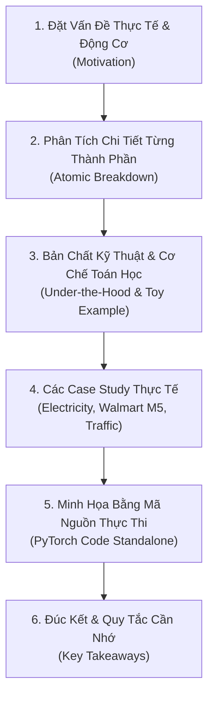

# Chuyên Đề Phân Tích Kỹ Thuật (Technical Deep-Dive Explanations)

> [!NOTE]
> **Điều hướng thư mục**: [🏠 Trang Chủ Repo](../../README.md) • [📖 Tổng Quan Tài Liệu](../00_tong_quan_tai_lieu.md) • [💡 Từ Điển Glossary](../glossary/README.md)  
> **Mục tiêu**: Nơi tập hợp các bài phân tích kỹ thuật chuyên sâu (Deep-Dive Analysis), mổ xẻ tường minh từng công thức toán học, cơ chế vận hành nội tại của các khối mạng, kèm số liệu mô phỏng từng bước (Toy Examples), case study thực tế và mã nguồn PyTorch độc lập có thể thực thi ngay.

---

## 🎯 Triết Lý Soạn Thảo

Các tài liệu trong thư mục này được xây dựng theo **Quy chuẩn chuyên đề kỹ thuật (`RULE.md`)** với 4 nguyên tắc cốt lõi:

1. **Đi từ cái biết rồi đến cái chưa biết (Anchoring Effect)**: Bắt đầu từ bài toán thực tế trước khi đưa ra toán học ma trận/tensor.
2. **Giải phẫu nguyên tử (Atomic Deconstruction)**: Bóc tách riêng từng ký tự, toán tử, chỉ số và không gian vector trong công thức.
3. **Logic đa tầng (The 3 Whys)**: Trả lời rõ ràng tại sao lại thiết kế như vậy, nếu không có bước này thì hậu quả là gì.
4. **Luôn gắn liền với Case Study & Code thực tế**: Tối thiểu 2 - 3 case study có số liệu cụ thể (Electricity, Walmart M5, Traffic) và đoạn mã PyTorch tự chạy được.

---

## 📑 Danh Sách Chuyên Đề Phân Tích

| STT | Tài Liệu | Tiêu Đề Chuyên Đề | Nội Dung Chi Tiết |
|:---:|:---|:---|:---|
| **00** | [`RULE.md`](./RULE.md) | **Quy Chuẩn Soạn Thảo Chuyên Đề Phân Tích Kỹ Thuật** | Bộ khung 6 phần bắt buộc, quy chuẩn hiển thị LaTeX/KaTeX, Mermaid chuẩn GitHub và quy trình 4 bước kiểm duyệt. |
| **01** | [`section_4_1_residual_block.md`](./section_4_1_residual_block.md) | **Giải Thích Chi Tiết Phần 4.1: Khối Residual Block** | Cơ chế chuyển đổi số chiều $d_{\text{in}} \to d_{\text{hidden}}$, hàm kích hoạt ReLU, nghịch lý Linear Collapse, Inverted Dropout, Skip Connection, LayerNorm vs BatchNorm và code PyTorch hoàn chỉnh. |
| **02** | [`target_horizon_vector.md`](./target_horizon_vector.md) | **Giải Phẫu Công Thức: Vector Mục Tiêu Tương Lai $y_{L+1:L+H}^{(i)}$** | Mổ xẻ 10 thành phần toán học, giải thích bản chất vector cột $\top \in \mathbb{R}^H$, phân biệt Ground Truth $y$ vs Prediction $\hat{y}$, tính MSE loss, 3 case study thực tế và PyTorch Dataset slicing. |
| **03** | [`forward_pass_step_by_step.md`](./forward_pass_step_by_step.md) | **Đối Chiếu Chi Tiết Forward Pass: Section 4 Toán Học vs PyTorch Code** | Bảng đối chiếu 1:1 từng công thức trong Section 4 cạnh từng dòng code PyTorch, theo dõi Tensor Shapes qua 8 bước và script giả lập kiểm chứng ($B=32, L=720, H=96$). |

---

## 🧭 Cấu Trúc Khung Chuẩn (Standard 6-Part Framework)

Mỗi bài phân tích kỹ thuật trong thư mục này đều tuân thủ cấu trúc chuẩn mực:

---

> [!TIP]
> **Đóng góp chuyên đề mới**: Trước khi khởi tạo bài phân tích mới, vui lòng đọc kỹ hướng dẫn trong [`RULE.md`](./RULE.md).
