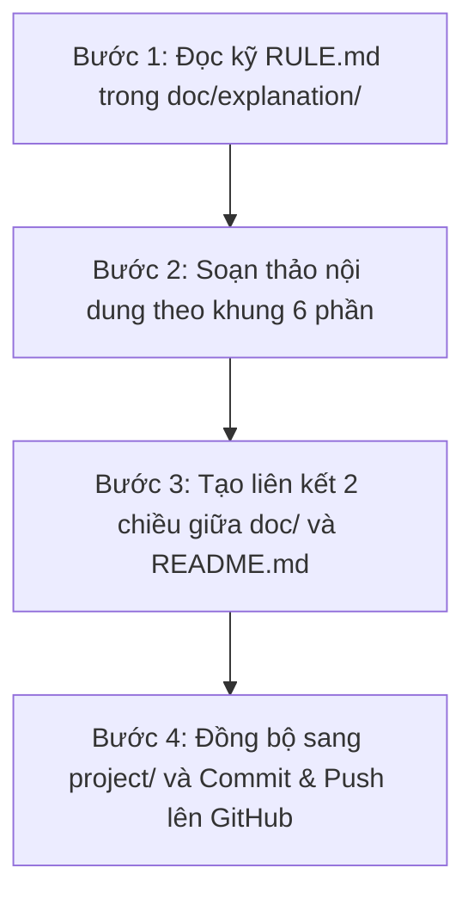

# QUY CHUẨN SOẠN THẢO CHUYÊN ĐỀ PHÂN TÍCH KỸ THUẬT (EXPLANATION RULES)

> **QUY TẮC BẮT BUỘC**:  
> Trước khi khởi tạo hoặc chỉnh sửa bất kỳ tài liệu nào trong thư mục `doc/explanation/`, **BẮT BUỘC PHẢI ĐỌC KỸ VÀ TUÂN THỦ TUYỆT ĐỐI** các quy chuẩn trong file `RULE.md` này.  
> Mục tiêu cốt lõi: **Giải thích chi tiết, logic đa tầng, dễ hiểu bản chất, không làm người đọc bị rối, và luôn gắn chặt với ví dụ Case Study thực tế có số liệu cụ thể.**

---

## 1. Mục Đích & Khác Biệt Giữa Các Thư Mục

Để tài liệu không bị trùng lặp hoặc đi sai trọng tâm, cần phân định rõ vai trò của 3 khu vực chính:

| Thư mục | Mục đích cốt lõi | Đối tượng phục vụ | Phong cách trình bày |
| :--- | :--- | :--- | :--- |
| **`doc/`** | Dịch thuật, tổng hợp và hệ thống hóa toàn bộ các chương của bài báo khoa học TiDE (Chương 1 đến Chương 6 + Phụ lục A, B). | Người cần đọc toàn văn tài liệu nghiên cứu chuẩn chỉ. | Phong cách học thuật, cấu trúc theo chương mục bài báo. |
| **`doc/glossary/`** | Giải thích trực giác từng khái niệm kỹ thuật đơn lẻ theo phương pháp Feynman (cho đứa trẻ 10 tuổi). | Người mới tiếp cận, cần hiểu nhanh bản chất và trực giác qua ẩn dụ đời thường. | Kể chuyện ngụ ngôn, ẩn dụ đời thực, không công thức nặng nề, tóm tắt 30 giây. |
| **`doc/explanation/`** | **Phân tích kỹ thuật chuyên sâu (Deep-Dive Technical Analysis)**: Giải phẫu từng công thức toán học, cơ chế hoạt động bên trong từng khối mạng, lý do thiết kế kiến trúc, mã nguồn thực thi và case study thực tế. | Kỹ sư AI/Data Scientist, người thực chiến muốn hiểu cặn kẽ bản chất toán học và cách code chạy. | **Phân tích logic từng bước (Step-by-step), bóc tách từng ký hiệu, số liệu thực tế, code PyTorch minh họa.** |

---

## 2. Tiêu Chí "Dễ Hiểu – Có Logic – Tránh Làm Rối Thêm"

Một bài phân tích kỹ thuật thất bại là bài viết biến một công thức khó thành một đống định nghĩa còn khó hiểu hơn. Để người đọc **không bị ngợp và rối trí**, bài viết trong `explanation/` phải tuân thủ nghiêm ngặt 4 nguyên tắc sau:

### Nguyên Tắc 1: Đi Từ Cái Biết Rồi Đến Cái Chưa Biết (Anchoring Effect)
- Luôn mở đầu bằng câu hỏi: *"Bài toán thực tế cần giải quyết là gì?"* và *"Đầu vào/Đầu ra thực tế trông như thế nào?"*.
- Đưa ra một ví dụ đời thường hoặc bảng số liệu nhỏ trực quan **TRƯỚC KHI** đi sâu vào toán học ma trận/tensor.

### Nguyên Tắc 2: "Giải Phẫu Nguyên Tử" (Atomic Deconstruction)
- Nếu bài viết giải thích một công thức toán học (ví dụ: $y_{L+1:L+H}^{(i)}$, hàm kích hoạt ReLU, phép biến đổi số chiều):  
  👉 **Bóc tách riêng từng ký tự một** ($y$, $(i)$, $L$, $H$, dấu hai chấm, dấu chuyển vị $\top$, không gian $\mathbb{R}^H$).  
  👉 Lập bảng định nghĩa nguyên tử: Ký hiệu | Tên gọi chuẩn | Ý nghĩa trực giác | Giá trị ví dụ thực tế.

### Nguyên Tắc 3: Logic Đa Tầng "Tại Sao Lại Làm Như Vậy?" (The 3 Whys)
Không chỉ mô tả *"Mô hình làm cái gì"*, mà phải trả lời 3 câu hỏi sâu:
1. **Tại sao không làm theo cách đơn giản hơn?** (Ví dụ: Tại sao không dùng Linear thẳng mà phải qua Residual Block?).
2. **Nếu bỏ qua bước này thì hậu quả là gì?** (Ví dụ: Không có phi tuyến thì mạng sâu biến thành 1 ma trận duy nhất; không có Dropout thì overfit).
3. **Cơ chế toán học/kỹ thuật bên trong hoạt động như thế nào?** (Bằng số liệu tính toán từng bước $1 \to 2 \to 3$).

### Nguyên Tắc 4: Luôn Có Case Study Thực Tế Cụ Thể Số Liệu
- Mỗi bài viết **BẮT BUỘC PHẢI CÓ ÍT NHẤT 2 - 3 CASE STUDY THỰC TẾ** với số liệu cụ thể (ví dụ: số ngày, số giờ, số bước dự báo, loại cảm biến, số lượng hàng bán).
- Không nói chung chung *"Ví dụ chuỗi thời gian nào đó"*, mà phải đưa số liệu chuẩn từ các bài toán thực tế (Điện lực Electricity, Bán lẻ Walmart M5, Giao thông PeMS, Thời tiết Weather...).

---

## 3. Khung Cấu Trúc Chuẩn Bắt Buộc Của Một File Trong `doc/explanation/`

Mỗi file trong `doc/explanation/` (ví dụ: `section_4_1_residual_block.md`, `target_horizon_vector.md`, `feature_projection_mechanism.md`...) phải được cấu trúc theo 6 phần chuẩn sau:

```markdown
# [TÊN CHUYÊN ĐỀ PHÂN TÍCH KỸ THUẬT: CỤ THỂ & RÕ RÀNG]

> 🎯 **Mục tiêu chuyên đề:** Tóm tắt trong 2-3 câu ngắn gọn về vấn đề kỹ thuật sẽ được giải quyết triệt để trong bài viết.

---

## 1. Đặt Vấn Đề Thực Tế & Động Cơ (Motivation)
- Vấn đề thực tế gặp phải là gì?
- Tại sao bài báo TiDE cần cơ chế/công thức này?
- Bảng hoặc sơ đồ trực quan hóa dữ liệu trước và sau khi xử lý.

---

## 2. Phân Tích Chi Tiết Từng Thành Phần (Atomic Step-by-Step Breakdown)
- Trình bày công thức gốc của bài báo (định dạng LaTeX chuẩn).
- Lập bảng "Giải phẫu nguyên tử": Bóc tách từng ký hiệu, toán tử, chỉ số và không gian vector.
- Sơ đồ luồng dữ liệu (Mermaid flowchart) minh họa quá trình biến đổi từ Tensor đầu vào sang Tensor đầu ra.

---

## 3. Bản Chất Kỹ Thuật & Cơ Chế Toán Học (Under-the-Hood Mechanics)
- Trả lời câu hỏi "Tại sao lại thiết kế như vậy?":
  - Nếu không có bước này thì sao?
  - Toán học đằng sau (đạo hàm, tính phi tuyến, chuẩn hóa, bảo toàn gradient...).
- Bảng tính mô phỏng số liệu từng bước (Toy Numerical Example): Đưa vào một vector số cụ thể (ví dụ: `[1.2, -0.5, 3.0]`) và tính toán kết quả qua từng tầng.

---

## 4. Các Case Study Thực Tế (Real-World Case Studies)
Phải có ít nhất 2 - 3 case study cụ thể:
- **Case Study 1: [Lĩnh vực 1 - Ví dụ: Dự Báo Lưới Điện Quốc Gia (Electricity)]**
  - Ngữ cảnh nghiệp vụ.
  - Bộ tham số thực tế ($L, H, r, p...$).
  - Ý nghĩa nghiệp vụ của đầu vào và đầu ra.
- **Case Study 2: [Lĩnh vực 2 - Ví dụ: Quản Trị Chuỗi Cung Ứng & Tồn Kho (Walmart M5)]**
  - Ngữ cảnh nghiệp vụ.
  - Bộ tham số thực tế.
  - Giá trị kinh doanh mang lại.
- **Case Study 3: [Lĩnh vực 3 - Ví dụ: Giám Sát Giao Thông Thông Minh (Traffic/PeMS)]**

---

## 5. Minh Họa Bằng Mã Nguồn Thực Thi (PyTorch Code Implementation)
- Đoạn mã Python / PyTorch chuẩn chỉnh, tự chạy được (standalone executable).
- Có comment tiếng Việt giải thích từng dòng code.
- In ra kích thước Tensor (`shape`) tại mỗi bước xử lý để người đọc đối chiếu trực tiếp với công thức toán.

---

## 6. Đúc Kết & Quy Tắc Cần Nhớ (Key Takeaways)
- Bảng tóm tắt hoặc 3-4 gạch đầu dòng then chốt nhất.
- Lời khuyên thực chiến cho Kỹ sư AI khi triển khai vào dự án thực tế.
```

---

## 4. Quy Chuẩn Về Ngôn Ngữ, Trình Bày & Sơ Đồ

### 1. Ngôn Ngữ & Thuật Ngữ
- **100% Tiếng Việt có dấu đầy đủ và chuẩn xác chính tả** trong toàn bộ bài viết, tiêu đề, bảng biểu, code comments và sơ đồ Mermaid.
- Khi nhắc tới thuật ngữ tiếng Anh, hãy mở ngoặc giải thích từ ngữ: ví dụ: *"Bộ giải mã theo thời gian (Temporal Decoder)"*, *"Khoảng quan sát quá khứ (Lookback Window)"*.

### 2. Định Dạng Công Thức Toán Học (LaTeX / KaTeX)
- Tất cả các khối công thức hiển thị riêng (`$$...$$`) phải:
  - Nằm trên các dòng độc lập.
  - Có dòng trống phía trước và phía sau.
  - **TUYỆT ĐỐI KHÔNG** thụt đầu dòng dấu `$$` bên trong danh sách gạch đầu dòng (bullet points) vì GitHub sẽ hiểu nhầm là khối code thụt lề và không render công thức toán.

### 3. Quy Chuẩn Sơ Đồ Mermaid Trên GitHub
- **Luôn bọc nhãn node bằng cặp dấu ngoặc kép**: `Node["Nội dung tiếng Việt có dấu"]`.
- **Tuyệt đối không dùng ký tự `->` bên trong nhãn node**: Thay vì viết `Node["A -> B"]`, hãy viết `Node["A chuyển thành B"]`.
- **Tuyệt đối không dùng dấu ngoặc vuông `[` hoặc `]` bên trong nhãn**: Thay vì `Node["Ghép [a ; b]"]`, hãy viết `Node["Ghép vector a và vector b"]`.
- **Tuyệt đối không dùng biểu đồ `xychart-beta`**: Vì GitHub thường báo lỗi `UnknownDiagramError`. Hãy dùng `flowchart TD` / `flowchart LR` hoặc bảng biểu Markdown.
- **Không nối trực tiếp ID của Subgraph**: Luôn nối giữa các Node cụ thể bên trong.

---

## 5. Quy Trình 4 Bước Khi Tạo File Mới Trong `doc/explanation/`

Mỗi khi nhận yêu cầu tạo file giải thích mới trong `doc/explanation/`, trợ lý AI phải thực hiện tuần tự 4 bước sau:



1. **Bước 1**: Đọc kỹ `doc/explanation/RULE.md` để nắm chuẩn cấu trúc và phong cách diễn đạt.
2. **Bước 2**: Soạn thảo file giải thích đầy đủ các phần: Đặt vấn đề, Bóc tách nguyên tử, Cơ chế bên trong, Case study thực tế (có số liệu), Mã nguồn PyTorch, Đúc kết.
3. **Bước 3**: Thêm liên kết 2 chiều:
   - Trong file `doc/` tương ứng (ví dụ: `doc/03_problem_setting.md` hoặc `doc/04_model_architecture.md`), thêm khối trích dẫn liên kết đến bài giải thích chi tiết.
   - Trong `doc/explanation/README.md` và root `README.md`, bổ sung tên bài viết vào mục **Chuyên Đề Phân Tích Kỹ Thuật**.
4. **Bước 4**: Đồng bộ song song giữa thư mục repository và thư mục làm việc cục bộ `d:\PTDLKD\project\`, sau đó commit và push lên remote repository.
