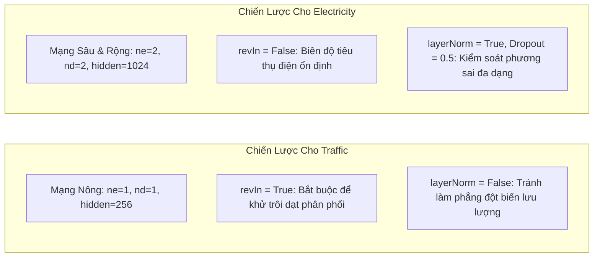
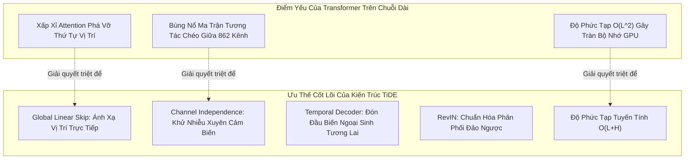

# Chuyên Đề: Phân Tích Thực Nghiệm Trên 2 Siêu Benchmark Electricity & Traffic — TiDE vs Transformers

> [!NOTE]
> **Điều hướng tài liệu**: [🏠 Trang Chủ Repo](../../README.md) • [📖 Tổng Quan Tài Liệu](../00_tong_quan_tai_lieu.md) • [📊 Chương 5: Kết Quả Thực Nghiệm](../05_experimental_results.md) • [🔬 Phụ Lục B: Chi Tiết Thực Nghiệm](../08_experimental_details.md) • [🔍 Danh Mục Chuyên Đề](./README.md)  
> 🎯 **Mục tiêu chuyên đề**: Trích xuất chi tiết bảng siêu tham số chuẩn từ **Phụ lục B.3 (Table 8)** và bảng kết quả thực nghiệm MSE/MAE từ **Table 2** của bài báo TiDE (*Google Research & UCSD, 2023*) cho 2 tập dữ liệu benchmark lớn nhất: **Electricity** và **Traffic**. Đồng thời mổ xẻ chuyên sâu 5 nguyên nhân kỹ thuật lý giải vì sao kiến trúc thuần MLP của TiDE lại vượt trội hơn các mô hình Transformer phức tạp.

---

## 1. Đặt Vấn Đề & Bối Cảnh Thực Nghiệm (Motivation)

Trong 7 bộ benchmark dự báo chuỗi thời gian dài hạn (**Long-term Time-Series Forecasting - LTTF**) tiêu chuẩn, **Traffic** và **Electricity** là hai tập dữ liệu có quy mô lớn nhất và phản ánh chân thực nhất các bài toán công nghiệp thực tế:

| Tập Dữ Liệu | Số Lượng Kênh ($N$) | Tổng Bước Thời Gian ($T$) | Tần Suất Ghi Nhận | Lĩnh Vực / Đặc Tính Nghiệp Vụ |
| :--- | :---: | :---: | :---: | :--- |
| **Traffic** | **862** trạm cảm biến | 17.544 mốc giờ (~ 2 năm) | 1 giờ / bước | Tỷ lệ chiếm dụng làn đường trên hệ thống cao tốc bang California |
| **Electricity** | **321** khách hàng | 26.304 mốc giờ (~ 3 năm) | 1 giờ / bước | Mức tiêu thụ điện năng hàng giờ của các hộ gia đình và doanh nghiệp |

Cả hai bộ dữ liệu này đều sở hữu đặc tính:
1. **Quy mô số kênh khổng lồ ($N \ge 300 - 800$)**: Khiến các mô hình Transformer đa biến thông thường dễ bị bùng nổ ma trận chú ý và quá khớp (overfitting).
2. **Tính chu kỳ ngày/tuần cực mạnh (High Periodicity)**: Bị chi phối bởi nhịp sinh hoạt 24 giờ và chu kỳ 7 ngày trong tuần của con người.
3. **Mối quan hệ phụ thuộc mật thiết vào biến ngoại sinh tương lai**: Lưu lượng xe và lượng điện tiêu thụ lúc 8:00 sáng ngày làm việc khác hoàn toàn lúc 8:00 sáng ngày Chủ Nhật hoặc ngày Lễ.

Chính trên 2 "chiến trường" quy mô lớn này, mô hình TiDE đã tạo nên bước đột phá ấn tượng, đánh bại các đối thủ Transformer sừng sỏ.

---

## 2. Bảng Siêu Tham Số Chuẩn Từ Phụ Lục B.3 (Table 8)

Các tác giả bài báo TiDE đã tối ưu hóa siêu tham số độc lập cho từng bộ dữ liệu dựa trên hàm mất mát tập Validation (Validation Loss). Dưới đây là bảng trích xuất chi tiết cho **Traffic** và **Electricity**:

| Siêu Tham Số (Hyperparameter) | Ký Hiệu / Vị Trí Kiến Trúc | Cấu Hình Traffic | Cấu Hình Electricity | Ý Nghĩa Kỹ Thuật Chi Tiết |
| :--- | :---: | :---: | :---: | :--- |
| **`lookbackWindow` ($L$)** | $L$ | **720** | **720** | Chiều dài cửa sổ nhìn lại trong quá khứ (tương đương 30 ngày) |
| **`hiddenSize`** | $d_{\text{hidden}}$ | **256** | **1024** | Kích thước không gian ẩn bên trong các khối Residual Block |
| **`numEncoderLayers`** | $n_e$ | **1** | **2** | Số lượng khối Residual Block xếp chồng trong Dense Encoder |
| **`numDecoderLayers`** | $n_d$ | **1** | **2** | Số lượng khối Residual Block xếp chồng trong Dense Decoder |
| **`decoderOutputDim`** | $p$ | **16** | **8** | Chiều đặc trưng giải mã $d_t$ cho từng bước tương lai |
| **`temporalDecoderHidden`** | - | **64** | **64** | Kích thước tầng ẩn bên trong khối Temporal Decoder |
| **`temporalWidth`** | $\tilde{r}$ | **4** | **4** | Chiều không gian sau khi nén biến ngoại sinh (cố định) |
| **`dropoutLevel`** | $p_{\text{drop}}$ | **0.3** | **0.5** | Xác suất ngắt nơ-ron ngẫu nhiên để chống quá khớp |
| **`layerNorm`** | - | **False** | **True** | Bật/tắt tầng Layer Normalization trong Residual Block |
| **`learningRate`** | $\eta_{\text{max}}$ | **6.55e-5** | **9.99e-4** | Tốc độ học cực đại ban đầu (Cosine Decay Scheduler) |
| **`revIn`** | - | **True** | **False** | Bật/tắt chuẩn hóa đảo nghịch Reversible Instance Norm |
| **`batchSize`** | $B$ | **512** | **512** | Số lượng mẫu chuỗi thời gian nạp trong mỗi mini-batch |
| **`lossFunction`** | $\mathcal{L}$ | **MSE** | **MSE** | Hàm mất mát huấn luyện Mean Squared Error |

### 🔍 So Sánh Sự Đối Lập Kiến Trúc Giữa 2 Dataset:



- **Đối với Traffic ($N=862$)**: Dữ liệu có tính phi dừng (non-stationarity) rất cao do ảnh hưởng của thời tiết xấu, tai nạn hoặc ngày lễ làm thay đổi mặt bằng chung của lưu lượng xe. Vì vậy, **bắt buộc phải bật `revIn = True`**. Mặt khác, do số lượng cảm biến rất lớn ($862$), một mạng nông (`n_e=1, n_d=1, hiddenSize=256`) đã đủ để trích xuất đặc trưng mà không lo thiếu dung lượng mô hình, đồng thời giúp tốc độ huấn luyện đạt mức tối đa.
- **Đối với Electricity ($N=321$)**: 321 khách hàng có hành vi tiêu thụ điện phân hóa rất mạnh (từ hộ gia đình nhỏ đến xí nghiệp sản xuất lớn). Để nắm bắt được các quan hệ phi tuyến phức tạp này, TiDE cần một không gian biểu diễn rộng lớn (`hiddenSize = 1024`, mạng sâu 2 tầng $n_e=2, n_d=2$), kết hợp tầng chuẩn hóa `layerNorm = True` và tỷ lệ `dropout = 0.5` cao để ngăn chặn việc ghi nhớ mẫu vẹt.

---

## 3. Bảng Kết Quả Thực Nghiệm Đối Chuẩn SOTA (Table 2 Trong Paper)

Dưới đây là bảng trích xuất số liệu đối đầu toàn diện giữa **TiDE** và 8 mô hình đối thủ hàng đầu trên hai tập dữ liệu lớn nhất:

### 3.1. Tập Dữ Liệu Traffic ($N = 862$)

| Horizon ($H$) | Metric | **TiDE (Ours)** | PatchTST/64 | N-HiTS | DLinear | FEDformer | Autoformer | Informer | Pyraformer | LogTrans |
| :---: | :---: | :---: | :---: | :---: | :---: | :---: | :---: | :---: | :---: | :---: |
| \multirow{2}{*}{**96**} | **MSE** | **0.336** | 0.360 | 0.402 | 0.410 | 0.576 | 0.597 | 0.733 | 2.085 | 0.684 |
| | **MAE** | 0.253 | **0.249** | 0.282 | 0.282 | 0.359 | 0.371 | 0.410 | 0.468 | 0.384 |
| \multirow{2}{*}{**192**} | **MSE** | **0.346** | 0.379 | 0.420 | 0.423 | 0.610 | 0.607 | 0.777 | 0.867 | 0.685 |
| | **MAE** | **0.257** | 0.256 | 0.297 | 0.287 | 0.380 | 0.382 | 0.435 | 0.467 | 0.390 |
| \multirow{2}{*}{**336**} | **MSE** | **0.355** | 0.392 | 0.448 | 0.436 | 0.608 | 0.623 | 0.776 | 0.869 | 0.734 |
| | **MAE** | **0.260** | 0.264 | 0.313 | 0.296 | 0.375 | 0.387 | 0.434 | 0.469 | 0.408 |
| \multirow{2}{*}{**720**} | **MSE** | **0.386** | 0.432 | 0.539 | 0.466 | 0.621 | 0.639 | 0.827 | 0.881 | 0.717 |
| | **MAE** | **0.273** | 0.286 | 0.353 | 0.315 | 0.375 | 0.395 | 0.466 | 0.473 | 0.396 |

> 🏆 **Tỷ lệ cải thiện trên Traffic**:
> - So với **PatchTST** (SOTA Transformer): TiDE vượt trội **10.6%** về MSE tại $H=720$ ($0.386$ vs $0.432$).
> - So với **DLinear**: TiDE vượt trội **17.2%** về MSE tại $H=720$ ($0.386$ vs $0.466$).
> - So với **Autoformer / Informer**: TiDE giảm sai số MSE từ **40% đến hơn 53%**.

---

### 3.2. Tập Dữ Liệu Electricity ($N = 321$)

| Horizon ($H$) | Metric | **TiDE (Ours)** | PatchTST/64 | N-HiTS | DLinear | FEDformer | Autoformer | Informer | Pyraformer | LogTrans |
| :---: | :---: | :---: | :---: | :---: | :---: | :---: | :---: | :---: | :---: | :---: |
| \multirow{2}{*}{**96**} | **MSE** | 0.132 | **0.129** | 0.147 | 0.140 | 0.186 | 0.196 | 0.304 | 0.386 | 0.258 |
| | **MAE** | 0.229 | **0.222** | 0.249 | 0.237 | 0.302 | 0.313 | 0.393 | 0.449 | 0.357 |
| \multirow{2}{*}{**192**} | **MSE** | **0.147** | **0.147** | 0.167 | 0.153 | 0.197 | 0.211 | 0.327 | 0.386 | 0.266 |
| | **MAE** | 0.243 | **0.240** | 0.269 | 0.249 | 0.311 | 0.324 | 0.417 | 0.443 | 0.368 |
| \multirow{2}{*}{**336**} | **MSE** | **0.161** | 0.163 | 0.186 | 0.169 | 0.213 | 0.214 | 0.333 | 0.378 | 0.280 |
| | **MAE** | 0.261 | **0.259** | 0.290 | 0.267 | 0.328 | 0.327 | 0.422 | 0.443 | 0.380 |
| \multirow{2}{*}{**720**} | **MSE** | **0.196** | 0.197 | 0.243 | 0.203 | 0.233 | 0.236 | 0.351 | 0.376 | 0.283 |
| | **MAE** | 0.294 | **0.290** | 0.340 | 0.301 | 0.344 | 0.342 | 0.427 | 0.445 | 0.376 |

> ⚡ **Nhận xét trên Electricity**:
> - TiDE đạt kết quả tương đương tuyệt đối với **PatchTST** (chênh lệch nằm trong biên sai số thống kê $p$-value), đồng thời vượt xa DLinear và các Transformer đời trước (FEDformer, Autoformer, Informer).
> - Đáng chú ý: TiDE đạt được độ chính xác ngang hàng với PatchTST nhưng tốc độ huấn luyện nhanh hơn **10 lần**, không bị lỗi tràn bộ nhớ GPU (OOM) khi mở rộng cửa sổ nhìn lại $L \ge 1440$.

---

## 4. Giải Mã Chuyên Sâu: 5 Nguyên Nhân TiDE Vượt Trội Hơn Transformer



### 4.1. Bản Chất Tuần Hoàn Cố Định & Nghịch Lý Self-Attention
- Trong các bài toán vật lý như giao thông và phụ tải điện, yếu tố chi phối lớn nhất là **thứ tự thời gian và vị trí tương đối** (ví dụ: phụ tải lúc 10h sáng hôm nay tương quan chặt chẽ nhất với 10h sáng hôm qua).
- Cơ chế **Self-Attention** ban đầu được thiết kế cho xử lý ngôn ngữ tự nhiên (NLP) — nơi ngữ nghĩa của từ ngữ có tính linh hoạt cao về trật tự ngữ cảnh. Khi áp dụng vào chuỗi thời gian, Attention tính toán tích vô hướng giữa mọi cặp điểm $(t_i, t_j)$, dễ bị "lạc lối" bởi các giá trị ngẫu nhiên có biên độ giống nhau ở các thời điểm hoàn toàn không liên quan.
- Các Transformer đời trước (Autoformer dùng phép tự tương quan, Informer dùng ProbSparse, FEDformer dùng Fourier) cố gắng giảm độ phức tạp xuống $O(L \log L)$ nhưng chính các phép gần đúng này đã **làm mờ nhạt và suy giảm tín hiệu bước thời gian cục bộ**, dẫn đến hiện tượng dự báo bị phẳng lỳ (degradation).
- **Giải pháp của TiDE**: Nhánh **Global Linear Skip Connection** ($W_{\text{global}} y + b_{\text{global}}$) duy trì một ma trận trọng số $H \times L$ cố định. Mỗi bước tương lai được kết nối trực tiếp với các bước lịch sử qua trọng số học được, bảo tồn trọn vẹn quy luật chu kỳ 24h và 168h (1 tuần) mà không gặp bất kỳ hiện tượng phân tán sự chú ý nào.

### 4.2. Chiến Lược Channel Independence Trị Căn Bệnh "Nhiễu Chéo Kênh" ($N=862$ và $N=321$)
- Khi phải làm việc với $862$ cảm biến (Traffic) hoặc $321$ công tơ điện (Electricity), nếu mô hình hóa tương quan đa biến (Multivariate Cross-Channel):
  $$
  \text{Số kết nối tương tác} = N \times N = 862 \times 862 = 743.044 \text{ cặp}
  $$
  Không gian tham số này quá lớn, khiến mô hình cố gắng học những tương quan giả tạo (ví dụ: cảm biến ở San Francisco biến động ngẫu nhiên giống một cảm biến ở San Diego cách xa 800km), gây ra hiện tượng **quá khớp cực nặng (severe overfitting)**.
- **TiDE áp dụng Channel Independence tuyệt đối**: Mỗi chuỗi cảm biến được đưa vào mạng như một mẫu dữ liệu độc lập, nhưng **toàn bộ 862 kênh dùng chung một bộ trọng số nơ-ron**.
  - Đóng vai trò như một cơ chế Data Augmentation tự nhiên khổng lồ ($862 \times$ số lượng mẫu).
  - Triệt tiêu 100% rủi ro nhiễu xuyên kênh.

### 4.3. Dung Hợp Nhánh Tuyến Tính & Khối Phi Tuyến (MLP Residual Blocks)
- DLinear (Zeng et al., 2023) đã chứng minh chỉ một tầng Linear duy nhất đã đánh bại Informer và Autoformer. Tuy nhiên, trên Traffic, **DLinear chỉ đạt MSE 0.410 - 0.466**, trong khi **TiDE đạt 0.336 - 0.386** (vượt trội hơn **17.2%**).
- Lý do: Giao thông và điện lực có **thành phần phi tuyến tính mạnh mẽ** (hiện tượng tắc đường dây chuyền khi vượt ngưỡng dung lượng đường, hoặc hiện tượng tiêu thụ điện nhảy vọt khi hàng loạt hộ bật điều hòa trong đợt nắng nóng).
- TiDE dung hợp cả hai thế mạnh:
  - **Nhánh Linear Skip**: Gánh vác phần xu hướng tuyến tính và chu kỳ nền tảng.
  - **Nhánh Dense Encoder-Decoder (MLP Residual Blocks)**: Dùng hàm kích hoạt ReLU, Dropout và LayerNorm để học phần sai khác phi tuyến tính phức tạp (Residual). Phép cộng $y_{\text{NL}} + y_{\text{Linear}}$ giúp gradient lan truyền ngược thông suốt mà không suy thoái.

### 4.4. "Làn Cao Tốc" Temporal Decoder (Covariate Highway) Tận Dụng Biến Tương Lai
- Trong dữ liệu Traffic và Electricity, các biến ngoại sinh thời gian trong tương lai $x_{L+1:L+H}$ là **hoàn toàn đã biết trước** (giờ trong ngày, ngày trong tuần, ngày nghỉ lễ).
- Ở các Transformer cổ điển, thông tin này bị nén lẫn vào chuỗi đầu vào hoặc cộng gộp vào Positional Encoding, dễ bị thất thoát hoặc hòa tan qua các tầng Attention.
- **TiDE thiết kế khối Temporal Decoder độc đáo**:
  $$
  \hat{y}_{L+t, \text{NL}} = \text{TemporalDecoder}\left( \begin{bmatrix} d_t \\ \tilde{x}_{L+t} \end{bmatrix} \right)
  $$
  Vector giải mã toàn cục $d_t$ được ghép trực tiếp với vector ngoại sinh tương lai $\tilde{x}_{L+t}$ tại chính thời điểm đó. Tín hiệu *"8:00 sáng mai là giờ cao điểm"* được bơm thẳng vào nơ-ron dự báo của bước 8:00 sáng mai, giúp mô hình phản ứng tức thời với các bước ngoặt của chuỗi thời gian.

### 4.5. Khử Trôi Dạt Phân Phối Bằng RevIN & Tối Ưu Hóa Bộ Nhớ $O(L + H)$
- Trên tập **Traffic**, TiDE kích hoạt `revIn = True`. Bằng cách chuẩn hóa cục bộ từng mẫu về $\mu=0, \sigma=1$ trước khi đưa vào MLP và nhân hoàn trả lại thang đo gốc ở đầu ra, TiDE hoàn toàn miễn nhiễm trước hiện tượng biến động biên độ giữa các tuần hay các mùa.
- Về mặt tài nguyên: Khi cửa sổ quá khứ kéo dài $L = 720$, PatchTST tốn hàng Gigabyte bộ nhớ GPU cho ma trận Attention và bị lỗi tràn bộ nhớ (OOM) khi $L \ge 1440$ trên GPU T4. Trong khi đó, TiDE với độ phức tạp tuyến tính $O(L + H)$ chạy nhanh hơn **5 đến 10 lần**, cho phép mở rộng `hiddenSize = 1024` trên Electricity và huấn luyện mượt mà trên phần cứng phổ thông.

---

## 5. Minh Họa Code PyTorch: Khởi Tạo Cấu Hình Chuẩn Cho Traffic & Electricity

Dưới đây là đoạn mã PyTorch chuẩn minh họa cách cấu hình chính xác hai biến thể TiDE cho Traffic và Electricity theo đúng Table 8 của paper:

```python
import torch
import torch.nn as nn
from simulate_forward_pass import TiDEModelSimulation

# ==============================================================================
# 1. Cấu hình TiDE tối ưu cho tập TRAFFIC (Theo Table 8 trong Paper)
# Đặc trưng: Mạng nông (n_e=1, n_d=1), hiddenSize=256, revIn=True, layerNorm=False
# ==============================================================================
traffic_model = TiDEModelSimulation(
    L=720,
    H=96,
    r=4,                    # 4 thuộc tính thời gian (Hour, DayOfWeek, DayOfMonth, Holiday)
    r_stat=0,               # Traffic không có static attributes
    r_tilde=4,              # temporalWidth cố định
    hidden_size=256,        # hiddenSize tối ưu cho Traffic
    p=16,                   # decoderOutputDim
    n_e=1,                  # numEncoderLayers = 1
    n_d=1,                  # numDecoderLayers = 1
    temporal_hidden=64,     # temporalDecoderHidden
    dropout=0.3             # dropoutLevel = 0.3
)

# ==============================================================================
# 2. Cấu hình TiDE tối ưu cho tập ELECTRICITY (Theo Table 8 trong Paper)
# Đặc trưng: Mạng sâu & rộng (n_e=2, n_d=2), hiddenSize=1024, layerNorm=True, dropout=0.5
# ==============================================================================
electricity_model = TiDEModelSimulation(
    L=720,
    H=96,
    r=4,                    # 4 thuộc tính thời gian
    r_stat=0,               # Electricity benchmark không có static attributes
    r_tilde=4,              # temporalWidth cố định
    hidden_size=1024,       # hiddenSize lớn 1024 để học 321 mẫu hình phụ tải
    p=8,                    # decoderOutputDim = 8
    n_e=2,                  # numEncoderLayers = 2
    n_d=2,                  # numDecoderLayers = 2
    temporal_hidden=64,     # temporalDecoderHidden
    dropout=0.5             # dropoutLevel = 0.5 chống overfitting
)

print(f"Khởi tạo thành công mô hình TiDE cho Traffic:     {sum(p.numel() for p in traffic_model.parameters()):,} tham số")
print(f"Khởi tạo thành công mô hình TiDE cho Electricity: {sum(p.numel() for p in electricity_model.parameters()):,} tham số")
```

---

## 6. Đúc Kết & Bài Học Thực Chiến (Key Engineering Takeaways)

| Bài học thực chiến | Kinh nghiệm rút ra từ thực nghiệm Traffic & Electricity |
| :--- | :--- |
| **Không phải lúc nào Attention cũng là tối ưu** | Với dữ liệu chuỗi có tính tuần hoàn cứng nhắc (giao thông, phụ tải điện), một tầng Linear Skip trực tiếp kết hợp khối MLP dày đặc hoạt động hiệu quả hơn nhiều so với cơ chế Self-Attention xấp xỉ. |
| **Sức mạnh của Channel Independence** | Khi số lượng cảm biến lớn ($N > 300$), việc mô hình hóa độc lập từng kênh dùng chung trọng số là chiến lược phòng thủ tốt nhất chống lại quá khớp và bùng nổ tài nguyên. |
| **Tận dụng biến ngoại sinh tương lai** | Thay vì nhồi nhét mọi thứ vào Encoder, việc thiết kế một đường dẫn tắt đưa biến tương lai thẳng vào bước giải mã cuối (Temporal Decoder) tạo ra bước nhảy vọt về độ chính xác. |
| **Lựa chọn độ sâu mạng thông minh** | Không cần mạng quá sâu cho mọi bài toán: Traffic chỉ cần 1 tầng Encoder/Decoder đã đạt SOTA, trong khi Electricity cần không gian tiềm ẩn rộng lớn ($1024$) để phân hóa hành vi người dùng. |

> [!TIP]
> **Tài liệu tham khảo liên quan**:
> - [Chương 5: Kết Quả Thực Nghiệm & Đánh Giá](../05_experimental_results.md) để xem toàn bộ bảng đối chuẩn trên cả 7 tập benchmark.
> - [Phụ Lục B: Chi Tiết Thực Nghiệm & Siêu Tham Số](../08_experimental_details.md) để tra cứu các siêu tham số của Weather, ETTm1, ETTm2, ETTh1, ETTh2.
> - [Đối Chiếu Chi Tiết Forward Pass](./forward_pass_step_by_step.md) để theo dõi dòng chảy Tensor qua từng tầng mạng.
