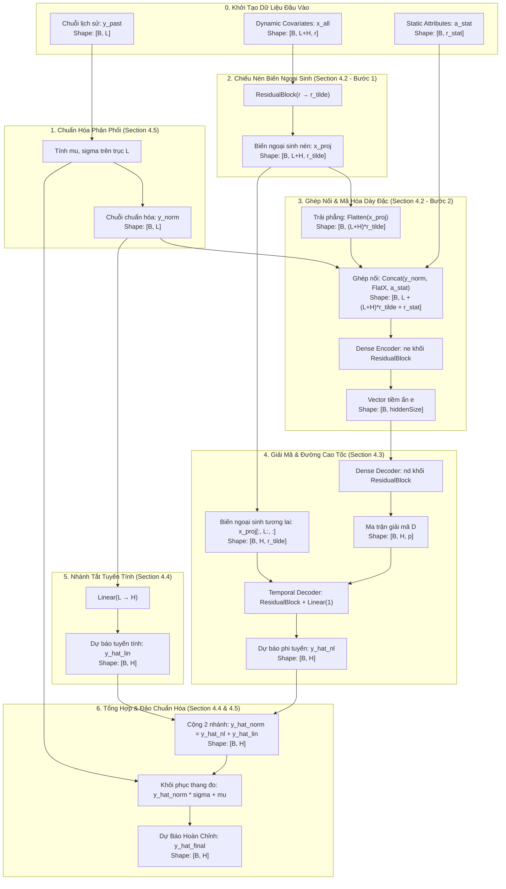

# Đối Chiếu Chi Tiết Forward Pass TiDE: Từ Công Thức Section 4 Đến Mã Nguồn PyTorch

> [!NOTE]
> **Điều hướng tài liệu**: [🏠 Trang Chủ Repo](../../README.md) • [📖 Tổng Quan Tài Liệu](../00_tong_quan_tai_lieu.md) • [📖 Chương 4: Kiến Trúc TiDE](../04_model_architecture.md) • [🔍 Danh Mục Chuyên Đề](./README.md)  
> 🎯 **Mục tiêu chuyên đề**: Đặt từng công thức toán học xuất hiện trong **Section 4** của bài báo gốc TiDE song song cạnh từng dòng lệnh PyTorch tương ứng trong quá trình **Forward Pass**, theo dõi chi tiết kích thước Tensor (Tensor Shapes) biến đổi qua từng tầng với ví dụ cấu hình chuẩn $B=32, L=720, H=96$.

---

## 1. Đặt Vấn Đề & Sơ Đồ Tổng Thể Luồng Dữ Liệu (Motivation & Flow)

Khi đọc bài báo khoa học TiDE (*Long-term Forecasting with TiDE: Time-series Dense Encoder*), kỹ sư AI và nhà nghiên cứu thường gặp rào cản khi chuyển dịch từ **ký hiệu toán học giải tích** (vector cột $\mathbb{R}^H$, ma trận chiếu, phép ghép nối dọc) sang **lập trình Tensor đa chiều** trong PyTorch (`torch.Tensor` với trục batch `dim=0`, trục thời gian `dim=1`, trục đặc trưng `dim=2`).

Tài liệu này giải quyết triệt để sự đứt gãy đó bằng cách lập bảng đối chiếu song song **1:1** giữa công thức bài báo và code PyTorch thực chiến.



---

## 2. Bảng Đối Chiếu Từng Bước: Công Thức Toán vs Mã Nguồn PyTorch

Dưới đây là bảng ánh xạ chi tiết từng công thức toán trong Section 4 sang cú pháp thực thi PyTorch:

| Bước thực hiện | Công thức toán học (Section 4) | Mã nguồn PyTorch tương ứng | Kích thước Tensor ($B=32, L=720, H=96$) |
| :--- | :--- | :--- | :---: |
| **0. Tensor đầu vào** | $y_{1:L} \in \mathbb{R}^L$<br/>$x_{1:L+H} \in \mathbb{R}^{(L+H) \times r}$<br/>$a \in \mathbb{R}^{r_{\text{stat}}}$ | `y_past = torch.randn(B, L)`<br/>`x_all = torch.randn(B, L + H, r)`<br/>`a_stat = torch.randn(B, r_stat)` | `[32, 720]`<br/>`[32, 816, 4]`<br/>`[32, 2]` |
| **1. Chuẩn hóa RevIN**<br/>*(Section 4.5)* | $\mu = \frac{1}{L} \sum_{t=1}^L y_t$<br/>$\sigma = \sqrt{\frac{1}{L}\sum (y_t - \mu)^2 + \epsilon}$<br/>$y_{\text{norm}} = \frac{y_{1:L} - \mu}{\sigma}$ | `mu = y_past.mean(dim=1, keepdim=True)`<br/>`sigma = torch.sqrt(y_past.var(dim=1, keepdim=True, unbiased=False) + 1e-5)`<br/>`y_norm = (y_past - mu) / sigma` | `mu`: `[32, 1]`<br/>`sigma`: `[32, 1]`<br/>`y_norm`: `[32, 720]` |
| **2. Feature Projection**<br/>*(Section 4.2 - Bước 1)* | $\tilde{x}_t = \text{FeatureProjection}(x_t) \in \mathbb{R}^{\tilde{r}}$<br/>áp dụng độc lập $\forall t \in \{1, \dots, L+H\}$ | `# Khối ResidualBlock chiếu r -> r_tilde`<br/>`x_proj = self.feature_proj(x_all)` | `[32, 816, 4]` |
| **3. Trải phẳng & Ghép nối**<br/>*(Section 4.2 - Bước 2)* | $u_{\text{enc}} = \begin{bmatrix} y_{\text{norm}} \\ \text{vec}(\tilde{x}_{1:L+H}) \\ a \end{bmatrix} \in \mathbb{R}^{L + (L+H)\tilde{r} + r_{\text{stat}}}$ | `flat_x = x_proj.flatten(start_dim=1)`<br/>`u_enc = torch.cat([y_norm, flat_x, a_stat], dim=-1)` | `flat_x`: `[32, 3264]`<br/>`u_enc`: `[32, 3986]` |
| **4. Dense Encoder**<br/>*(Section 4.2 - Bước 2)* | $e = \text{DenseEncoder}(u_{\text{enc}}) \in \mathbb{R}^{\text{hiddenSize}}$<br/>gồm $n_e$ khối Residual Block | `e = self.dense_encoder(u_enc)` | `[32, 256]` |
| **5. Dense Decoder**<br/>*(Section 4.3 - Bước 1)* | $g = \text{DenseDecoder}(e) \in \mathbb{R}^{H \cdot p}$<br/>$D = \text{reshape}(g) \in \mathbb{R}^{H \times p}$ | `g = self.dense_decoder(e)`<br/>`D = g.view(-1, H, p)` | `g`: `[32, 1536]`<br/>`D`: `[32, 96, 16]` |
| **6. Temporal Decoder**<br/>*(Section 4.3 - Bước 2)* | $\begin{bmatrix} d_t \\ \tilde{x}_{L+t} \end{bmatrix} \in \mathbb{R}^{p + \tilde{r}}$<br/>$\hat{y}_{L+t,\text{NL}} = \text{TemporalDecoder}\left(\begin{bmatrix} d_t \\ \tilde{x}_{L+t} \end{bmatrix}\right)$ | `x_fut = x_proj[:, L:, :]`<br/>`temp_in = torch.cat([D, x_fut], dim=-1)`<br/>`y_hat_nl = self.temporal_decoder(temp_in).squeeze(-1)` | `x_fut`: `[32, 96, 4]`<br/>`temp_in`: `[32, 96, 20]`<br/>`y_hat_nl`: `[32, 96]` |
| **7. Global Linear Skip**<br/>*(Section 4.4)* | $\hat{y}_{\text{Linear}} = W_{\text{global}} \cdot y_{\text{norm}} + b_{\text{global}}$ | `y_hat_lin = self.global_skip(y_norm)` | `[32, 96]` |
| **8. Tổng hợp & Phục hồi**<br/>*(Section 4.4 & 4.5)* | $\hat{y}_{\text{norm}} = \hat{y}_{\text{NL}} + \hat{y}_{\text{Linear}}$<br/>$\hat{y}_{\text{final}} = \hat{y}_{\text{norm}} \cdot \sigma + \mu$ | `y_hat_norm = y_hat_nl + y_hat_lin`<br/>`y_hat_final = y_hat_norm * sigma + mu` | `y_hat_norm`: `[32, 96]`<br/>`y_hat_final`: `[32, 96]` |

---

## 3. Bản Chất Kỹ Thuật & Cơ Chế Chuyển Đổi Số Chiều (Under-the-Hood)

### 3.1. Phép Chiếu Giảm Chiều Feature Projection: Vì Sao Cần Thiết?
Nếu không có bước Feature Projection ($r \to \tilde{r}$), kích thước của vector sau khi trải phẳng sẽ là:
$$
\text{dim}_{\text{uncompressed}} = (L + H) \times r = (720 + 96) \times 4 = 3264
$$
Trong các bài toán giao thông hoặc năng lượng lớn với $r = 30$ covariates, kích thước này sẽ bùng nổ lên $(720 + 96) \times 30 = 24.480$ chiều!
Việc ép qua khối Residual Block với $\tilde{r} = 4$ giúp khống chế kích thước vector đầu vào của Encoder luôn ở mức ổn định, ngăn chặn hiện tượng tràn bộ nhớ GPU (OOM) và bẫy quá khớp (overfitting).

### 3.2. Cấu Trúc Khối Residual Block (Section 4.1) Trong Quá Trình Forward
Mỗi khối Residual Block nhận đầu vào vector $u$, áp dụng song song:
1. **Nhánh MLP**:
   $$
   z_1 = W_1 u + b_1 \in \mathbb{R}^{d_{\text{hidden}}} \implies a_1 = \text{ReLU}(z_1) \implies z_2 = W_2 a_1 + b_2 \in \mathbb{R}^{d_{\text{out}}} \implies \tilde{z}_2 = \text{Dropout}(z_2)
   $$
2. **Nhánh Linear Skip**:
   $$
   u_{\text{skip}} = W_{\text{skip}} u \in \mathbb{R}^{d_{\text{out}}} \quad (\text{sử dụng Identity nếu } d_{\text{in}} = d_{\text{out}})
   $$
3. **Phép cộng và chuẩn hóa LayerNorm**:
   $$
   v = \text{LayerNorm}(\tilde{z}_2 + u_{\text{skip}})
   $$

### 3.3. Đường Cao Tốc Covariate Highway: Vì Sao Tách Biệt $D$ Và $\tilde{x}_{L+t}$?
Tại bước giải mã tương lai:
- Ma trận $D \in \mathbb{R}^{H \times p}$ chứa **bối cảnh toàn cục (global context)** được cô đọng từ toàn bộ quá khứ $y_{1:L}$ thông qua Encoder-Decoder.
- Vector $\tilde{x}_{L+t} \in \mathbb{R}^{\tilde{r}}$ chứa **sự kiện cụ thể tức thời tại thời điểm tương lai $L+t$** (ví dụ: ngày mai là Lễ Giáng Sinh, nhiệt độ giảm đột ngột 5 độ C).

Bằng cách ghép nối trực tiếp `torch.cat([D, x_fut], dim=-1)` thành vector $(p + \tilde{r}) = 20$ chiều đưa vào `TemporalDecoder`, mô hình đảm bảo tín hiệu sự kiện tương lai không bị thất thoát hoặc suy giảm khi đi qua các tầng mạng nén.

---

## 4. Case Study Số Liệu Thực Tế: Tập Benchmark LTTF Chuẩn

Xem xét ví dụ thực nghiệm tiêu chuẩn trong các bài báo LTTF (Electricity / Traffic):
- **Batch Size ($B$)**: $32$
- **Look-back Window ($L$)**: $720$ bước (tương đương 30 ngày dữ liệu theo giờ)
- **Forecast Horizon ($H$)**: $96$ bước (tương đương 4 ngày dự báo tiếp theo)
- **Dynamic Covariates ($r$)**: $4$ thuộc tính thời gian (Hour of Day, Day of Week, Day of Month, Holiday Indicator)
- **Static Attributes ($r_{\text{stat}}$)**: $2$ thuộc tính tĩnh (Sensor ID embedding, Region ID)
- **Temporal Width ($\tilde{r}$)**: $4$
- **Hidden Size**: $256$
- **Decoder Output Dim ($p$)**: $16$

### Bảng Kích Thước Tensor Thực Tế Tại Từng Bước:

| Cột mốc Forward Pass | Tên Tensor trong PyTorch | Kích thước Tensor | Tổng số phần tử mỗi mẫu |
| :--- | :--- | :---: | :---: |
| Dữ liệu lịch sử gốc | `y_past` | `[32, 720]` | 720 |
| Biến ngoại sinh toàn bộ | `x_all` | `[32, 816, 4]` | 3.264 |
| Thuộc tính tĩnh | `a_stat` | `[32, 2]` | 2 |
| Sau Feature Projection | `x_proj` | `[32, 816, 4]` | 3.264 |
| Đầu vào Dense Encoder | `u_enc` | `[32, 3986]` | 3.986 |
| Biểu diễn tiềm ẩn Encoder | `e` | `[32, 256]` | 256 |
| Đầu ra Dense Decoder | `g` | `[32, 1536]` | 1.536 |
| Ma trận giải mã đa bước | `D` | `[32, 96, 16]` | 1.536 |
| Đầu vào Temporal Decoder | `temp_in` | `[32, 96, 20]` | 1.920 |
| Dự báo nhánh phi tuyến | `y_hat_nl` | `[32, 96]` | 96 |
| Dự báo nhánh tuyến tính | `y_hat_lin` | `[32, 96]` | 96 |
| **Dự báo hoàn chỉnh cuối cùng** | `y_hat_final` | `[32, 96]` | **96** |

---

## 5. Script Python Giả Lập Độc Lập (Standalone Simulation Script)

Dự án cung cấp sẵn script thực thi độc lập tại [`simulate_forward_pass.py`](../../simulate_forward_pass.py). Bạn có thể kích hoạt chạy thử bất kỳ lúc nào qua lệnh:

```bash
python simulate_forward_pass.py
```

### Kết quả log terminal mẫu thu được:

```text
=====================================================================================
BẮT ĐẦU FORWARD PASS CHI TIẾT MÔ HÌNH TiDE
=====================================================================================
[*] CẤU HÌNH ĐẦU VÀO BAN ĐẦU:
    - y_past (Chuỗi lịch sử quan sát)           : (32, 720)  [B, L]
    - x_all  (Biến ngoại sinh động toàn thời gian): (32, 816, 4)  [B, L+H, r]
    - a_stat (Thuộc tính ngoại sinh tĩnh)        : (32, 2)  [B, r_stat]
-------------------------------------------------------------------------------------
[Bước 1 - Section 4.5: Chuẩn Hóa RevIN]
    Công thức: y_norm = (y_past - mu) / sigma
    -> mu:      (32, 1)              (Trung bình mỗi chuỗi trong batch)
    -> sigma:   (32, 1)              (Độ lệch chuẩn mỗi chuỗi)
    -> y_norm:  (32, 720)            (Chuỗi quá khứ đã khử xu hướng)
-------------------------------------------------------------------------------------
[Bước 2 - Section 4.2 Step 1: Feature Projection]
    Công thức: x_tilde_t = ResidualBlock(x_t) với r -> r_tilde
    -> x_all gốc : (32, 816, 4)         (r=4 chiều covariates)
    -> x_proj nén: (32, 816, 4)         (r_tilde=4 chiều nén)
-------------------------------------------------------------------------------------
[Bước 3 - Section 4.2 Step 2: Ghép Nối Đầu Vào Encoder]
    Công thức: u_enc = Concat( y_norm, Flatten(x_proj), a_stat )
    -> flat_x_proj: (32, 3264)         ((L+H)*r_tilde = (720+96)*4 = 3264)
    -> u_enc hợp nhất: (32, 3986)       (L + 3264 + r_stat = 3986)
-------------------------------------------------------------------------------------
[Bước 4 - Section 4.2 Step 2: Khối Mã Hóa Dense Encoder]
    Công thức: e = DenseEncoder(u_enc) gồm 2 khối ResidualBlock
    -> Vector tiềm ẩn e: (32, 256)        (hiddenSize=256)
-------------------------------------------------------------------------------------
[Bước 5 - Section 4.3 Step 1: Khối Giải Mã Dense Decoder]
    Công thức: g = DenseDecoder(e) -> D = Reshape(g, [H, p])
    -> Vector giải mã g:    (32, 1536)       (H * p = 96 * 16 = 1536)
    -> Ma trận đặc trưng D: (32, 96, 16)     (Mỗi bước tương lai có 1 vector d_t kích thước p=16)
-------------------------------------------------------------------------------------
[Bước 6 - Section 4.3 Step 2: Temporal Decoder & Covariate Highway]
    Công thức: y_hat_NL(L+t) = TemporalDecoder(Concat(d_t, x_tilde_{L+t}))
    -> x_proj_future:       (32, 96, 4)      (Covariates tương lai L+1 -> L+H)
    -> temp_in ghép nối:    (32, 96, 20)     (p + r_tilde = 16 + 4 = 20)
    -> y_hat_nl phi tuyến:  (32, 96)         (Dự báo thành phần phi tuyến)
-------------------------------------------------------------------------------------
[Bước 7 - Section 4.4: Nhánh Tắt Tuyến Tính Toàn Cục]
    Công thức: y_hat_lin = W_global * y_norm + b_global (Ánh xạ trực tiếp L -> H)
    -> y_hat_lin tuyến tính: (32, 96)         (Dự báo thành phần xu hướng tuyến tính)
-------------------------------------------------------------------------------------
[Bước 8 - Section 4.4 & 4.5: Tổng Hợp & Đảo Chuẩn Hóa RevIN]
    Công thức: y_hat_final = (y_hat_nl + y_hat_lin) * sigma + mu
    -> y_hat_norm:          (32, 96)         (Kết quả cộng 2 nhánh trước rescale)
    -> y_hat_final HOÀN TẤT: (32, 96)         (Dự báo cuối cùng thang đo gốc!)
=====================================================================================
FORWARD PASS HOÀN TẤT THÀNH CÔNG VỚI TẤT CẢ KÍCH THƯỚC KHỚP HOÀN HẢO!
=====================================================================================

[Xác minh Assertion]: Đầu ra đạt chuẩn xác kích thước (32, 96)!
```

---

## 6. Đúc Kết & Quy Tắc Cần Nhớ (Key Engineering Takeaways)

| Quy tắc kỹ thuật | Cơ chế trong Code PyTorch | Lưu ý thực chiến quan trọng |
| :--- | :--- | :--- |
| **Quản lý trục thời gian** | `flatten(start_dim=1)` | Trải phẳng toàn bộ chiều $(L + H) \times \tilde{r}$ trước khi đưa vào Encoder, biến thông tin thời gian thành các đặc trưng không gian. |
| **Bảo tồn chiều trong RevIN** | `keepdim=True` | Khi tính `mean` và `var`, bắt buộc đặt `keepdim=True` để có shape `[B, 1]`, hỗ trợ cơ chế phát thanh tự động (Broadcasting) khi cộng trừ với `[B, L]` và `[B, H]`. |
| **Tách biệt lát cắt tương lai** | `x_proj[:, L:, :]` | Lấy đúng $H$ bước tương lai của covariates để ghép với ma trận giải mã $D$, tránh nhầm lẫn chỉ số gây rò rỉ dữ liệu. |
| **Phép cộng Skip Connection** | `y_hat_nl + y_hat_lin` | Cả hai nhánh độc lập phải cùng kích thước `[B, H]` trước khi thực hiện phép cộng phần tử. |

> [!TIP]
> **Đọc thêm**:
> - [Chương 4: Kiến Trúc Chi Tiết Mô Hình TiDE](../04_model_architecture.md) để nắm toàn bộ lý thuyết nền tảng của bài báo.
> - [Chuyên Đề Khối Residual Block (Section 4.1)](./section_4_1_residual_block.md) để xem chi tiết cơ chế vi mô của khối MLP nền tảng.
> - [Chuyên Đề Vector Nhãn Tương Lai $y_{L+1:L+H}$](./target_horizon_vector.md) để hiểu sâu về cách chuẩn bị nhãn huấn luyện.
