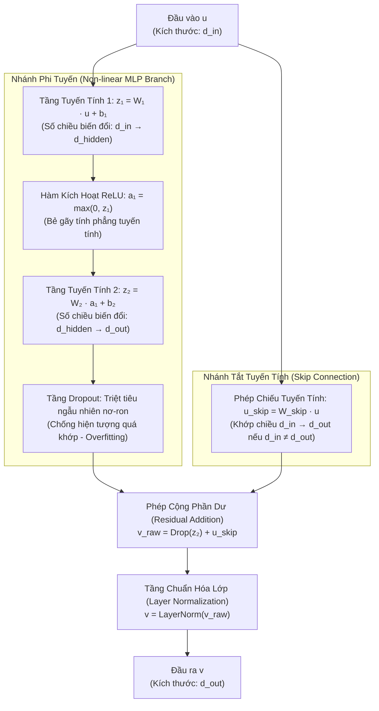
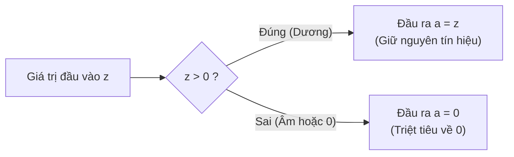

# Giải Thích Chi Tiết Phần 4.1: Khối Residual Block Trong TiDE

> [!NOTE]
> **Điều hướng tài liệu**: [🏠 Tổng Quan Tài Liệu](../doc/00_tong_quan_tai_lieu.md) • [📖 Chương 4: Kiến Trúc TiDE](../doc/04_model_architecture.md) • [📚 Glossary: Residual Block](../glossary/residual_block.md)  
> **Mục tiêu**: Bóc tách chi tiết từng thành phần toán học, cơ chế vận hành nội tại và ý nghĩa hình học của **Residual Block** — đơn vị xử lý nền tảng xuất hiện xuyên suốt kiến trúc TiDE (Feature Projection, Dense Encoder, Dense Decoder, Temporal Decoder).

---

## 1. Tổng Quan Kiến Trúc Khối Residual Block

Khối **Residual Block** trong TiDE là một mạng nơ-ron nhiều tầng dày đặc (**MLP**) có nhánh tắt tuyến tính, được chuẩn hóa và điều hòa cẩn thận.



### Công thức toán học hoàn chỉnh

$$
v = \text{LayerNorm} \left( \text{Dropout} \left( W_2 \cdot \text{ReLU}(W_1 u + b_1) + b_2 \right) + W_{\text{skip}} u \right)
$$

### Bảng tóm tắt dòng chảy Tensor qua các tầng

| Bước | Thành phần | Ký hiệu | Kích thước Tensor đầu ra | Vai trò chính |
| :---: | :--- | :---: | :---: | :--- |
| **0** | Vector đầu vào | $u$ | `[Batch, d_in]` | Dữ liệu đặc trưng đưa vào khối |
| **1** | Tuyến tính 1 | $z_1 = W_1 u + b_1$ | `[Batch, d_hidden]` | Chiếu mở rộng không gian đặc trưng ẩn |
| **2** | Kích hoạt phi tuyến | $a_1 = \max(0, z_1)$ | `[Batch, d_hidden]` | Bẻ gãy tính tuyến tính, tạo tính thưa |
| **3** | Tuyến tính 2 | $z_2 = W_2 a_1 + b_2$ | `[Batch, d_out]` | Thu gọn về kích thước đầu ra mong muốn |
| **4** | Dropout | $\tilde{z}_2 = \text{Dropout}(z_2)$ | `[Batch, d_out]` | Điều hòa, chống đồng thích nghi nơ-ron |
| **5** | Nhánh tắt Skip | $u_{\text{skip}} = W_{\text{skip}} u$ | `[Batch, d_out]` | Bảo tồn thông tin gốc, chống suy thoái |
| **6** | Phép cộng phần dư | $v_{\text{raw}} = \tilde{z}_2 + u_{\text{skip}}$ | `[Batch, d_out]` | Hợp nhất biểu diễn phi tuyến và tín hiệu gốc |
| **7** | Chuẩn hóa lớp | $v = \text{LayerNorm}(v_{\text{raw}})$ | `[Batch, d_out]` | Ổn định phân phối dữ liệu đầu ra |

---

## 2. Làm Sao Đưa Được Số Chiều Từ $d_{\text{in}} \to d_{\text{hidden}}$?

Đây là nhiệm vụ của **Tầng Tuyến Tính Thứ Nhất (Linear Layer 1)**:

$$
z_1 = W_1 u + b_1
$$

### 2.1. Phép Toán Đại Số Tuyến Tính Chi Tiết

Giả sử vector đầu vào là $u \in \mathbb{R}^{d_{\text{in}}}$ (vector cột gồm $d_{\text{in}}$ phần tử). Để biến đổi thành vector $z_1 \in \mathbb{R}^{d_{\text{hidden}}}$ gồm $d_{\text{hidden}}$ phần tử:

- **Ma trận trọng số (Weight Matrix) $W_1 \in \mathbb{R}^{d_{\text{hidden}} \times d_{\text{in}}}$**:
  - Gồm $d_{\text{hidden}}$ hàng và $d_{\text{in}}$ cột.
  - Mỗi hàng thứ $j$ của ma trận $W_1$ (ký hiệu là $w_{1, j}^\top \in \mathbb{R}^{d_{\text{in}}}$) đại diện cho các trọng số kết nối từ toàn bộ $d_{\text{in}}$ đầu vào tới nơ-ron ẩn thứ $j$.
- **Vector độ lệch (Bias Vector) $b_1 \in \mathbb{R}^{d_{\text{hidden}}}$**:
  - Có kích thước là $d_{\text{hidden}} \times 1$.

Phép nhân ma trận và cộng bias được biểu diễn tường minh dưới dạng hệ phương trình:

$$
\begin{bmatrix}
z_{1, 1} \\
z_{1, 2} \\
\vdots \\
z_{1, d_{\text{hidden}}}
\end{bmatrix}
=
\begin{bmatrix}
w_{1, 11} & w_{1, 12} & \dots & w_{1, 1 d_{\text{in}}} \\
w_{1, 21} & w_{1, 22} & \dots & w_{1, 2 d_{\text{in}}} \\
\vdots & \vdots & \ddots & \vdots \\
w_{1, d_{\text{hidden}} 1} & w_{1, d_{\text{hidden}} 2} & \dots & w_{1, d_{\text{hidden}} d_{\text{in}}}
\end{bmatrix}
\begin{bmatrix}
u_1 \\
u_2 \\
\vdots \\
u_{d_{\text{in}}}
\end{bmatrix}
+
\begin{bmatrix}
b_{1, 1} \\
b_{1, 2} \\
\vdots \\
b_{1, d_{\text{hidden}}}
\end{bmatrix}
$$

Giá trị của mỗi nơ-ron ẩn $z_{1, j}$ được tính bằng **tích vô hướng (dot product)** giữa hàng trọng số thứ $j$ và vector đầu vào $u$, cộng thêm bias $b_{1, j}$:

$$
z_{1, j} = \sum_{k=1}^{d_{\text{in}}} w_{1, jk} u_k + b_{1, j} = \langle w_{1, j}, \, u \rangle + b_{1, j}
$$

### 2.2. Ý Nghĩa Hình Học & Trực Giác Không Gian

1. **Chiếu không gian (Space Projection)**:
   Phép nhân $W_1 u + b_1$ là một **biến đổi Affine** (bao gồm xoay, co giãn và tịnh tiến hệ tọa độ trong không gian).
2. **Máy dò đặc trưng (Feature Detectors)**:
   Mỗi hàng $w_{1, j}$ đóng vai trò như một "bộ lọc" mẫu hình (pattern detector). Khi vector đầu vào $u$ có hướng gần trùng với vector trọng số $w_{1, j}$, giá trị tích vô hướng $\langle w_{1, j}, u \rangle$ sẽ đạt cực đại.
3. **Mở rộng chiều (Up-projection)**:
   Thông thường trong tầng ẩn, $d_{\text{hidden}}$ lớn hơn nhiều so với $d_{\text{in}}$ (ví dụ: $d_{\text{in}} = 4 \to d_{\text{hidden}} = 256$). Việc đưa vector lên không gian nhiều chiều giúp tách biệt các cụm dữ liệu vốn đan xen phức tạp ở không gian chiều thấp, chuẩn bị cho bước bẻ gãy phi tuyến tiếp theo.

---

## 3. Hàm Kích Hoạt Phi Tuyến Tính (ReLU) Cụ Thể Làm Gì?

Sau khi qua tầng tuyến tính, giá trị $z_1$ được đưa qua hàm kích hoạt **ReLU (Rectified Linear Unit)**:

$$
a_1 = \text{ReLU}(z_1) = \max(0, \, z_1)
$$

Nghĩa là với từng phần tử $z_{1, j}$:
- Nếu $z_{1, j} > 0 \implies a_{1, j} = z_{1, j}$ (Giữ nguyên tín hiệu dương).
- Nếu $z_{1, j} \le 0 \implies a_{1, j} = 0$ (Dập tắt hoàn toàn tín hiệu âm).



### 3.1. Nghịch Lý Nếu Không Có Hàm Phi Tuyến (Linear Collapse)

Tại sao mạng nơ-ron không thể chỉ ghép nối các tầng Linear liên tiếp?

Giả sử ta bỏ qua hàm ReLU và nối trực tiếp hai tầng tuyến tính:
- Tầng 1: $z_1 = W_1 u + b_1$
- Tầng 2: $z_2 = W_2 z_1 + b_2$

Thay $z_1$ vào $z_2$:

$$
z_2 = W_2 (W_1 u + b_1) + b_2 = (W_2 W_1) u + (W_2 b_1 + b_2)
$$

Đặt $W_{\text{new}} = W_2 W_1$ và $b_{\text{new}} = W_2 b_1 + b_2$, ta thu được:

$$
z_2 = W_{\text{new}} u + b_{\text{new}}
$$

> [!WARNING]
> **Hậu quả nghiêm trọng (Sự sụp đổ tuyến tính - Linear Collapse)**:  
> Tích của hai ma trận ($W_2 W_1$) vẫn chỉ là **MỘT ma trận duy nhất**!  
> Nếu không có hàm phi tuyến, dù xếp chồng **100 tầng hay 1000 tầng Linear**, toàn bộ mạng nơ-ron sâu đồ sộ đó cũng chỉ tương đương về mặt toán học với **MỘT tầng Linear đơn lẻ duy nhất**. Mô hình sẽ hoàn toàn bất lực trước các mối quan hệ phi tuyến tính phức tạp trong chuỗi thời gian thực tế.

### 3.2. ReLU Bẻ Gãy Tính Tuyến Tính Như Thế Nào?

- **Tạo mặt siêu phẳng từng đoạn (Piecewise Linear)**:
  ReLU biến không gian thành nhiều vùng cục bộ. Tại vùng này nơ-ron được bật (hệ số góc bằng 1), tại vùng khác nơ-ron bị tắt (hệ số góc bằng 0). Khi kết hợp hàng trăm nơ-ron ReLU, mạng có khả năng xấp xỉ bất kỳ hàm số phi tuyến phức tạp nào (**Định lý Xấp xỉ Phổ quát - Universal Approximation Theorem**).
- **Tính kích hoạt thưa (Sparsity)**:
  Tại mỗi thời điểm, chỉ một phần nơ-ron có phản hồi dương được kích hoạt truyền tiếp. Việc triệt tiêu các tín hiệu yếu/nhiễu giúp mô hình tối ưu năng lượng tính toán và tập trung vào các đặc trưng quan trọng.

---

## 4. Tầng Tuyến Tính Thứ Hai: Đưa Từ $d_{\text{hidden}} \to d_{\text{out}}$

Sau khi đã tạo lập các đặc trưng phi tuyến trong không gian ẩn $a_1 \in \mathbb{R}^{d_{\text{hidden}}}$, mạng cần tổng hợp chúng về kích thước mong muốn của tầng tiếp theo:

$$
z_2 = W_2 a_1 + b_2
$$

- **Ma trận trọng số**: $W_2 \in \mathbb{R}^{d_{\text{out}} \times d_{\text{hidden}}}$.
- **Vector độ lệch**: $b_2 \in \mathbb{R}^{d_{\text{out}}}$.
- **Ý nghĩa**: Phép biến đổi này đóng vai trò chắt lọc và kết hợp tuyến tính các đặc trưng trừu tượng từ $d_{\text{hidden}}$ nơ-ron ẩn để tạo ra $d_{\text{out}}$ giá trị đại diện cô đọng cho tầng tiếp theo.

---

## 5. Tầng Dropout: Tác Dụng Và Bản Chất

Tầng **Dropout** đặt ngay sau tầng tuyến tính thứ hai:
- Trong quá trình huấn luyện (**Training**), mỗi nơ-ron có xác suất $p$ (`dropoutLevel`) bị ngẫu nhiên gán giá trị bằng 0 tại mỗi mini-batch.
- Chuẩn triển khai hiện đại (như trong PyTorch) sử dụng **Inverted Dropout**:
  
$$
\tilde{z}_{2} = \frac{1}{1 - p} \cdot (m \odot z_2), \quad m_i \sim \text{Bernoulli}(1 - p)
$$

Nhờ nhân hệ số $\frac{1}{1-p}$ ngay trong lúc huấn luyện, kỳ vọng toán học của tín hiệu được bảo toàn $\mathbb{E}[\tilde{z}_2] = \mathbb{E}[z_2]$. Khi đánh giá/kiểm thử (**Inference**), Dropout được tắt hoàn toàn và dữ liệu được truyền thẳng mà không cần bất kỳ phép tính bù trừ nào.

### Tại sao Dropout lại hiệu quả?

1. **Chống hiện tượng đồng thích nghi (Preventing Co-adaptation)**:
   Nếu không có Dropout, các nơ-ron có xu hướng phụ thuộc lẫn nhau, một nơ-ron sửa lỗi sai cho nơ-ron lân cận thay vì độc lập học đặc trưng có nghĩa. Dropout buộc mỗi nơ-ron phải học cách tự trích xuất đặc trưng hữu ích.
2. **Mô hình kết hợp ngầm (Implicit Ensemble)**:
   Với $M$ nơ-ron, việc ngẫu nhiên tắt các nơ-ron tương đương với việc huấn luyện đồng thời $2^M$ cấu trúc mạng nơ-ron con khác nhau cùng lúc. Khi inference, mạng hoạt động như một hệ thống kết hợp bình quân (ensemble) của tất cả các mạng con, giúp giảm phương sai và chống overfitting vượt trội.

---

## 6. Nhánh Tắt Tuyến Tính (Linear Skip Connection)

Song song với nhánh phi tuyến qua MLP ở trên, TiDE duy trì một nhánh tắt trực tiếp từ đầu vào:

$$
u_{\text{skip}} = W_{\text{skip}} u
$$

- **Khi $d_{\text{in}} = d_{\text{out}}$**: Ma trận $W_{\text{skip}}$ chính là ma trận đơn vị $I$ (truyền thẳng nguyên vẹn $u$ mà không cần tham số học).
- **Khi $d_{\text{in}} \neq d_{\text{out}}$**: $W_{\text{skip}} \in \mathbb{R}^{d_{\text{out}} \times d_{\text{in}}}$ là một ma trận chiếu tuyến tính để khớp số chiều.

Hai nhánh được cộng lại với nhau trước khi chuẩn hóa:

$$
v_{\text{raw}} = \text{Dropout}(z_2) + u_{\text{skip}}
$$

### Tầm quan trọng cốt lõi của Skip Connection

1. **Giải quyết triệt để Triệt tiêu Gradient (Vanishing Gradient)**:  
   Khi tính đạo hàm lan truyền ngược (Backpropagation), gradient truyền qua phép cộng được tách thành hai nhánh độc lập:

$$
\frac{\partial v_{\text{raw}}}{\partial u} = \frac{\partial \text{MLP}(u)}{\partial u} + W_{\text{skip}}
$$

   Số hạng $W_{\text{skip}}$ (hoặc ma trận đơn vị $I$) đảm bảo đạo hàm luôn có một "đường cao tốc" chảy thẳng ngược về các tầng trước mà không bao giờ bị nhân dồn suy giảm về 0. Điều này cho phép kiến trúc TiDE có thể xếp chồng nhiều khối Residual Block sâu mà việc huấn luyện vẫn diễn ra ổn định.

2. **Học phép đồng nhất (Identity Mapping)**:  
   Nếu một khối biến đổi phi tuyến không đem lại lợi ích trong việc dự báo, mạng chỉ cần học cách ép các trọng số $W_1, W_2$ về 0. Khi đó:

$$
v_{\text{raw}} = 0 + u_{\text{skip}} = u_{\text{skip}}
$$

   Khối nơ-ron tự động suy biến thành một phép truyền dẫn dữ liệu nguyên vẹn mà không làm méo mó hay giảm chất lượng biểu diễn ban đầu.

---

## 7. Tầng Chuẩn Hóa Lớp (Layer Normalization)

Bước cuối cùng của Residual Block là chuẩn hóa vector tổng $v_{\text{raw}}$:

$$
v = \text{LayerNorm}(v_{\text{raw}}) = \frac{v_{\text{raw}} - \mu}{\sqrt{\sigma^2 + \epsilon}} \odot \gamma + \beta
$$

Trong đó:
- $\mu = \frac{1}{d_{\text{out}}} \sum_{k=1}^{d_{\text{out}}} v_{\text{raw}, k}$ (Giá trị trung bình của chính mẫu đó tính trên $d_{\text{out}}$ chiều đặc trưng).
- $\sigma^2 = \frac{1}{d_{\text{out}}} \sum_{k=1}^{d_{\text{out}}} (v_{\text{raw}, k} - \mu)^2$ (Phương sai của mẫu đó).
- $\gamma, \beta \in \mathbb{R}^{d_{\text{out}}}$ là các tham số co giãn và tịnh tiến học được (learnable scale & shift parameters).
- $\epsilon$ là hằng số cực nhỏ (ví dụ $10^{-5}$) nhằm triệt tiêu lỗi chia cho 0.

### Bảng so sánh: Layer Normalization vs. Batch Normalization

| Tiêu chí | Batch Normalization (BatchNorm) | Layer Normalization (LayerNorm) | Lý do TiDE lựa chọn LayerNorm |
| :--- | :--- | :--- | :--- |
| **Trục chuẩn hóa** | Theo chiều Batch (trục dọc $N$) | Theo chiều Feature (trục ngang $d$) | Chuẩn hóa độc lập cho từng chuỗi/mẫu |
| **Phụ thuộc Batch Size** | Phụ thuộc nặng nề; kém ổn định khi batch size nhỏ | Hoàn toàn độc lập với kích thước Batch | Ổn định ở mọi kích thước batch và khi suy luận từng mẫu đơn lẻ |
| **Tính phù hợp với Chuỗi Thời Gian** | Dễ gây rò rỉ thông tin hoặc trôi phân phối | Bảo toàn trọn vẹn đặc thù phân phối cục bộ của mẫu | Rất thích hợp với dữ liệu chuỗi có tính phi tĩnh (non-stationary) |
| **Trạng thái suy luận (Inference)** | Cần lưu giữ biến thống kê tích lũy (`running_mean`, `running_var`) | Tính toán trực tiếp tức thì từ vector đầu vào | Loại bỏ rủi ro lệch phân phối giữa tập train và tập test |

---

## 8. Minh Họa Bằng Mã Nguồn PyTorch Cụ Thể

Dưới đây là mã nguồn cài đặt hoàn chỉnh của khối **Residual Block** trong PyTorch, theo dõi chi tiết kích thước Tensor qua từng bước và hỗ trợ cả 2 trường hợp khớp số chiều:

```python
import torch
import torch.nn as nn
from typing import Optional


class ResidualBlock(nn.Module):
    """Khối Residual Block cốt lõi trong kiến trúc TiDE.
    
    Cấu trúc:
        u -> Linear(d_in, d_hidden) -> ReLU -> Linear(d_hidden, d_out) -> Dropout
          -> (+) SkipConnection(u) -> LayerNorm -> v
    """
    def __init__(
        self, 
        in_dim: int, 
        hidden_dim: int, 
        out_dim: int, 
        dropout: float = 0.1, 
        use_layer_norm: bool = True
    ):
        super().__init__()
        
        # 1. Nhánh phi tuyến MLP
        self.fc1 = nn.Linear(in_dim, hidden_dim)       # d_in -> d_hidden
        self.relu = nn.ReLU()                          # Kích hoạt phi tuyến
        self.fc2 = nn.Linear(hidden_dim, out_dim)      # d_hidden -> d_out
        self.dropout = nn.Dropout(dropout)             # Chống overfitting (Inverted Dropout)
        
        # 2. Nhánh tắt tuyến tính (Skip Connection)
        if in_dim != out_dim:
            self.skip_proj = nn.Linear(in_dim, out_dim)  # Phép chiếu tuyến tính khớp chiều
        else:
            self.skip_proj = nn.Identity()                # Giữ nguyên bản nếu số chiều đã bằng nhau
            
        # 3. Chuẩn hóa lớp (Layer Normalization)
        self.use_layer_norm = use_layer_norm
        if use_layer_norm:
            self.layer_norm = nn.LayerNorm(out_dim)

    def forward(self, u: torch.Tensor) -> torch.Tensor:
        """Lan truyền tiến qua Residual Block.
        
        Args:
            u: Tensor đầu vào có kích thước [Batch_Size, in_dim]
            
        Returns:
            Tensor đầu ra v có kích thước [Batch_Size, out_dim]
        """
        # ==================== 1. Nhánh chính (MLP Branch) ====================
        z1 = self.fc1(u)           # [Batch_Size, hidden_dim]
        a1 = self.relu(z1)         # [Batch_Size, hidden_dim]
        z2 = self.fc2(a1)          # [Batch_Size, out_dim]
        out_mlp = self.dropout(z2) # [Batch_Size, out_dim]
        
        # ==================== 2. Nhánh tắt (Skip Branch) =====================
        u_skip = self.skip_proj(u) # [Batch_Size, out_dim]
        
        # ==================== 3. Cộng phần dư & Chuẩn hóa ===================
        v_raw = out_mlp + u_skip   # [Batch_Size, out_dim]
        
        if self.use_layer_norm:
            v = self.layer_norm(v_raw)
        else:
            v = v_raw
            
        return v                   # [Batch_Size, out_dim]


# ==================== Ví dụ kiểm chứng thực nghiệm ====================
if __name__ == "__main__":
    batch_size = 8
    
    # Kịch bản 1: Đổi số chiều (d_in != d_out), ví dụ trong Feature Projection
    print("--- Kịch bản 1: in_dim != out_dim (Feature Projection: 4 -> 16) ---")
    block_proj = ResidualBlock(in_dim=4, hidden_dim=64, out_dim=16, dropout=0.2)
    sample_input1 = torch.randn(batch_size, 4)
    sample_output1 = block_proj(sample_input1)
    print(f"Kích thước đầu vào u: {sample_input1.shape}")   # torch.Size([8, 4])
    print(f"Kích thước đầu ra v:  {sample_output1.shape}")  # torch.Size([8, 16])
    
    # Kịch bản 2: Số chiều bằng nhau (d_in == d_out), ví dụ trong Dense Encoder
    print("\n--- Kịch bản 2: in_dim == out_dim (Dense Encoder: 16 -> 16) ---")
    block_same = ResidualBlock(in_dim=16, hidden_dim=64, out_dim=16, dropout=0.2)
    sample_input2 = torch.randn(batch_size, 16)
    sample_output2 = block_same(sample_input2)
    print(f"Kích thước đầu vào u: {sample_input2.shape}")   # torch.Size([8, 16])
    print(f"Kích thước đầu ra v:  {sample_output2.shape}")  # torch.Size([8, 16])
```

---

## 9. Tổng Kết

| Đặc điểm | Cơ chế trong Residual Block | Lợi ích đối với mô hình TiDE |
| :--- | :--- | :--- |
| **Tính phi tuyến** | $W_2 \cdot \text{ReLU}(W_1 u + b_1) + b_2$ | Mô hình hóa mối quan hệ tương tác phức tạp giữa các chuỗi thời gian |
| **Tính ổn định dòng đạo hàm** | $u_{\text{skip}} = W_{\text{skip}} u$ | Đảm bảo gradient không bị suy hao khi xếp chồng nhiều tầng sâu ($n_e, n_d$) |
| **Khả năng kiểm soát quá khớp** | Inverted Dropout ($p$) | Buộc các nơ-ron học đặc trưng độc lập, đóng vai trò như mạng ensemble ngầm |
| **Độ độc lập phân phối** | Layer Normalization | Giữ thang đo biên độ tín hiệu ổn định, không phụ thuộc vào batch size |

> [!TIP]
> **Đọc tiếp**:
> - [Chương 4: Kiến Trúc Chi Tiết Mô Hình TiDE](../doc/04_model_architecture.md) để xem cách khối Residual Block này được ghép nối trong Feature Projection, Dense Encoder, Dense Decoder và Temporal Decoder.
> - [Thuật ngữ: Residual Block](../glossary/residual_block.md) để tiếp cận khái niệm này dưới góc nhìn trực quan theo kỹ thuật Feynman.
