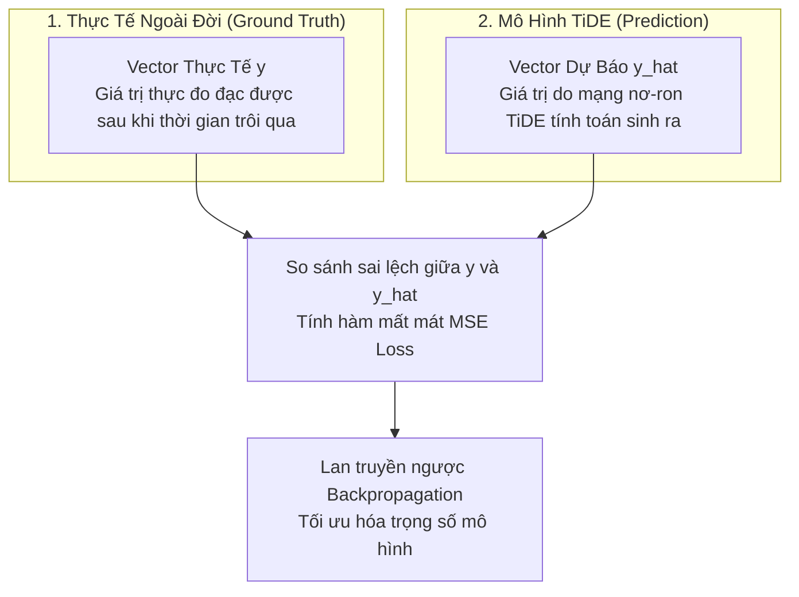

# Giải Thích Chi Tiết Công Thức: Vector Mục Tiêu Tương Lai $y_{L+1:L+H}^{(i)}$

> [!NOTE]
> **Điều hướng tài liệu**: [🏠 Tổng Quan Tài Liệu](../doc/00_tong_quan_tai_lieu.md) • [📖 Chương 3: Thiết Lập Bài Toán](../doc/03_problem_setting.md) • [📚 Chuyên Đề Phân Tích](../README.md#4-chuyên-đề-phân-tích-kỹ-thuật-chuyên-sâu-explanation)  
> 🎯 **Mục tiêu chuyên đề**: Bóc tách chi tiết từng ký tự toán học trong công thức biểu diễn chuỗi tương lai cần dự báo $y_{L+1:L+H}^{(i)} = [y_{L+1}^{(i)}, y_{L+2}^{(i)}, \dots, y_{L+H}^{(i)}]^\top \in \mathbb{R}^H$, giải thích bản chất đại số tuyến tính (vector cột, phép chuyển vị), đối chiếu giá trị thực tế (Ground Truth) và giá trị dự báo, cùng 3 case study thực tế có số liệu cụ thể và mã nguồn PyTorch minh họa.

---

## 1. Đặt Vấn Đề Thực Tế & Động Cơ (Motivation)

Trong bài toán dự báo chuỗi thời gian nhiều bước (**Multi-step Time Series Forecasting**), câu hỏi cốt lõi mà mọi mô hình phải trả lời là:

> *"Nếu đã biết toàn bộ diễn biến dữ liệu trong $L$ bước thời gian quá khứ, làm sao để dự đoán chính xác toàn bộ $H$ bước thời gian tiếp theo trong tương lai?"*

Để thiết lập bài toán một cách chặt chẽ về mặt toán học và lập trình, ta cần một đại lượng chuẩn mực đại diện cho toàn bộ giá trị tương lai này. Đó chính là **Vector mục tiêu tương lai $y_{L+1:L+H}^{(i)}$**.


### Bảng phân định ranh giới trục thời gian

| Giai đoạn | Ký hiệu bước thời gian | Độ dài đoạn | Trạng thái thông tin trong thực tế | Vai trò trong mô hình TiDE |
| :--- | :---: | :---: | :--- | :--- |
| **Quá khứ (Look-back Window)** | $t \in \{1, 2, \dots, L\}$ | $L$ bước | Đã xảy ra, đã ghi nhận đầy đủ 100% | Đầu vào của Dense Encoder |
| **Hiện tại (Current Step)** | $t = L$ | 1 mốc | Thời điểm ra quyết định dự báo | Ranh giới chia cắt quá khứ / tương lai |
| **Tương lai (Forecast Horizon)** | $t \in \{L+1, L+2, \dots, L+H\}$ | $H$ bước | Chưa xảy ra, cần dự báo | Nhãn mục tiêu (Ground Truth) để tính Loss |

---

## 2. Phân Tích Chi Tiết Từng Thành Phần (Atomic Breakdown)

### 2.1. Công Thức Chuẩn Mực

$$
y_{L+1:L+H}^{(i)} = \begin{bmatrix} y_{L+1}^{(i)} \\ y_{L+2}^{(i)} \\ \vdots \\ y_{L+H}^{(i)} \end{bmatrix} = \left[ y_{L+1}^{(i)}, \, y_{L+2}^{(i)}, \, \dots, \, y_{L+H}^{(i)} \right]^\top \in \mathbb{R}^H
$$

### 2.2. Bảng Giải Phẫu Nguyên Tử Ký Hiệu Toán Học

| Ký Tự | Tên Gọi Kỹ Thuật | Ý Nghĩa Bản Chất | Ý Nghĩa Trong Lập Trình (Python / PyTorch) | Ví Dụ Cụ Thể |
| :---: | :--- | :--- | :--- | :--- |
| **$y$** | **Biến mục tiêu (Target Variable)** | Đại lượng chính cần quan sát và dự đoán (doanh số, phụ tải điện, lưu lượng giao thông). Phân biệt với biến phụ ngoại sinh $x$. | Tên cột nhãn trong DataFrame (`df['target']`). | Lượng điện tiêu thụ (kWh). |
| **$(i)$** | **Chỉ số kênh / chuỗi (Channel Index)** | Đại diện cho chuỗi thời gian thứ $i$ trong tập gồm $N$ chuỗi. TiDE áp dụng *Channel Independence* nên mỗi chuỗi được xử lý độc lập. | ID cảm biến, mã SKU sản phẩm hoặc chỉ số cột thứ $i$. | Cảm biến điện căn hộ số 42. |
| **$L$** | **Độ dài nhìn lại (Look-back Window)** | Số lượng bước thời gian lịch sử mà mô hình được phép tiếp nhận làm đầu vào. | Tham số `lookback_len` hoặc `input_chunk_length`. | $L = 720$ (30 ngày trước). |
| **$H$** | **Độ dài khoảng dự báo (Forecast Horizon)** | Số lượng bước thời gian tương lai cần dự đoán đồng thời trong một lần chạy. | Tham số `horizon_len` hoặc `output_chunk_length`. | $H = 24$ (24 giờ ngày mai). |
| **$L+1$** | **Thời điểm bắt đầu tương lai** | Bước thời gian đầu tiên ngay sau hiện tại $L$. | Điểm cắt đầu tiên của mảng tương lai: `slice(L, L+H)`. | Giờ thứ 721 (1 giờ sáng ngày mai). |
| **$L+H$** | **Thời điểm kết thúc tương lai** | Bước thời gian xa nhất trong tương lai mà mô hình cần vươn tới. | Điểm kết thúc của đoạn tương lai. | Giờ thứ 744 (24 giờ đêm mai). |
| **$:$** | **Toán tử lát cắt (Slice Operator)** | Biểu thị một dải thời gian liên tục từ mốc bắt đầu ($L+1$) tới mốc kết thúc ($L+H$). | Cú pháp slice mảng Python: `series[L : L + H]`. | Cắt đoạn từ mốc 721 đến 744. |
| **$[\dots]$** | **Cặp ngoặc vuông** | Biểu diễn một danh sách tuần tự các giá trị số thực có thứ tự thời gian tăng dần. | Mảng 1 chiều (Array hoặc 1D Tensor). | `[1.25, 0.82, ..., 2.65]`. |
| **$\top$** | **Phép chuyển vị (Transpose)** | Biến vector hàng (ngang) thành **vector cột (dọc)** kích thước $H \times 1$ chuẩn trong đại số tuyến tính. | Lệnh `.t()` hoặc `.unsqueeze(-1)` trong PyTorch. | Biến `[1, H]` thành `[H, 1]`. |
| **$\in \mathbb{R}^H$** | **Không gian Euclid $H$ chiều** | Khẳng định vector này chứa đúng $H$ con số thực liên tục. | Shape của Tensor trong PyTorch: `torch.Size([H])`. | Vector chứa đúng 24 số thực. |

---

## 3. Bản Chất Kỹ Thuật & Cơ Chế Toán Học (Under-the-Hood Mechanics)

### 3.1. Tại Sao Phải Dùng Phép Chuyển Vị $\top$ Tạo Vector Cột?

Trong đại số tuyến tính chuẩn, mọi vector mặc định đều là **vector cột** (kích thước $H \times 1$). Khi viết trên một dòng văn bản:
- Dạng hàng ngang $[y_{L+1}, y_{L+2}, \dots, y_{L+H}]$ chỉ là cách viết tiện lợi để tiết kiệm diện tích trang giấy.
- Phép chuyển vị $\top$ biến đổi hàng ngang thành cột thẳng đứng:

$$
\begin{bmatrix} y_{L+1}^{(i)}, & y_{L+2}^{(i)}, & \dots, & y_{L+H}^{(i)} \end{bmatrix}^\top = \begin{bmatrix} y_{L+1}^{(i)} \\ y_{L+2}^{(i)} \\ \vdots \\ y_{L+H}^{(i)} \end{bmatrix}
$$

Điều này đảm bảo tính hợp lệ tuyệt đối của các phép nhân ma trận trọng số trong mô hình TiDE (như tầng Global Linear Skip Connection hoặc tầng đầu ra của Dense Decoder).

### 3.2. Phân Biệt Giá Trị Thực Tế $y$ (Ground Truth) Và Giá Trị Dự Báo $\hat{y}$ (Model Prediction)

Sự hiện diện của dấu mũ `^` (hat) thể hiện ranh giới bản chất giữa **thực tế khách quan** và **phỏng đoán của mô hình**:



- **$y_{L+1:L+H}^{(i)}$ (Không dấu mũ)**: Là **đáp án chuẩn** (Ground Truth). Trong quá trình huấn luyện, vector này được giấu đi và chỉ dùng để chấm điểm sai lệch.
- **$\hat{y}_{L+1:L+H}^{(i)}$ (Có dấu mũ $\hat{}$)**: Là vector kết quả do mạng TiDE tính toán dự phóng ra từ lịch sử quá khứ.
- **Hàm mất mát MSE (Mean Squared Error)** tính toán sai khác giữa hai vector:

$$
\mathcal{L}_{\text{MSE}}^{(i)} = \frac{1}{H} \left\| y_{L+1:L+H}^{(i)} - \hat{y}_{L+1:L+H}^{(i)} \right\|_2^2 = \frac{1}{H} \sum_{t=1}^H \left( y_{L+t}^{(i)} - \hat{y}_{L+t}^{(i)} \right)^2
$$

> [!IMPORTANT]
> Mục tiêu tối thượng của quá trình huấn luyện TiDE là tìm bộ trọng số tối ưu $\Theta^*$ sao cho khoảng cách Euclidean giữa vector dự báo và vector thực tế tiệm cận về 0:
> $$
> \left\| y_{L+1:L+H}^{(i)} - \hat{y}_{L+1:L+H}^{(i)} \right\|_2 \to 0
> $$

### 3.3. Ví Dụ Tính Toán Bằng Số Liệu Cụ Thể (Toy Numerical Example)

Giả sử ta theo dõi chuỗi số liệu gồm 8 mốc thời gian:

$$
\text{Dữ liệu quan sát: } [12.0, \, 14.5, \, 11.0, \, 15.0, \, 16.5, \, 18.0, \, 17.5, \, 20.0]
$$

Thiết lập mô hình với độ dài nhìn lại $L = 5$ và khoảng dự báo $H = 3$:
- **Vector quá khứ** ($t = 1 \dots 5$):
  $$
  y_{1:5} = [12.0, \, 14.5, \, 11.0, \, 15.0, \, 16.5]^\top \in \mathbb{R}^5
  $$
- **Vector mục tiêu tương lai thực tế** ($t = 6 \dots 8$):
  $$
  y_{6:8} = [18.0, \, 17.5, \, 20.0]^\top \in \mathbb{R}^3
  $$
- Giả sử mô hình TiDE dự báo ra:
  $$
  \hat{y}_{6:8} = [17.0, \, 18.0, \, 21.0]^\top \in \mathbb{R}^3
  $$
- Sai số bình phương từng bước:
  - Bước 1 ($t = 6$): $(18.0 - 17.0)^2 = 1.0^2 = 1.0$
  - Bước 2 ($t = 7$): $(17.5 - 18.0)^2 = (-0.5)^2 = 0.25$
  - Bước 3 ($t = 8$): $(20.0 - 21.0)^2 = (-1.0)^2 = 1.0$
- Giá trị hàm mất mát MSE trên khoảng dự báo:
  $$
  \mathcal{L}_{\text{MSE}} = \frac{1.0 + 0.25 + 1.0}{3} = \frac{2.25}{3} = 0.75
  $$

---

## 4. Các Case Study Thực Tế (Real-World Case Studies)

### Case Study 1: Dự Báo Lưới Điện Thông Minh (Electricity Benchmark)

- **Ngữ cảnh nghiệp vụ**: Tổng công ty Điện lực cần dự báo lượng điện tiêu thụ của **321 hộ gia đình** tại TP.HCM trong 24 giờ của ngày tiếp theo để điều phối tải nguồn máy phát.
- **Tần suất ghi nhận**: Từng giờ một (1 Hour / step).
- **Kênh thứ $i = 42$**: Căn hộ số 42 tại khu chung cư Sunrise City.
- **Tham số chuẩn TiDE**: $L = 720$ giờ (30 ngày lịch sử), $H = 24$ giờ (1 ngày tới).
- **Mốc thời gian**:
  - $L+1 = 721$: Giờ thứ nhất của ngày mai (1 giờ sáng).
  - $L+H = 744$: Giờ thứ 24 của ngày mai (12 giờ đêm mai).

Vector mục tiêu thực tế gồm 24 số thực đo đạc từ công tơ:

$$
y_{721:744}^{(42)} = \begin{bmatrix} y_{721}^{(42)} \\ y_{722}^{(42)} \\ \vdots \\ y_{744}^{(42)} \end{bmatrix} = \begin{bmatrix} 1.25 \\ 0.82 \\ \vdots \\ 2.65 \end{bmatrix} \quad (\text{đơn vị: kWh}) \in \mathbb{R}^{24}
$$

---

### Case Study 2: Quản Trị Chuỗi Cung Ứng & Tồn Kho (Walmart M5 Forecasting)

- **Ngữ cảnh nghiệp vụ**: Giám đốc chuỗi cung ứng siêu thị Walmart cần dự đoán nhu cầu tiêu thụ của **30.490 sản phẩm** trong 28 ngày tới để lên kế hoạch nhập hàng, tránh đứt gãy tồn kho.
- **Tần suất ghi nhận**: Từng ngày một (1 Day / step).
- **Kênh thứ $i = \text{"FOODS\_3\_090"}$**: Mặt hàng bánh mì sandwich tại cửa hàng California số 1.
- **Tham số**: $L = 90$ ngày (3 tháng nhìn lại), $H = 28$ ngày (4 tuần dự báo).
- **Mốc thời gian**:
  - $L+1 = 91$: Ngày mai (ngày thứ 91).
  - $L+H = 118$: Ngày thứ 118 (cuối tuần thứ 4).

Vector mục tiêu thực tế thể hiện số chiếc bánh mì bán được mỗi ngày:

$$
y_{91:118}^{(\text{FOODS\_3\_090})} = \begin{bmatrix} 150 \\ 142 \\ 210 \\ \vdots \\ 175 \end{bmatrix} \quad (\text{đơn vị: số lượng bánh}) \in \mathbb{R}^{28}
$$

---

### Case Study 3: Giám Sát Giao Thông Cao Tốc (Traffic / PeMS Dataset)

- **Ngữ cảnh nghiệp vụ**: Sở Giao thông Vận tải California (Caltrans) điều phối đèn tín hiệu và cảnh báo ùn tắc dựa trên dữ liệu từ **862 trạm cảm biến** gắn trên các tuyến cao tốc bang California.
- **Tần suất ghi nhận**: 1 giờ.
- **Kênh thứ $i = 105$**: Cảm biến đặt tại trạm thu phí Long Beach.
- **Tham số chuẩn TiDE**: $L = 720$ (30 ngày trước), $H = 96$ (dự báo trước 4 ngày tiếp theo = 96 giờ).
- **Đại lượng đo lường**: Tỷ lệ chiếm dụng làn đường (Occupancy rate, dao động từ $0.0$ đến $1.0$).

$$
y_{721:816}^{(105)} = \begin{bmatrix} y_{721}^{(105)} \\ y_{722}^{(105)} \\ \vdots \\ y_{816}^{(105)} \end{bmatrix} = \begin{bmatrix} 0.045 \\ 0.038 \\ \vdots \\ 0.682 \end{bmatrix} \in \mathbb{R}^{96}
$$

### Bảng tổng hợp so sánh 3 Case Study

| Tiêu chí so sánh | Case Study 1: Điện Lực | Case Study 2: Bán Lẻ Walmart | Case Study 3: Giao Thông |
| :--- | :--- | :--- | :--- |
| **Tập dữ liệu** | Electricity Benchmark | Walmart M5 Competition | California PeMS Traffic |
| **Kênh thứ $i$** | Hộ gia đình số 42 | Mã SKU bánh mì sandwich | Cảm biến trạm Long Beach |
| **Tần suất quan sát** | Hàng giờ (Hourly) | Hàng ngày (Daily) | Hàng giờ (Hourly) |
| **Độ dài quá khứ $L$** | 720 bước (30 ngày) | 90 bước (3 tháng) | 720 bước (30 ngày) |
| **Độ dài dự báo $H$** | 24 bước (1 ngày) | 28 bước (4 tuần) | 96 bước (4 ngày) |
| **Kích thước vector $y$** | $\mathbb{R}^{24}$ | $\mathbb{R}^{28}$ | $\mathbb{R}^{96}$ |
| **Đơn vị đo lường** | Lượng điện (kWh) | Số lượng sản phẩm (cái) | Tỷ lệ chiếm dụng làn (0.0 - 1.0) |

---

## 5. Minh Họa Bằng Mã Nguồn Thực Thi (PyTorch Code Implementation)

Đoạn mã Python hoàn chỉnh dưới đây minh họa quá trình cắt lát (slicing) vector $y_{1:L}$ và $y_{L+1:L+H}$ từ một chuỗi thời gian, đưa qua mini-batch DataLoader và tính toán sai số MSE chuẩn chỉnh:

```python
import torch
import torch.nn as nn
from torch.utils.data import Dataset, DataLoader


class TimeSeriesWindowDataset(Dataset):
    """Dataset trích xuất các cặp cửa sổ (Quá khứ y_past, Tương lai y_future).
    
    Quy tắc cắt lát:
        - Quá khứ:   y[t : t + L]
        - Tương lai:  y[t + L : t + L + H]
    """
    def __init__(self, full_series: torch.Tensor, lookback_len: int, horizon_len: int):
        self.series = full_series
        self.L = lookback_len
        self.H = horizon_len
        self.num_samples = len(full_series) - lookback_len - horizon_len + 1

    def __len__(self) -> int:
        return self.num_samples

    def __getitem__(self, idx: int):
        # 1. Cắt cửa sổ nhìn lại trong quá khứ: y_(1:L)
        y_past = self.series[idx : idx + self.L]                          # Shape: [L]
        
        # 2. Cắt vector mục tiêu tương lai thực tế: y_(L+1:L+H)
        y_future = self.series[idx + self.L : idx + self.L + self.H]      # Shape: [H]
        
        return y_past, y_future


# ==================== Thực thi kiểm chứng thực nghiệm ====================
if __name__ == "__main__":
    # Thiết lập tính tái lập
    torch.manual_seed(42)
    
    # Giả lập chuỗi thời gian 1000 bước của 1 kênh cảm biến
    T_total = 1000
    L = 720  # Look-back window: 720 bước (ví dụ: 30 ngày)
    H = 96   # Forecast Horizon: 96 bước (ví dụ: 4 ngày)
    
    # Tạo dữ liệu sóng sin giả lập có nhiễu Gaussian
    time_steps = torch.linspace(0, 50, T_total)
    synthetic_series = torch.sin(time_steps) + 0.1 * torch.randn(T_total)
    
    dataset = TimeSeriesWindowDataset(synthetic_series, lookback_len=L, horizon_len=H)
    loader = DataLoader(dataset, batch_size=16, shuffle=False)
    
    # Lấy thử 1 mini-batch đầu tiên
    batch_y_past, batch_y_future = next(iter(loader))
    
    print("=" * 65)
    print("XÁC MINH KÍCH THƯỚC TENSOR TRONG PYTORCH DATALOADER")
    print("=" * 65)
    print(f"Tổng số bước thời gian của chuỗi:      {T_total}")
    print(f"Độ dài cửa sổ nhìn lại (L):             {L}")
    print(f"Độ dài khoảng dự báo (H):              {H}")
    print(f"Số lượng mẫu khả dụng trích xuất được:  {len(dataset)}")
    print(f"Batch Tensor quá khứ y_(1:L):          {batch_y_past.shape}  -> [Batch, L]")
    print(f"Batch Tensor tương lai y_(L+1:L+H):     {batch_y_future.shape}  -> [Batch, H]")
    
    # Giả lập đầu ra dự báo của mô hình TiDE: y_hat có cùng shape [Batch, H]
    dummy_pred_y_hat = batch_y_future + 0.05 * torch.randn_like(batch_y_future)
    
    # Tính hàm mất mát MSE Loss giữa Ground Truth và Prediction
    criterion = nn.MSELoss()
    loss_value = criterion(dummy_pred_y_hat, batch_y_future)
    print(f"Sai số MSE Loss giữa y và y_hat:        {loss_value.item():.6f}")
    print("=" * 65)
```

---

## 6. Đúc Kết & Quy Tắc Cần Nhớ (Key Takeaways)

| Quy tắc | Bản chất kỹ thuật | Lưu ý thực chiến cho Kỹ sư AI |
| :--- | :--- | :--- |
| **Ranh giới không chồng lấn** | Quá khứ kết thúc tại $L$, tương lai bắt đầu tại $L+1$ | Tuyệt đối tránh để lộ nhãn tương lai vào tập đầu vào (**Data Leakage**). |
| **Quy ước chỉ số (Indexing)** | Toán học đánh số từ 1 ($1 \dots L$); Python đánh số từ 0 | Trong Python, đoạn $y_{L+1:L+H}$ được cắt bằng cú pháp `series[L : L + H]`. |
| **Bản chất Vector Cột** | Ký hiệu $\top$ xác định vector thuộc $\mathbb{R}^{H \times 1}$ | Khi tính toán ma trận với Linear layers, cần chú ý kiểm soát trục tensor qua `.unsqueeze(-1)` hoặc `.squeeze(-1)`. |
| **Đối tượng so sánh Loss** | MSE được tính trực tiếp giữa $y_{L+1:L+H}^{(i)}$ và $\hat{y}_{L+1:L+H}^{(i)}$ | Không tính loss trên đoạn quá khứ $y_{1:L}$; chỉ tính trên đoạn dự báo $H$ bước. |

> [!TIP]
> **Tài liệu tham khảo chuyên sâu**:
> - Đọc tiếp [Chương 3: Thiết Lập Bài Toán Dự Báo Đa Biến Trong TiDE](../doc/03_problem_setting.md) để tìm hiểu cách vector $y_{L+1:L+H}^{(i)}$ được tích hợp cùng các biến ngoại sinh động (dynamic covariates $x$) và thuộc tính tĩnh ($a$).
> - Đọc tiếp [Chuyên đề Khối Residual Block](../explanation/section_4_1_residual_block.md) để hiểu cơ chế biến đổi số chiều từ vector đầu vào thành vector dự báo cuối cùng.
