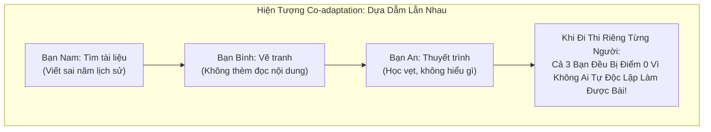
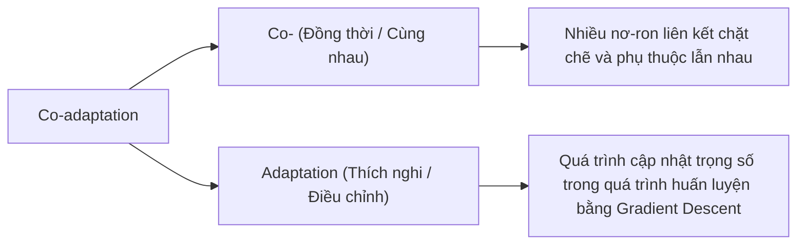
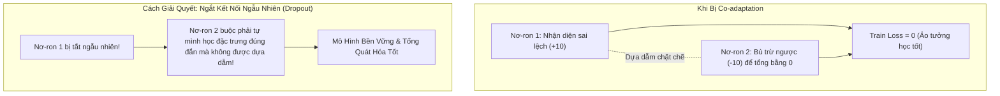
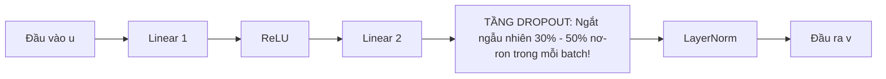

# Thuật Ngữ: Co-adaptation (Sự Đồng Thích Nghi Tai Hại Giữa Các Nơ-ron)

> **Phương pháp tiếp cận Feynman (Feynman Technique)**:  
> *"Nếu bạn không thể giải thích một điều gì đó cho một đứa trẻ 10 tuổi hiểu, thì chính bạn cũng chưa thực sự hiểu nó."*  
> Bài viết này bóc tách hiện tượng **Co-adaptation** từ câu chuyện một nhóm học sinh làm bài tập nhóm nhưng dựa dẫm lẫn nhau, giải thích vì sao cơ chế Dropout trong TiDE là liều thuốc giải độc duy nhất giúp từng nơ-ron trở nên độc lập và mạnh mẽ.

---

## 1. Giải Thích Cho Một Đứa Trẻ 10 Tuổi: Nhóm Bạn Làm Bài Tập Và Người Bạn "Gánh Team"

Hãy tưởng tượng một nhóm gồm **3 bạn học sinh** được cô giáo giao làm chung một bài thuyết trình Lịch sử:
- **Bạn Nam (rất giỏi tìm tài liệu):** Phụ trách toàn bộ phần đọc sách và ghi chép.
- **Bạn Bình (khéo tay):** Phụ trách vẽ tranh minh họa.
- **Bạn An (hoạt ngôn):** Phụ trách đứng lên bục thuyết trình.

Ban đầu mọi thứ có vẻ rất ổn. Nhưng sau một thời gian, một căn bệnh xuất hiện gọi là **"Sự ỷ lại lẫn nhau" (Co-adaptation)**:
- Bạn An **chẳng thèm đọc một chữ nào** trong bài vì nghĩ: *"Đã có bạn Nam lo nội dung rồi, mình chỉ cần đọc vẹt lại thôi!"*
- Bạn Bình **chẳng thèm hiểu nội dung** bức tranh vì nghĩ: *"Đã có bạn An giải thích giùm rồi!"*
- Bạn Nam viết sai một mốc lịch sử nghiêm trọng, nhưng cả An và Bình đều không phát hiện ra vì họ quá tin tưởng Nam!

**Hậu quả**: Khi cô giáo bất ngờ cho thi riêng từng người (tương đương với việc đưa dữ liệu mới vào mô hình), **cả 3 bạn đều bị điểm 0** vì không một ai có khả năng tự giải quyết bài toán độc lập từ đầu đến cuối!

> 💡 **Định nghĩa kiểu Feynman**:  
> **Co-adaptation** là hiện tượng **"các nơ-ron cấu kết và ỷ lại vào nhau"**. Thay vì tự mình học lấy một đặc trưng hữu ích, nơ-ron này lại tìm cách bù trừ hoặc dựa dẫm vào nơ-ron kia. Hậu quả là cả mạng chỉ học vẹt trên tập huấn luyện và sụp đổ hoàn toàn khi gặp dữ liệu thực tế!

---

## 2. Bóc Tách Từng Từ Ngữ Chuyên Ngành (Deconstructing the Jargon)

Tại sao lại gọi là **Co-adaptation**?

| Thành phần | Nghĩa gốc | Ý nghĩa trong Machine Learning | Phản nghĩa / Đối lập |
|:---|:---|:---|:---|
| **Co-** (*Đồng*) | Cùng nhau, phối hợp | Sự phối hợp giữa các nơ-ron trong cùng một tầng hoặc giữa các tầng liền kề. | **Independent** (*Độc lập, riêng lẻ*). |
| **Adaptation** (*Thích nghi*) | Biến đổi để thích nghi | Việc điều chỉnh trọng số $W$ để giảm thiểu hàm mất mát trên tập dữ liệu huấn luyện. | **Maladaptation** (*Không thích nghi, không học được*). |
| **Co-adaptation** (*Đồng thích nghi*) | Đồng thích nghi tai hại | Trạng thái các nơ-ron sửa lỗi cho nhau một cách cục bộ, tạo ra một mạng lưới mong manh dễ gãy khi dữ liệu thay đổi. | **Feature Diversity** (*Đa dạng hóa đặc trưng độc lập*). |

---

## 3. Trực Quan Hóa Bằng Bảng Dữ Liệu (The "Aha!" Moment)

Hãy xem chuyện gì xảy ra bên trong tầng nơ-ron khi có và không có hiện tượng Co-adaptation:

| Tình Huống | Nơ-ron A (Dò tìm xu hướng) | Nơ-ron B (Bù trừ sai số) | Trạng Thái Mạng Nơ-ron | Kết Quả Trên Dữ Liệu Mới (Test Set) |
|:---|:---:|:---:|:---|:---|
| **Bị Co-adaptation (Không dùng Dropout)** | Đoán sai lệch $+15.0$ đơn vị | Tự điều chỉnh trọng số âm $-15.0$ để "vá lỗi" cho nơ-ron A | 💥 Hai nơ-ron cấu kết thành một cặp bài trùng giả tạo, trên tập Train loss bằng 0 tuyệt đối! | 🔴 **Sụp đổ hoàn toàn**: Dữ liệu thực tế thay đổi một chút, cặp bài trùng lệch pha và sai số nhân đôi! |
| **Khử Co-adaptation (Bật Dropout $p=0.3$)** | Buộc phải tự học để giảm sai số về gần $0$ | Buộc phải tự học đặc trưng khác độc lập (như ngày lễ, giờ cao điểm) | ✅ Mỗi nơ-ron là một chuyên gia độc lập, không phụ thuộc vào sự tồn tại của nơ-ron bên cạnh! | 🟢 **Dự báo chuẩn xác**: Dù mất đi vài nơ-ron ngẫu nhiên, các nơ-ron còn lại vẫn gánh vác mô hình mượt mà. |

> 🎯 **Khoảnh khắc "Aha!"**:  
> Co-adaptation chính là nguồn gốc sâu xa của căn bệnh **Overfitting (Học vẹt)**!  
> Nếu các nơ-ron cấu kết với nhau để "học thuộc lòng" từng mẫu dữ liệu tập train, mô hình sẽ cực kỳ mong manh. Chỉ cần tách rời chúng ra một cách ngẫu nhiên trong quá trình học, từng nơ-ron sẽ buộc phải tự thân vận động và trở thành một nơ-ron mạnh mẽ độc lập!

---

## 4. Thách Thức Kỹ Thuật: Vì Sao Mạng Sâu Dày Đặc Dễ Bị Co-adaptation?

Trong các mạng nơ-ron dày đặc (**Dense MLP** như TiDE):
1. **Mật độ kết nối cực lớn (Fully Connected):** Mọi nơ-ron ở tầng trước đều nối với mọi nơ-ron ở tầng sau. Sự tự do kết nối quá mức này khiến các nơ-ron rất dễ hình thành các liên minh ngầm để bù trừ lỗi cho nhau.
2. **Quy tắc cập nhật đồng thời (Simultaneous Weight Updates):** Trong quá trình lan truyền ngược (Backpropagation), tất cả các trọng số đều được cập nhật cùng một lúc. Nơ-ron $B$ có thể dễ dàng thay đổi để thích nghi với sai sót của nơ-ron $A$, thay vì sửa chữa bản thân để nhận diện đúng đặc trưng khách quan từ dữ liệu.

---

## 5. Mô Hình TiDE Hóa Giải Co-adaptation Như Thế Nào?

Bài báo TiDE sử dụng một vũ khí khắc chế kinh điển nhưng cực kỳ hiệu quả: **Dropout (Srivastava et al., 2014)** được tích hợp trực tiếp bên trong từng khối **Residual Block (Mục 4.1)**.

### Cơ Chế TiDE Dập Tắt Co-adaptation:
- **Tỷ lệ Dropout (`dropoutLevel`):** Nhóm tác giả TiDE thiết lập tỷ lệ Dropout từ `0.3` đến `0.5` (tức là ngẫu nhiên "đóng băng" 30% đến 50% nơ-ron trong mỗi lượt huấn luyện).
- **Phá vỡ liên minh ngầm:** Vì một nơ-ron không bao giờ biết trước nơ-ron bên cạnh mình có bị tắt hay không, nó **không thể dựa dẫm vào ai cả**!
- **Tập hợp mô hình ngầm (Implicit Ensemble):** Mỗi batch huấn luyện tương đương với một kiến trúc mạng con khác nhau. Khi chạy thực tế (Inference), toàn bộ nơ-ron cùng bật lên, hoạt động như một hội đồng chuyên gia độc lập bỏ phiếu, đem lại kết quả dự báo cực kỳ ổn định trên cả 7 benchmark LTTF.

---

## 6. Tổng Kết 30 Giây (The Elevator Pitch)

1. **Co-adaptation là gì?**  
   Là hiện tượng các nơ-ron trong mạng dựa dẫm và bù trừ sai số cho nhau, dẫn đến học vẹt trên tập huấn luyện và sụp đổ khi gặp dữ liệu thực tế.
2. **Tác hại lớn nhất là gì?**  
   Là thủ phạm trực tiếp gây ra hiện tượng Overfitting, làm suy giảm nghiêm trọng khả năng tổng quát hóa của các mô hình mạng nơ-ron sâu.
3. **TiDE giải quyết bằng cách nào?**  
   Tích hợp tầng Dropout với tỷ lệ $0.3 - 0.5$ vào từng khối Residual Block, buộc từng nơ-ron phải tự học các đặc trưng độc lập và bền vững.
