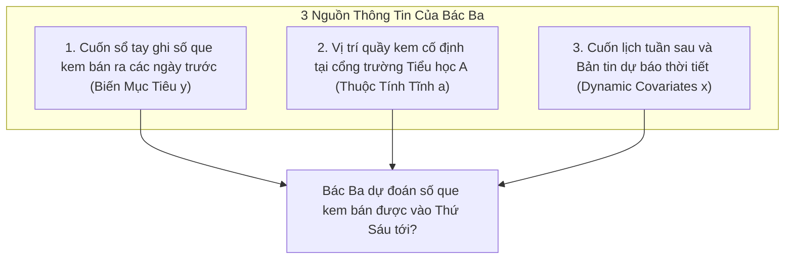
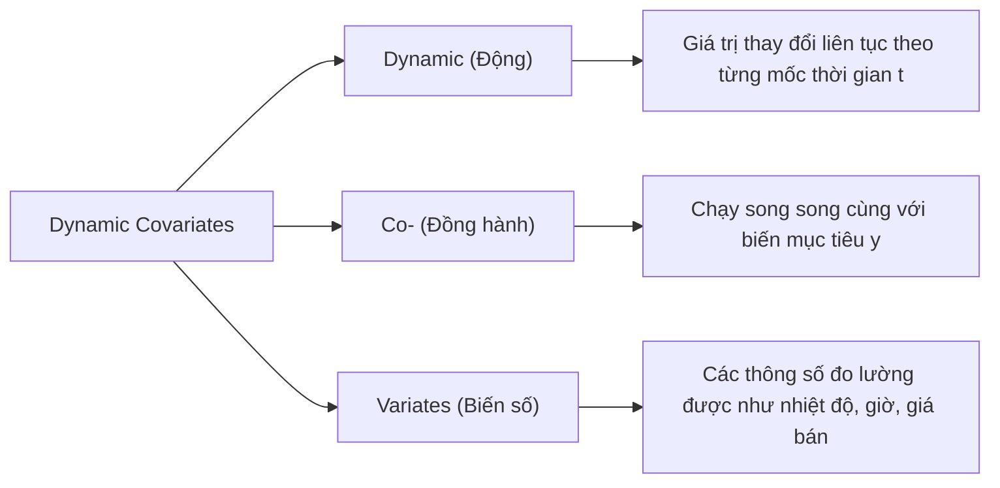
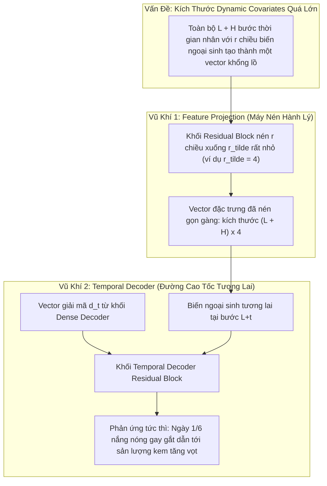

# Thuật Ngữ: Dynamic Covariates (Biến Ngoại Sinh Động Theo Thời Gian)

> **Phương pháp tiếp cận Feynman (Feynman Technique)**:  
> *"Nếu bạn không thể giải thích một điều gì đó cho một đứa trẻ 10 tuổi hiểu, thì chính bạn cũng chưa thực sự hiểu nó."*  
> Bài viết này bóc tách thuật ngữ **Dynamic Covariates** từ câu chuyện đời thường giản dị nhất, sau đó nâng dần lên góc nhìn toán học và cách thức mô hình **TiDE** chinh phục nó.

---

## 1. Giải Thích Cho Một Đứa Trẻ 10 Tuổi: Câu Chuyện Quầy Bán Kem Của Bác Ba

Hãy tưởng tượng bác Ba mở một quầy bán kem tươi trước cổng trường học. Bác Ba muốn biết: **"Thứ Sáu tuần sau bác sẽ bán được bao nhiêu cây kem?"** để chuẩn bị sẵn nguyên liệu sữa tươi và bánh ốc quế.

Bác Ba có 3 nguồn thông tin trên bàn làm việc:

1. **Cuốn sổ ghi số que kem các ngày trước**:
   - Thứ Hai bán 50 que, Thứ Ba 60 que, Thứ Tư 55 que...
   - Đây chính là **Biến mục tiêu trong quá khứ ($y$)** — thứ bác Ba muốn nhìn lại để tìm quy luật buôn bán.
2. **Quầy kem đặt ở cổng trường Tiểu học A**:
   - Vị trí này cố định, không bao giờ thay đổi dù là hôm qua, hôm nay hay tuần sau.
   - Đây là **Thuộc tính tĩnh (Static Attribute $a$)**.
3. **Cuốn lịch học sinh và Bản tin dự báo thời tiết**:
   - Bác Ba lật cuốn lịch tuần sau ra xem và thấy ngay:
     - *Thứ Sáu tới là ngày 1/6 (Quốc tế Thiếu nhi)* $\to$ chắc chắn học sinh sẽ được liên hoan và mua kem rất đông!
     - *Dự báo thời tiết Thứ Sáu tới*: Trời nắng nóng gay gắt lên tới $39^\circ\text{C}$!
     - *Giờ tan trường*: 11 giờ trưa.
   - Những thông tin này **thay đổi liên tục theo từng ngày** (gọi là *Động - Dynamic*) và bác Ba **đã biết chắc chắn trước từ hôm nay mà không cần đợi đến Thứ Sáu mới biết**!

> 💡 **Định nghĩa kiểu Feynman**:  
> **Dynamic Covariates** chính là những **"tờ lịch ghi chú tương lai"** — những thông tin thay đổi theo thời gian mà bạn **đã nắm chắc trong lòng bàn tay từ trước**, giúp bạn soi đường để đoán biến số chính.

---

## 2. Bóc Tách Từng Từ Ngữ Chuyên Ngành (Deconstructing the Jargon)

Tại sao các nhà khoa học lại đặt tên là **Dynamic Covariates** mà không gọi đơn giản là "thời gian" hay "thời tiết"?

| Thành phần | Nghĩa gốc | Ý nghĩa trong Machine Learning | Phản nghĩa / Đối lập |
|:---|:---|:---|:---|
| **Dynamic** (*Động*) | Chuyển động, biến đổi liên tục theo thời gian | Giá trị của biến tại thời điểm $t=1$ khác $t=2$, khác $t=10$. | **Static** (*Tĩnh*): Mã định danh cửa hàng, vị trí địa lý, nhóm chủng loại hàng hóa. |
| **Co-** (*Đồng hành*) | Cùng nhau, song hành | Nó biến thiên song song bên cạnh chuỗi mục tiêu $y_t$, tác động trực tiếp tới $y_t$. | **Target** (*Mục tiêu chính*): Giá trị $y$ mà ta phải dự đoán. |
| **Variates** (*Biến số*) | Đại lượng có thể đo lường | Là các con số cụ thể: $38^\circ\text{C}$, giờ thứ 14 trong ngày, mã giảm giá 20%... | **Constant** (*Hằng số bất biến*). |

---

## 3. Trực Quan Hóa Bằng Bảng Dữ Liệu (The "Aha!" Moment)

Điểm kỳ diệu nhất của **Dynamic Covariates** nằm ở ranh giới giữa **Quá khứ** và **Tương lai**. Hãy nhìn vào bảng dữ liệu sau:

| Thời Điểm $t$ | Giai Đoạn | Số Que Kem Bán Ra ($y_t$ - Mục Tiêu) | Giờ Trong Ngày ($x_{t,1}$) | Nhiệt Độ Dự Báo ($x_{t,2}$) | Có Phải Ngày Lễ? ($x_{t,3}$) |
|:---:|:---:|:---:|:---:|:---:|:---:|
| 1 | Quá khứ ($t \le L$) | **50** | 10:00 | $32^\circ\text{C}$ | Không (0) |
| 2 | Quá khứ ($t \le L$) | **85** | 12:00 | $36^\circ\text{C}$ | Không (0) |
| ... | ... | ... | ... | ... | ... |
| $L$ (Hiện tại) | Quá khứ ($t \le L$) | **60** | 17:00 | $33^\circ\text{C}$ | Không (0) |
| **$L+1$** | **Tương lai ($t > L$)** | ❓ *(Ẩn - Cần dự báo)* | **10:00** *(Đã biết)* | **$38^\circ\text{C}$** *(Đã biết)* | **Có (1)** *(Đã biết)* |
| **$L+2$** | **Tương lai ($t > L$)** | ❓ *(Ẩn - Cần dự báo)* | **12:00** *(Đã biết)* | **$39^\circ\text{C}$** *(Đã biết)* | **Có (1)** *(Đã biết)* |
| **$L+H$** | **Tương lai ($t > L$)** | ❓ *(Ẩn - Cần dự báo)* | **17:00** *(Đã biết)* | **$35^\circ\text{C}$** *(Đã biết)* | **Có (1)** *(Đã biết)* |

> 🎯 **Khoảnh khắc "Aha!"**:  
> Nhìn vào các dòng **Tương lai**: Giá trị mục tiêu $y_{L+1:L+H}$ bị dấu hỏi chấm che khuất (đó là thứ ta phải đi tìm).  
> Nhưng tất cả các cột $x_{t}$ bên cạnh **đều đã sáng tỏ và biết trước 100%**!  
> Nếu một mô hình dự báo bỏ qua các cột $x_t$ tương lai này, mô hình đó chẳng khác nào một người đi trong đêm tối mà tự lấy tay bịt mắt mình lại!

---

## 4. Tại Sao Các Mô Hình Khác Lại "Bó Tay" Trước Dynamic Covariates?

Trước khi mô hình TiDE ra đời, việc đưa Dynamic Covariates vào các mô hình dự báo dài hạn gặp phải những rào cản kỹ thuật rất lớn:

### 1. Mô hình Tuyến tính (DLinear, NLinear)
- DLinear phân rã chuỗi mục tiêu $y$ thành Trend (Xu hướng) và Seasonal (Mùa vụ) bằng một phép chiếu tuyến tính từ $L \to H$.
- Nếu nhét thêm $r$ chiều covariates cho cả $L+H$ bước, kích thước ma trận trọng số sẽ bùng nổ, phá vỡ cấu trúc giải tích tuyến tính và làm giảm độ chính xác nghiêm trọng. Vì vậy tác giả DLinear đành phải **bỏ rơi hoàn toàn các biến covariates**.

### 2. Mô hình Transformer (PatchTST nguyên bản, Informer)
- PatchTST chia chuỗi thời gian thành các "miếng vá" (patches). Mỗi patch gom nhiều bước thời gian liên tiếp của một kênh đơn lẻ.
- Cách tiếp cận này rất khó để ghép các biến phụ $x_t$ vào từng bước thời gian chi tiết của tương lai mà không làm bùng nổ số lượng token của cơ chế Self-Attention $O(N_{\text{patch}}^2)$.

---

## 5. TiDE Chinh Phục Dynamic Covariates Như Thế Nào?

Nhóm tác giả TiDE (Google Research) đã đưa ra lời giải cực kỳ thông minh thông qua hai "vũ khí bí mật":

### Vũ khí 1: Feature Projection (Chiếc máy nén hành lý)
- Dynamic covariates có thể có hàng chục chiều ($r$). Nếu trải phẳng ra cả đoạn $L+H$, vector đầu vào sẽ dài dằng dặc $(L+H) \times r$.
- TiDE đặt một trạm kiểm soát nén: dùng một Residual Block chiếu mỗi vector $x_t \in \mathbb{R}^r$ xuống một vector tí hon $\tilde{x}_t \in \mathbb{R}^{\tilde{r}}$ (ví dụ $\tilde{r} = 4$).
- Hành lý được nén gọn gàng trước khi đưa vào Dense Encoder mà không làm mất mát các thông tin cốt lõi.

### Vũ khí 2: Temporal Decoder (Đường cao tốc cho sự kiện tương lai)
- Giả sử tại bước tương lai $L+5$ là ngày Quốc tế Thiếu nhi 1/6.
- Ở các mô hình khác, thông tin "1/6" này bị trộn chung vào bộ nhớ toàn cục, khi giải mã ra có thể bị "pha loãng" hoặc quên mất.
- Ở TiDE, tác giả xây dựng một **Temporal Decoder**: Tại đúng bước $L+5$, mô hình lấy vector giải mã $d_{L+5}$ ghép trực tiếp với chính biến ngoại sinh của ngày hôm đó $\tilde{x}_{L+5}$.
- Điều này tạo ra một **đường dẫn tắt (highway)**: Khi có sự kiện đặc biệt ở bước nào, tín hiệu sẽ bắn thẳng vào dự báo của bước đó ngay lập tức!

---

## 6. Tổng Kết 30 Giây (The Elevator Pitch)

1. **Dynamic Covariates là gì?**  
   Là những biến số phụ thay đổi liên tục theo thời gian (giờ trong ngày, ngày lễ, nhiệt độ dự báo, kế hoạch khuyến mãi) mà ta **đã biết trước toàn bộ** từ quá khứ đến tương lai.
2. **Khác gì với Static Attributes?**  
   Static attributes không bao giờ đổi theo thời gian (như mã cửa hàng, thành phố). Dynamic covariates nhảy số theo từng mốc thời gian.
3. **Tại sao TiDE chiến thắng nhờ nó?**  
   TiDE dùng **Feature Projection** để nén gọn biến ngoại sinh và **Temporal Decoder** để tạo "đường cao tốc" dẫn truyền tác động của sự kiện tương lai thẳng tới kết quả dự báo, giúp mô hình vượt DeepAR **20%** và bỏ xa các mô hình "mù covariates" như PatchTST trên tập dữ liệu Walmart M5.
