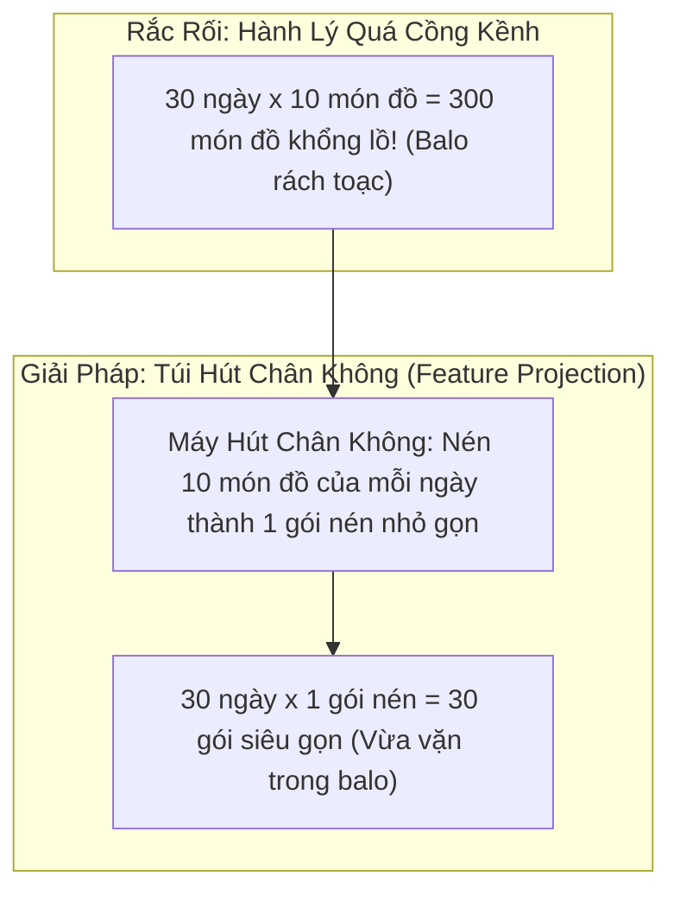
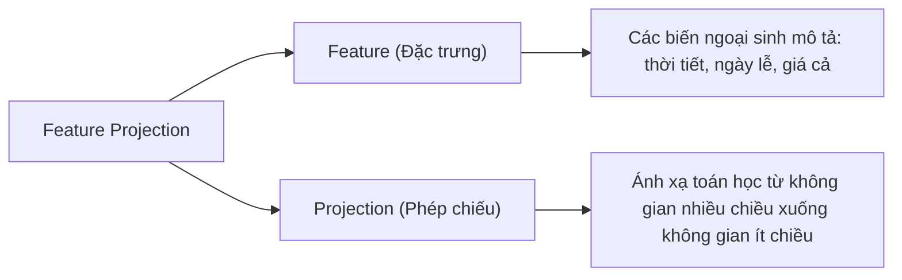
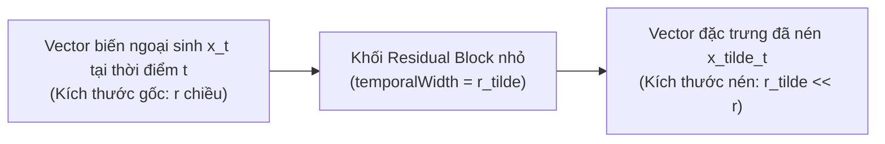

# Thuật Ngữ: Feature Projection (Chiếu Giảm Chiều Đặc Trưng Theo Thời Gian)

> **Phương pháp tiếp cận Feynman (Feynman Technique)**:  
> *"Nếu bạn không thể giải thích một điều gì đó cho một đứa trẻ 10 tuổi hiểu, thì chính bạn cũng chưa thực sự hiểu nó."*  
> Bài viết này bóc tách khái niệm **Feature Projection** trong mô hình TiDE từ câu chuyện đóng gói hành lý du lịch, sau đó phân tích bản chất toán học và tác dụng sống còn của nó đối với bộ nhớ máy tính.

---

## 1. Giải Thích Cho Một Đứa Trẻ 10 Tuổi: Chiếc Balo Đi Cắm Trại Và Túi Hút Chân Không

Hãy tưởng tượng bạn chuẩn bị đi cắm trại liên tục trong vòng **30 ngày**. Mỗi ngày, bạn phải chuẩn bị sẵn **10 món đồ lặt vặt** khác nhau: đèn pin, áo ấm, pin dự phòng, la bàn, hộp quẹt, bình xịt côn trùng, kem chống nắng, v.v.

Bây giờ bạn gặp một rắc rối lớn:
- Nếu bạn cứ để nguyên 10 món đồ cồng kềnh cho từng ngày rồi nhét hết vào balo:  
  **30 ngày $\times$ 10 món = 300 món đồ đồ sộ!**  
  Chiếc balo của bạn sẽ rách toạc ngay lập tức, và bạn cũng không thể nào vác nổi trên vai.

**Cách giải quyết thông minh**:
Bạn mua một chiếc **máy hút chân không**. Với đồ đạc của mỗi ngày, bạn ép chặt 10 món đó lại thành **1 gói nén tí hon**, chỉ giữ lại những gì thực sự quan trọng và chiếm rất ít thể tích. Khi đó, balo của bạn chỉ cần chứa 30 gói nén nhỏ nhắn, nhẹ nhàng và tiện lợi.

> 💡 **Định nghĩa kiểu Feynman**:  
> **Feature Projection** trong TiDE chính là chiếc **"máy hút chân không"**. Nó nén các thông tin ngoại sinh cồng kềnh tại mỗi bước thời gian thành một gói đặc trưng siêu nhỏ gọn trước khi xếp vào bộ nhớ của mô hình.

---

## 2. Bóc Tách Từng Từ Ngữ Chuyên Ngành (Deconstructing the Jargon)

Tại sao lại gọi là **Feature Projection** mà không gọi đơn giản là "nén dữ liệu"?

| Thành phần | Nghĩa gốc | Ý nghĩa trong Machine Learning | Phản nghĩa / Đối lập |
|:---|:---|:---|:---|
| **Feature** (*Đặc trưng*) | Dấu hiệu nhận biết, thuộc tính | Các biến số ngoại sinh mô tả bối cảnh tại thời điểm $t$ (nhiệt độ, độ ẩm, mã sự kiện...). | **Raw Data** (*Dữ liệu thô chưa qua chọn lọc*). |
| **Projection** (*Phép chiếu*) | Chiếu bóng, rọi ánh sáng | Ánh xạ một vector từ không gian có số chiều lớn ($r$) sang không gian có số chiều nhỏ hơn ($\tilde{r} \ll r$), tương tự chiếc bóng 2D của một bàn tay 3D in lên tường. | **Expansion** (*Phép mở rộng số chiều*). |

---

## 3. Trực Quan Hóa Bằng Bảng Dữ Liệu (The "Aha!" Moment)

Hãy nhìn vào sự bùng nổ số chiều khủng khiếp nếu không có Feature Projection:

Giả sử ta xét bài toán dự báo phụ tải điện với:
- Cửa sổ nhìn lại: $L = 720$ bước (30 ngày).
- Khoảng dự báo tương lai: $H = 720$ bước (30 ngày).
- Tổng số bước thời gian cần xử lý: $L + H = 1440$ bước thời gian.
- Số lượng biến ngoại sinh tại mỗi bước: $r = 20$ chiều (giờ, ngày, tháng, nhiệt độ, tốc độ gió, giá điện, ngày nghỉ...).

| Phương Án | Số Bước Thời Gian | Kích Thước Biến Ngoại Sinh | Tổng Số Chiều Khi Trải Phẳng (Flatten) | Tình Trạng Bộ Nhớ & Mô Hình |
|:---|:---:|:---:|:---:|:---|
| **Không dùng Projection** | 1,440 | $r = 20$ | **$1440 \times 20 = 28,800$ chiều!** | 💥 Quá tải bộ nhớ, bùng nổ tham số, mạng học vẹt (overfitting). |
| **Có Feature Projection (TiDE)** | 1,440 | $\tilde{r} = 4$ *(nén bằng Residual Block)* | **$1440 \times 4 = 5,760$ chiều!** | ✅ Gọn nhẹ gấp **5 lần**, tính toán mượt mà, chống quá khớp vượt bậc. |

> 🎯 **Khoảnh khắc "Aha!"**:  
> Nếu bạn trải phẳng 28,800 con số để đưa vào một tầng ẩn có 512 nơ-ron, riêng tầng đầu tiên đã tốn tới:  
> $28,800 \times 512 \approx \mathbf{14.7 \text{ triệu tham số}}$!  
> Nhưng khi dùng Feature Projection nén xuống $\tilde{r} = 4$, số tham số giảm ngay xuống chỉ còn:  
> $5,760 \times 512 \approx \mathbf{2.9 \text{ triệu tham số}}$ (giảm hơn **80%** gánh nặng tính toán)!

---

## 4. Tại Sao Các Mô Hình Khác Lại Bị Hạn Chế?

1. **Các mô hình MLP đơn giản**: Nếu không có cơ chế nén theo từng bước thời gian mà cứ thế nối toàn bộ $x_{1:L+H}$ vào đầu vào, mạng sẽ bị hiện tượng **"Lời nguyền số chiều" (Curse of Dimensionality)**. Số lượng tham số quá lớn khiến mô hình học vẹt trên tập huấn luyện và sai lệch hoàn toàn khi gặp dữ liệu thực tế.
2. **Các mô hình Transformer (Informer, Autoformer)**: Cố gắng mã hóa từng bước thời gian thành các vector nhúng (embedding) có kích thước lớn ($d_{\text{model}} = 512$), khiến ma trận Attention giữa các bước thời gian phình to thành $1440 \times 1440 \times 512$, dẫn tới tràn bộ nhớ GPU (Out-Of-Memory).

---

## 5. Mô Hình TiDE Triển Khai Feature Projection Như Thế Nào?

TiDE thiết kế một khối chiếu đặc trưng cực kỳ thanh lịch và độc lập theo từng bước thời gian:

Công thức toán học:

$$
\tilde{x}_t^{(i)} = \text{ResidualBlock}(x_t^{(i)}) \in \mathbb{R}^{\tilde{r}} \quad \forall t \in \{1, 2, \dots, L+H\}
$$

- Điểm mấu chốt: **Trọng số của Residual Block này được chia sẻ chung cho tất cả các bước thời gian $t$**.
- Nhờ đó, mô hình học được một bộ quy tắc nén đặc trưng nhất quán, bảo toàn thông tin quan trọng nhất của các biến ngoại sinh mà chi phí tham số gần như bằng 0.

---

## 6. Tổng Kết 30 Giây (The Elevator Pitch)

1. **Feature Projection là gì?**  
   Là bước nén số chiều của các biến ngoại sinh tại từng thời điểm $t$ từ không gian lớn $r$ xuống không gian nhỏ $\tilde{r} \ll r$ (thường chọn $\tilde{r} = 4$).
2. **Giải quyết vấn đề gì?**  
   Ngăn chặn hiện tượng bùng nổ số chiều khi trải phẳng $(L+H) \times r$ điểm thời gian vào mạng nơ-ron, giảm hơn 80% số tham số không cần thiết.
3. **Tại sao TiDE vượt trội?**  
   Dùng một khối Residual Block nhỏ dùng chung cho mọi bước thời gian, vừa đảm bảo tính phi tuyến tính vừa giữ cho mô hình chạy nhanh gấp 5-10 lần các mạng Transformer.
