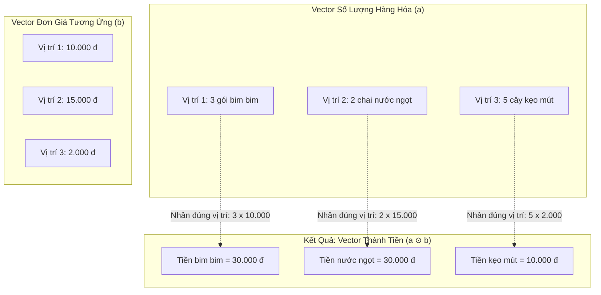
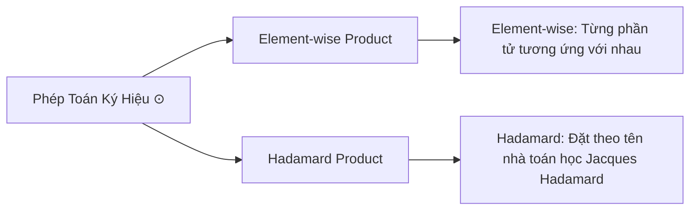
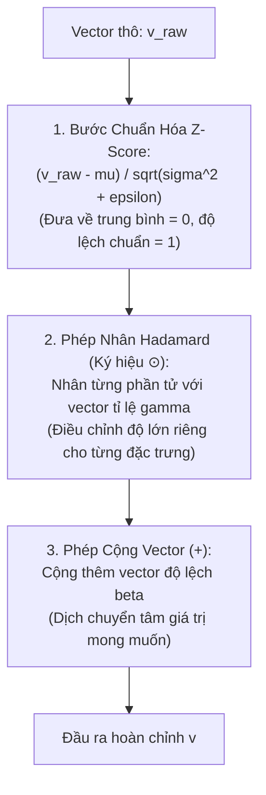

# Thuật Ngữ: Ký Hiệu Phép Nhân Hadamard / Element-wise Product ($\odot$)

> **Phương pháp tiếp cận Feynman (Feynman Technique)**:  
> *"Nếu bạn không thể giải thích một điều gì đó cho một đứa trẻ 10 tuổi hiểu, thì chính bạn cũng chưa thực sự hiểu nó."*  
> Bài viết này giải mã ký hiệu hình tròn có dấu chấm ở giữa **$\odot$** từ câu chuyện chiếc máy tính tiền siêu thị, phân biệt rõ ràng với phép nhân ma trận thông thường và chỉ ra lý do tại sao nó là trái tim của tầng chuẩn hóa Layer Normalization trong mô hình TiDE.

---

## 1. Giải Thích Cho Một Đứa Trẻ 10 Tuổi: Chiếc Máy Tính Tiền Tại Quầy Siêu Thị

Hãy tưởng tượng bạn cùng mẹ đi siêu thị mua đồ ăn vặt. Trong giỏ hàng của bạn có:
- **3 gói bim bim** (ở vị trí số 1).
- **2 chai nước ngọt** (ở vị trí số 2).
- **5 cây kẹo mút** (ở vị trí số 3).

Trên màn hình máy tính tiền của cô thu ngân có sẵn bảng giá niêm yết:
- Bim bim: **10.000đ / gói** (vị trí số 1).
- Nước ngọt: **15.000đ / chai** (vị trí số 2).
- Kẹo mút: **2.000đ / cây** (vị trí số 3).



Cô thu ngân sẽ tính tiền như thế nào?
- Cô lấy: $3 \times 10.000đ = 30.000đ$ (tiền bim bim).
- Lấy: $2 \times 15.000đ = 30.000đ$ (tiền nước ngọt).
- Lấy: $5 \times 2.000đ = 10.000đ$ (tiền kẹo mút).

Tuyệt đối **không bao giờ** có chuyện cô thu ngân lấy số lượng bim bim nhân chéo với giá của kẹo mút! **Vị trí nào trong giỏ hàng sẽ nhân với đúng vị trí đó trên bảng giá**.

> 💡 **Định nghĩa kiểu Feynman**:  
> Ký hiệu **$\odot$** (đọc là *Hadamard Product* hay *Element-wise Product*) chỉ đơn giản là phép nhân **"ghép đôi đúng vị trí"**: Phần tử thứ nhất nhân với phần tử thứ nhất, phần tử thứ hai nhân với phần tử thứ hai, cứ thế cho đến hết.

---

## 2. Bóc Tách Từng Từ Ngữ Chuyên Ngành (Deconstructing the Jargon)

Phép toán này có hai tên gọi phổ biến trong toán học và trí tuệ nhân tạo:



| Tên gọi | Nguồn gốc / Bản chất | Ý nghĩa thực tế |
|:---|:---|:---|
| **Element-wise Product** | Thuật ngữ mô tả chức năng | Phép nhân thực hiện độc lập trên từng cặp phần tử có cùng chỉ số tọa độ $(i, j)$. |
| **Hadamard Product** | Tên gọi vinh danh | Đặt theo tên nhà toán học người Pháp **Jacques Hadamard** (1865 – 1963). |
| **Schur Product** | Tên gọi thay thế | Đôi khi được gọi là tích Schur theo nhà toán học Issai Schur. |

### So Sánh 3 Phép Nhân Dễ Nhầm Lẫn Trong Đại Số Tuyến Tính:
1. **Phép nhân từng phần tử ($a \odot b$)**: Hai vector cùng chiều nhân từng cặp vị trí tương ứng, cho ra một **vector mới có cùng kích thước**.
2. **Tích vô hướng ($a \cdot b$ hay $a^\top b$)**: Lấy các phần tử tương ứng nhân với nhau rồi **cộng dồn toàn bộ lại**, cho ra **một con số thực duy nhất (Scalar)**.
3. **Phép nhân ma trận thông thường ($A \times B$ hay $A B$)**: Lấy từng hàng của ma trận thứ nhất nhân tích vô hướng với từng cột của ma trận thứ hai.

---

## 3. Trực Quan Hóa Bằng Công Thức & Mã Nguồn (The "Aha!" Moment)

### 3.1. Dạng Toán Học Tổng Quát
Cho hai vector $a, b \in \mathbb{R}^d$ có cùng số chiều $d$:

$$
a = \begin{bmatrix} a_1 \\ a_2 \\ \vdots \\ a_d \end{bmatrix}, \quad b = \begin{bmatrix} b_1 \\ b_2 \\ \vdots \\ b_d \end{bmatrix}
$$

Khi đó, tích Hadamard $a \odot b$ được định nghĩa là:

$$
a \odot b = \begin{bmatrix} a_1 \times b_1 \\ a_2 \times b_2 \\ \vdots \\ a_d \times b_d \end{bmatrix} \in \mathbb{R}^d
$$

Tương tự đối với hai ma trận cùng kích thước $A, B \in \mathbb{R}^{m \times n}$:

$$
(A \odot B)_{ij} = A_{ij} \times B_{ij}
$$

### 3.2. Trong Mã Nguồn Lập Trình (Python / PyTorch / NumPy)
Trong lập trình thực tế, các thư viện đều mặc định toán tử dấu nhân `*` chính là phép nhân $\odot$:

```python
import torch

# Khởi tạo 2 vector cùng kích thước 3 phần tử
a = torch.tensor([2.0, 5.0, 3.0])
b = torch.tensor([4.0, 2.0, 10.0])

# 1. Phép nhân Hadamard (Element-wise) ký hiệu là ⊙:
c_hadamard = a * b          # Hoặc torch.mul(a, b)
print(c_hadamard)           # Kết quả: tensor([ 8., 10., 30.])

# 2. Phép nhân ma trận thông thường (Matrix Multiplication):
# Trong PyTorch dùng toán tử @ hoặc torch.matmul
c_matrix = torch.dot(a, b)  # 2*4 + 5*2 + 3*10 = 8 + 10 + 30 = 48.0
print(c_matrix)             # Kết quả: tensor(48.)
```

---

## 4. Tại Sao Lại Dùng $\odot$ Thay Vì Phép Nhân Ma Trận Thông Thường?

Hãy so sánh sự khác biệt sống còn về số lượng tài nguyên máy tính giữa hai cách tiếp cận:

Giả sử mạng nơ-ron có kích thước vector đặc trưng là $d = 1024$:

| Phương Án Biến Đổi | Phép Toán | Số Lượng Tham Số Cần Lưu | Độ Phức Tạp Tính Toán |
|:---|:---:|:---:|:---:|
| **Nhân ma trận thông thường** | $W \times u$ | $1024 \times 1024 = \mathbf{1.048.576 \text{ tham số}}$! | $O(d^2)$ (Rất tốn kém bộ nhớ) |
| **Nhân từng phần tử ($\odot$)** | $u \odot \gamma$ | Đúng **$1024 \text{ tham số}$** duy nhất! | $O(d)$ (**Tiết kiệm 1000 lần** bộ nhớ!) |

> 🎯 **Khoảnh khắc "Aha!"**:  
> Phép nhân từng phần tử $\odot$ cho phép mô hình **điều chỉnh biên độ của từng đặc trưng độc lập** mà không làm xáo trộn hay pha trộn các đặc trưng với nhau, với chi phí bộ nhớ nhỏ hơn hàng nghìn lần so với một ma trận đầy đủ!

---

## 5. Ứng Dụng Trong Mô Hình TiDE: Tầng Chuẩn Hóa Layer Normalization

Đây chính là công thức xuất hiện ở cuối mỗi khối **Residual Block** trong bài báo TiDE:

$$
v = \frac{v_{\text{raw}} - \mu}{\sqrt{\sigma^2 + \epsilon}} \odot \gamma + \beta
$$

Hãy bóc tách từng bộ phận trong công thức này:



1. **Phần phân thức $\frac{v_{\text{raw}} - \mu}{\sqrt{\sigma^2 + \epsilon}}$**:  
   Vector này đã bị "gọt giũa" đưa về chuẩn: trung bình bằng 0, độ lệch chuẩn bằng 1. Nhưng đôi khi mạng nơ-ron không muốn mọi đặc trưng đều có biên độ bằng 1. Có những đặc trưng quan trọng cần biên độ lớn hơn, có những đặc trưng cần nhỏ đi.
2. **Vai trò của $\odot \gamma$ (Scale)**:  
   Vector $\gamma = [\gamma_1, \gamma_2, \dots, \gamma_d]^\top$ là một bộ trọng số học được (**Learnable Scale**).  
   Nó hoạt động hệt như **một hàng nút vặn âm lượng (volume sliders)** trong phòng thu âm:
   - Nếu muốn tăng âm bass (đặc trưng số 1): $\gamma_1 = 2.5$.
   - Nếu muốn giảm âm treble (đặc trưng số 2): $\gamma_2 = 0.3$.
   - Nhờ phép nhân $\odot$, mỗi nút vặn chỉ tác động đúng vào kênh của nó mà không làm lệch các kênh khác!
3. **Vai trò của $+ \beta$ (Shift)**:  
   Dịch chuyển đường cơ sở trung bình của từng kênh lên hoặc xuống theo nhu cầu tối ưu của mô hình.

---

## 6. Tổng Kết 30 Giây (The Elevator Pitch)

1. **Ký hiệu $\odot$ là gì?**  
   Là phép nhân từng phần tử tương ứng (**Element-wise Product** hay **Hadamard Product**), phần tử thứ $i$ của vector này nhân với đúng phần tử thứ $i$ của vector kia.
2. **Khác gì với nhân ma trận thông thường?**  
   Nó không nhân hàng với cột rồi cộng dồn, mà giữ nguyên số chiều độc lập của từng vị trí, với chi phí tính toán cực nhẹ $O(d)$.
3. **Tại sao nó có mặt trong TiDE?**  
   Trong tầng Layer Normalization, phép nhân $\odot \gamma$ đóng vai trò như một bộ nút điều chỉnh độ lớn cho từng đặc trưng sau khi đã được chuẩn hóa, giúp mạng linh hoạt thích ứng mà chỉ tốn đúng $d$ tham số.
