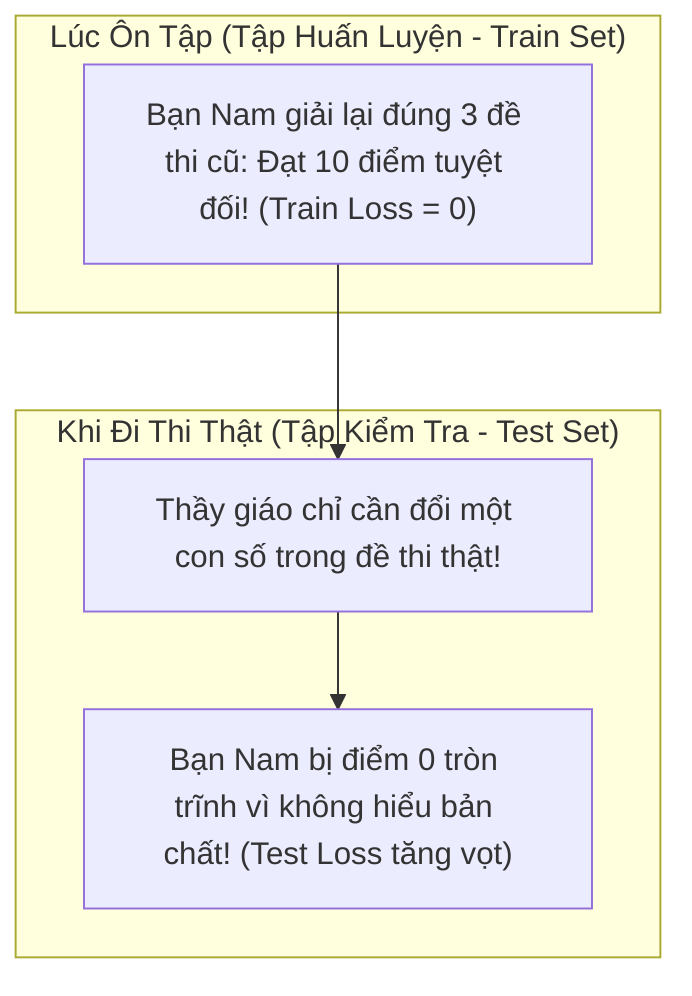
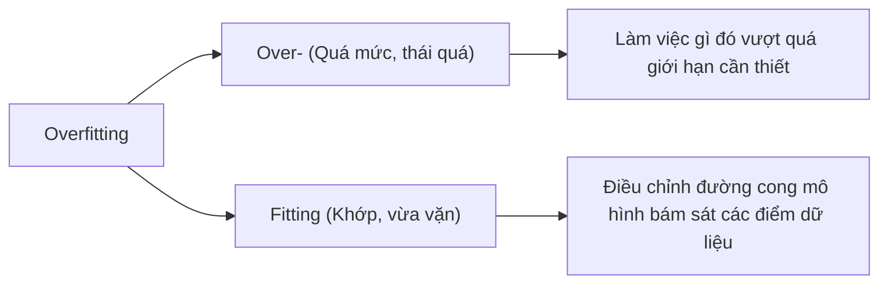
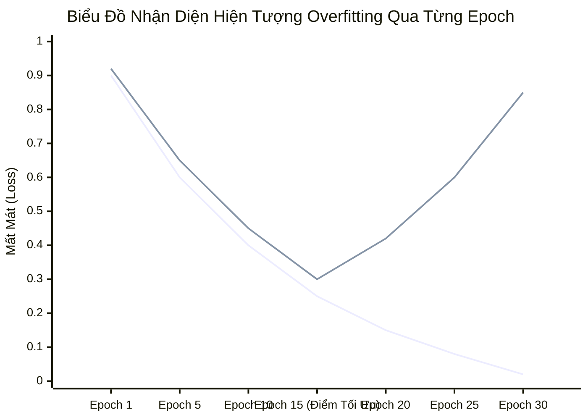
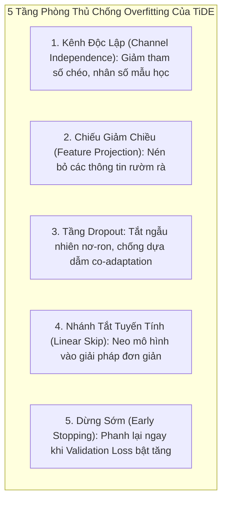

# Thuật Ngữ: Overfitting (Hiện Tượng Quá Khớp / Học Vẹt)

> **Phương pháp tiếp cận Feynman (Feynman Technique)**:  
> *"Nếu bạn không thể giải thích một điều gì đó cho một đứa trẻ 10 tuổi hiểu, thì chính bạn cũng chưa thực sự hiểu nó."*  
> Bài viết này bóc tách hiện tượng **Overfitting** từ câu chuyện người học sinh học vẹt đề thi, phân tích nguyên nhân tại sao chuỗi thời gian lại dễ mắc bẫy này và cách mô hình **TiDE** thiết lập hàng phòng ngự kiên cố.

---

## 1. Giải Thích Cho Một Đứa Trẻ 10 Tuổi: Câu Chuyện Học Sinh Học Vẹt Đề Thi

Hãy tưởng tượng bạn Nam đang chuẩn bị cho kỳ thi tốt nghiệp môn Toán. Thầy giáo phát cho cả lớp **3 đề thi thử của năm ngoái**.

Có hai cách học:
- **Bạn An**: Học hiểu cặn kẽ bản chất công thức, hiểu tại sao phải làm bước này, bước kia để khi đề thi đổi số thì vẫn làm được.
- **Bạn Nam (Bị Overfitting)**: Bạn Nam không thèm hiểu bài. Thay vào đó, bạn ấy **học thuộc lòng từng dấu chấm, dấu phẩy, vị trí từng chữ cái và đáp số** của cả 3 đề thi thử đó!

Khi làm lại 3 đề cũ (Tập Train), bạn Nam tự tin đạt điểm 10 tuyệt đối! Nhưng khi vào phòng thi thật (Tập Test), thầy giáo chỉ cần đổi con số $5$ thành con số $7$, bạn Nam lập tức lúng túng và bị điểm 0 vì bạn ấy chỉ **học vẹt dữ liệu cũ** chứ không học được **quy luật tổng quát**.

> 💡 **Định nghĩa kiểu Feynman**:  
> **Overfitting** chính là căn bệnh **"học vẹt"** của máy tính! Mô hình ghi nhớ chính xác từng hạt bụi nhiễu của quá khứ, nên khi đối diện với tương lai thực tế, nó hoàn toàn bất lực và dự báo sai bét.

---

## 2. Bóc Tách Từng Từ Ngữ Chuyên Ngành (Deconstructing the Jargon)

Tại sao lại gọi là **Overfitting**?

| Thành phần | Nghĩa gốc | Ý nghĩa trong Machine Learning | Phản nghĩa / Đối lập |
|:---|:---|:---|:---|
| **Over-** (*Quá mức*) | Vượt quá ranh giới hợp lý | Mô hình học quá kỹ, ghi nhớ cả những chi tiết vụn vặt và sai số ngẫu nhiên. | **Under-** (*Chưa tới*): Mô hình quá đơn giản, không học nổi quy luật. |
| **Fitting** (*Khớp*) | Vừa vặn, vừa khít | Thuật toán điều chỉnh trọng số sao cho đường dự báo khớp với dữ liệu thực tế. | **Misfit** (*Lệch pha, không vừa*). |

- **Underfitting (Chưa khớp)**: Mô hình quá ngây thơ, không học được gì cả (Cả Train và Test đều kém).
- **Good Fitting / Generalization (Tổng quát hóa tốt)**: Học đúng quy luật cốt lõi (Train tốt và Test cũng tốt).
- **Overfitting (Quá khớp)**: Học vẹt dữ liệu cũ (Train cực tốt nhưng Test cực kỳ tệ).

---

## 3. Trực Quan Hóa Bằng Đồ Thị (The "Aha!" Moment)

Dấu hiệu nhận biết kinh điển nhất của Overfitting chính là **sự phân kỳ giữa đường cong Train Loss và Validation Loss**:

*(Đường xanh nét liền phía dưới: **Train Loss** tiếp tục cắm đầu giảm về 0. Đường phía trên: **Validation Loss** chỉ giảm đến Epoch 15 rồi bắt đầu bật tăng vọt lên trời!)*

| Giai Đoạn | Train Loss (Trên tập học) | Validation Loss (Trên tập kiểm định) | Trạng Thái Của Mô Hình |
|:---|:---:|:---:|:---|
| **Epoch 1 - 10** | Giảm nhanh | Giảm nhanh | 🟢 Đang học quy luật chung rất tốt. |
| **Epoch 15** | Đạt mức tối ưu | Đạt mức thấp nhất | 🌟 **Điểm vàng (Sweet Spot)**: Cần dừng huấn luyện ngay tại đây! |
| **Epoch 20 - 30** | Tiếp tục giảm gần về 0 | **Bật tăng vọt lên cao!** | 🔴 **Bị Overfitting nặng**: Mô hình bắt đầu học vẹt các hạt nhiễu của tập Train. |

---

## 4. Tại Sao Dữ Liệu Chuỗi Thời Gian Lại Cực Kỳ Dễ Bị Overfitting?

Dự báo chuỗi thời gian dài hạn (**LTTF**) là "mảnh đất màu mỡ" của Overfitting vì 3 lý do:

1. **Dữ liệu chứa nhiều nhiễu ngẫu nhiên (Noise)**: Biến động giá chứng khoán, một cơn gió bất chợt làm nhiệt độ giảm trong 10 phút, hay một vụ va chạm xe cộ ngẫu nhiên trên cao tốc... Nếu mô hình cố gắng giải thích bằng được những biến động tức thời này, nó sẽ bị lạc lối.
2. **Số lượng tham số quá lớn của các mạng Transformer**: Các mô hình như Informer hay Autoformer có hàng chục triệu tham số. Khi huấn luyện trên một số lượng chuỗi thời gian hạn chế, số bậc tự do quá lớn khiến mạng dễ dàng "học thuộc lòng" toàn bộ lịch sử.
3. **Mối tương quan giả (Spurious Correlation)**: Nếu cho mô hình nhìn thấy hàng trăm biến phụ cùng lúc, nó có thể tìm thấy một mối liên hệ trùng hợp ngẫu nhiên (ví dụ: mỗi lần cổ phiếu tăng thì ngoài trời có gió cấp 3) và ngộ nhận đó là chân lý.

---

## 5. Mô Hình TiDE Chống Overfitting Bằng Cách Nào?

TiDE thiết lập một hệ thống phòng thủ đa tầng gồm 5 lớp bảo vệ để ngăn chặn triệt để hiện tượng Overfitting:

1. **Chiến lược Kênh Độc Lập (Channel Independence)**:  
   Không xây dựng ma trận tương quan khổng lồ $N \times N$, mà dùng chung một bộ não cho tất cả các kênh, giúp tăng số lượng mẫu học lên $N$ lần.
2. **Feature Projection**:  
   Nén các biến ngoại sinh từ $r$ chiều xuống $\tilde{r} = 4$ chiều, loại bỏ bớt các biến động nhiễu không quan trọng.
3. **Tầng Dropout trong mọi Residual Block**:  
   Tắt ngẫu nhiên từ $20\%$ đến $50\%$ số nơ-ron trong quá trình học, ép các nơ-ron còn lại phải tự lực cánh sinh học ra đặc trưng bền vững.
4. **Nhánh Tắt Tuyến Tính Toàn Cục (Global Linear Skip)**:  
   Đóng vai trò như một mỏ neo an toàn. Nếu các tầng nơ-ron sâu bị loạn vì học vẹt, mô hình vẫn luôn có một nhánh tuyến tính đơn giản bảo vệ kết quả.
5. **Cơ chế Early Stopping**:  
   Liên tục theo dõi Validation Loss và tự động ngắt quá trình huấn luyện khi loss không còn giảm sau 5 - 10 epoch.

---

## 6. Tổng Kết 30 Giây (The Elevator Pitch)

1. **Overfitting là gì?**  
   Là hiện tượng mô hình "học vẹt" quá kỹ các chi tiết vụn vặt và nhiễu của dữ liệu quá khứ, khiến nó đạt điểm tuyệt đối trên tập học nhưng dự báo sai lệch trên thực tế.
2. **Làm sao nhận biết?**  
   Khi Train Loss liên tục giảm nhưng Validation Loss bắt đầu quay đầu tăng vọt.
3. **TiDE trị bệnh này như thế nào?**  
   Bằng cách kết hợp Channel Independence, Feature Projection nén chiều, tầng Dropout ngẫu nhiên, mỏ neo tuyến tính Global Skip và cơ chế Early Stopping.
