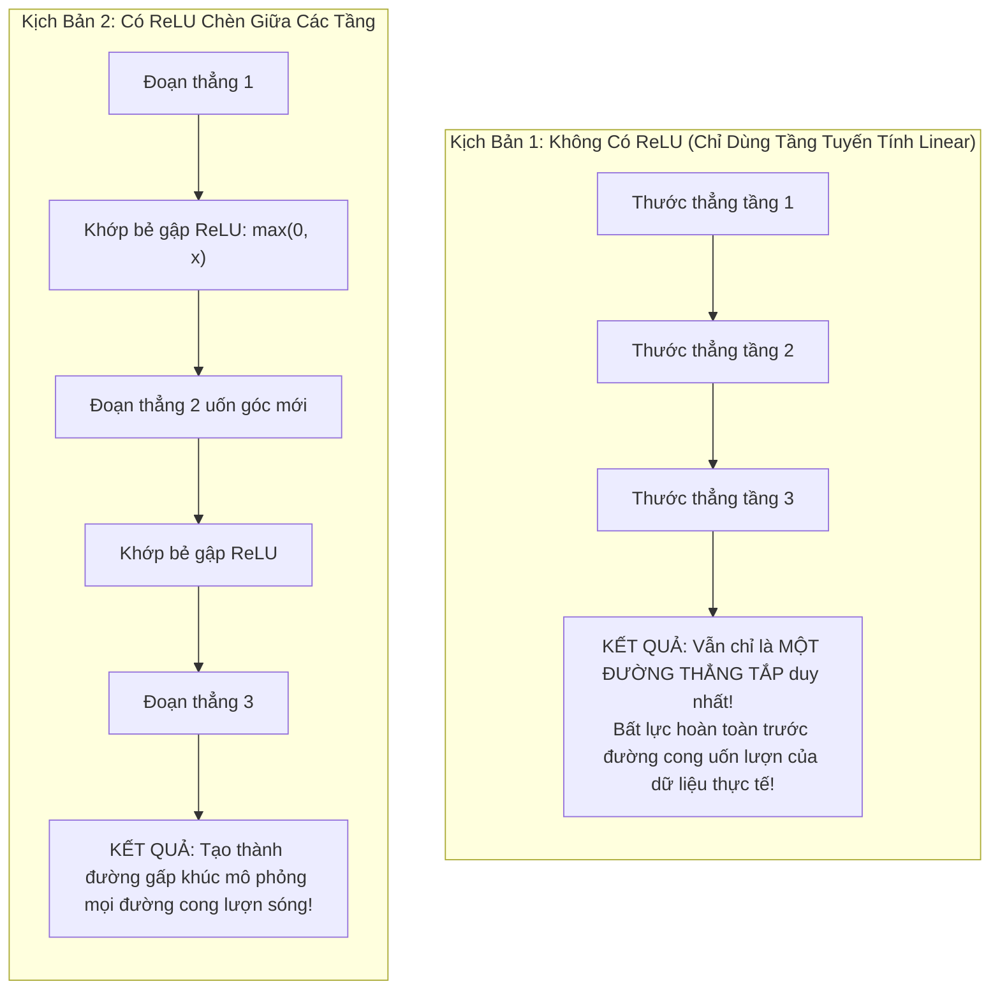
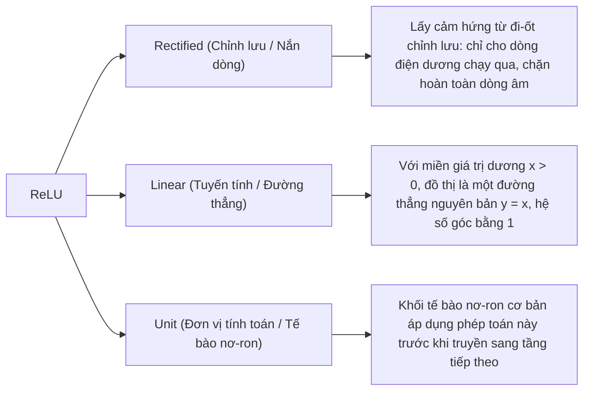
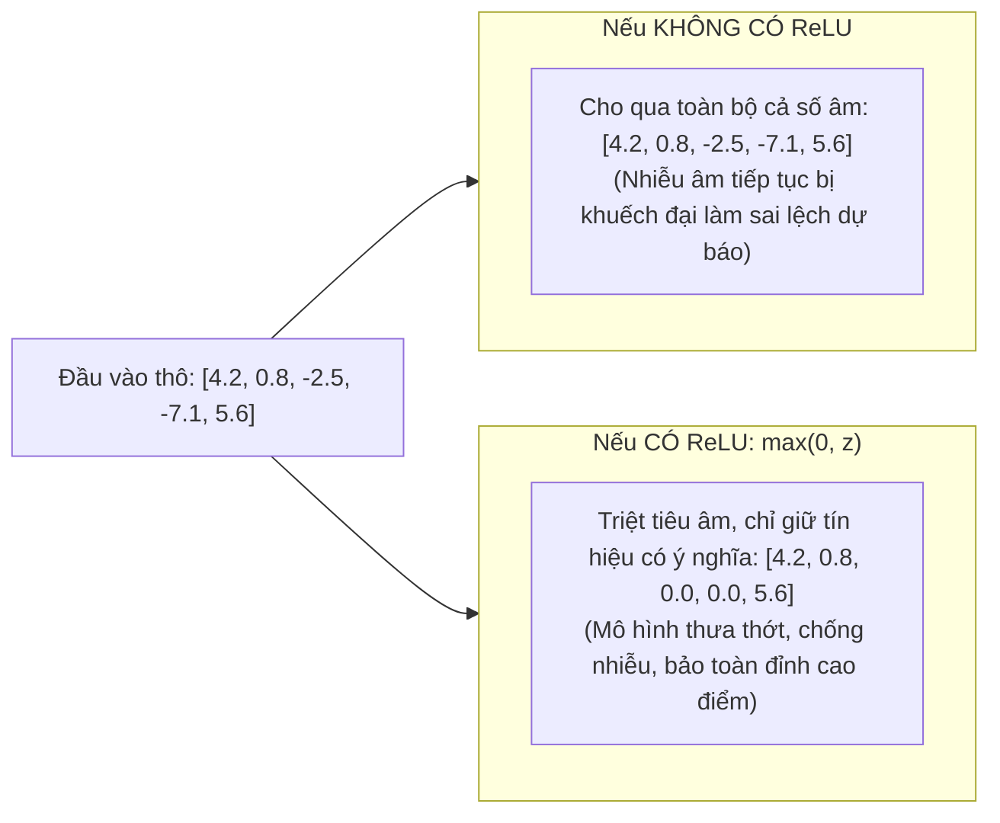
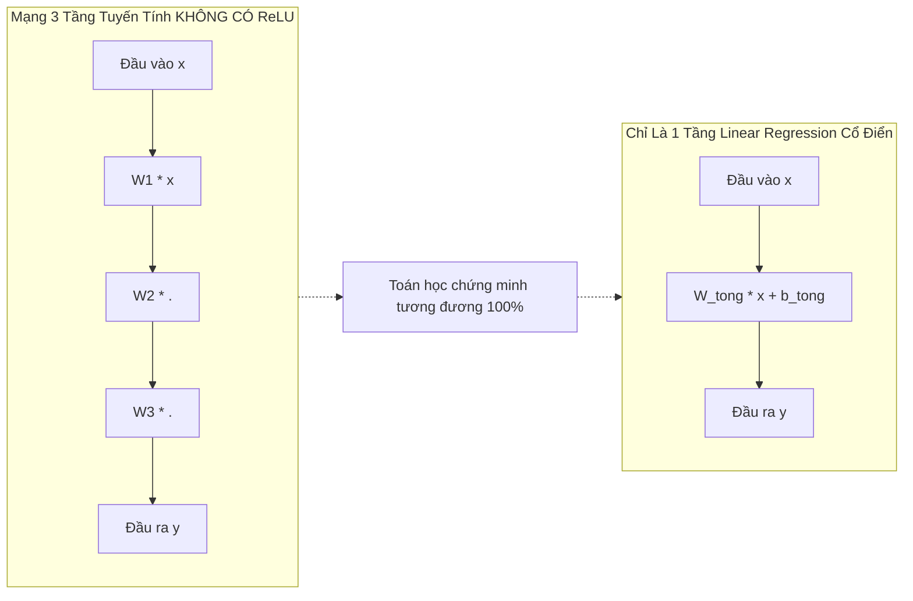
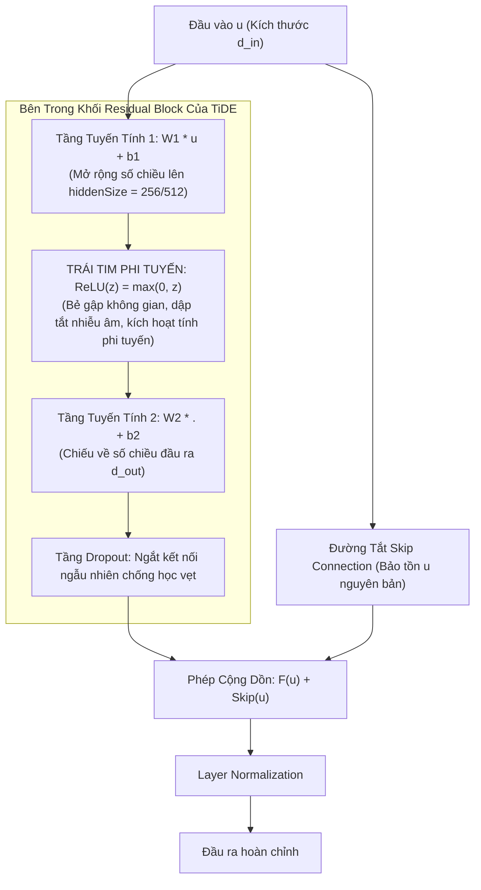

# Thuật Ngữ: ReLU (Rectified Linear Unit - Hàm Kích Hoạt Tuyến Tính Từng Đoạn)

> **Phương pháp tiếp cận Feynman (Feynman Technique)**:  
> *"Nếu bạn không thể giải thích một điều gì đó cho một đứa trẻ 10 tuổi hiểu, thì chính bạn cũng chưa thực sự hiểu nó."*  
> Bài viết này bóc tách bản chất của **ReLU (Rectified Linear Unit)** từ câu chuyện chiếc van một chiều và thanh uốn dẻo, giải thích cặn kẽ: **Nếu không có ReLU (hoặc không dùng hàm kích hoạt), mô hình TiDE sẽ gặp thảm họa gì?**

---

## 1. Giải Thích Cho Một Đứa Trẻ 10 Tuổi: Cây Thước Gỗ Thẳng Tắp Và Sợi Dây Thép Uốn Lượn

Hãy tưởng tượng bạn được giao một thử thách: **Hãy vẽ lại hình dáng một ngọn núi nhấp nhô lượn sóng trên giấy**.

1. **Nếu bạn chỉ được dùng một cây thước kẻ thẳng (Mô hình KHÔNG CÓ ReLU):**
   - Bạn chỉ có thể kẻ một đường thẳng tắp từ chân núi lên đỉnh núi.
   - Dù bạn có xếp chồng 10 cây thước kẻ lên nhau, chúng vẫn chỉ tạo thành **một đường thẳng duy nhất**. Cây thước thẳng hoàn toàn bất lực, không tài nào vẽ được những chỗ uốn lượn, lồi lõm hay khe suối ngoằn ngoèo của ngọn núi!
2. **Khi bạn có thêm "Khớp bẻ gập" ReLU (Mô hình CÓ ReLU):**
   - Cây thước kẻ bây giờ được gắn các khớp lề có thể bẻ gập tại điểm số 0: $\max(0, x)$.
   - Khi có nhiều khớp bẻ gập nối tiếp nhau, bạn có thể uốn lượn cây thước theo từng khúc gấp dốc lên, gập xuống, ôm trọn lấy đường cong của toàn bộ ngọn núi!

---

### Chiếc Van Một Chiều Chống Tràn Nước Bẩn
Một hình ảnh trực quan khác là chiếc **van lật một chiều** ở cống thoát nước nhà bạn:
- **Khi nước mưa sạch từ sân chảy ra ngoài (Tín hiệu dương $x > 0$):** Chiếc van lật mở toang tự nhiên. Nước chảy ra bao nhiêu thì thoát bấy nhiêu ($y = x$), không bị cản trở chút nào.
- **Khi nước cống đen hôi thối dâng ngược lên (Nhiễu âm $x \le 0$):** Chiếc van lập tức đóng sập lại, triệt tiêu toàn bộ dòng nước bẩn về mức $0$ ($y = 0$).

> 💡 **Định nghĩa kiểu Feynman**:  
> **ReLU** là một "khớp bẻ gập" kiêm "van lọc một chiều": Nó dập tắt tất cả tín hiệu âm về số $0$ và giữ nguyên vẹn tín hiệu dương. Nhờ hành động bẻ gập đơn giản này, mạng nơ-ron biến các phép tính đường thẳng đơn điệu thành các đường cong uốn lượn kỳ diệu để học dữ liệu thực tế.

---

## 2. Bóc Tách Từng Từ Ngữ Chuyên Ngành (Deconstructing the Jargon)

Tại sao trong ngành Trí tuệ nhân tạo lại đặt tên là **Rectified Linear Unit**?

| Thành phần | Nghĩa gốc đời thường | Ý nghĩa trong Machine Learning | Phản nghĩa / Đối lập |
|:---|:---|:---|:---|
| **Rectified** (*Nắn dòng*) | Uốn nắn cho ngay ngắn, lọc một chiều | Biến đổi phần âm về $0$, giữ nguyên phần dương: $\max(0, x)$. | **Unrectified** (*Để nguyên cả âm lẫn dương, không nắn dòng*). |
| **Linear** (*Tuyến tính*) | Đường thẳng, tỷ lệ thuận | Khi $x > 0$, hàm số là đường thẳng $y = x$ có đạo hàm bằng $1$, bảo toàn nguyên vẹn độ dốc tín hiệu. | **Non-linear saturated** (*Bão hòa phi tuyến cong queo như Sigmoid/Tanh*). |
| **Unit** (*Đơn vị*) | Một mắt xích, một tế bào | Khối nơ-ron nhận đầu vào, nhân ma trận rồi áp dụng ReLU. | **Network** (*Toàn bộ mạng lưới hoàn chỉnh*). |

---

## 3. Trực Quan Hóa Bằng Bảng Dữ Liệu (The "Aha!" Moment)

Hãy nhìn vào cách một tầng nơ-ron trong mô hình TiDE xử lý chuỗi dữ liệu phụ tải điện khi **CÓ** và **KHÔNG CÓ** ReLU:

| Thời điểm ($t$) | Hiện trạng thực tế | Đầu vào thô sau tầng Linear ($z$) | KHÔNG CÓ ReLU (Giữ nguyên $z$) | CÓ ReLU ($\max(0, z)$) | Ý nghĩa thực tế trong dự báo |
|:---:|:---|:---:|:---:|:---:|:---|
| 08:00 | Giờ cao điểm, mở máy lạnh | $+4.2$ | $+4.2$ | **$+4.2$** | 🟢 Tín hiệu mạnh $\to$ Truyền nguyên vẹn lên tầng sau. |
| 12:00 | Nghỉ trưa, tắt bớt thiết bị | $+0.8$ | $+0.8$ | **$+0.8$** | 🟢 Tín hiệu nhỏ $\to$ Giữ nguyên. |
| 02:00 | Đêm khuya, nhiễu dao động âm | $-2.5$ | **$-2.5$ (Nhiễu đi tiếp)** | **$0.0$ (Dập tắt nhiễu)** | 🔴 ReLU loại bỏ tín hiệu vô nghĩa/nhiễu âm ban đêm. |
| 04:00 | Sự cố đo đạc âm bất thường | $-7.1$ | **$-7.1$ (Lệch mô hình)** | **$0.0$ (Khử rác dữ liệu)** | 🔴 Tránh làm sai lệch trọng số của các nơ-ron tầng sau. |
| 19:00 | Giờ sinh hoạt tối đỉnh điểm | $+5.6$ | $+5.6$ | **$+5.6$** | 🟢 Nhu cầu bùng nổ $\to$ Truyền nguyên vẹn 100%. |

---

## 4. Nếu KHÔNG Ứng Dụng ReLU Vào Mô Hình Thì Sẽ Bị Vấn Đề Gì?

Đây chính là câu hỏi mấu chốt nhất của bất kỳ kỹ sư học sâu nào. Nếu bạn gỡ bỏ ReLU khỏi mô hình TiDE, mô hình sẽ lập tức sụp đổ vì **3 thảm họa kỹ thuật nghiêm trọng**:

### 💥 Thảm Họa 1: Hiện Tượng "Sụp Đổ Tuyến Tính" (Linear Collapse)
Giả sử bạn thiết kế một mô hình TiDE cực kỳ đồ sộ với 3 tầng mạng nối tiếp nhau:
- Tầng 1: $h_1 = W_1 \cdot x + b_1$
- Tầng 2: $h_2 = W_2 \cdot h_1 + b_2$
- Tầng 3: $\hat{y} = W_3 \cdot h_2 + b_3$

**Nếu KHÔNG chèn hàm kích hoạt phi tuyến như ReLU ở giữa các tầng:**

$$
\hat{y} = W_3 \cdot \Big( W_2 \cdot (W_1 \cdot x + b_1) + b_2 \Big) + b_3
$$

$$
\hat{y} = (W_3 \cdot W_2 \cdot W_1) \cdot x + (W_3 \cdot W_2 \cdot b_1 + W_3 \cdot b_2 + b_3)
$$

$$
\hat{y} = W_{\text{total}} \cdot x + b_{\text{total}}
$$

> *(Trong đó: $W_{\text{total}} = W_3 \cdot W_2 \cdot W_1$ là một ma trận trọng số gộp duy nhất, $b_{\text{total}}$ là hệ số bù gộp).*

> ⚠️ **Hậu quả kinh hoàng**:  
> Tích của 3 ma trận $W_3 \cdot W_2 \cdot W_1$ chỉ là **MỘT MA TRẬN DUY NHẤT** $W_{\text{total}}$!  
> Dù bạn có xếp chồng 100 tầng nơ-ron sâu, đầu tư hàng triệu tham số và chạy trên cụm GPU nghìn đô, toàn bộ mạng sâu của bạn **bị suy biến (collapse) thành đúng một mô hình Hồi quy Tuyến tính (Linear Regression) đơn giản của thế kỷ 19**! Mô hình hoàn toàn không có khả năng học các mối quan hệ phi tuyến.

---

### 💥 Thảm Họa 2: Bất Lực Hoàn Toàn Trước Chuỗi Thời Gian Thực Tế
Chuỗi thời gian trong thế giới thực (điện lực, giao thông xe cộ, nhiệt độ thời tiết) **không bao giờ đi theo một đường thẳng**:
- Nhu cầu tải điện buổi sáng tăng vọt, ban đêm giảm sâu (chu kỳ lượn sóng hình sin).
- Vào ngày nghỉ lễ hoặc đợt nắng nóng đột ngột, mức tiêu thụ điện nhảy vọt theo kiểu bậc thang gập khúc.

Một mô hình thuần tuyến tính (do không có ReLU) chỉ có thể vẽ ra một **mặt phẳng hoặc đường thẳng tắp**. Nó sẽ cắt ngang qua dữ liệu và bỏ lỡ hoàn toàn các đỉnh nhọn cao điểm và đáy sâu ban đêm. Kết quả là mô hình bị **Underfitting cực độ**, sai số dự báo (MSE) bùng nổ khổng lồ.

---

### 💥 Thảm Họa 3: Nếu Không Dùng ReLU Mà Dùng Sigmoid/Tanh Thì Bị "Triệt Tiêu Gradient" (Vanishing Gradient)
Bạn có thể hỏi: *"Nếu không có ReLU thì tôi dùng hàm Sigmoid hay Tanh để tạo phi tuyến tính có được không?"*

Câu trả lời là **không thể huấn luyện được mạng sâu** vì:
1. **Đạo hàm của Sigmoid tối đa chỉ là $0.25$**. Khi truyền ngược qua mạng TiDE có nhiều tầng Encoder và Decoder, gradient bị nhân dồn liên tiếp:
   $$
   0.25 \times 0.25 \times 0.25 \times 0.25 \approx 0.0039
   $$
   Tín hiệu đạo hàm nhanh chóng tiến về $0$. Các tầng đầu tiên của mô hình bị "đóng băng" (tê liệt hoàn toàn), không học được bất cứ điều gì!
2. **Chi phí tính toán đắt đỏ**: Sigmoid và Tanh chứa hàm số mũ $e^x$ và phép chia rất nặng nề cho phần cứng GPU. Trong khi đó, ReLU chỉ là một phép so sánh nhị phân đơn giản (`x > 0`), giúp TiDE chạy nhanh gấp 5 - 10 lần các mô hình khác!

| Tiêu chí | KHÔNG DÙNG ReLU (Chỉ dùng Linear) | DÙNG Sigmoid / Tanh | DÙNG ReLU (Lựa chọn của TiDE) |
|:---|:---|:---|:---|
| **Khả năng học đường cong** | ❌ Hoàn toàn bất lực (Bị suy biến về đường thẳng) | ✅ Học được | ✅ **Học cực tốt mọi dạng đường gấp khúc phi tuyến** |
| **Huấn luyện mạng sâu** | ⚠️ Vô nghĩa (Nhiều tầng cũng chỉ bằng 1 tầng) | ❌ Bị triệt tiêu gradient (Vanishing gradient) | ✅ **Gradient = 1 khi $x > 0$, học mượt mà qua hàng chục tầng** |
| **Tốc độ tính toán trên GPU** | ✅ Nhanh (chỉ nhân ma trận) | ❌ Rất chậm (tốn phép tính số mũ $e^x$) | ✅ **Siêu tốc (Chỉ so sánh logic `x > 0`)** |
| **Khả năng chống nhiễu** | ❌ Kém (Tín hiệu nhiễu bị lan truyền khắp nơi) | ⚠️ Trung bình | ✅ **Tuyệt vời (Triệt tiêu 50% nhiễu âm về đúng 0)** |

---

## 5. Mô Hình TiDE Ứng Dụng ReLU Như Thế Nào?

Trong kiến trúc của TiDE (Google Research, 2023), tác giả thiết kế một khối cơ sở duy nhất gọi là **Residual Block (Khối phần dư)**. Cấu trúc toán học chính xác của nó tại Mục 4.1 trong bài báo gốc:

$$
F(u) = \text{Dropout} \Big( W_2 \cdot \mathbf{\text{ReLU}}(W_1 \cdot u + b_1) + b_2 \Big)
$$

### Ứng Dụng Trong 4 Phân Vùng Của TiDE:
1. **Feature Projection (Chiếu đặc trưng)**: Nén các biến ngoại sinh (thời tiết, ngày lễ) có số chiều cao về không gian ẩn nhỏ gọn. ReLU giúp loại bỏ các thông tin ngoại sinh dư thừa mang giá trị âm sau khi chiếu.
2. **Dense Encoder (Bộ mã hóa dày đặc)**: Gom lịch sử quá khứ $y_{1:L}$ và các biến ngoại sinh. ReLU tạo ra khả năng trích xuất các quy luật phi tuyến phức tạp theo thời gian.
3. **Dense Decoder (Bộ giải mã)**: Giải nén vector đặc trưng toàn cục thành ma trận dự báo tương lai.
4. **Temporal Decoder (Bộ giải mã thời gian)**: Kết hợp vector tương lai với biến ngoại sinh tương lai $x_{L+1:L+H}$ để đưa ra dự báo cuối cùng $\hat{y}_{L+1:L+H}$.

---

## 6. Tổng Kết 30 Giây (The Elevator Pitch)

1. **ReLU là gì?**  
   Là hàm kích hoạt $\max(0, x)$, hoạt động như một chiếc van một chiều: Chặn toàn bộ số âm về $0$ và cho số dương đi qua nguyên vẹn.
2. **Nếu không dùng ReLU thì chuyện gì sẽ xảy ra?**  
   Toàn bộ mạng sâu dù có 100 tầng cũng sẽ **sụp đổ về mặt toán học thành đúng 1 tầng hồi quy tuyến tính đơn giản** ($W_3 W_2 W_1 = W_{\text{total}}$). Mô hình chỉ vẽ được một đường thẳng tắp, hoàn toàn bất lực trước tính chu kỳ nhấp nhô và các bước nhảy vọt của dữ liệu thực tế!
3. **Tại sao TiDE chọn ReLU mà không dùng Sigmoid?**  
   Vì ReLU có đạo hàm bằng $1$ khi $x > 0$ giúp dòng gradient truyền ngược nguyên vẹn không bao giờ bị triệt tiêu (*Vanishing Gradient*), đồng thời tính toán siêu tốc trên GPU do không phải tính hàm mũ $e^x$.