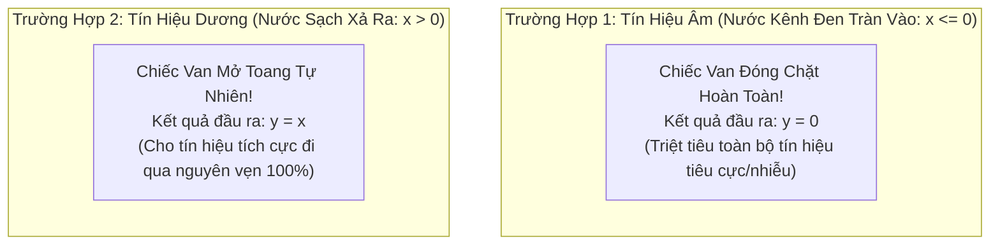
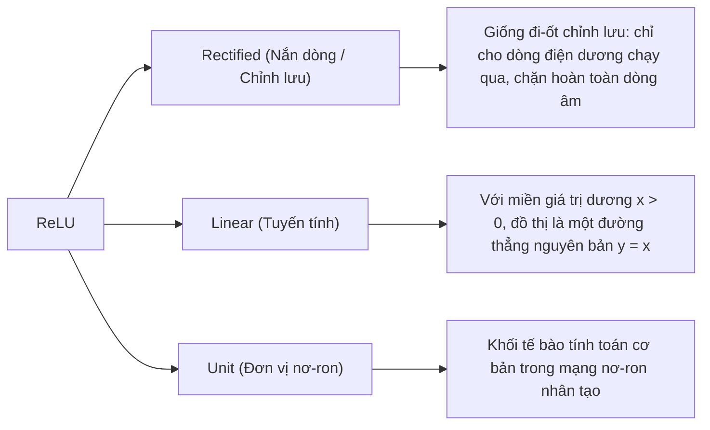
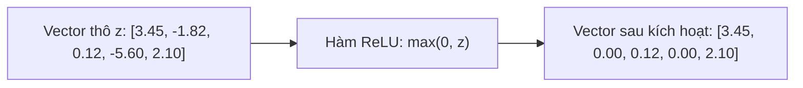
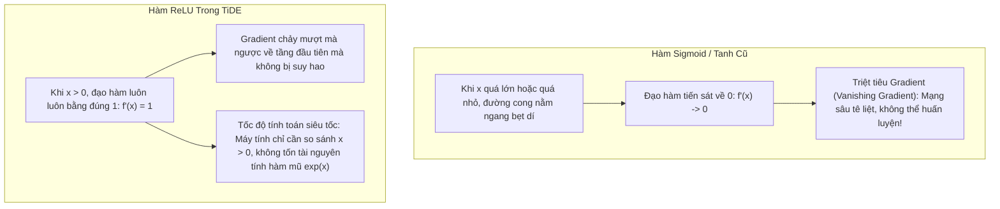
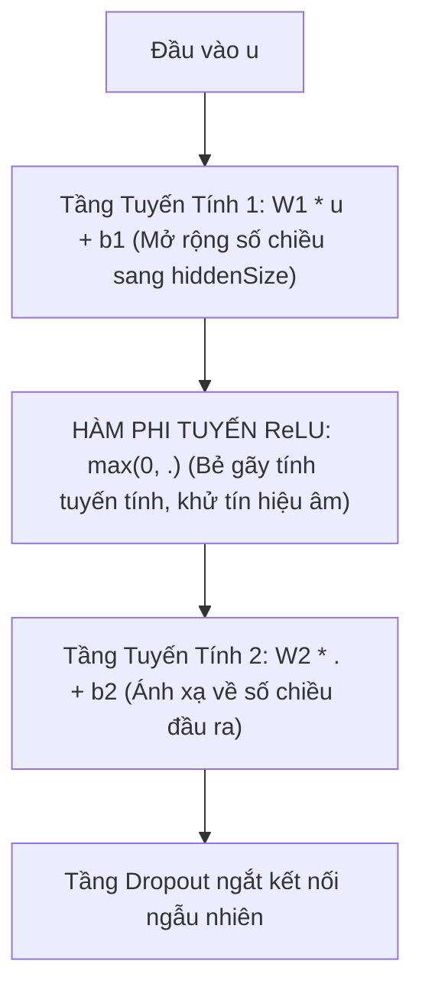

# Thuật Ngữ: ReLU (Rectified Linear Unit - Hàm Kích Hoạt Tuyến Tính Từng Đoạn)

> **Phương pháp tiếp cận Feynman (Feynman Technique)**:  
> *"Nếu bạn không thể giải thích một điều gì đó cho một đứa trẻ 10 tuổi hiểu, thì chính bạn cũng chưa thực sự hiểu nó."*  
> Bài viết này bóc tách bản chất của **ReLU (Rectified Linear Unit)** từ câu chuyện chiếc van một chiều chống ngập nước, giải thích vì sao phép toán siêu đơn giản $\max(0, x)$ lại là "chiếc đũa thần phi tuyến" giúp mô hình TiDE vừa học được các quy luật phức tạp vừa giữ tốc độ tính toán thần tốc.

---

## 1. Giải Thích Cho Một Đứa Trẻ 10 Tuổi: Chiếc Van Một Chiều Chống Ngập Nước

Hãy tưởng tượng nhà bạn ở cạnh một con kênh và trước cửa nhà có lắp một **chiếc van lật một chiều chống ngập**:

1. **Khi trời nắng ráo hoặc nước kênh thấp (Áp lực âm $x \le 0$):**  
   Chiếc van đóng chặt hoàn toàn, không cho một giọt nước bẩn nào tràn ngược vào nhà. Mức nước chảy vào nhà bằng đúng **0**.
2. **Khi bạn xả nước sạch từ trong nhà ra ngoài (Áp lực dương $x > 0$):**  
   Nước đẩy chiếc van mở toang tự nhiên. Bạn xả bao nhiêu nước thì nước chảy ra ngoài bấy nhiêu ($y = x$), không bị cản trở chút nào!

Nếu không có chiếc van này, nước bẩn và nước sạch sẽ hòa lẫn vào nhau theo một đường thẳng tuyến tính đơn điệu, bạn không bao giờ phân biệt hoặc chặn được nước ngập.

> 💡 **Định nghĩa kiểu Feynman**:  
> **ReLU** giống như một **"chiếc công tắc một chiều"**: Nó dập tắt tất cả những con số âm thành số $0$, và giữ nguyên vẹn tất cả những con số dương. Nhờ hành động gập khúc đơn giản này, mạng nơ-ron có thể "uốn lượn" để mô phỏng mọi đường cong phức tạp trong thực tế!

---

## 2. Bóc Tách Từng Từ Ngữ Chuyên Ngành (Deconstructing the Jargon)

Tại sao lại gọi là **Rectified Linear Unit**?

| Thành phần | Nghĩa gốc | Ý nghĩa trong Machine Learning | Phản nghĩa / Đối lập |
|:---|:---|:---|:---|
| **Rectified** (*Nắn dòng*) | Uốn nắn cho thẳng, lọc một chiều | Biến đổi phần âm về $0$, giữ nguyên phần dương: $\max(0, x)$. Lấy cảm hứng từ mạch chỉnh lưu trong điện tử. | **Unrectified** (*Để nguyên cả âm lẫn dương*). |
| **Linear** (*Tuyến tính*) | Đường thẳng, tỷ lệ thuận | Khi $x > 0$, hàm số có đạo hàm bằng đúng $1$, bảo toàn nguyên vẹn độ dốc tín hiệu. | **Non-linear saturated** (*Bão hòa phi tuyến như Sigmoid/Tanh*). |
| **Unit** (*Đơn vị*) | Một phần tử, một tế bào | Khối nơ-ron áp dụng hàm kích hoạt này trước khi truyền sang tầng tiếp theo. | **Composite Block** (*Cụm nhiều tầng phức tạp*). |

---

## 3. Trực Quan Hóa Bằng Bảng Dữ Liệu (The "Aha!" Moment)

Hãy nhìn vào cách ReLU biến đổi một vector dữ liệu thực tế tại ngõ ra của tầng Linear trong mô hình TiDE:

| Bước Thời Gian ($t$) | Giá Trị Thô Sau Tầng Linear ($z$) | Qua Hàm Kích Hoạt ReLU ($\max(0, z)$) | Trạng Thái Nơ-ron | Ý Nghĩa Thực Tế Trong Chuỗi Thời Gian |
|:---:|:---:|:---:|:---:|:---|
| $t = 1$ | $+3.45$ | **$+3.45$** | 🟢 Kích hoạt (Active) | Nhu cầu tải điện giờ cao điểm $\to$ Cho qua nguyên vẹn. |
| $t = 2$ | $-1.82$ | **$0.00$** | 🔴 Tắt hoàn toàn (Inactive)| Tín hiệu nhiễu ban đêm $\to$ Chặn lại, khử nhiễu. |
| $t = 3$ | $+0.12$ | **$+0.12$** | 🟢 Kích hoạt nhẹ | Nhu cầu tăng nhẹ $\to$ Giữ nguyên tín hiệu nhỏ. |
| $t = 4$ | $-5.60$ | **$0.00$** | 🔴 Tắt hoàn toàn (Inactive)| Mất điện đột ngột hoặc giá trị âm vô lý $\to$ Triệt tiêu về 0. |
| $t = 5$ | $+2.10$ | **$+2.10$** | 🟢 Kích hoạt (Active) | Sự kiện khuyến mãi kích cầu $\to$ Truyền tiếp lên tầng sau. |

> 🎯 **Khoảnh khắc "Aha!"**:  
> Điều gì xảy ra nếu **KHÔNG CÓ ReLU** mà chỉ xếp chồng 10 tầng Linear?  
> Về mặt toán học: $W_2 \cdot (W_1 \cdot x) = (W_2 \cdot W_1) \cdot x = W_{\text{tổng}} \cdot x$.  
> Dù bạn xếp chồng bao nhiêu tầng Linear đi nữa, toàn bộ mạng sâu sẽ bị thu gọn lại thành đúng **MỘT MA TRẬN DUY NHẤT**! Mạng hoàn toàn mất khả năng học các mối quan hệ phi tuyến uốn lượn.  
> Chỉ cần một nhát cắt gập khúc $\max(0, x)$ của ReLU, mạng lập tức có khả năng xấp xỉ bất kỳ hàm số phi tuyến phức tạp nào trên thế giới!

---

## 4. Thách Thức Kỹ Thuật: Vì Sao Không Dùng Sigmoid Hay Tanh?

Trước khi ReLU trở thành tiêu chuẩn vàng, các mạng nơ-ron cổ điển sử dụng hàm **Sigmoid** $\sigma(x) = \frac{1}{1 + e^{-x}}$ hoặc **Tanh** $\tanh(x) = \frac{e^x - e^{-x}}{e^x + e^{-x}}$:

1. **Bài toán Triệt tiêu Gradient (Vanishing Gradient):**  
   Với Sigmoid, đạo hàm cực đại chỉ là $0.25$. Khi truyền ngược qua 4 tầng, gradient bị nhân dồn $0.25^4 \approx 0.0039$, khiến các tầng đầu tiên bị "đóng băng", không cập nhật được trọng số.  
   Với ReLU, khi $x > 0$, đạo hàm bằng đúng $1$! Gradient truyền ngược nguyên vẹn 100%.
2. **Chi phí tính toán (Computational Cost):**  
   Sigmoid và Tanh đòi hỏi phép tính số mũ $e^x$ và phép chia cực kỳ đắt đỏ trên GPU. Trong khi đó, ReLU chỉ là một phép so sánh logic: `x if x > 0 else 0`. Tiết kiệm hàng triệu chu kỳ xung nhịp CPU/GPU.

---

## 5. Mô Hình TiDE Ứng Dụng ReLU Như Thế Nào?

Trong bài báo TiDE (Google Research, 2023), nhóm tác giả xây dựng toàn bộ mô hình dựa trên một viên gạch duy nhất là **Khối Residual Block (Mục 4.1)**. 

Bên trong mỗi khối Residual Block, hàm ReLU đóng vai trò là **nguồn phi tuyến tính duy nhất**:

$$
F(u) = \text{Dropout} \left( W_2 \cdot \text{ReLU}(W_1 \cdot u + b_1) + b_2 \right)
$$

- **Tại sao TiDE chiến thắng các Transformer phức tạp?**  
  Các mô hình Transformer phải tính ma trận Attention tự động $O(L^2)$ rất chậm và tốn bộ nhớ. TiDE chỉ dùng phép nhân ma trận kết hợp với ReLU, đạt tốc độ tuyến tính $O(L + H)$ nhanh gấp 5 - 10 lần mà vẫn bắt trọn mọi hình thái phi tuyến của chuỗi thời gian!

---

## 6. Tổng Kết 30 Giây (The Elevator Pitch)

1. **ReLU là gì?**  
   Là hàm kích hoạt có công thức $\max(0, x)$ — chuyển toàn bộ số âm thành $0$ và giữ nguyên vẹn số dương.
2. **Tại sao bắt buộc phải có?**  
   Nó "bẻ gãy" tính tuyến tính đơn điệu, giúp mạng nơ-ron học được các quy luật phi tuyến phức tạp mà không bị triệt tiêu gradient (đạo hàm luôn bằng $1$ khi $x > 0$).
3. **Ý nghĩa trong TiDE?**  
   Là động cơ phi tuyến duy nhất trong các khối Residual Block, giúp mô hình vượt trội về tốc độ tính toán và dự báo chính xác các bước nhảy vọt trong chuỗi thời gian.
