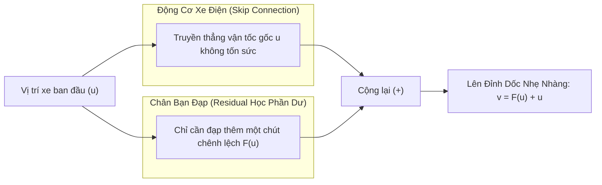
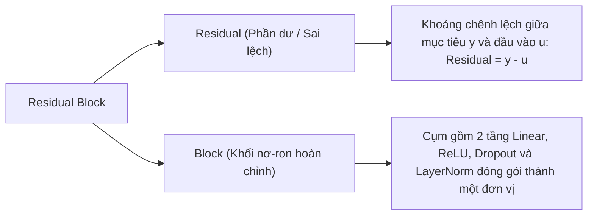
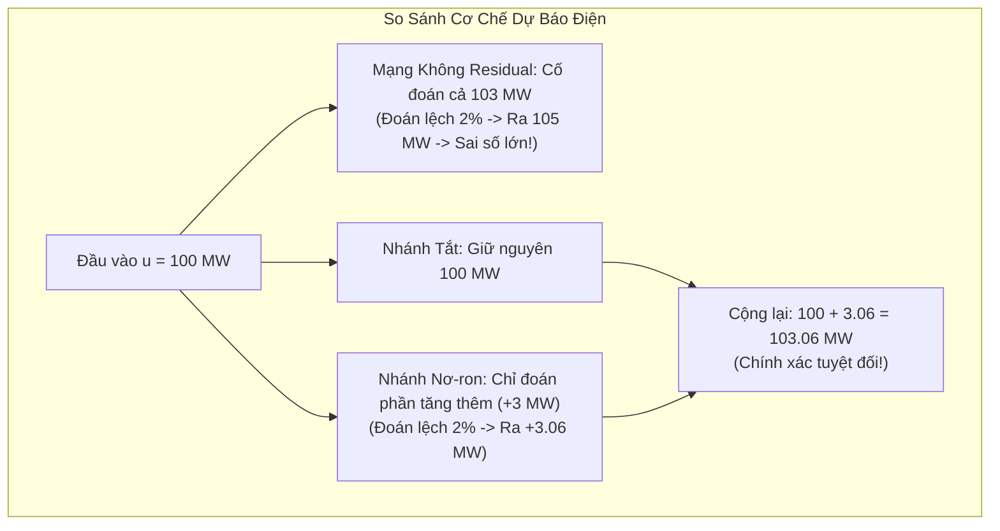
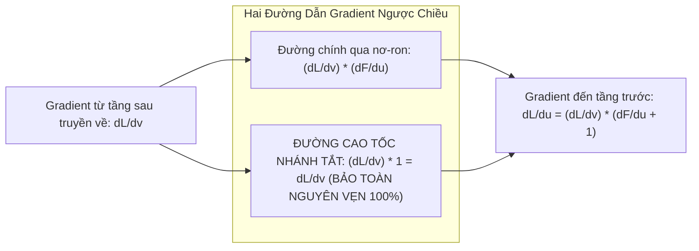
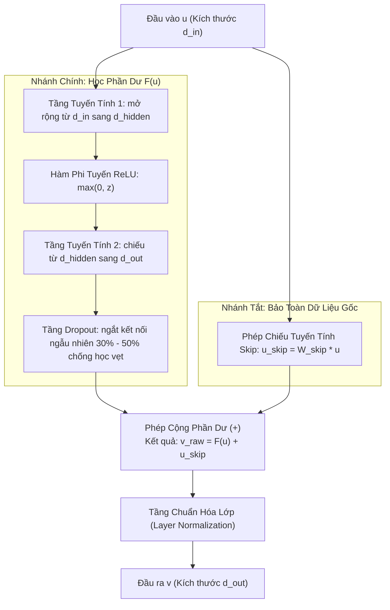

# Thuật Ngữ: Residual Block (Khối Nơ-ron Phần Dư Dày Đặc)

> **Phương pháp tiếp cận Feynman (Feynman Technique)**:  
> *"Nếu bạn không thể giải thích một điều gì đó cho một đứa trẻ 10 tuổi hiểu, thì chính bạn cũng chưa thực sự hiểu nó."*  
> Bài viết này bóc tách bản chất **Residual Block** từ câu chuyện chiếc xe điện leo dốc và bảng điểm thi học sinh thực tế, giải thích cặn kẽ tại sao phép cộng $F(u) + u$ lại là "viên gạch vạn năng" cứu sống toàn bộ các mạng nơ-ron sâu trong TiDE.

---

## 1. Giải Thích Cho Một Đứa Trẻ 10 Tuổi: Người Thợ Sửa Tranh Và Chiếc Xe Đạp Trợ Lực Điện

Để hiểu Residual Block, hãy bắt đầu với **2 ví dụ đời thực cực kỳ gần gũi**:

### 🚲 Ví Dụ 1: Chiếc Xe Đạp Trợ Lực Điện Leo Dốc
Hãy tưởng tượng bạn đang đạp xe lên một con dốc cao:
- **Nếu đi xe đạp thường (Mạng không có Residual):** Bạn phải tự mình dùng 100% sức lực từ đôi chân để đạp từ chân dốc lên đỉnh dốc. Đi qua 5 con dốc liên tiếp (tương đương 5 tầng mạng sâu), chân bạn sẽ mỏi nhừ và xe dừng lại chết đứng giữa đường (Hiện tượng *Triệt tiêu Gradient - Tê liệt mô hình*).
- **Nếu đi xe đạp trợ lực điện (Cách của Residual Block):**
  - **Động cơ điện (Nhánh tắt - Skip Connection):** Luôn tự động đẩy bạn đi một vận tốc cơ bản cố định $u$ mà bạn không tốn chút sức nào!
  - **Chân bạn (Nhánh học phần dư - Residual $F(u)$):** Chỉ cần đạp thêm một chút xíu $\Delta$ để tăng tốc vượt qua đoạn gập ghềnh.
  - **Tổng vận tốc:** $v = u + F(u)$ (trong đó $u$ là trợ lực tự động từ động cơ điện, $F(u)$ là sức đạp thêm của chân).

---

### 🎨 Ví Dụ 2: Chỉnh Sửa Bản Vẽ Thiết Kế Trên Tấm Giấy Can Mờ
Bạn là một kiến trúc sư đã vẽ xong một ngôi nhà rất đẹp trên tờ giấy trắng:
1. **Cách 1 (Không có Residual):** Khách hàng yêu cầu: *"Hãy vẽ thêm cho tôi một ống khói trên mái nhà"*. Bạn vứt bỏ tờ giấy vẽ cũ đi và hì hục ngồi vẽ lại từ đầu cả ngôi nhà kèm ống khói! Rất có thể bạn sẽ vẽ sai tỷ lệ các cửa sổ và làm hỏng luôn ngôi nhà ban đầu.
2. **Cách 2 (Cách của Residual Block):** Bạn giữ nguyên bản vẽ nhà gốc bên dưới. Bạn lấy một **tờ giấy can mờ trong suốt** đặt đè lên trên và chỉ vẽ đúng chiếc ống khói lên mặt giấy can.
   - Ngôi nhà gốc **vẫn còn nguyên vẹn 100%** bên dưới không bao giờ bị mất (**Nhánh tắt Skip**).
   - Bạn chỉ cần tốn công vẽ đúng phần thêm vào (**Phần dư Residual**).

> 💡 **Định nghĩa kiểu Feynman**:  
> **Residual Block** là cơ chế **"giữ nguyên cái đang có và chỉ học thêm phần chênh lệch"**. Thay vì bắt mạng nơ-ron học lại toàn bộ dữ liệu từ con số không, nó truyền thẳng dữ liệu gốc sang đích và chỉ bắt mạng học thêm phần bổ sung cần thiết.

---

## 2. Bóc Tách Từng Từ Ngữ Chuyên Ngành (Deconstructing the Jargon)

Tại sao trong toán học và trí tuệ nhân tạo lại gọi là **Residual Block**?

| Thành phần | Nghĩa gốc | Ý nghĩa toán học & Machine Learning | Phản nghĩa / Đối lập |
|:---|:---|:---|:---|
| **Residual** (*Phần dư*) | Phần còn thừa, phần chênh lệch | Nếu mục tiêu là $H(u)$ và đầu vào là $u$, phần chênh lệch là $F(u) = H(u) - u$. Thay vì học trực tiếp $H(u)$, mạng chỉ cần học $F(u)$ rồi cộng với $u$. | **Absolute Target** (*Mục tiêu nguyên vẹn từ đầu*). |
| **Block** (*Khối*) | Khối linh kiện, tế bào xây dựng | Một cụm hoàn chỉnh gồm Linear Layer, ReLU, Dropout và LayerNorm được lặp lại nhiều lần. | **Single Layer** (*Một tầng đơn lẻ rời rạc*). |

---

## 3. Trực Quan Hóa Bằng Bảng Số Liệu Tính Toán Thực Tế (The "Aha!" Moment)

Hãy xem một ví dụ số liệu thực tế để thấy tại sao **"Học phần dư" lại dễ gấp 100 lần so với "Học lại từ đầu"**:

### Ví dụ bài toán thực tế: Dự báo lượng điện tiêu thụ giờ cao điểm
- Giả sử lúc 17h00 hôm nay, lượng điện tiêu thụ của một khu đô thị là **$100 \text{ MW}$** (đầu vào $u = 100$).
- Lúc 18h00, mọi người đi làm về bật máy lạnh và nấu cơm, lượng điện tăng lên thành **$103 \text{ MW}$** (kết quả mong muốn $H(u) = 103$).

| Cách Làm | Nhiệm Vụ Của Mạng Nơ-ron | Sai Số Nếu Mạng Ước Lượng Lệch 2% | Hậu Quả Thực Tế |
|:---|:---|:---:|:---|
| **Cách 1: Mạng Không Có Residual (Học Toàn Bộ)** | Mạng phải tự học để sinh ra đúng con số **$103$**. | Nếu mạng đoán lệch 2% $\to$ Kết quả là **$105.06$** hoặc **$100.94$** $\implies$ Lệch hẳn **$2.06 \text{ MW}$**! | 💥 Sai số cực kỳ lớn, lưới điện bị chập chờn hoặc quá tải. |
| **Cách 2: Có Residual Block (Giữ Gốc 100, Chỉ Học Phần Bù)** | Mạng chỉ cần học phần chênh lệch: $F(u) = 103 - 100 = \mathbf{+3}$. Sau đó cộng với gốc: $100 + 3 = 103$. | Nếu mạng đoán lệch 2% trên phần bù $+3$ $\to$ Phần bù ra **$3.06$** $\implies$ Kết quả cuối: $100 + 3.06 = \mathbf{103.06 \text{ MW}}$! | ✅ Sai số chỉ có **$0.06 \text{ MW}$** (chính xác hơn gấp **34 lần**)! |

> 🎯 **Khoảnh khắc "Aha!"**:  
> Trong chuỗi thời gian, phần lớn giá trị tương lai **thừa kế phần lớn xu hướng của quá khứ** (nhiệt độ ngày mai thường tương tự hôm nay, giá cổ phiếu lát nữa thường dao động quanh mức hiện tại).  
> Residual Block cho phép mô hình bê nguyên giá trị quá khứ sang tương lai thông qua nhánh tắt, và dành toàn bộ trí tuệ nhân tạo chỉ để dự báo **sự dao động tăng/giảm nhỏ**!

---

## 4. Thách Thức Kỹ Thuật: Căn Bệnh "Triệt Tiêu Gradient" (Vanishing Gradient)

Tại sao các mạng nơ-ron trước năm 2015 cứ hễ xếp sâu quá 10 tầng là bị "chết não" không học được nữa?

### 1. Phép nhân liên tiếp làm biến mất Gradient:
Khi huấn luyện mạng nơ-ron bằng giải thuật Lan truyền ngược (Backpropagation), máy tính dùng quy tắc dây chuyền (Chain Rule) để tính đạo hàm từ đầu ra ngược về đầu vào:

$$
\frac{\partial \mathcal{L}}{\partial u} = \frac{\partial \mathcal{L}}{\partial z_n} \cdot \frac{\partial z_n}{\partial z_{n-1}} \cdot \frac{\partial z_{n-1}}{\partial z_{n-2}} \dots \frac{\partial z_1}{\partial u}
$$

Nếu mỗi tầng mạng có đạo hàm chỉ là $0.5$, qua 10 tầng liên tiếp:  
$$0.5 \times 0.5 \times 0.5 \times \dots \times 0.5 = 0.5^{10} \approx \mathbf{0.00097}$$  
Gradient suy giảm về $0$, các tầng đầu tiên hoàn toàn không nhận được tín hiệu học tập $\implies$ Mạng bị tê liệt!

### 2. Con số $+1$ kỳ diệu của Residual Block:
Khi có nhánh tắt $v = F(u) + u$, khi tính đạo hàm theo đầu vào $u$:

$$
\frac{\partial v}{\partial u} = \frac{\partial F(u)}{\partial u} + \mathbf{1}
$$

Nhờ có **con số $+1$**, ngay cả khi nhánh nơ-ron $\frac{\partial F(u)}{\partial u}$ bị suy giảm về $0$, gradient vẫn luôn giữ được giá trị ít nhất là $1$ để chảy thông suốt ngược về tầng đầu tiên. Mô hình có thể xếp sâu hàng chục tầng mà không bao giờ bị suy thoái!

---

## 5. Khối Residual Block Bên Trong Mô Hình TiDE Được Cấu Tạo Như Thế Nào?

Trong bài báo TiDE (Google Research, 2023 - Mục 4.1), Residual Block được cấu thành từ 5 linh kiện:

### Chi tiết 4 phân khu trong TiDE sử dụng Residual Block:
1. **Feature Projection:** 1 khối Residual Block nhỏ dùng để nén biến ngoại sinh từ $r$ chiều xuống $\tilde{r} = 4$ chiều.
2. **Dense Encoder:** Xếp chồng $n_e$ khối Residual Block để chắt lọc toàn bộ quá khứ thành vector bối cảnh $e$.
3. **Dense Decoder:** Xếp chồng $n_d$ khối Residual Block để giải mã bối cảnh thành vector tương lai $g$.
4. **Temporal Decoder:** 1 khối Residual Block tại ngõ ra kết hợp bối cảnh $d_t$ và ngoại sinh tương lai để sinh dự báo.

---

## 6. Tổng Kết 30 Giây (The Elevator Pitch)

1. **Residual Block là gì?**  
   Là khối nơ-ron có nhánh tắt nối thẳng đầu vào tới đầu ra theo công thức $v = F(u) + u$, chỉ bắt mô hình học phần chênh lệch thay vì học lại từ đầu.
2. **Tại sao lại ưu việt?**  
   Nó giải quyết triệt để bệnh triệt tiêu gradient nhờ đạo hàm $+1$, cho phép xây dựng các mạng nơ-ron sâu mà không bị suy thoái hiệu năng.
3. **Ý nghĩa sống còn trong TiDE?**  
   Là "viên gạch vạn năng" cấu thành toàn bộ hệ thống TiDE, giúp mô hình vừa sở hữu tính phi tuyến mạnh mẽ vừa giữ vững tốc độ tính toán tuyến tính $O(L + H)$ thần tốc.
