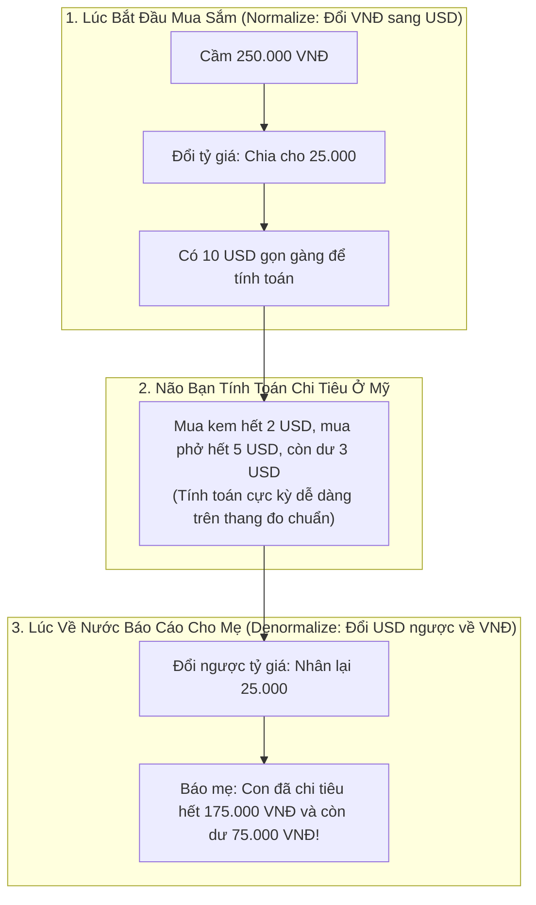
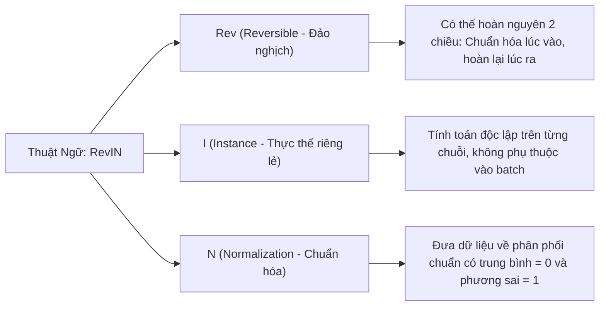
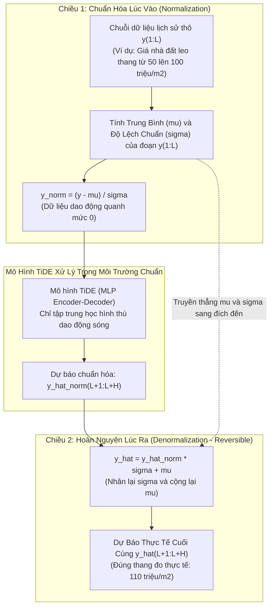

# Thuật Ngữ: RevIN (Reversible Instance Normalization)

> **Phương pháp tiếp cận Feynman (Feynman Technique)**:  
> *"Nếu bạn không thể giải thích một điều gì đó cho một đứa trẻ 10 tuổi hiểu, thì chính bạn cũng chưa thực sự hiểu nó."*  
> Bài viết này giải mã kỹ thuật **RevIN (Chuẩn Hóa Thực Thể Đảo Nghịch)** từ câu chuyện đổi tiền khi đi du lịch nước ngoài, làm sáng tỏ bài toán phân phối dữ liệu trôi dạt và lý do vì sao nó là "vũ khí bí mật" giúp TiDE dự báo chuẩn xác trên các chuỗi thời gian biến động dữ dội.

---

## 1. Giải Thích Cho Một Đứa Trẻ 10 Tuổi: Câu Chuyện Đổi Tiền Khi Đi Du Lịch

Hãy tưởng tượng bạn sống ở Việt Nam và quen tiêu tiền **Việt Nam Đồng (VNĐ)**. Bạn biết rất rõ: một cây kem giá 10.000đ, một bát phở giá 50.000đ. Não của bạn đã quen thuộc với thang đo hàng chục nghìn đồng này.

Một ngày nọ, bạn bay sang Mỹ du lịch. Ở Mỹ, người ta dùng tiền **Đô la Mỹ (USD)**: một cây kem giá 2 USD, một bát phở giá 10 USD.  
Nếu bạn cứ giữ nguyên thói quen số học cũ của tiền Việt Nam mà sang Mỹ:
- Bạn sẽ bị "sốc số liệu" hoàn toàn: Con số 2 USD quá nhỏ bé so với 10.000đ, não bạn không thể so sánh hay tính toán chi tiêu hợp lý được nữa!

**Cách giải quyết thông minh của bạn**:
1. **Lúc bước vào nước Mỹ**: Bạn lấy số tiền chia cho tỷ giá 25.000 để đổi sang thang đo USD nhỏ gọn.
2. **Trong suốt chuyến đi**: Não bạn thoải mái tính toán cộng trừ trên thang đo 1, 2, 5 USD.
3. **Lúc về Việt Nam**: Bạn nhân ngược lại với tỷ giá 25.000 để chuyển con số USD về lại VNĐ ban đầu và báo cáo cho mẹ.

> 💡 **Định nghĩa kiểu Feynman**:  
> **RevIN (Reversible Instance Normalization)** là chiếc **"máy đổi tiền hai chiều"**.  
> - **Chiều đi**: Đưa dữ liệu quá khứ về thang đo chuẩn (trung bình = 0) để mạng nơ-ron học quy luật hình thù dao động mà không bị sốc vì giá trị quá to hay quá nhỏ.  
> - **Chiều về**: Sau khi mạng dự báo xong, nó lập tức nhân và cộng ngược lại các giá trị ban đầu để trả về đúng con số thực tế.

---

## 2. Bóc Tách Từng Từ Ngữ Chuyên Ngành (Deconstructing the Jargon)

Tại sao kỹ thuật này lại có tên viết tắt là **RevIN**?

| Thành phần | Nghĩa gốc | Ý nghĩa trong Machine Learning | Phản nghĩa / Đối lập |
|:---|:---|:---|:---|
| **Reversible** (*Đảo nghịch*) | Quay ngược lại trạng thái ban đầu | Phép biến đổi toán học có ánh xạ ngược $f^{-1}$, đảm bảo không làm mất thông tin gốc. | **Irreversible** (*Một đi không trở lại, mất mát thông tin*). |
| **Instance** (*Thực thể*) | Một trường hợp, một cá thể | Thống kê trung bình $\mu$ và độ lệch chuẩn $\sigma$ được tính riêng cho **từng chuỗi thời gian đơn lẻ**. | **Batch** (*Gom chung cả nhóm nhiều chuỗi thời gian*). |
| **Normalization** (*Chuẩn hóa*) | Đưa về quy chuẩn | Phép biến đổi Z-score đưa dữ liệu bất kỳ về phân phối có $\text{Mean} = 0$ và $\text{Std} = 1$. | **Raw Scale** (*Thang đo thô nguyên bản*). |

---

## 3. Trực Quan Hóa Cơ Chế 2 Chiều Của RevIN (The "Aha!" Moment)

RevIN hoạt động như một lớp vỏ bọc bên ngoài mô hình dự báo TiDE:

### Công Thức Toán Học Chi Tiết:

#### 1. Chiều đi (Normalize):
Với mỗi chuỗi thời gian $y_{1:L}^{(i)}$, ta tính giá trị trung bình $\mu^{(i)}$ và độ lệch chuẩn $\sigma^{(i)}$:

$$
\mu^{(i)} = \frac{1}{L} \sum_{t=1}^{L} y_t^{(i)}, \quad \sigma^{(i)} = \sqrt{\frac{1}{L} \sum_{t=1}^{L} \left( y_t^{(i)} - \mu^{(i)} \right)^2 + \epsilon}
$$

Chuẩn hóa chuỗi đầu vào đưa vào mạng:

$$
y_{\text{norm}, t}^{(i)} = \frac{y_t^{(i)} - \mu^{(i)}}{\sigma^{(i)}} \quad \forall t \in \{1, 2, \dots, L\}
$$

#### 2. Chiều về (Denormalize):
Sau khi mô hình TiDE sinh ra kết quả dự báo chuẩn hóa $\hat{y}_{\text{norm}, L+t}^{(i)}$, RevIN áp dụng phép biến đổi ngược hoàn nguyên giá trị:

$$
\hat{y}_{L+t}^{(i)} = \hat{y}_{\text{norm}, L+t}^{(i)} \cdot \sigma^{(i)} + \mu^{(i)} \quad \forall t \in \{1, 2, \dots, H\}
$$

> 🎯 **Khoảnh khắc "Aha!"**:  
> Bạn có nhận ra điều kỳ diệu không?  
> Mạng nơ-ron TiDE **chỉ làm việc trong một thế giới hoàn hảo** nơi mà mọi chuỗi thời gian đều có trung bình bằng 0! Nó không bao giờ bị bối rối vì chuyện hôm nay số liệu to gấp 10 lần năm ngoái.  
> Mọi gánh nặng về việc "chuỗi này đang nằm ở mức cao hay mức thấp" đã được RevIN gánh vác trọn vẹn thông qua hai con số $\mu$ và $\sigma$!

---

## 4. Tại Sao RevIN Là Cứu Tinh Trước Hiện Tượng Trôi Phân Phối (Distribution Shift)?

Trong thực tế, chuỗi thời gian hầu như **không bao giờ có tính dừng (Non-Stationary)**:
- **Lạm phát**: Giá cả hàng hóa ngày càng tăng lên.
- **Tăng trưởng người dùng**: Lưu lượng truy cập máy chủ năm 2026 gấp 10 lần năm 2020.
- **Thời tiết theo mùa**: Mùa đông nhiệt độ trung bình là $10^\circ\text{C}$, mùa hè nhiệt độ trung bình là $35^\circ\text{C}$.

### Vấn Đề Gì Xảy Ra Nếu KHÔNG Có RevIN?
Nếu không có RevIN, khi mạng nơ-ron được huấn luyện trên dữ liệu quá khứ có giá trị trung bình quanh mức 50, nhưng bước sang giai đoạn kiểm thử dữ liệu thực tế tăng vọt lên mức 200:
- Mạng nơ-ron chưa từng nhìn thấy các con số lớn như 200 trong quá trình học.
- Các hàm kích hoạt ReLU sẽ bị bão hòa hoặc sai lệch hoàn toàn, dẫn đến dự báo bị bẹp dí ở mức cũ và sai số tăng vọt!

### Bằng Chứng Thực Nghiệm Trong Bài Báo TiDE:
Trong Bảng 8 của bài báo gốc, nhóm tác giả chỉ ra rằng trên các tập dữ liệu có độ trôi dạt phân phối mạnh mẽ như **Traffic (Lưu lượng giao thông)** và **ETT (Nhiệt độ dầu máy biến áp)**:
- Bật `revIn = True` giúp giảm mạnh sai số MSE từ **30% đến hơn 50%** so với khi tắt RevIN!

---

## 5. Mô Hình TiDE Triển Khai RevIN Như Thế Nào?

1. **Chỉ áp dụng trên chuỗi mục tiêu $y$**:  
   RevIN chỉ được áp dụng để chuẩn hóa chuỗi mục tiêu $y_{1:L}$. Các biến ngoại sinh $x_t$ (như giờ trong ngày, ngày lễ) đã được chuẩn hóa về đoạn $[-0.5, 0.5]$ trong bộ Data Loader nên không cần qua RevIN.
2. **Cấu hình siêu tham số linh hoạt**:  
   Tùy theo đặc tính của từng bộ dữ liệu mà tác giả quyết định bật hay tắt RevIN:
   - Các tập dữ liệu biến thiên mạnh (**Traffic, ETTm2, ETTh1, ETTh2**): Cấu hình `revIn = True`.
   - Các tập dữ liệu đã có tính dừng ổn định (**Electricity, Weather, ETTm1**): Cấu hình `revIn = False`.

---

## 6. Tổng Kết 30 Giây (The Elevator Pitch)

1. **RevIN là gì?**  
   Là kỹ thuật chuẩn hóa đảo nghịch hai chiều: trừ trung bình và chia độ lệch chuẩn trước khi vào mạng, sau đó nhân và cộng ngược lại khi có kết quả dự báo.
2. **Nó giải quyết vấn đề gì?**  
   Giải quyết triệt để hiện tượng trôi dạt phân phối thời gian (Non-stationarity / Distribution Shift), giúp mô hình không bị "sốc số liệu" khi tương lai có giá trị cao hoặc thấp hơn quá khứ.
3. **Hiệu quả thực tế ra sao?**  
   Giúp mô hình TiDE giảm mạnh từ 30% đến 50% sai số dự báo trên các tập dữ liệu giao thông và biến áp điện lực có xu hướng biến động dữ dội.
