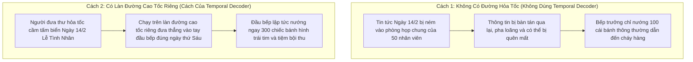
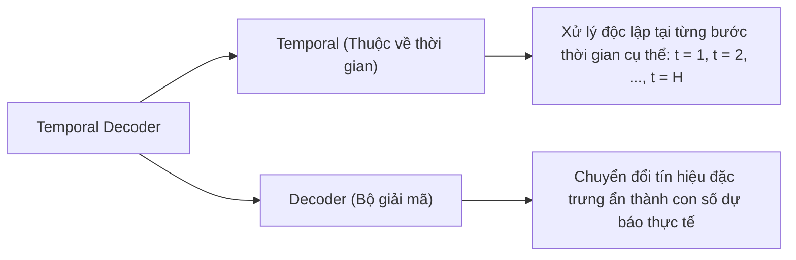
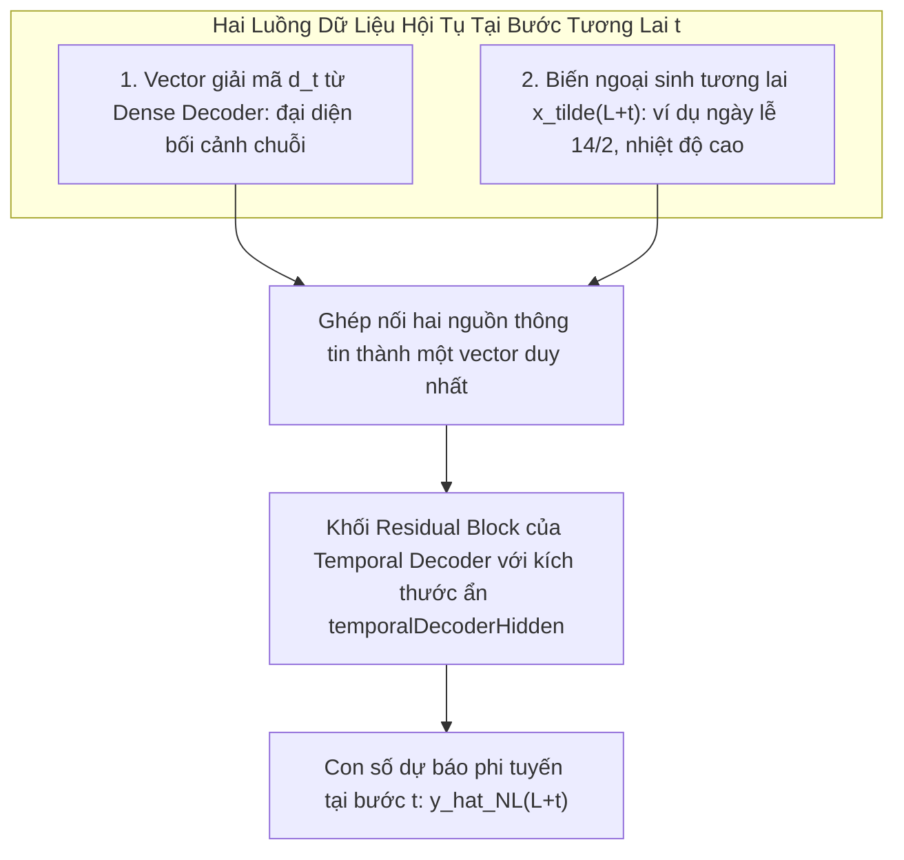

# Thuật Ngữ: Temporal Decoder (Bộ Giải Mã Theo Thời Gian)

> **Phương pháp tiếp cận Feynman (Feynman Technique)**:  
> *"Nếu bạn không thể giải thích một điều gì đó cho một đứa trẻ 10 tuổi hiểu, thì chính bạn cũng chưa thực sự hiểu nó."*  
> Bài viết này bóc tách khái niệm **Temporal Decoder** từ câu chuyện người đưa thư hỏa tốc trong tiệm bánh pizza, giải thích vì sao cơ chế "đường cao tốc" này là bí quyết giúp mô hình TiDE phản ứng chuẩn xác với các sự kiện tương lai đột xuất.

---

## 1. Giải Thích Cho Một Đứa Trẻ 10 Tuổi: Người Đưa Thư Hỏa Tốc Trong Tiệm Pizza

Hãy tưởng tượng bạn là bếp trưởng của một tiệm bánh pizza nổi tiếng. Bạn đang phải lên kế hoạch: **"Thứ Sáu tuần sau cần chuẩn bị bao nhiêu chiếc bánh pizza?"**

Bạn có hai luồng thông tin:
1. **Quy luật chung (Bộ giải mã toàn cục)**: Thông thường vào ngày thứ Sáu, quán bán được khoảng 100 chiếc bánh.
2. **Sự kiện đặc biệt tương lai**: Lật cuốn lịch ra, bạn thấy thứ Sáu tuần sau đúng vào ngày **Lễ Tình Nhân 14/2**!

Bây giờ có hai cách tổ chức hoạt động của tiệm:

- **Cách 1 (Không có Temporal Decoder)**: Thông tin "Ngày 14/2" bị đưa vào phòng họp chung của toàn bộ nhân viên. Mọi người bàn bạc một hồi lâu, thông tin bị pha loãng và có thể trôi mất. Kết quả là đầu bếp vẫn chỉ làm 100 chiếc bánh và bị cháy hàng.
- **Cách 2 (Có Temporal Decoder)**: Có một **người đưa thư hỏa tốc** chạy trên một làn đường riêng (**Covariate Highway**). Đúng vào mốc thứ Sáu tuần sau, người đưa thư mang thông tin "Ngày 14/2" trao thẳng vào tay người thợ nướng bánh. Người thợ lập tức phản ứng: *"Hôm nay là lễ Tình nhân, phải làm 300 chiếc bánh hình trái tim!"*

> 💡 **Định nghĩa kiểu Feynman**:  
> **Temporal Decoder** chính là **"làn đường cao tốc"** dẫn truyền thông tin ngoại sinh của tương lai (như ngày lễ, khuyến mãi, thời tiết xấu) chạy thẳng tới đúng bước thời gian cần dự báo, giúp mô hình phản ứng tức thì mà không bị pha loãng thông tin.

---

## 2. Bóc Tách Từng Từ Ngữ Chuyên Ngành (Deconstructing the Jargon)

Tại sao lại gọi là **Temporal Decoder**?

| Thành phần | Nghĩa gốc | Ý nghĩa trong Machine Learning | Phản nghĩa / Đối lập |
|:---|:---|:---|:---|
| **Temporal** (*Theo thời gian*) | Gắn liền với một thời điểm xác định | Phép toán được thực hiện riêng rẽ cho từng bước thời gian trong tương lai $t \in \{1, \dots, H\}$. | **Static** (*Phi thời gian, tổng thể*). |
| **Decoder** (*Bộ giải mã*) | Giải nghĩa, dịch mã | Khối nơ-ron nhận vector đặc trưng trừu tượng và sinh ra con số dự báo mục tiêu $\hat{y}_t$. | **Encoder** (*Bộ mã hóa nén dữ liệu vào*). |

---

## 3. Trực Quan Hóa Bằng Sơ Đồ Khối (The "Aha!" Moment)

Hãy nhìn vào cách thức vận hành của Temporal Decoder tại mỗi bước thời gian tương lai thứ $t$ ($t \in \{1, 2, \dots, H\}$):

Công thức toán học:

$$
\hat{y}_{L+t,\text{NL}}^{(i)} = \text{TemporalDecoder} \left( \begin{bmatrix} d_t^{(i)} \\ \tilde{x}_{L+t}^{(i)} \end{bmatrix} \right) \in \mathbb{R} \quad \forall t \in \{1, 2, \dots, H\}
$$

> 🎯 **Khoảnh khắc "Aha!"**:  
> Bạn có nhận ra sự tinh tế ở đây không?  
> - Vector $d_t^{(i)}$ mang thông tin **xu hướng toàn cục** được chắt lọc từ quá khứ.  
> - Vector $\tilde{x}_{L+t}^{(i)}$ mang thông tin **đột biến cục bộ** của chính thời điểm đó trong tương lai.  
> 
> Temporal Decoder kết hợp cả hai yếu tố này lại ngay tại đích đến, giúp dự báo vừa giữ được xu hướng vĩ mô vừa phản ánh chính xác từng cú sốc vi mô!

---

## 4. Bằng Chứng Thực Nghiệm: Chuyện Gì Xảy Ra Nếu Bỏ Temporal Decoder?

Trong bài báo gốc (Hình 3, Trang 10-11), nhóm tác giả Google Research đã làm một thí nghiệm so sánh trực tiếp mô hình TiDE **có Temporal Decoder** và **không có Temporal Decoder** trên tập dữ liệu phụ tải điện bị chèn sự kiện giả lập (đợt nắng nóng đột ngột):

| Tình Huống Thực Tế | Mô Hình CÓ Temporal Decoder | Mô Hình KHÔNG CÓ Temporal Decoder |
|:---|:---|:---|
| **Trong đợt nắng nóng đột ngột** | Dự báo tăng vọt chính xác theo nhu cầu tiêu thụ điện lạnh. | Dự báo tăng chậm và bị trễ pha. |
| **Giai đoạn ngay sau khi sự kiện kết thúc** | 🟢 **Hồi phục ngay lập tức**: Trở về quỹ đạo bình thường chỉ sau 1 epoch huấn luyện. | 🔴 **Bị chao đảo, mất phương hướng kéo dài**: Dự báo tiếp tục sai lệch nhiều bước sau đó do không có đường dẫn tắt tương lai để cân chỉnh. |

---

## 5. Mô Hình TiDE Thiết Kế Temporal Decoder Như Thế Nào?

1. **Khối lượng tham số cực kỳ gọn nhẹ**:  
   Temporal Decoder chỉ là một khối Residual Block nhỏ với đầu ra có kích thước duy nhất là 1 (`out_dim = 1`).
2. **Chia sẻ trọng số trên toàn bộ Horizon**:  
   Cùng một khối Temporal Decoder này được áp dụng lặp lại cho cả $H$ bước tương lai ($t = 1, 2, \dots, H$).
3. **Kết hợp với Global Linear Skip Connection**:  
   Dự báo cuối cùng là phép cộng giữa đầu ra phi tuyến của Temporal Decoder và nhánh tắt tuyến tính toàn cục:

$$
\hat{y}_{L+t} = \hat{y}_{L+t,\text{NL}} + \hat{y}_{L+t,\text{Linear}}
$$

---

## 6. Tổng Kết 30 Giây (The Elevator Pitch)

1. **Temporal Decoder là gì?**  
   Là khối nơ-ron giải mã theo từng bước thời gian, kết hợp vector bối cảnh $d_t$ với biến ngoại sinh tương lai $\tilde{x}_{L+t}$ để sinh ra dự báo cho bước đó.
2. **Vai trò then chốt là gì?**  
   Đóng vai trò như một **"đường cao tốc" (highway)**, đưa thông tin ngày lễ, khuyến mãi hoặc thời tiết xấu của tương lai bắn thẳng vào kết quả dự báo của ngày hôm đó.
3. **Tại sao nó giúp TiDE chiến thắng?**  
   Giúp mô hình phản ứng tức thì với các sự kiện đột biến trong tương lai và hồi phục quỹ đạo bình thường ngay sau sự kiện chỉ sau 1 epoch học.
