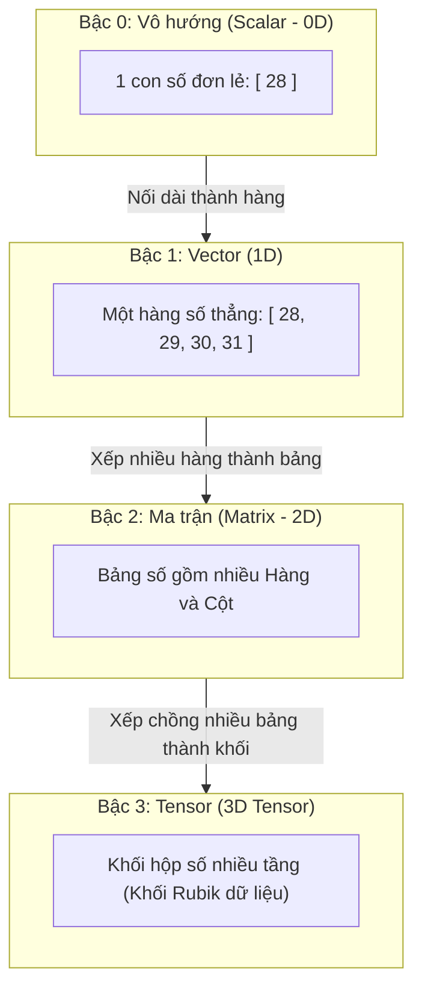
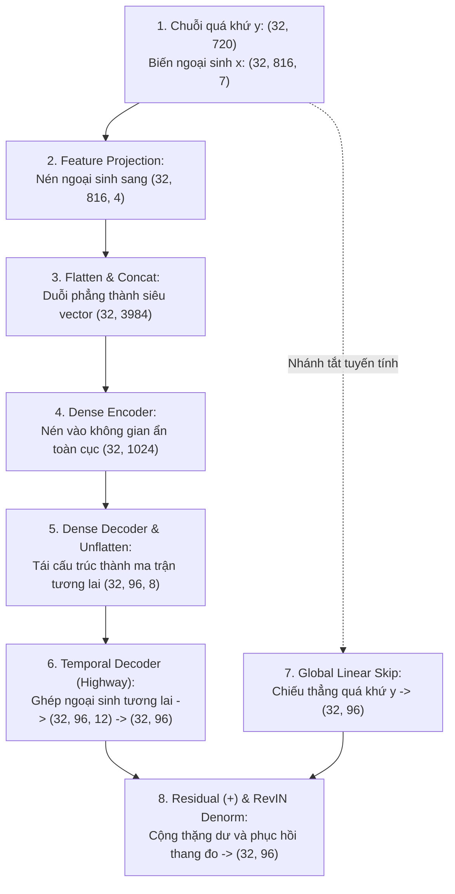

# Thuật Ngữ: Tensor (Ten-xơ) - Vật Chứa Dữ Liệu Đa Chiều Của Trí Tuệ Nhân Tạo

> **Phương pháp tiếp cận Feynman (Feynman Technique)**:  
> *"Nếu bạn không thể giải thích một điều gì đó cho một đứa trẻ 10 tuổi hiểu, thì chính bạn cũng chưa thực sự hiểu nó."*  
> Bài viết này giải mã khái niệm nền tảng **Tensor** từ câu chuyện chiếc tủ thuốc nhiều ngăn và khối Rubik đời thường, làm rõ bước nhảy không gian từ Vô hướng (0D) $\to$ Vector (1D) $\to$ Ma trận (2D) $\to$ Tensor (3D/N-D), đồng thời giải phẫu hành trình biến hóa kích thước tensor qua toàn bộ các tầng kiến trúc của mô hình TiDE.

---

## 1. Giải Thích Cho Một Đứa Trẻ 10 Tuổi: Khối Rubik & Chiếc Tủ Đồ Chơi Nhiều Ngăn

Hãy tưởng tượng bạn có một bộ sưu tập các khối đồ chơi xếp hình bằng gỗ có ghi các con số:

### 4 Cấp bậc đồ chơi từ đơn giản đến phức tạp:
1. **Một khối gỗ đơn lẻ (Bậc 0 - Scalar / Vô hướng)**:  
   Bạn cầm trên tay đúng **1 khối gỗ duy nhất** ghi số $28$. Đây là một con số đơn độc (ví dụ: nhiệt độ hôm nay là $28^\circ\text{C}$, hay chiều cao của bạn là $135\text{ cm}$). Nó không có chiều dài hay chiều rộng gì cả.
2. **Một thanh gỗ xếp thẳng hàng (Bậc 1 - Vector / Véc-tơ)**:  
   Bạn xếp 7 khối gỗ thành một hàng dài trên bàn để ghi lại nhiệt độ từ thứ Hai đến Chủ Nhật: `[28, 29, 27, 30, 31, 29, 28]`. Đây là một **dải số 1 chiều** — muốn tìm số nào, bạn chỉ cần một chỉ số duy nhất: "Cho tôi xem số ở vị trí thứ 3".
3. **Một tấm bảng gỗ hình chữ nhật (Bậc 2 - Matrix / Ma trận)**:  
   Bạn xếp nhiều hàng gỗ song song nhau tạo thành một tấm bảng ô cờ gồm nhiều hàng và cột (ví dụ: bảng theo dõi nhiệt độ của 4 thành phố trong 7 ngày). Đây là **bảng số 2 chiều** — muốn tìm một số, bạn cần 2 chỉ số: "Thành phố thứ mấy (hàng), ngày thứ mấy (cột)".
4. **Một khối Rubik nhiều tầng (Bậc 3 trở lên - Tensor / Ten-xơ)**:  
   Bạn xếp chồng nhiều tấm bảng gỗ lên nhau tạo thành một khối hộp 3 chiều (ví dụ: nhiệt độ của 4 thành phố, trong 7 ngày, được đo liên tục qua 12 tháng trong năm). Khối hộp số học này chính là một **Tensor 3 chiều**!  
   Nếu bạn đóng 100 khối hộp Rubik đó vào một thùng xe tải lớn, bạn sẽ có một **Tensor 4 chiều**.



> 💡 **Định nghĩa kiểu Feynman**:  
> **Tensor** thực chất là **"chiếc tủ nhiều tầng, nhiều ngăn chứa các con số một cách ngăn nắp"**. Dù dữ liệu có phức tạp đến đâu — từ bảng điểm, chuỗi thời gian, bức ảnh màu đến video nhiều khung hình — máy tính đều xếp gọn chúng vào một chiếc hộp Tensor đa chiều để xử lý cùng một lúc.

---

## 2. Bóc Tách Từng Từ Ngữ Chuyên Ngành (Deconstructing the Jargon)

### Nguồn gốc từ ngữ:
* Từ **Tensor** bắt nguồn từ tiếng Latinh cổ *"tendere"* có nghĩa là **"kéo căng"** (*to stretch*).
* Vào thế kỷ 19, các nhà vật lý học dùng từ này để mô tả lực căng và ứng suất tác động theo nhiều hướng khác nhau trong lòng các thanh kim loại hoặc chất lỏng.
* Đến kỷ nguyên Trí tuệ Nhân tạo (Machine Learning / Deep Learning), các nhà khoa học máy tính đã mượn từ này để gọi chung cho **mảng số nhiều chiều (Multi-dimensional Array)** vì nó có khả năng "kéo giãn" cấu trúc ra bao nhiêu chiều tùy ý ($0D, 1D, 2D, 3D, \dots, nD$).

### Bảng phân loại 4 cấp bậc cơ bản của Tensor:

| Cấp Bậc (Rank / Order) | Tên Gọi Toán Học | Cấu Trúc Trực Quan | Ví Dụ Đời Thực | Hình Dạng Code (Shape) |
| :---: | :--- | :--- | :--- | :---: |
| **Rank 0** | **Scalar** (Vô hướng) | 1 điểm duy nhất | Nhiệt độ phòng, hệ số học tập $\text{lr} = 0.001$ | `()` hoặc `(1,)` |
| **Rank 1** | **Vector** (Véc-tơ) | 1 đường thẳng (1 trục) | Danh sách giá điện trong 24 giờ, 1 câu văn | `(24,)` |
| **Rank 2** | **Matrix** (Ma trận) | 1 mặt phẳng (2 trục: Hàng $\times$ Cột) | Bảng tính Excel, ảnh xám (Chiều cao $\times$ Chiều rộng) | `(H, W)` hoặc `(720, 96)` |
| **Rank 3** | **3D Tensor** | 1 khối hộp (3 trục) | Ảnh màu RGB `(3, H, W)`, Chuỗi thời gian một Batch `(B, T, F)` | `(32, 816, 7)` |
| **Rank 4** | **4D Tensor** | Tập hợp nhiều khối hộp | Video gồm nhiều khung hình màu `(Batch, Frames, C, H, W)` | `(16, 30, 3, 224, 224)` |

---

## 3. Trực Quan Hóa Bằng Bảng Dữ Liệu & Hình Ảnh (The "Aha!" Moment)

### Cấu trúc Tensor 3 chiều đặc thù trong bài toán Dự báo Chuỗi thời gian (TiDE)

Trong mô hình TiDE, nguồn dữ liệu ngoại sinh động được biểu diễn bằng một Tensor 3 chiều có kích thước chuẩn:

$$
X \in \mathbb{R}^{B \times (L+H) \times r}
$$

Trong đó:
* **Chiều thứ nhất ($B = 32$) - Trục Batch (Tập mẫu)**: Biểu thị số lượng chuỗi thời gian được xử lý song song trong cùng một nhịp (ví dụ: 32 khách hàng dùng điện khác nhau).
* **Chiều thứ hai ($L+H = 816$) - Trục Thời Gian (Time Steps)**: Trục thời gian trải dài từ 720 bước quá khứ đến 96 bước tương lai.
* **Chiều thứ ba ($r = 7$) - Trục Đặc Trưng (Features / Covariates)**: 7 biến ngoại sinh đo được tại mỗi mốc thời gian (giờ trong ngày, ngày trong tuần, nhiệt độ, độ ẩm...).

```
                      Trục Thời Gian (L+H = 816 bước)
                   t=1     t=2     t=3   ...   t=816
                 ┌───────┬───────┬───────┬───┬───────┐
      Khách 1   │  x_1  │  x_2  │  x_3  │...│ x_816 │ ──┐
                 ├───────┼───────┼───────┼───┼───────┤   │
Trục  Khách 2   │  x_1  │  x_2  │  x_3  │...│ x_816 │   │ Mỗi ô là một vector r = 7
Mẫu              ├───────┼───────┼───────┼───┼───────┤   │ đặc trưng ngoại sinh:
(B=32) ...       │  ...  │  ...  │  ...  │...│  ...  │   │ [ Giờ, Ngày, Tháng, Temp,... ]
                 ├───────┼───────┼───────┼───┼───────┤   │
      Khách 32  │  x_1  │  x_2  │  x_3  │...│ x_816 │ ──┘
                 └───────┴───────┴───────┴───┴───────┘
```

### Thao tác cắt lát Tensor (Tensor Slicing) như cắt bánh:
* `X[0, :, :]`: Lấy toàn bộ lịch sử và tương lai của **riêng khách hàng đầu tiên** $\implies$ Trích xuất ra một **Ma trận 2D** kích thước `(816, 7)`.
* `X[:, 10, :]`: Chụp lại trạng thái của **tất cả 32 khách hàng tại đúng thời điểm thứ 10** $\implies$ Trích xuất ra một **Ma trận 2D** kích thước `(32, 7)`.
* `X[0, 10, 0]`: Lấy chỉ số giờ trong ngày của khách hàng 0 tại bước thời gian 10 $\implies$ Trích xuất ra đúng **1 con số đơn lẻ (Scalar 0D)**.

---

## 4. Thách Thức Kỹ Thuật: Vì Sao Deep Learning Bắt Buộc Phải Dùng Tensor?

Tại sao các kỹ sư trí tuệ nhân tạo không dùng danh sách thông thường (`list` lồng `list` trong Python) mà phải tạo ra thư viện Tensor chuyên dụng như PyTorch Tensor hay TensorFlow?

### 1. Nỗi ác mộng của vòng lặp `for` lồng nhau (Slow Execution)
Nếu bạn có một batch gồm 32 chuỗi, mỗi chuỗi 816 bước thời gian, mỗi bước có 7 biến ngoại sinh. Để cộng thêm 1 giá trị độ lệch (bias), một chương trình viết bằng vòng lặp `for` lồng 3 tầng sẽ phải chạy:

$$
32 \times 816 \times 7 = 182,784 \text{ lần lặp}
$$

Trong Python thuần, thao tác này mất hàng trăm mili-giây, khiến việc huấn luyện mô hình sâu mất hàng tháng trời.

### 2. Sức mạnh của Tensor: Vector hóa & Tăng tốc phần cứng (Hardware Acceleration)
* **Xử lý song song trên GPU/TPU**: Card đồ họa (GPU) sở hữu hàng nghìn nhân tính toán nhỏ (CUDA Cores). Khi dữ liệu được đóng gói thành một Tensor, GPU sẽ nạp toàn bộ $182,784$ con số vào bộ nhớ băng thông cao và thực hiện phép cộng trên tất cả các phần tử **chỉ trong 1 chu kỳ xung nhịp duy nhất (1 clock cycle)**.
* **Cơ chế Tự Động Tính Đạo Hàm (Autograd Engine)**: Khi dữ liệu đi qua các phép toán tensor, PyTorch tự động xây dựng đồ thị điện toán (Computational Graph). Nhờ đó, mô hình có thể lan truyền ngược đạo hàm (*Backpropagation*) trên hàng triệu trọng số ma trận cực kỳ mượt mà.
* **Khuếch đại kích thước thông minh (Broadcasting)**: Cho phép thực hiện các phép cộng, trừ giữa một Tensor 3D `(32, 816, 4)` và một Vector 1D `(4,)` mà không cần phải nhân bản dữ liệu tốn bộ nhớ RAM.

---

## 5. Tensor Trong Kiến Trúc TiDE Vận Hành Như Thế Nào?

Mô hình TiDE (Google Research, 2023) là một ví dụ mẫu mực về nghệ thuật biến đổi hình dạng Tensor (*Tensor Reshaping & Projection*). Dưới đây là hành trình chuyển đổi kích thước của Tensor qua 8 giai đoạn:



### Bảng đối chiếu các thao tác Tensor trong mã nguồn TiDE:

| Giai Đoạn | Thao Tác Biến Đổi Tensor | Hàm PyTorch Tương Ứng | Kích Thước Vào (Input Shape) | Kích Thước Ra (Output Shape) |
| :---: | :--- | :--- | :---: | :---: |
| **Giai đoạn 1** | Chuẩn hóa RevIN độc lập | `(y - mean) / std` | `(32, 720)` | `(32, 720)` |
| **Giai đoạn 2** | Chiếu giảm chiều đặc trưng | `self.feature_proj(x)` | `(32, 816, 7)` | `(32, 816, 4)` |
| **Giai đoạn 3** | Trải phẳng và Ghép nối không gian | `torch.flatten()` & `torch.cat()` | `(32, 720)` & `(32, 816, 4)` | `(32, 3984)` |
| **Giai đoạn 4** | Mã hóa dày đặc đa tầng | `self.encoder(u_enc)` | `(32, 3984)` | `(32, 1024)` |
| **Giai đoạn 5** | Giải mã và Tái cấu trúc ma trận | `self.decoder(e).view(B, H, p)` | `(32, 1024)` | `(32, 96, 8)` |
| **Giai đoạn 6** | Ghép trục cuối & Giải mã thời gian | `torch.cat([D, x_fut], dim=-1)` | `(32, 96, 8)` & `(32, 96, 4)` | `(32, 96)` |
| **Giai đoạn 7** | Ánh xạ tuyến tính trực tiếp | `self.linear_skip(y)` | `(32, 720)` | `(32, 96)` |
| **Giai đoạn 8** | Cộng phần dư & Phục hồi thang đo | `y_nl + y_lin` & `y * std + mean` | `(32, 96)` & `(32, 96)` | `(32, 96)` |

---

## 6. Tổng Kết 30 Giây (The Elevator Pitch)

* **Tensor là gì**: Là cấu trúc mảng đa chiều tổng quát hóa từ Vô hướng (0D), Vector (1D), Ma trận (2D) đến Khối Rubik số học ($n\text{D}$), đóng vai trò là "vật chứa dữ liệu" tiêu chuẩn của toàn bộ ngành Trí tuệ Nhân tạo.
* **Tại sao cần Tensor**: Cho phép loại bỏ vòng lặp chậm chạp trong Python, tận dụng hàng nghìn lõi tính toán song song trên GPU/TPU thông qua kỹ thuật vector hóa (*vectorization*) và tự động vi phân (*autograd*).
* **Tensor trong TiDE**: Toàn bộ mô hình TiDE là một cỗ máy điều phối Tensor tinh gọn — nén Tensor 3D ngoại sinh, duỗi phẳng thành Tensor 2D để mã hóa toàn cục qua MLP, rồi tái cấu trúc ngược lại thành Tensor 3D để dự báo từng bước thời gian với tốc độ vượt trội Transformer.
