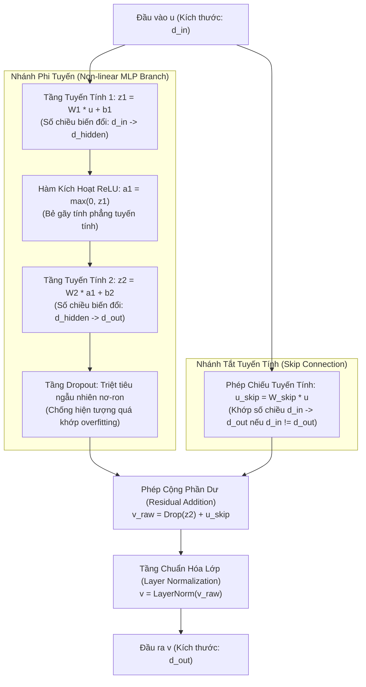
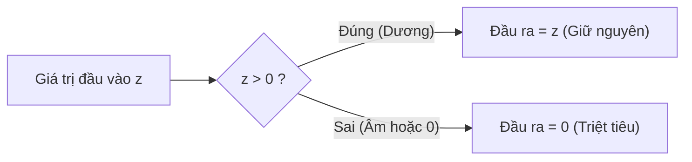

# Giải Thích Chi Tiết Phần 4.1: Khối Residual Block Trong TiDE

> **Mục tiêu tài liệu**: Bóc tách chi tiết từng thành phần toán học, cơ chế vận hành nội tại và ý nghĩa hình học của **Residual Block** — đơn vị xử lý nền tảng xuất hiện xuyên suốt kiến trúc TiDE (Feature Projection, Dense Encoder, Dense Decoder, Temporal Decoder).

---

## 1. Tổng Quan Kiến Trúc Khối Residual Block

Khối **Residual Block** trong TiDE là một mạng nơ-ron nhiều tầng dày đặc (**MLP**) có nhánh tắt tuyến tính, được chuẩn hóa và điều hòa cẩn thận.



Công thức toán học hoàn chỉnh:

$$
v = \text{LayerNorm} \left( \text{Dropout} \left( W_2 \cdot \text{ReLU}(W_1 u + b_1) + b_2 \right) + W_{\text{skip}} u \right)
$$

---

## 2. Làm Sao Đưa Được Số Chiều Từ $d_{\text{in}} \to d_{\text{hidden}}$?

Đây là nhiệm vụ của **Tầng Tuyến Tính Thứ Nhất (Linear Layer 1)**:

$$
z_1 = W_1 u + b_1
$$

### 2.1. Phép Toán Đại Số Tuyến Tính Chi Tiết
Giả sử vector đầu vào là $u \in \mathbb{R}^{d_{\text{in}}}$ (một vector cột có $d_{\text{in}}$ phần tử). Để biến đổi thành vector $z_1 \in \mathbb{R}^{d_{\text{hidden}}}$ có $d_{\text{hidden}}$ phần tử:

1. **Ma trận trọng số (Weight Matrix) $W_1$**:
   - Có kích thước là $d_{\text{hidden}} \times d_{\text{in}}$ (gồm $d_{\text{hidden}}$ hàng và $d_{\text{in}}$ cột).
   - Mỗi hàng thứ $j$ của ma trận $W_1$ (ký hiệu là $w_{1, j}^\top \in \mathbb{R}^{d_{\text{in}}}$) đại diện cho các trọng số kết nối từ toàn bộ $d_{\text{in}}$ đầu vào tới nơ-ron ẩn thứ $j$.
2. **Vector độ lệch (Bias Vector) $b_1$**:
   - Có kích thước là $d_{\text{hidden}} \times 1$.
3. **Phép nhân ma trận với vector**:

$$
\begin{bmatrix}
z_{1, 1} \\
z_{1, 2} \\
\vdots \\
z_{1, d_{\text{hidden}}}
\end{bmatrix}
=
\begin{bmatrix}
w_{1, 11} & w_{1, 12} & \dots & w_{1, 1 d_{\text{in}}} \\
w_{1, 21} & w_{1, 22} & \dots & w_{1, 2 d_{\text{in}}} \\
\vdots & \vdots & \ddots & \vdots \\
w_{1, d_{\text{hidden}} 1} & w_{1, d_{\text{hidden}} 2} & \dots & w_{1, d_{\text{hidden}} d_{\text{in}}}
\end{bmatrix}
\begin{bmatrix}
u_1 \\
u_2 \\
\vdots \\
u_{d_{\text{in}}}
\end{bmatrix}
+
\begin{bmatrix}
b_{1, 1} \\
b_{1, 2} \\
\vdots \\
b_{1, d_{\text{hidden}}}
\end{bmatrix}
$$

Giá trị của mỗi nơ-ron ẩn $z_{1, j}$ được tính bằng **tích vô hướng (dot product)** giữa hàng trọng số thứ $j$ và vector đầu vào $u$, cộng thêm bias $b_{1, j}$:

$$
z_{1, j} = \sum_{k=1}^{d_{\text{in}}} w_{1, jk} u_k + b_{1, j} = \langle w_{1, j}, \, u \rangle + b_{1, j}
$$

### 2.2. Ý Nghĩa Hình Học & Trực Giác Không Gian
- **Chiếu không gian (Space Projection)**: Phép nhân $W_1 u + b_1$ là một **biến đổi Affine** (bao gồm co giãn, xoay và tịnh tiến không gian).
- **Phát hiện mẫu hình (Feature Detection)**: Mỗi hàng $w_{1, j}$ đóng vai trò như một "máy dò" (detector). Khi vector đầu vào $u$ có hướng gần trùng với vector trọng số $w_{1, j}$, giá trị tích vô hướng sẽ rất lớn.
- **Mở rộng chiều (Up-projection)**: Thông thường trong tầng ẩn, $d_{\text{hidden}}$ lớn hơn nhiều so với $d_{\text{in}}$ (ví dụ: $d_{\text{in}} = 4 \to d_{\text{hidden}} = 256$). Việc mở rộng không gian này giúp dàn trải các điểm dữ liệu ra một không gian nhiều chiều hơn, nơi mà các dữ liệu phi tuyến tính phức tạp có thể dễ dàng tách biệt và biểu diễn hơn.

---

## 3. Hàm Kích Hoạt Phi Tuyến Tính (ReLU) Cụ Thể Làm Gì?

Sau khi qua tầng tuyến tính, giá trị $z_1$ được đưa qua hàm kích hoạt **ReLU (Rectified Linear Unit)**:

$$
a_1 = \text{ReLU}(z_1) = \max(0, \, z_1)
$$

Nghĩa là với từng phần tử $z_{1, j}$:
- Nếu $z_{1, j} > 0 \implies a_{1, j} = z_{1, j}$ (Giữ nguyên giá trị).
- Nếu $z_{1, j} \le 0 \implies a_{1, j} = 0$ (Chặn lại và dập tắt về 0).



### 3.1. Nghịch Lý Nếu Không Có Hàm Kích Hoạt Phi Tuyến (Linear Collapse)
Tại sao ta không thể chỉ dùng các tầng Linear nối tiếp nhau? Hãy thử làm toán:

Giả sử không có ReLU, ta có hai tầng tuyến tính liên tiếp:
- Tầng 1: $z_1 = W_1 u + b_1$
- Tầng 2: $z_2 = W_2 z_1 + b_2$

Thay $z_1$ vào $z_2$:

$$
z_2 = W_2 (W_1 u + b_1) + b_2 = (W_2 W_1) u + (W_2 b_1 + b_2)
$$

Đặt $W_{\text{new}} = W_2 W_1$ và $b_{\text{new}} = W_2 b_1 + b_2$, ta được:

$$
z_2 = W_{\text{new}} u + b_{\text{new}}
$$

> ⚠️ **Hậu quả nghiêm trọng**:  
> Tích của hai ma trận ($W_2 W_1$) vẫn chỉ là **MỘT ma trận duy nhất**!  
> Nếu không có hàm phi tuyến, dù bạn có xếp chồng **100 tầng hay 1000 tầng Linear**, toàn bộ mạng nơ-ron sâu đồ sộ đó cũng chỉ tương đương với **MỘT tầng Linear đơn lẻ duy nhất**! Mạng sẽ hoàn toàn bất lực trước mọi quy luật phi tuyến tính trong đời thực.

### 3.2. ReLU Bẻ Gãy Tính Tuyến Tính Như Thế Nào?
- **Tạo mặt siêu phẳng từng đoạn (Piecewise Linear)**: ReLU biến không gian thành nhiều vùng cục bộ. Ở vùng này nơ-ron được kích hoạt (hệ số góc khác 0), ở vùng khác nơ-ron bị tắt (hệ số góc bằng 0). Khi kết hợp hàng trăm nơ-ron ReLU, mạng có thể uốn lượn và xấp xỉ bất kỳ hình thù đường cong phức tạp nào trong không gian (**Định lý Xấp xỉ Phổ quát - Universal Approximation Theorem**).
- **Tính kích hoạt thưa (Sparsity)**: Chỉ những tín hiệu thực sự quan trọng và vượt qua ngưỡng mới được truyền tiếp, các tín hiệu nhiễu âm bị triệt tiêu, giúp mô hình tiết kiệm năng lượng tính toán và tập trung vào đặc trưng cốt lõi.

---

## 4. Tầng Tuyến Tính Thứ Hai: Đưa Từ $d_{\text{hidden}} \to d_{\text{out}}$

Sau khi đã học được các đặc trưng phi tuyến tính phong phú trong không gian ẩn $a_1 \in \mathbb{R}^{d_{\text{hidden}}}$, mạng cần tổng hợp chúng về kích thước mong muốn của tầng tiếp theo:

$$
z_2 = W_2 a_1 + b_2
$$

- Ma trận $W_2 \in \mathbb{R}^{d_{\text{out}} \times d_{\text{hidden}}}$.
- Phép biến đổi này đóng vai trò chắt lọc và kết hợp tuyến tính các đặc trưng trừu tượng từ $d_{\text{hidden}}$ nơ-ron ẩn để tạo ra $d_{\text{out}}$ giá trị đại diện cho tầng tiếp theo.

---

## 5. Tầng Dropout: Tác Dụng Và Bản Chất

Tầng **Dropout** đặt ngay sau tầng tuyến tính thứ hai:
- Trong quá trình huấn luyện, mỗi nơ-ron có xác suất $p$ (`dropoutLevel`) bị ngẫu nhiên gán giá trị bằng 0 tại mỗi lượt tính (mini-batch).
- Khi đánh giá/kiểm thử (Inference), Dropout được tắt đi và nhân với hệ số $(1 - p)$ để bảo toàn kỳ vọng toán học.

### Tại sao Dropout lại hiệu quả?
1. **Chống đồng thích nghi (Preventing Co-adaptation)**: Nếu không có Dropout, các nơ-ron có xu hướng "dựa dẫm" vào nhau, một nơ-ron sửa lỗi sai của nơ-ron bên cạnh thay vì tự học đặc trưng hữu ích. Dropout buộc mỗi nơ-ron phải tự học một đặc trưng độc lập và mạnh mẽ.
2. **Mô hình kết hợp ngầm (Implicit Ensemble)**: Với $M$ nơ-ron, việc tắt ngẫu nhiên tương đương với việc huấn luyện đồng thời $2^M$ cấu trúc mạng nơ-ron con khác nhau, giúp kết quả dự báo ổn định và chống overfitting vượt trội.

---

## 6. Nhánh Tắt Tuyến Tính (Linear Skip Connection)

Song song với nhánh phi tuyến qua MLP ở trên, TiDE duy trì một nhánh tắt:

$$
u_{\text{skip}} = W_{\text{skip}} u
$$

- Nếu $d_{\text{in}} = d_{\text{out}}$, ma trận $W_{\text{skip}}$ chính là ma trận đơn vị $I$ (truyền thẳng dữ liệu $u$).
- Nếu $d_{\text{in}} \neq d_{\text{out}}$, $W_{\text{skip}} \in \mathbb{R}^{d_{\text{out}} \times d_{\text{in}}}$ là một phép chiếu tuyến tính đơn giản để khớp số chiều.

Hai nhánh được cộng lại với nhau:

$$
v_{\text{raw}} = \text{Dropout}(z_2) + u_{\text{skip}}
$$

### Tầm quan trọng của Skip Connection:
1. **Giải quyết bài toán Triệt tiêu Gradient (Vanishing Gradient)**:
   Khi tính đạo hàm để lan truyền ngược, gradient truyền qua nhánh cộng được bảo toàn:
   $$
   \frac{\partial v_{\text{raw}}}{\partial u} = \frac{\partial \text{MLP}(u)}{\partial u} + W_{\text{skip}}
   $$
   Số hạng $W_{\text{skip}}$ đảm bảo gradient luôn có một "đường cao tốc" chảy ngược thẳng về các tầng đầu vào mà không bị triệt tiêu về 0, cho phép huấn luyện các mạng nơ-ron sâu ổn định.
2. **Học phép đồng nhất (Identity Mapping)**:
   Nếu một tầng biến đổi phi tuyến không đem lại lợi ích, mạng chỉ cần điều chỉnh trọng số của nhánh MLP về 0. Khi đó $v \approx u_{\text{skip}}$, mạng tự động giữ nguyên thông tin ban đầu mà không làm biến dạng dữ liệu.

---

## 7. Tầng Chuẩn Hóa Lớp (Layer Normalization)

Bước cuối cùng của Residual Block là chuẩn hóa vector $v_{\text{raw}}$:

$$
v = \text{LayerNorm}(v_{\text{raw}}) = \frac{v_{\text{raw}} - \mu}{\sqrt{\sigma^2 + \epsilon}} \odot \gamma + \beta
$$

Trong đó:
- $\mu = \frac{1}{d_{\text{out}}} \sum_{k=1}^{d_{\text{out}}} v_{\text{raw}, k}$ (Giá trị trung bình của chính mẫu đó trên các chiều đặc trưng).
- $\sigma^2 = \frac{1}{d_{\text{out}}} \sum_{k=1}^{d_{\text{out}}} (v_{\text{raw}, k} - \mu)^2$ (Phương sai của mẫu đó).
- $\gamma, \beta \in \mathbb{R}^{d_{\text{out}}}$ là các tham số học được (learnable scale & shift).
- $\epsilon$ là số rất nhỏ (ví dụ $10^{-5}$) để tránh chia cho 0.

### Khác biệt giữa Layer Normalization và Batch Normalization:
- **Batch Normalization (BatchNorm)**: Chuẩn hóa theo trục dọc batch (phụ thuộc vào các mẫu khác trong cùng batch). Điều này rất nhạy cảm với batch size và khó áp dụng cho dữ liệu tuần tự có chiều dài thay đổi.
- **Layer Normalization (LayerNorm)**: Chuẩn hóa theo trục ngang đặc trưng của **từng mẫu độc lập**. Do đó, LayerNorm hoạt động cực kỳ ổn định bất kể batch size lớn hay nhỏ, giữ cho biên độ tín hiệu số học ổn định qua nhiều tầng xếp chồng.

---

## 8. Minh Họa Bằng Mã Nguồn PyTorch Cụ Thể

Dưới đây là cài đặt chuẩn của khối Residual Block trong PyTorch với kích thước tensor được theo dõi qua từng dòng lệnh:

```python
import torch
import torch.nn as nn

class ResidualBlock(nn.Module):
    def __init__(self, in_dim: int, hidden_dim: int, out_dim: int, dropout: float = 0.1, use_layer_norm: bool = True):
        super().__init__()
        
        # 1. Nhánh phi tuyến MLP
        self.fc1 = nn.Linear(in_dim, hidden_dim)      # d_in -> d_hidden
        self.relu = nn.ReLU()                         # Phi tuyến tính
        self.fc2 = nn.Linear(hidden_dim, out_dim)     # d_hidden -> d_out
        self.dropout = nn.Dropout(dropout)            # Chống overfitting
        
        # 2. Nhánh tắt tuyến tính (Skip Connection)
        if in_dim != out_dim:
            self.skip_proj = nn.Linear(in_dim, out_dim)  # Khớp số chiều
        else:
            self.skip_proj = nn.Identity()               # Giữ nguyên nếu đã khớp
            
        # 3. Chuẩn hóa lớp
        self.use_layer_norm = use_layer_norm
        if use_layer_norm:
            self.layer_norm = nn.LayerNorm(out_dim)

    def forward(self, u: torch.Tensor) -> torch.Tensor:
        # u: [Batch_Size, d_in]
        
        # Nhánh chính (MLP Branch)
        z1 = self.fc1(u)          # [Batch_Size, d_hidden]
        a1 = self.relu(z1)        # [Batch_Size, d_hidden]
        z2 = self.fc2(a1)         # [Batch_Size, d_out]
        out_mlp = self.dropout(z2)# [Batch_Size, d_out]
        
        # Nhánh phụ (Skip Branch)
        u_skip = self.skip_proj(u)# [Batch_Size, d_out]
        
        # Phép cộng Residual
        v_raw = out_mlp + u_skip  # [Batch_Size, d_out]
        
        # Chuẩn hóa lớp (Layer Normalization)
        if self.use_layer_norm:
            v = self.layer_norm(v_raw)
        else:
            v = v_raw
            
        return v  # [Batch_Size, d_out]

# Ví dụ chạy thử kiểm tra kích thước Tensor:
if __name__ == "__main__":
    batch_size = 8
    d_in = 4       # Ví dụ: Feature Projection từ 4 chiều covariates
    d_hidden = 64  # Kích thước tầng ẩn
    d_out = 16     # Chiều đầu ra mong muốn
    
    block = ResidualBlock(in_dim=d_in, hidden_dim=d_hidden, out_dim=d_out, dropout=0.2)
    sample_input = torch.randn(batch_size, d_in)
    sample_output = block(sample_input)
    
    print(f"Kích thước đầu vào u: {sample_input.shape}")   # torch.Size([8, 4])
    print(f"Kích thước đầu ra v:  {sample_output.shape}")  # torch.Size([8, 16])
```
