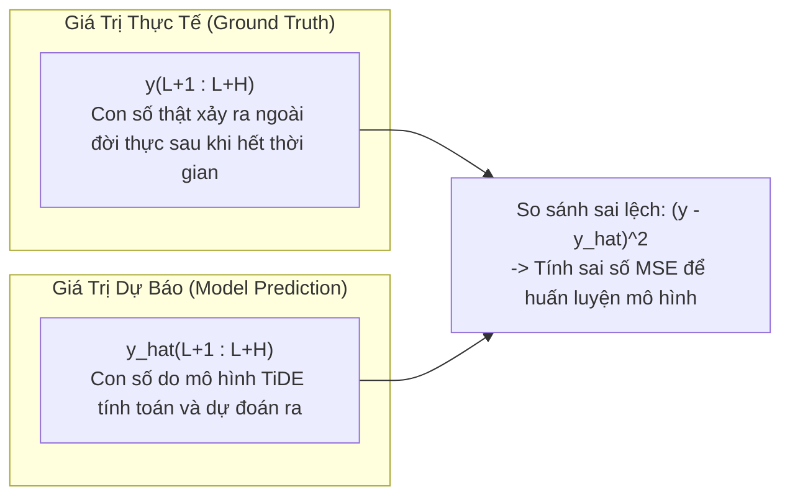

# Giải Thích Chi Tiết Công Thức: Vector Mục Tiêu Tương Lai $y_{L+1:L+H}^{(i)}$

> **Mục tiêu bài viết**: Mổ xẻ chi tiết từng ký tự toán học trong công thức biểu diễn chuỗi tương lai cần dự báo $y_{L+1:L+H}^{(i)} = [y_{L+1}^{(i)}, y_{L+2}^{(i)}, \dots, y_{L+H}^{(i)}]^\top \in \mathbb{R}^H$, kết hợp với các tình huống (use cases) thực tế trong đời sống và dự án TiDE.

---

## 1. Công Thức Đầy Đủ

$$
y_{L+1:L+H}^{(i)} = \begin{bmatrix} y_{L+1}^{(i)}, y_{L+2}^{(i)}, \dots, y_{L+H}^{(i)} \end{bmatrix}^\top \in \mathbb{R}^H
$$


---

## 2. Bóc Tách Chi Tiết Từng Thành Phần Toán Học

| Ký Tự | Tên Gọi Kỹ Thuật | Ý Nghĩa Bản Chất | Ý Nghĩa Trong Lập Trình (Python / PyTorch) |
|:---:|:---|:---|:---|
| **$y$** | **Biến mục tiêu (Target Variable)** | Đại lượng chính mà bài toán cần quan sát và dự đoán (ví dụ: lượng điện, số lượt xe, doanh số bán hàng). Phân biệt với biến phụ ngoại sinh $x$. | Tên cột dữ liệu mục tiêu trong bảng DataFrame (`df['target']`). |
| **$(i)$** | **Chỉ số kênh / chuỗi (Channel Index)** | Đại diện cho chuỗi thời gian thứ $i$ trong tập dữ liệu gồm $N$ chuỗi ($i \in \{1, 2, \dots, N\}$). Trong TiDE, mỗi chuỗi được xử lý độc lập (*Channel Independence*). | ID của cảm biến, mã sản phẩm hoặc chỉ số cột thứ $i$ trong ma trận dữ liệu đa biến. |
| **$L$** | **Độ dài nhìn lại (Look-back Window)** | Số lượng bước thời gian trong quá khứ mà mô hình được phép nhìn vào để lấy thông tin (ví dụ: 720 bước). | Độ dài cửa sổ đầu vào `lookback_len` hoặc `input_chunk_length`. |
| **$H$** | **Độ dài khoảng dự báo (Forecast Horizon)** | Số lượng bước thời gian trong tương lai mà mô hình phải dự đoán cùng lúc (ví dụ: 96, 192, 336, 720 bước). | Độ dài đầu ra `horizon_len` hoặc `output_chunk_length`. |
| **$L+1$** | **Thời điểm bắt đầu tương lai** | Bước thời gian đầu tiên ngay sau hiện tại. Nếu hiện tại là thời điểm $L$, thì $L+1$ chính là "bước tiếp theo". | Vị trí index bắt đầu của nhãn mục tiêu: `L : L + H`. |
| **$L+H$** | **Thời điểm kết thúc tương lai** | Bước thời gian xa nhất trong tương lai mà mô hình cần vươn tới trong một lần dự báo. | Mốc kết thúc của khoảng dự báo. |
| **$:$** | **Ký hiệu lát cắt thời gian (Slice Notation)** | Biểu thị một đoạn thời gian liên tục từ mốc bắt đầu ($L+1$) đến mốc kết thúc ($L+H$). | Tương tự toán tử cắt mảng `[start:end]` trong Python. |
| **$[\dots]$** | **Cặp ngoặc vuông** | Biểu diễn một danh sách tuần tự các giá trị số thực rời rạc theo thứ tự thời gian tăng dần. | Mảng một chiều (Array hoặc Tensor). |
| **$\top$** | **Phép chuyển vị (Transpose)** | Biến một vector hàng (ngang) thành một **vector cột (dọc)** chuẩn mực trong đại số tuyến tính. | Lệnh `.t()` hoặc `.transpose()` trong PyTorch. |
| **$\in \mathbb{R}^H$** | **Không gian vector $H$ chiều** | Khẳng định rằng đây là một vector chứa đúng $H$ con số thực liên tục. | Kích thước tensor: `shape = (H,)` hoặc `(H, 1)`. |

---

## 3. Các Ví Dụ Tình Huống Thực Tế (Real-World Use Cases)

---

### Tình Huống 1: Dự Báo Lượng Điện Tiêu Thụ Của Hộ Gia Đình (Electricity Dataset)

Giả sử Tổng công ty Điện lực cần dự báo lượng điện tiêu thụ của **321 hộ gia đình** tại TP.HCM trong ngày mai:
- **Tần suất ghi nhận**: Từng giờ một (1 Hour/step).
- **Kênh thứ $i = 42$**: Căn hộ số 42 tại khu chung cư Sunrise City.
- **Độ dài quá khứ $L = 720$ giờ**: Dữ liệu đo đếm từ công tơ điện tử trong 30 ngày vừa qua (từ giờ thứ 1 đến giờ thứ 720).
- **Độ dài dự báo $H = 24$ giờ**: Cần dự báo trọn vẹn 24 giờ của ngày tiếp theo.

Khi đó:
- $L+1 = 721$: Giờ thứ nhất của ngày mai (1 giờ sáng).
- $L+2 = 722$: Giờ thứ hai của ngày mai (2 giờ sáng).
- ...
- $L+H = 720 + 24 = 744$: Giờ thứ 24 của ngày mai (12 giờ đêm mai).

Vector mục tiêu thực tế của căn hộ số 42 sẽ là:

$$
y_{721:744}^{(42)} = \begin{bmatrix} y_{721}^{(42)} \\ y_{722}^{(42)} \\ \vdots \\ y_{744}^{(42)} \end{bmatrix} = \begin{bmatrix} 1.25 \\ 0.82 \\ \vdots \\ 2.65 \end{bmatrix} \quad (\text{đơn vị: kWh}) \in \mathbb{R}^{24}
$$

Mô hình TiDE sẽ nhận đầu vào là $y_{1:720}^{(42)}$ (720 giờ quá khứ) và dự đoán ra vector $\hat{y}_{721:744}^{(42)}$.

---

### Tình Huống 2: Dự Báo Nhu Cầu Bán Hàng Tại Chuỗi Siêu Thị (Walmart M5 Forecasting)

Giả sử bạn là giám đốc chuỗi cung ứng của chuỗi siêu thị Walmart:
- **Tần suất ghi nhận**: Từng ngày một (1 Day/step).
- **Kênh thứ $i = \text{"FOODS\_3\_090"}$**: Mặt hàng bánh mì sandwich tại cửa hàng California số 1.
- **Độ dài quá khứ $L = 90$ ngày**: Doanh số bán hàng trong 3 tháng gần nhất.
- **Độ dài dự báo $H = 28$ ngày**: Cần lập kế hoạch nhập hàng cho 4 tuần tiếp theo.

Khi đó:
- $L+1 = 91$: Ngày mai (ngày thứ 91).
- $L+28 = 118$: Ngày thứ 118 (cuối tuần thứ 4).

Vector thực tế đại diện cho số chiếc bánh mì bán được mỗi ngày trong 28 ngày tới:

$$
y_{91:118}^{(\text{FOODS\_3\_090})} = \begin{bmatrix} 150 \\ 142 \\ 210 \\ \vdots \\ 175 \end{bmatrix} \quad (\text{đơn vị: số lượng bánh}) \in \mathbb{R}^{28}
$$

---

### Tình Huống 3: Giám Sát Lưu Lượng Xe Trên Cao Tốc (Traffic Dataset)

Trong tập benchmark **Traffic** gồm 862 cảm biến đo lưu lượng xe trên các tuyến cao tốc bang California:
- **Kênh thứ $i = 105$**: Cảm biến đặt tại trạm thu phí Long Beach.
- **Tần suất**: 1 giờ.
- **Cấu hình TiDE**: $L = 720$ (30 ngày trước), $H = 96$ (dự báo trước 4 ngày tiếp theo = 96 giờ).
- Giá trị $y_t^{(105)}$: Tỷ lệ chiếm dụng làn đường (từ 0.0 đến 1.0).

$$
y_{721:816}^{(105)} = \begin{bmatrix} 0.045 \\ 0.038 \\ \vdots \\ 0.682 \end{bmatrix} \in \mathbb{R}^{96}
$$

---

## 4. Phân Biệt Giữa Giá Trị Thực Tế $y$ Và Giá Trị Dự Báo $\hat{y}$

Trong các bài báo khoa học, sự xuất hiện của dấu mũ `^` (hat) thể hiện sự đối lập giữa **sự thật** và **phỏng đoán**:



- **$y_{L+1:L+H}^{(i)}$ (Không có dấu mũ)**: Là **giá trị thực tế (Ground Truth)** xảy ra ngoài đời thực. Trong quá trình huấn luyện, đây là "đáp án chuẩn" được giấu đi để chấm điểm mô hình.
- **$\hat{y}_{L+1:L+H}^{(i)}$ (Có dấu mũ $\hat{}$)**: Là **giá trị do mô hình nơ-ron sinh ra**.
- Mục tiêu tối thượng của mô hình TiDE là điều chỉnh các trọng số mạng sao cho khoảng cách giữa hai vector này tiệm cận về 0:

$$
\left\| y_{L+1:L+H}^{(i)} - \hat{y}_{L+1:L+H}^{(i)} \right\|_2 \to 0
$$

---

## 5. Minh Họa Bằng Mã Nguồn Python / PyTorch

Dưới đây là đoạn mã mô phỏng cách trích xuất vector $y_{1:L}^{(i)}$ và $y_{L+1:L+H}^{(i)}$ từ một chuỗi thời gian thực tế:

```python
import torch

# Giả sử ta có chuỗi dữ liệu lịch sử liên tục gồm 1000 bước thời gian của kênh số 0:
T_total = 1000
full_time_series = torch.sin(torch.linspace(0, 50, T_total))  # Mô phỏng sóng dữ liệu

L = 720  # Look-back window: 720 bước
H = 96   # Forecast Horizon: 96 bước

# 1. Cắt cửa sổ quá khứ (y_1:L)
# Trong Python đánh chỉ số từ 0, nên đoạn 1:L tương ứng từ index 0 đến L:
y_past = full_time_series[0:L]              # Kích thước: [720]

# 2. Cắt cửa sổ tương lai thực tế (y_L+1:L+H)
# Tương ứng từ index L đến L+H:
y_future = full_time_series[L : L + H]      # Kích thước: [96]

# 3. Chuyển vị thành vector cột (Column Vector) ∈ R^H:
y_future_col = y_future.unsqueeze(-1)       # Kích thước: [96, 1]

print(f"Kích thước vector quá khứ y_(1:L):       {y_past.shape}")       # [720]
print(f"Kích thước vector tương lai y_(L+1:L+H): {y_future_col.shape}") # [96, 1]
print(f"Mốc bắt đầu tương lai (L+1):             index {L} ({y_future[0].item():.4f})")
print(f"Mốc kết thúc tương lai (L+H):            index {L+H-1} ({y_future[-1].item():.4f})")
```

---

## 6. Tổng Kết 30 Giây

1. **Ý nghĩa cốt lõi**:  
   $y_{L+1:L+H}^{(i)}$ là vector cột chứa toàn bộ $H$ giá trị thực tế trong tương lai của kênh thứ $i$, bắt đầu ngay từ thời điểm $L+1$ và kết thúc ở $L+H$.
2. **Ký hiệu chuyển vị $\top$**:  
   Thể hiện đây là một vector cột toán học thẳng đứng có kích thước $H \times 1$.
3. **Mục đích**:  
   Đóng vai trò là "đáp án chuẩn" của tương lai để so sánh với vector dự báo $\hat{y}_{L+1:L+H}^{(i)}$ của TiDE nhằm tính hàm mất mát MSE trong quá trình huấn luyện.
