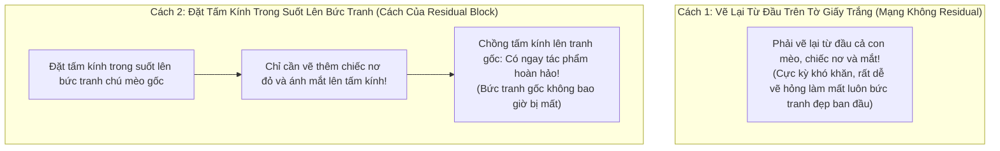
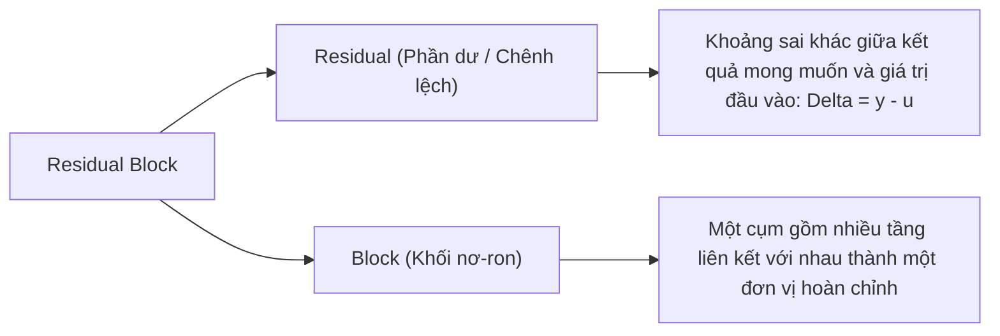
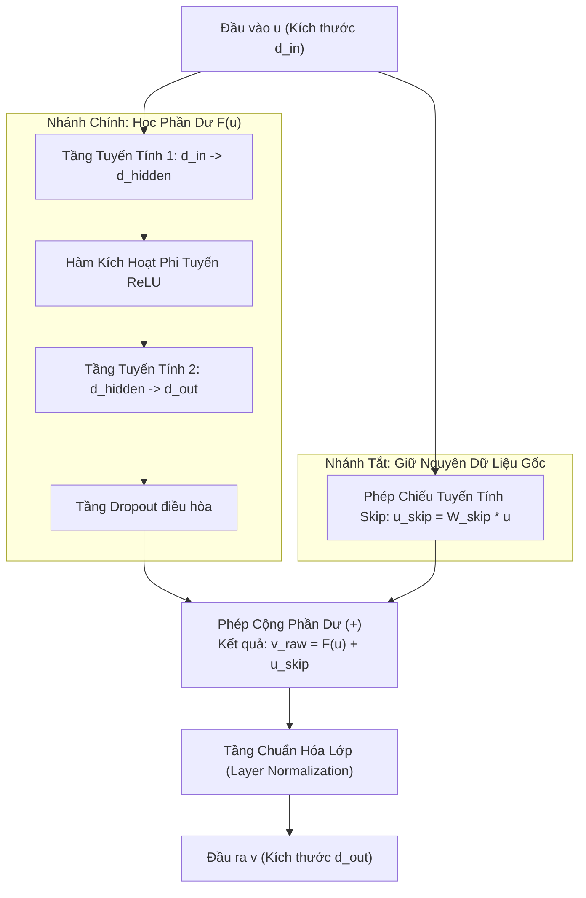

# Thuật Ngữ: Residual Block (Khối Phần Dư Dày Đặc)

> **Phương pháp tiếp cận Feynman (Feynman Technique)**:  
> *"Nếu bạn không thể giải thích một điều gì đó cho một đứa trẻ 10 tuổi hiểu, thì chính bạn cũng chưa thực sự hiểu nó."*  
> Bài viết này bóc tách cấu trúc **Residual Block** từ câu chuyện người họa sĩ sửa tranh trên tấm kính trong suốt, giải thích tại sao nó là "viên gạch vạn năng" giúp TiDE huấn luyện sâu mà không bị suy thoái.

---

## 1. Giải Thích Cho Một Đứa Trẻ 10 Tuổi: Người Thợ Sửa Tranh Và Tấm Kính Trong Suốt

Hãy tưởng tượng bạn vừa vẽ xong một bức tranh chú mèo con rất đẹp trên giấy vẽ. Bây giờ bạn muốn vẽ thêm **một chiếc nơ đỏ trên cổ** và **tô bóng mắt** cho chú mèo lung linh hơn.

Có hai cách để làm điều này:

- **Cách 1 (Không có Residual)**: Bạn lấy một tờ giấy trắng mới tinh và cố gắng vẽ lại toàn bộ con mèo cùng chiếc nơ từ đầu. Việc này cực kỳ rủi ro: bạn rất dễ vẽ sai tỷ lệ và làm hỏng cả bức tranh!
- **Cách 2 (Có Residual Block)**: Bạn lấy một **tấm kính trong suốt** đặt đè lên bức tranh chú mèo ban đầu. Bạn chỉ cần vẽ đúng chiếc nơ và ánh mắt lên mặt kính.
  - Bức tranh chú mèo ban đầu **vẫn còn nguyên vẹn 100%** bên dưới tấm kính (**Nhánh tắt - Skip Connection**).
  - Bạn chỉ cần tốn công vẽ **phần thêm vào** (**Phần dư - Residual**).

> 💡 **Định nghĩa kiểu Feynman**:  
> **Residual Block** là cơ chế **"giữ nguyên cái gốc và chỉ học phần chênh lệch"**. Thay vì bắt mạng nơ-ron học lại toàn bộ dữ liệu từ con số không, nó cho phép mạng truyền thẳng dữ liệu gốc qua một nhánh tắt và chỉ tập trung tinh chỉnh phần bổ sung cần thiết.

---

## 2. Bóc Tách Từng Từ Ngữ Chuyên Ngành (Deconstructing the Jargon)

Tại sao lại gọi là **Residual Block**?

| Thành phần | Nghĩa gốc | Ý nghĩa trong Machine Learning | Phản nghĩa / Đối lập |
|:---|:---|:---|:---|
| **Residual** (*Phần dư*) | Phần còn lại, phần chênh lệch | Thay vì học hàm mục tiêu $H(u)$, mạng chỉ cần học hàm chênh lệch $F(u) = H(u) - u$. | **Absolute Target** (*Mục tiêu tuyệt đối nguyên vẹn*). |
| **Block** (*Khối*) | Khối xây dựng, cụm linh kiện | Một đơn vị ghép gồm Linear Layer, ReLU, Dropout và LayerNorm hoạt động như một tế bào nơ-ron hoàn chỉnh. | **Single Layer** (*Một tầng đơn lẻ rời rạc*). |

---

## 3. Trực Quan Hóa Bằng Sơ Đồ Khối (The "Aha!" Moment)

Hãy nhìn vào cấu trúc bên trong của một khối Residual Block trong TiDE:

> 🎯 **Khoảnh khắc "Aha!"**:  
> Điều gì xảy ra nếu nhánh chính $F(u)$ học không tốt hoặc tầng này hóa ra không cần thiết?  
> Rất đơn giản: Mạng chỉ cần điều chỉnh các trọng số của nhánh chính về gần bằng $0$.  
> Khi đó: $v_{\text{raw}} = 0 + u_{\text{skip}} = u_{\text{skip}}$.  
> Mạng nơ-ron **tự động giữ nguyên dữ liệu đầu vào** mà không làm méo mó hay suy thoái kết quả! Đây chính là lý do các mạng có Residual Block có thể xếp sâu hàng chục tầng mà không bao giờ bị kém hơn mạng nông.

---

## 4. Tại Sao Các Mạng Sâu Không Có Residual Lại Bị "Tê Liệt"?

Trước khi phát minh ra Residual Connection (He et al., 2015 trong ResNet), các kỹ sư gặp phải hiện tượng đau đầu gọi là **"Sự suy thoái của mạng sâu" (Degradation Problem)**:

1. **Triệt tiêu gradient (Vanishing Gradient)**:  
   Khi tính đạo hàm để cập nhật trọng số từ đầu ra ngược về đầu vào theo quy tắc dây chuyền (Chain Rule):  
   $\frac{\partial \text{Loss}}{\partial u} = \frac{\partial \text{Loss}}{\partial z_n} \cdot \frac{\partial z_n}{\partial z_{n-1}} \dots \frac{\partial z_1}{\partial u}$.  
   Nếu các đạo hàm trung gian nhỏ hơn 1, nhân liên tục qua 10 tầng sẽ khiến gradient suy giảm về $0.000000...$ Tầng đầu tiên hoàn toàn bị "tê liệt", không thể cập nhật trọng số.
2. **Residual Block giải quyết như thế nào?**  
   Nhờ có phép cộng $v = F(u) + u$, khi lấy đạo hàm:  
   $$
   \frac{\partial v}{\partial u} = \frac{\partial F(u)}{\partial u} + 1
   $$
   Con số $+1$ kỳ diệu này đảm bảo gradient luôn có một "đường cao tốc" chảy thẳng ngược về đầu vào mà không bao giờ bị suy giảm về 0!

---

## 5. Mô Hình TiDE Ứng Dụng Residual Block Như Thế Nào?

Trong bài báo TiDE, nhóm tác giả Google không dùng Residual Block như một thành phần phụ họa, mà biến nó thành **"viên gạch vạn năng" duy nhất** cấu thành toàn bộ hệ thống:

| Vị Trí Trong TiDE | Vai Trò Cụ Thể | Siêu Tham Số Điều Khiển |
|:---|:---|:---|
| **1. Feature Projection** | Nén biến ngoại sinh từ $r$ chiều xuống $\tilde{r} = 4$ chiều | `temporalWidth` |
| **2. Dense Encoder** | Xếp chồng $n_e$ khối để học biểu diễn nén toàn cục | `hiddenSize`, `numEncoderLayers` |
| **3. Dense Decoder** | Xếp chồng $n_d$ khối để giải mã thành ma trận tương lai | `decoderOutputDim`, `numDecoderLayers` |
| **4. Temporal Decoder** | Kết hợp biến tương lai và vector giải mã để dự báo | `temporalDecoderHidden` |

Toàn bộ mô hình không có một lớp Attention hay LSTM nào, chỉ là sự kết hợp nhịp nhàng giữa các khối Residual Block dày đặc, tạo nên tốc độ xử lý nhanh hơn 5 - 10 lần so với các đối thủ.

---

## 6. Tổng Kết 30 Giây (The Elevator Pitch)

1. **Residual Block là gì?**  
   Là khối nơ-ron có nhánh tắt nối thẳng đầu vào tới đầu ra, cho phép mô hình chỉ cần học phần chênh lệch (phần dư) thay vì học lại toàn bộ từ đầu.
2. **Tại sao bắt buộc phải có?**  
   Nó giải quyết triệt để bài toán triệt tiêu gradient, cho phép xếp chồng nhiều tầng sâu mà không làm suy thoái mô hình.
3. **Ý nghĩa trong TiDE?**  
   Là khối xây dựng nền tảng duy nhất xuất hiện ở mọi phân khu của TiDE, vừa đảm bảo tính phi tuyến mạnh mẽ vừa giữ tốc độ tính toán tuyến tính $O(L + H)$.
