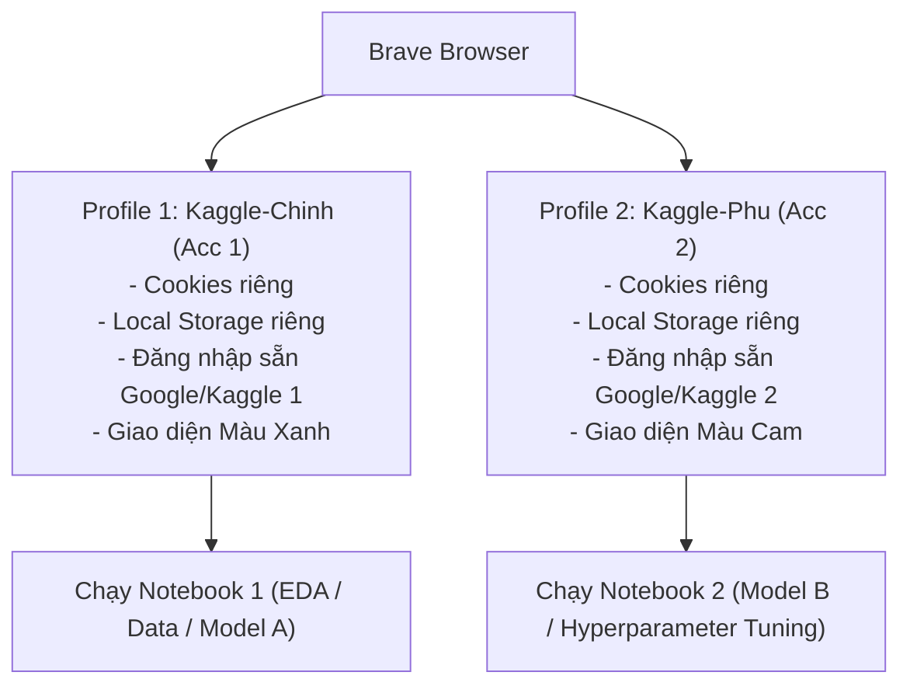

# 🚀 Hướng Dẫn Chạy Song Song 2 Tài Khoản Kaggle Trên Trình Duyệt Brave (Chung 1 IP)

Tài liệu này hướng dẫn cách cấu hình và sử dụng **Brave Browser** để vận hành song song 2 tài khoản Kaggle (đã xác thực bằng 2 số điện thoại khác nhau) trên cùng một địa chỉ IP mạng (Wi-Fi/LAN gia đình hoặc phòng trọ) một cách an toàn, mượt mà và **không lo bị khoá tài khoản (Ban/Flag)**.

---

## 📌 1. Bản chất kỹ thuật: Dùng chung 1 IP có bị Kaggle Ban không?

> [!NOTE]
> **Câu trả lời ngắn gọn: HOÀN TOÀN KHÔNG BỊ BAN NẾU TUÂN THỦ ĐÚNG QUY TẮC.**

### Cơ chế nhận diện của Kaggle:
- **Trùng IP là chuyện bình thường**: Hàng ngàn sinh viên đại học, kỹ sư công ty hay người ở cùng phòng trọ/ký túc xá đều dùng chung một mạng Wi-Fi và có cùng **Public IP (địa chỉ IP công cộng)** qua router NAT. Kaggle hiểu rất rõ điều này và **không bao giờ tự động ban một tài khoản chỉ vì trùng IP**.
- **Kaggle chỉ phạt khi có "Hành vi gian lận" (Fraudulent / Suspicious Behaviors)**:
  1. *Upvote chéo (Voting Ring / Collusion)*: Acc 1 đăng bài/notebook, Acc 2 vào Upvote để cày huy chương (Medals).
  2. *Gian lận cuộc thi (Competition Cheating)*: Cả 2 tài khoản cùng submit bài vào 1 cuộc thi có giải thưởng mà không gộp chung Team chính thức (để ăn gian lượt submit mỗi ngày).
  3. *Copy nguyên xi Notebook cá nhân*: Chia sẻ giải pháp nội bộ vi phạm quy chế cuộc thi.

Nếu mục tiêu của bạn là **nhân đôi hạn mức GPU (30h + 30h = 60h GPU/tuần)** để nghiên cứu, học tập, chạy song song 2 mô hình khác nhau thì hoàn toàn an toàn và hợp lệ.

---

## 🧭 2. Tại sao lại dùng Profile trên Brave Browser?

Nhiều người thường chọn cách dùng **Tab ẩn danh (Incognito/Private)** hoặc **2 trình duyệt khác nhau (Chrome + Brave/Edge)**. Tuy nhiên, sử dụng **Brave Profiles** là giải pháp tối ưu nhất:

### Ưu điểm vượt trội của Brave Profiles:
1. **Cô lập tuyệt đối môi trường (Sandboxed Environments)**:
   - Mỗi profile có thư mục lưu trữ riêng biệt trên ổ đĩa.
   - Cache, Cookies, Session Tokens, IndexedDB của Acc 1 hoàn toàn không chạm tới Acc 2. Không bao giờ có hiện tượng "văng session" hay đăng nhập chéo.
2. **Tiện lợi và lưu phiên làm việc**:
   - Tab ẩn danh sẽ xóa sạch phiên đăng nhập mỗi khi đóng trình duyệt (phải đăng nhập và xác thực lại).
   - Với Brave Profile, bạn chỉ cần đăng nhập 1 lần duy nhất, mở lên là chạy ngay.
3. **Tiết kiệm RAM & Chặn theo dõi**:
   - Brave tích hợp tính năng **Memory Saver (Bộ tiết kiệm bộ nhớ)** giúp đóng băng các tab không dùng, giải phóng RAM để máy chạy mượt khi mở nhiều Notebook nặng.

---

## 🛠️ 3. Các bước thiết lập Brave Profiles từng bước

### Bước 1: Tạo Profile thứ nhất (Tài khoản 1)
1. Mở Brave Browser.
2. Nhìn góc trên cùng bên phải thanh công cụ, nhấn vào biểu tượng **Avatar / Profile** (hình người tròn cạnh nút menu 3 gạch).
3. Chọn **Add / Thêm hồ sơ** (nếu chưa có profile riêng).
4. Đặt tên gợi nhớ: `Kaggle-Chinh` hoặc `Kaggle-Alpha`.
5. Chọn màu sắc nhận diện (ví dụ: **Màu Xanh Dương**).
6. Truy cập [Kaggle](https://www.kaggle.com) và đăng nhập Tài khoản 1.

### Bước 2: Tạo Profile thứ hai (Tài khoản 2)
1. Tại cửa sổ Brave vừa mở, lại bấm vào biểu tượng Avatar ở góc trên cùng bên phải.
2. Chọn **Add / Thêm hồ sơ**.
3. Đặt tên: `Kaggle-Phu` hoặc `Kaggle-Beta`.
4. Chọn màu sắc tương phản nổi bật (ví dụ: **Màu Cam** hoặc **Màu Đỏ**) để tránh thao tác nhầm lẫn.
5. Truy cập [Kaggle](https://www.kaggle.com) và đăng nhập Tài khoản 2.

> [!TIP]
> **Đổi màu theme khác biệt**: Việc đặt 2 màu sắc khác nhau (ví dụ: Xanh dương cho Acc chính, Cam cho Acc phụ) giúp mắt bạn phân biệt ngay lập tức đang thao tác ở tài khoản nào, tránh tuyệt đối việc nhầm lẫn tai hại (như lấy Acc 2 vào Upvote cho Acc 1).

### Bước 3: Tạo Shortcut ngoài màn hình Desktop để mở nhanh
1. Ở mỗi Profile, vào `brave://settings/manageProfile` (hoặc Cài đặt -> Bạn và Brave -> Tùy chỉnh hồ sơ của bạn).
2. Bật công tắc: **"Tạo lối tắt trên màn hình" (Create desktop shortcut)**.
3. Ngoài Desktop sẽ xuất hiện 2 icon Brave riêng biệt: `Brave - Kaggle-Chinh` và `Brave - Kaggle-Phu`. Khi cần chạy, chỉ cần bấm đúp vào cả 2 icon để mở song song 2 cửa sổ.

---

## 🛡️ 4. Quy tắc "Bảo Vệ Tài Khoản" khi dùng chung 1 IP

Để 2 tài khoản tồn tại bền vững qua nhiều năm mà không bao giờ bị AI giám sát của Kaggle gắn cờ, hãy ghi nhớ **4 KHÔNG** và **3 NÊN**:

### 🚫 4 KHÔNG (CỰC KỲ QUAN TRỌNG):
1. **TUYỆT ĐỐI KHÔNG UPVOTE / THẢ TIM CHO NHAU**:
   - Không lấy Acc 2 vào bấm Upvote cho Notebook, Dataset, hay Thảo luận (Discussion) của Acc 1 (và ngược lại).
   - Hệ thống tự động phát hiện Voting Ring (vòng tròn bình chọn) dựa trên trùng IP + tần suất tương tác cực kỳ nhạy bén.
2. **TUYỆT ĐỐI KHÔNG NỘP BÀI CÙNG 1 CUỘC THI (COMPETITION) NẾU CHƯA GỘP TEAM**:
   - Nếu cả 2 tài khoản cùng tham gia 1 cuộc thi có bảng xếp hạng (Leaderboard), bạn **bắt buộc** phải dùng chức năng **Team Merge** trước hạn chót.
   - Nếu để 2 tài khoản riêng lẻ cùng nộp vào 1 cuộc thi từ 1 IP, hệ thống sẽ đánh dấu là cố tình "lách luật" nhân đôi số lần nộp bài (Double Submissions) và sẽ disqualification/ban cả 2.
3. **KHÔNG ĐĂNG NHẬP CHÉO TRONG CÙNG 1 PROFILE**:
   - Không bao giờ thoát Acc 1 trên Profile 1 để đăng nhập Acc 2, và ngược lại. Hãy giữ mỗi tài khoản "ở yên" trong profile của nó để cookie không bị trộn lẫn (Cross-contamination).
4. **KHÔNG CHẠY NOTEBOOK DÙNG CHUNG SECRET TOKEN / API KEY**:
   - Nếu dùng Weights & Biases (WandB), GitHub Token hay Kaggle API Token, hãy dùng token riêng hoặc dùng link public, không lưu credentials chéo.

### ✅ 3 NÊN:
1. **Dùng GitHub làm trung gian đồng bộ code**:
   - Khi viết code trong notebook của Acc 1 và muốn chuyển sang Acc 2, hãy `git push` lên GitHub (Private Repo) rồi ở Acc 2 `git clone` về. Cách này hoàn toàn tự nhiên và chuyên nghiệp.
2. **Xác thực số điện thoại chuẩn**:
   - Mỗi tài khoản phải xác thực bằng 1 SIM điện thoại thực tế (không dùng số ảo online nhận SMS rác vì số đó có thể bị người khác dùng trước).
3. **Ưu tiên chạy ngầm (Save & Run All / Background Run)**:
   - Kaggle cho phép mỗi phiên chạy ngầm tối đa 12 giờ. Bạn có thể bấm Run trên cả 2 tài khoản rồi tắt trình duyệt đi ngủ, kết quả và model checkpoint sẽ tự động lưu lại.

---

## ⚡ 5. Chiến lược tối ưu GPU Quota (Tận dụng 60 giờ GPU/tuần)

Mỗi tài khoản được Kaggle cấp miễn phí **30 giờ GPU** (thường là GPU NVIDIA T4 x 2 hoặc P100) mỗi tuần, reset vào thứ Bảy hoặc Chủ Nhật hàng tuần. Khi có 2 tài khoản:

| Tài khoản | Hạn mức tuần | Mục đích khuyến nghị |
| :--- | :--- | :--- |
| **Acc 1 (Chính)** | 30 Giờ GPU | Chạy thử nghiệm code (Interactive), EDA, Tiền xử lý dữ liệu nặng, Huấn luyện Model Baseline |
| **Acc 2 (Phụ)** | 30 Giờ GPU | Chạy Background Run (12h) cho các mô hình lớn, Tìm kiếm siêu tham số (Hyperparameter Tuning), Chạy cross-validation |

> [!WARNING]
> Khi mở phiên làm việc trực tiếp (Interactive Session), luôn nhớ nhấn nút **Power Off (Tắt máy ảo)** ở góc trên bên phải khi không còn code nữa. Nếu quên, phiên làm việc sẽ tiếp tục ngốn GPU quota của bạn vô ích trong 1 giờ chờ (Idle timeout)!

---

## 📋 6. Checklist kiểm tra nhanh mỗi khi bắt đầu làm việc

- [ ] Cửa sổ 1: Đang mở đúng Profile `Kaggle-Chinh` (Màu Xanh)?
- [ ] Cửa sổ 2: Đang mở đúng Profile `Kaggle-Phu` (Màu Cam)?
- [ ] Kiểm tra xem Accelerator đã chọn đúng loại cần dùng chưa (CPU, GPU T4x2, GPU P100)?
- [ ] Bật công tắc **Internet: ON** trong thanh cấu hình bên phải của Notebook để có thể tải thư viện hoặc clone repo.
- [ ] Đã tắt tính năng chia sẻ tự động / không upvote bất kỳ nội dung nào giữa 2 tài khoản.
- [ ] Khi chạy xong, đã nhấn **Stop Session** hoặc tải checkpoint về máy/GitHub.

---
*Chúc bạn tận dụng tối đa tài nguyên điện toán đám mây cho các bài toán Data Science và Machine Learning!*
