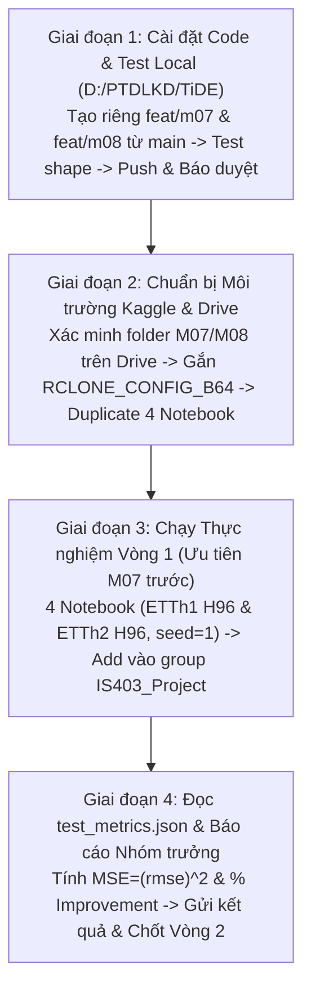

# 🗓️ KẾ HOẠCH THỰC HIỆN FINAL SPRINT (`M07` & `M08`)

> [!IMPORTANT]
> Tài liệu này lập **kế hoạch hành động khép kín từ Local $\to$ GitHub $\to$ Kaggle $\to$ Google Drive** cho 2 đề xuất của Hiệu (`feat/m07` và `feat/m08`) dựa trên repo gốc `AIVIETNAM-AIO-dthphuc/TiDE` (đã clone sạch tại `D:/PTDLKD/TiDE`).

---

## 1. Mục tiêu & Phạm vi thực hiện

### Vòng 1: Kiểm chứng nhanh (Ưu tiên làm ngay)
* **Phạm vi dữ liệu & hạt giống:** **1 seed** (`seed = 1`) trên **2 tập dữ liệu** `ETTh1` (`H = 96`) và `ETTh2` (`H = 96`).
* **Số lượt chạy Kaggle:** Tổng cộng **4 lượt chạy**:
  * **M07 (`feat/m07` — Low-Rank Factorized Dense Decoder Projection, `r = 64`):** Trọng tâm chính giải quyết bài toán bùng nổ tham số tầng chiếu cuối.
  * **M08 (`feat/m08` — Temporal-Smoothed Dense Decoder, `k = 3`):** Hướng bổ trợ làm mịn cục bộ chuỗi $\mathbf{d}_t$ sau Unflatten.
* **Tiêu chí đạt Vòng 1:**
  * Code chạy thông suốt không lỗi shape/checkpoint, giảm mạnh tham số tầng cuối với `M07` (~85.4% ở `H = 96`, `p = 32`, `d_h = 512`), chi phí tăng không đáng kể với `M08` (+128 tham số).
  * Thu đủ `./results/test_metrics.json` cho cả 4 lượt chạy và gửi báo cáo % cải thiện MSE/MAE cho nhóm trưởng.

### Vòng 2: Mở rộng (Chỉ chạy sau khi nhóm trưởng duyệt kết quả Vòng 1)
* **Điều kiện kích hoạt:** Có tín hiệu tích cực từ Vòng 1 (đặc biệt nếu MSE/MAE giảm khoảng $\sim 5\%$ hoặc đạt tiêu chí giữ/tốt hơn Baseline nhưng giảm $\ge 85\%$ tham số).
* **Phạm vi mở rộng dự kiến:** Chạy đủ bộ horizon dài (`H = 192, 336, 720`), mở rộng sang `Electricity` (`d_h = 1024`, nơi `M07` giảm tới ~92.6% tham số tầng cuối), quét nhạy cảm `decoder_rank` $\in \{32, 64, 128\}$ / `smooth_kernel_size` $\in \{3, 5\}$ và chạy nhiều seed.

---

## 2. Sơ đồ lộ trình 4 giai đoạn

---

## 3. Kế hoạch hành động chi tiết theo từng giai đoạn

### Giai đoạn 1 — Cài đặt Code, Kiểm thử Local & Push GitHub

| Task | Công việc cụ thể | Đầu ra (Output) | Tiêu chí hoàn thành | Tài liệu |
| :--- | :--- | :--- | :--- | :--- |
| **1.1** | Đứng tại `D:/PTDLKD/TiDE` trên nhánh `main` sạch, tách nhánh `feat/m07` (tuyệt đối không sửa `main`). | Branch `feat/m07` | `git branch` hiện `* feat/m07` tách từ `main` sạch | [`01_huong_dan...`](./01_huong_dan_github_va_cai_dat_code.md#a1-tạo-nhánh-featm07) |
| **1.2** | Viết/cập nhật `README.md` (Title + Sơ lược `M07`), sửa `models.py` (`LowRankDense`, `LowRankMLPResidual`, `_make_low_rank_decoder`) và `train.py` (`--decoder_rank`). | Code `M07` hoàn chỉnh | Chạy test Python local: `out=(8, 96)`, `decoder_params` giảm ~85.4% | [`01_huong_dan...`](./01_huong_dan_github_va_cai_dat_code.md#phần-a-cài-đặt-đề-xuất-m07-trên-nhánh-featm07) |
| **1.3** | Commit & push `feat/m07` lên `AIVIETNAM-AIO-dthphuc/TiDE`. | Remote branch `feat/m07` | Code `feat/m07` hiển thị đầy đủ trên GitHub nhóm | [`01_huong_dan...`](./01_huong_dan_github_va_cai_dat_code.md#a5-kiểm-thử-nhanh-local--push-featm07) |
| **1.4** | Quay về `main` sạch (`git checkout main`), tách nhánh `feat/m08`. | Branch `feat/m08` | Nhánh `feat/m08` không dính bất kỳ file nào của `M07` | [`01_huong_dan...`](./01_huong_dan_github_va_cai_dat_code.md#b1-quay-về-main-và-tạo-nhánh-featm08) |
| **1.5** | Viết `README.md` (`M08`), sửa `models.py` (chèn `DepthwiseConv1D` + `tf.transpose` sau `tf.reshape`) và `train.py` (`--smooth_kernel_size`), test local & push `feat/m08`. | Remote branch `feat/m08` | Chạy test Python local: `out=(8, 96)`, `+128` params; đã push lên GitHub | [`01_huong_dan...`](./01_huong_dan_github_va_cai_dat_code.md#phần-b-cài-đặt-đề-xuất-m08-trên-nhánh-featm08) |
| **1.6** | Nhắn báo ngay cho nhóm trưởng để kiểm tra & duyệt cả 2 nhánh `feat/m07` và `feat/m08`. | Xác nhận duyệt | Nhóm trưởng đồng ý cho pull branch chạy Kaggle | [`01_huong_dan...`](./01_huong_dan_github_va_cai_dat_code.md#bước-cuối-của-bước-1-nhắn-nhóm-trưởng-duyệt) |

---

### Giai đoạn 2 — Chuẩn bị Google Drive & 4 Notebook Kaggle

| Task | Công việc cụ thể | Đầu ra (Output) | Tiêu chí hoàn thành | Tài liệu |
| :--- | :--- | :--- | :--- | :--- |
| **2.1** | Mở Google Drive `[IS403]_Experiment` kiểm tra thực tế đường dẫn thư mục đích `M07` và `M08` (1 lớp `improvements/` hay 2 lớp `improvements/improvements/`). | Đường dẫn `REMOTE_BASE` chính xác | Khớp 100% cấu trúc thư mục thực tế trên Drive nhóm | [`02_huong_dan...`](./02_huong_dan_kaggle_va_rclone.md#32-sửa-biến-remote_base-trong-cell-google-drive) |
| **2.2** | Duplicate notebook tái lập TiDE gốc thành 4 notebook đúng chuẩn tên: `IS403_TiDE-fm07_ETTh1_H96`, `IS403_TiDE-fm07_ETTh2_H96`, `IS403_TiDE-fm08_ETTh1_H96`, `IS403_TiDE-fm08_ETTh2_H96`. | 4 Notebook Kaggle sẵn sàng | Tên notebook khớp quy ước `IS403_TiDE-fm0x_[dataset]_[horizon]` | [`02_huong_dan...`](./02_huong_dan_kaggle_va_rclone.md#1-duplicate--đặt-tên-chuẩn-4-notebook-kaggle) |
| **2.3** | Gắn (Attach) Secret `RCLONE_CONFIG_B64` mới cho cả 4 notebook, bật **Internet = ON**, chọn **GPU (T4/P100)**, sửa `git clone -b feat/m07` (hoặc `feat/m08`) và `REMOTE_BASE`. | Cấu hình notebook sạch | Đạt đủ 6 mục trong Checklist trước khi bấm Run | [`02_huong_dan...`](./02_huong_dan_kaggle_va_rclone.md#5-checklist-6-bước-trước-khi-bấm-run--thao-tác-sau-khi-xong) |

---

### Giai đoạn 3 — Thực thi 4 Run Thực nghiệm (Ưu tiên `M07` trước, `M08` sau)

| Thứ tự chạy | Tên Notebook | Branch | Dataset & Siêu tham số chính (`scripts/etth*.sh`) | Thao tác kết thúc |
| :---: | :--- | :--- | :--- | :--- |
| **Run 1** | `IS403_TiDE-fm07_ETTh1_H96` | `feat/m07` | `etth1`, `H=96`, `dropout=0.5`, `lr=0.00098489...`, `min_ep=20`, `--decoder_rank=64`, `--seed=1` | Add vào `IS403_Project` |
| **Run 2** | `IS403_TiDE-fm07_ETTh2_H96` | `feat/m07` | `etth2`, `H=96`, `dropout=0.2`, `lr=0.00022400...`, `min_ep=0`, `--decoder_rank=64`, `--seed=1` | Add vào `IS403_Project` |
| **Run 3** | `IS403_TiDE-fm08_ETTh1_H96` | `feat/m08` | `etth1`, `H=96`, `dropout=0.5`, `lr=0.00098489...`, `min_ep=20`, `--smooth_kernel_size=3`, `--seed=1` | Add vào `IS403_Project` |
| **Run 4** | `IS403_TiDE-fm08_ETTh2_H96` | `feat/m08` | `etth2`, `H=96`, `dropout=0.2`, `lr=0.00022400...`, `min_ep=0`, `--smooth_kernel_size=3`, `--seed=1` | Add vào `IS403_Project` |

*(Gợi ý tối ưu thời gian: Dùng 2 tài khoản Kaggle trên Brave để chạy song song `Run 1 + Run 2` cho `M07`, sau đó chạy tiếp `Run 3 + Run 4` cho `M08`).*

---

### Giai đoạn 4 — Kiểm tra kết quả & Báo cáo Nhóm trưởng

| Task | Công việc cụ thể | Đầu ra (Output) | Tiêu chí hoàn thành | Tài liệu |
| :--- | :--- | :--- | :--- | :--- |
| **4.1** | Mở `<REMOTE_BASE>/M0x/<dataset>/seed_1/H96/results/test_metrics.json` trên Google Drive. Lấy `"mae"` và tính `MSE = (rmse)^2` (vì `models.py#L355-L362` xuất `rmse`, không xuất khóa `mse`). | Bảng số liệu MSE & MAE mới | Đủ 4 cặp số liệu cho `M07` & `M08` | [`03_kiem_tra...`](./03_kiem_tra_ket_qua_va_bao_cao.md#1-vị-trí-file-kết-quả-trên-google-drive) |
| **4.2** | Tính `% Improvement` cho MSE và MAE so với Baseline gốc của nhóm. | Bảng tổng hợp 4 run | Hoàn thành bảng đối chiếu ở Bước 3 | [`03_kiem_tra...`](./03_kiem_tra_ket_qua_va_bao_cao.md#3-bảng-tổng-hợp-kết-quả-thực-nghiệm-4-run-m07--m08--1-seed-h96) |
| **4.3** | Gửi ngay kết quả cho nhóm trưởng (**dù có cải thiện hay không**; báo gấp nếu giảm $\sim 5\%$). | Phản hồi từ nhóm trưởng | Chốt phương án dừng hoặc chạy mở rộng Vòng 2 | [`03_kiem_tra...`](./03_kiem_tra_ket_qua_va_bao_cao.md#4-quy-tắc-báo-cáo-nhóm-trưởng-sau-khi-có-kết-quả) |

---

## 4. Bảng quản lý rủi ro & Cách xử lý nhanh

| Rủi ro / Lỗi dễ gặp | Nguyên nhân | Cách phòng tránh / Xử lý ngay |
| :--- | :--- | :--- |
| **Lỗi `Checkpoint configuration does not match current run`** (`train.py#L183-L188`) | Đổi giá trị `--decoder_rank` hoặc `--smooth_kernel_size` nhưng chạy đè lên checkpoint cũ khi `--resume=true` | Thêm `--run_id=r32 --resume=false` (hoặc đổi `--run_id`) khi thử giá trị siêu tham số mới trên cùng `dataset/seed/horizon`. |
| **Lỗi shape khi cài `DepthwiseConv1D` ở `M08`** | `decoder_out` có shape `(B, p, H)` trong khi `DepthwiseConv1D` mặc định `channels_last` đòi `(B, H, p)` | Bắt buộc dùng `tf.transpose(decoder_out, (0, 2, 1))` trước conv và transpose ngược lại sau conv trước khi vào dòng 211. |
| **Checkpoint lưu nhầm chỗ trên Drive** | Đường dẫn `"improvements/"` bị lặp 2 lần trong ghi chú cũ | Kiểm tra trực tiếp folder `[IS403]_Experiment` trên Google Drive trước khi bấm Run ở Giai đoạn 2. |
| **Tìm không thấy khóa `"mse"` trong `test_metrics.json`** | `METRICS` trong `models.py#L355-L362` chỉ ghi `mape, wape, smape, nrmse, rmse, mae` | Tính **`MSE = (rmse)^2`** từ giá trị `"rmse"` (hoặc kiểm tra dòng `Test Loss` trong log). |
| **`M07` (`r = 64`) bị Underfitting (MSE tăng)** | Hạng `r = 64` có thể hơi hẹp hoặc cần điều chỉnh learning rate | Xin phép nhóm trưởng chạy thêm 1 run với **`--decoder_rank=128 --run_id=r128 --resume=false`** để đối chứng. |

---

## 5. Master Checklist theo dõi tiến độ

* [ ] **Giai đoạn 1:** Cài đặt + test local + push xong `feat/m07` & `feat/m08`, đã được nhóm trưởng duyệt.
* [ ] **Giai đoạn 2:** Đã tạo 4 notebook đúng tên chuẩn, gắn `RCLONE_CONFIG_B64` mới, check Drive `M07`/`M08`, bật Internet & GPU.
* [ ] **Giai đoạn 3:** Hoàn thành `IS403_TiDE-fm07_ETTh1_H96` & `IS403_TiDE-fm07_ETTh2_H96` $\to$ Đã add vào `IS403_Project`.
* [ ] **Giai đoạn 3:** Hoàn thành `IS403_TiDE-fm08_ETTh1_H96` & `IS403_TiDE-fm08_ETTh2_H96` $\to$ Đã add vào `IS403_Project`.
* [ ] **Giai đoạn 4:** Đã đọc `test_metrics.json`, tính MSE/MAE `% Improvement` và báo cáo đầy đủ cho nhóm trưởng.
