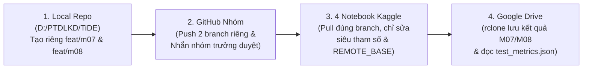

# 🚀 FINAL SPRINT — HƯỚNG DẪN CÀI ĐẶT CODE & THỰC NGHIỆM (`M07` & `M08`)

> [!IMPORTANT]
> **Mục tiêu trước mắt (Kiểm chứng nhanh 1 Seed):**
> Tự cài đặt code và chạy thực nghiệm nhanh trên **1 seed** cho **2 tập dữ liệu `ETTh1` (`H = 96`) và `ETTh2` (`H = 96`)** đối với **2 đề xuất của Hiệu** (đã chốt mã nhánh trong `doc/improvement_proposals.xlsx`):
> * **`feat/m07` (`M07`):** **Low-Rank Factorized Dense Decoder Projection** *(Phân rã hạng thấp tầng chiếu cuối — Trọng tâm chính giải quyết nút thắt tham số)*.
> * **`feat/m08` (`M08`):** **Temporal-Smoothed Dense Decoder** *(Làm mịn cục bộ chuỗi $\mathbf{d}_t$ bằng `DepthwiseConv1D` sau Unflatten)*.

---

## 🔄 PIPELINE CHUNG & NGUYÊN TẮC VẬN HÀNH

Repo gốc của nhóm trưởng [`AIVIETNAM-AIO-dthphuc/TiDE`](https://github.com/AIVIETNAM-AIO-dthphuc/TiDE) (nhánh `main`) đã được clone nguyên bản (giữ sạch, chưa chỉnh sửa gì) tại **`D:\PTDLKD\TiDE`**. Toàn bộ quy trình làm việc của bạn diễn ra theo 4 bước:

### Quy tắc bắt buộc của dự án:
1. **Cô lập từng nhánh trên GitHub:** Mỗi phương pháp nằm trên **1 branch riêng** tách ra từ `main` (`feat/m07` và `feat/m08`). **Tuyệt đối không push trực tiếp lên `main`** và không gộp chung M07 với M08 vào cùng 1 nhánh khi chạy đối chứng.
2. **Kaggle Notebook chỉ chỉnh tham số:** Không sửa code mô hình trực tiếp trong cell Kaggle; mọi sửa đổi code `models.py` / `train.py` phải nằm trên branch GitHub và được nhóm trưởng duyệt trước khi chạy.
3. **Dùng đúng rclone Key & đường dẫn Drive:** Sử dụng Key `RCLONE_CONFIG_B64` mới của Phúc và cập nhật `REMOTE_BASE` trỏ về `M07` hoặc `M08`.
4. **Báo cáo ngay khi có kết quả:** Kiểm tra `./results/test_metrics.json`, tính % cải thiện MSE/MAE và báo ngay cho nhóm trưởng dù kết quả tăng hay giảm.

---

## 📋 DANH SÁCH 4 NOTEBOOK KAGGLE CẦN CHẠY (1 SEED — H96)

| Đề xuất | Branch GitHub | Thư mục Drive (`REMOTE_BASE`) | Tên Notebook Kaggle chuẩn | Dataset & Horizon |
| :--- | :--- | :--- | :--- | :--- |
| **M07 (Low-Rank)** | `feat/m07` | `.../M07` | `IS403_TiDE-fm07_ETTh1_H96` | `ETTh1` (`H = 96`) |
| **M07 (Low-Rank)** | `feat/m07` | `.../M07` | `IS403_TiDE-fm07_ETTh2_H96` | `ETTh2` (`H = 96`) |
| **M08 (Smoothed)** | `feat/m08` | `.../M08` | `IS403_TiDE-fm08_ETTh1_H96` | `ETTh1` (`H = 96`) |
| **M08 (Smoothed)** | `feat/m08` | `.../M08` | `IS403_TiDE-fm08_ETTh2_H96` | `ETTh2` (`H = 96`) |

---

## 📚 TÀI LIỆU HƯỚNG DẪN CHI TIẾT TỪNG BƯỚC

| Thứ tự | Tài liệu hướng dẫn | Nội dung chính |
| :--- | :--- | :--- |
| **Bước 1** | [`01_huong_dan_github_va_cai_dat_code.md`](./01_huong_dan_github_va_cai_dat_code.md) | Chi tiết từng dòng code sửa trong `models.py`, `train.py`, mẫu `README.md` và lệnh kiểm thử/push cho cả `feat/m07` và `feat/m08`. |
| **Bước 2** | [`02_huong_dan_kaggle_va_rclone.md`](./02_huong_dan_kaggle_va_rclone.md) | Cấu hình Secret `RCLONE_CONFIG_B64`, `REMOTE_BASE` cho M07/M08, lệnh chạy `train.py` khớp `etth1.sh`/`etth2.sh`, lưu ý `--resume`/`--run_id` và add vào `IS403_Project`. |
| **Bước 3** | [`03_kiem_tra_ket_qua_va_bao_cao.md`](./03_kiem_tra_ket_qua_va_bao_cao.md) | Đọc `./results/test_metrics.json`, công thức tính % cải thiện MSE/MAE, bảng điền kết quả 4 lần chạy và quy tắc báo cáo nhóm trưởng. |

---

## ✅ CHECKLIST NGHIỆM THU NHANH

* [ ] Kiểm tra `D:\PTDLKD\TiDE` đang sạch trên nhánh `main` trước khi bắt đầu tự tách nhánh làm việc.
* [ ] Push xong `feat/m07` (kèm `README.md`), test forward pass local thành công và nhắn nhóm trưởng duyệt.
* [ ] Push xong `feat/m08` (kèm `README.md`), test forward pass local thành công và nhắn nhóm trưởng duyệt.
* [ ] Chạy đủ 4 notebook (`fm07` & `fm08` trên `ETTh1 H96` và `ETTh2 H96`) trên Kaggle với `RCLONE_CONFIG_B64` mới, GPU ON, Internet ON.
* [ ] Thêm cả 4 notebook vào group `IS403_Project`, đọc `test_metrics.json` và báo cáo kết quả cho nhóm trưởng.
