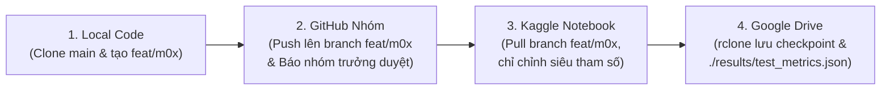

# 🚀 FINAL SPRINT — HƯỚNG DẪN CÀI ĐẶT CODE & CHẠY THỰC NGHIỆM ĐỀ XUẤT CẢI TIẾN TiDE

> [!IMPORTANT]
> **Mục tiêu trước mắt:**
> Tự cài đặt code phương pháp đề xuất (**Low-Rank Dense Decoder Projection**) vào repo chung của nhóm và chạy thực nghiệm kiểm chứng nhanh trên **1 seed** cho **2 bộ dữ liệu**:
> * **`ETTh1`** — Horizon **`H = 96`**
> * **`ETTh2`** — Horizon **`H = 96`**

---

## 🔄 PIPELINE CHUNG CỦA DỰ ÁN

Toàn bộ quy trình thực nghiệm khép kín gồm 4 thành phần liên kết chặt chẽ với nhau:

### Nguyên tắc bắt buộc phải nhớ:
1. **GitHub (`AIVIETNAM-AIO-dthphuc/TiDE`):** Mọi thay đổi kiến trúc/code đề xuất đều thực hiện ở local rồi push lên nhánh mới `feat/m0x` (**tuyệt đối không push trực tiếp lên `main`**).
2. **Kaggle Notebook:** Chỉ dùng để chạy và thay đổi siêu tham số (`seed`, `dataset`, `horizon`...), **không cài đặt code cải tiến trực tiếp trong notebook**.
3. **rclone:** Dùng sẵn key `RCLONE_CONFIG_B64` nhóm trưởng đã tạo để đồng bộ checkpoint và kết quả lên Google Drive.
4. **Google Drive:** Kiểm tra kết quả MSE/MAE trong `./results/test_metrics.json` ngay sau khi chạy xong và báo cho nhóm trưởng (dù có cải thiện hay không).

---

## 📚 DANH SÁCH TÀI LIỆU HƯỚNG DẪN CHI TIẾT

Hãy thực hiện lần lượt theo đúng 3 tài liệu dưới đây:

| Thứ tự | Tài liệu hướng dẫn | Nội dung chính |
| :--- | :--- | :--- |
| **Bước 1** | [`01_huong_dan_github_va_cai_dat_code.md`](./01_huong_dan_github_va_cai_dat_code.md) | Clone repo nhóm trưởng, tạo branch `feat/m0x`, viết `README.md` mô tả phương pháp, cài code Low-Rank và push nhờ duyệt. |
| **Bước 2** | [`02_huong_dan_kaggle_va_rclone.md`](./02_huong_dan_kaggle_va_rclone.md) | Duplicate notebook cũ, đặt tên chuẩn `IS403_TiDE-fm0x_[dataset]_[horizon]`, cài `RCLONE_CONFIG_B64`, sửa `REMOTE_BASE`, bật GPU/Internet và thêm vào group `IS403_Project`. |
| **Bước 3** | [`03_kiem_tra_ket_qua_va_bao_cao.md`](./03_kiem_tra_ket_qua_va_bao_cao.md) | Đọc `./results/test_metrics.json`, tính % cải thiện MSE/MAE so với Baseline và báo cáo nhóm trưởng. |

---

## ✅ CHECKLIST NHANH TRƯỚC KHI BẮT ĐẦU

* [ ] Kiểm tra sheet `improvement_proposals` để biết chính xác mã **`m0x`** (ví dụ `m01`, `m02`...) của đề xuất mình phụ trách.
* [ ] Đã được nhóm trưởng duyệt branch `feat/m0x` trước khi bấm chạy notebook Kaggle.
* [ ] Chạy đủ 2 notebook: `IS403_TiDE-fm0x_ETTh1_H96` và `IS403_TiDE-fm0x_ETTh2_H96` (1 seed).
