# 📑 BÁO CÁO CHUYÊN ĐỀ THUYẾT TRÌNH: DENSE DECODER TRONG MÔ HÌNH TiDE

> [!NOTE]
> **Thông tin chuyên đề:**
> - 👤 **Người thuyết trình:** Hiệu
> - 🤖 **Trợ lý kỹ thuật:** Antigravity
> - 📄 **Tài liệu tham chiếu:** *Long-term Forecasting with TiDE: Time-series Dense Encoder* (Google Research, 2023) - Mục 4.3 & Figure 1
> - 📌 **Chủ đề được giao:** **Present - Dense Decoder: Chuyển đổi biểu diễn ẩn thành các vector dành cho từng bước dự báo**
> - 🧭 **Cấu trúc bài trình bày:** Tuân thủ chuẩn 5 yêu cầu bắt buộc (Lý thuyết • Toán học • Source code • Phân tích • Đề xuất)

---

## 🎯 Tổng Quan Chủ Đề Thuyết Trình
Nếu như `Dense Encoder` đóng vai trò nén toàn bộ thông tin quá khứ thành một vector bối cảnh ẩn duy nhất $e^{(i)}$, thì **Dense Decoder** chính là cây cầu giải mã bối cảnh toàn cục đó thành các đặc trưng phân bổ cho từng bước thời gian trong tương lai $H$. Điểm mấu chốt của Dense Decoder là thực hiện giải mã song song trực tiếp một lần duy nhất (**One-shot / Non-autoregressive**), khắc phục triệt để nhược điểm sinh tuần tự chậm chạp và lỗi tích lũy sai số của các kiến trúc truyền thống.

```mermaid
graph LR
    subgraph DauVao ["1. Vector Tiềm Ẩn Toàn Cục"]
        E["Vector ẩn e(i)<br/>Kích thước: (B, d_hidden)"]
    end

    subgraph KhoiGiaiMa ["2. Khối Giải Mã Dày Đặc (Dense Decoder)"]
        RB1["Residual Block 1..(n_d - 1)<br/>(d_hidden -> d_hidden)"]
        RBLast["Residual Block Cuối Cùng<br/>(d_hidden -> H * p)"]
    end

    subgraph BienDoiHinhHoc ["3. Thao Tác Tái Định Hình Không Gian"]
        G["Vector giải mã phẳng g(i)<br/>Kích thước: (B, H * p)"]
        Unflat["Thao tác Reshape / Unflatten<br/>view(-1, H, p)"]
    end

    subgraph DauRa ["4. Ma Trận Đặc Trưng Tương Lai"]
        D["Ma Trận Bối Cảnh D(i)<br/>Kích thước: (B, H, p)"]
        Slices["Gồm H vector lát cắt:<br/>d_1, d_2, ..., d_H (mỗi vector p chiều)"]
    end

    E --> RB1
    RB1 --> RBLast
    RBLast --> G
    G --> Unflat
    Unflat --> D
    D --> Slices
```



---

## 1. 📖 Lý Thuyết: Chức Năng, Nguyên Lý & Lý Do Thiết Kế

### 1.1. Chức năng của Dense Decoder
Dense Decoder có hai chức năng cốt lõi:
1. **Giải nén biểu diễn tiềm ẩn:** Tiếp nhận vector bối cảnh ẩn $e^{(i)} \in \mathbb{R}^{d_{\text{hidden}}}$ từ Encoder và giải nén thành một vector phẳng $g^{(i)} \in \mathbb{R}^{H \cdot p}$.
2. **Phân phối bối cảnh cho từng bước tương lai:** Thông qua thao tác tái cấu trúc không gian (`Reshape / Unflatten`), chuyển đổi vector phẳng $g^{(i)}$ thành ma trận đặc trưng thời gian:

$$
D^{(i)} \in \mathbb{R}^{H \times p}
$$

Trong ma trận này, mỗi hàng $t$ chính là một vector $d_t^{(i)} \in \mathbb{R}^p$, đại diện cho bối cảnh tiềm ẩn riêng biệt dành cho bước dự báo tương lai thứ $t \in \{1, 2, \dots, H\}$.

### 1.2. Nguyên lý hoạt động
* **Mạng nơ-ron thặng dư đa tầng:** Dense Decoder được cấu thành từ chuỗi $n_d$ khối `ResidualBlock` xếp chồng. Khối cuối cùng có tầng Linear ngõ ra đặc biệt, mở rộng số chiều lên đúng bằng $H \times p$.
* **Cơ chế phi tự quy (Non-autoregressive / Direct Multi-step Forecasting):** Thay vì dự báo từng bước $t$, rồi lấy kết quả bước $t$ làm đầu vào để dự báo bước $t+1$ (như LSTM hoặc Autoregressive Transformer), Dense Decoder sinh toàn bộ biểu diễn cho cả $H$ bước tương lai **trong đúng 1 lần tính toán duy nhất**.

### 1.3. Lý do thành phần này được thiết kế
Thiết kế của Dense Decoder xuất phát từ 3 lý do kỹ thuật then chốt:

**Lý do 1: Triệt tiêu hoàn toàn hiện tượng tích lũy sai số (Error Accumulation)**
Trong các mô hình sinh tuần tự (Autoregressive), nếu bước dự báo đầu tiên $\hat{y}_1$ có sai số nhỏ, sai số này sẽ làm nhiễu đầu vào của bước $\hat{y}_2$, và tiếp tục khuếch đại theo cấp số nhân khi $H$ lớn (ví dụ $H = 96$ hay $720$). Dense Decoder sinh toàn bộ các vector bối cảnh $d_t$ độc lập trực tiếp từ $e^{(i)}$, ngăn chặn triệt để sự lan truyền sai số.

**Lý do 2: Tối ưu hóa tuyệt đối năng lực xử lý song song của GPU**
Một phép forward duy nhất qua Dense Decoder tốn độ phức tạp tuần tự là $O(1)$, cho phép GPU phân phối hàng nghìn nhân CUDA để tính toán đồng thời mọi bước thời gian của cả batch dữ liệu.

**Lý do 3: Tách bạch rõ ràng giữa "Bối cảnh toàn cục" và "Tương tác thời gian cục bộ"**
Dense Decoder chỉ làm nhiệm vụ trích xuất bối cảnh thời gian từ quá khứ ($d_t$). Việc kết hợp bối cảnh này với các biến ngoại sinh cụ thể tại thời điểm $t$ ($\tilde{x}_{L+t}$) sẽ được giao cho khối `Temporal Decoder` phía sau, tạo nên sự phân tách trách nhiệm mạch lạc (Separation of Concerns) trong kiến trúc.

---

## 2. 📐 Toán Học: Công Thức & Kích Thước Tensor Đầu Vào - Đầu Ra

### 2.1. Kiến trúc Dense Decoder gồm $n_d$ Residual Blocks
Dense Decoder nhận đầu vào là vector $e^{(i)} \in \mathbb{R}^{d_{\text{hidden}}}$. Đặt $v^{(0)} = e^{(i)}$.

Với các khối trung gian từ $l = 1$ đến $n_d - 1$:
* Số chiều đầu vào: $d_{\text{hidden}}$.
* Số chiều đầu ra: $d_{\text{hidden}}$.
* Công thức tính qua khối $l$:

$$
v^{(l)} = \text{LayerNorm}\Big( \text{Dropout}\big( W_2^{(l)} \text{ReLU}(W_1^{(l)} v^{(l-1)} + b_1^{(l)}) + b_2^{(l)} \big) + v^{(l-1)} \Big)
$$

### 2.2. Cách chuyển $e^{(i)}$ thành vector $g^{(i)}$ kích thước $H \times p$
Khối `ResidualBlock` cuối cùng ($l = n_d$) đóng vai trò quyết định cấu trúc ngõ ra:
* Số chiều đầu vào: $d_{\text{hidden}}$.
* Số chiều tầng ẩn nội bộ: $d_{\text{hidden}}$.
* Số chiều đầu ra: $d_{\text{out}} = \mathbf{H \times p}$ (với $H$ là khoảng cách dự báo, $p$ là số chiều đặc trưng lát cắt).

Công thức tạo vector phẳng $g^{(i)}$:

$$
g^{(i)} = \text{LayerNorm}\Big( \text{Dropout}\big( W_{2}^{(n_d)} \text{ReLU}(W_1^{(n_d)} v^{(n_d - 1)} + b_1^{(n_d)}) + b_2^{(n_d)} \big) + W_{\text{skip}}^{(n_d)} v^{(n_d - 1)} \Big)
$$

Trong đó:
* $W_2^{(n_d)} \in \mathbb{R}^{(H \cdot p) \times d_{\text{hidden}}}$: Ma trận chiếu ngõ ra phi tuyến.
* $W_{\text{skip}}^{(n_d)} \in \mathbb{R}^{(H \cdot p) \times d_{\text{hidden}}}$: Ma trận chiếu nhánh tắt do kích thước đầu vào và đầu ra lệch nhau ($d_{\text{hidden}} \neq H \cdot p$).
* Kết quả $g^{(i)} \in \mathbb{R}^{H \cdot p}$.

### 2.3. Vai trò của thao tác Reshape (Unflatten)
Sau khi thu được vector phẳng $g^{(i)}$, mô hình thực hiện thao tác tái tạo hình học tensor (Unflatten):

$$
D^{(i)} = \text{Reshape}\big(g^{(i)}, \; (H, p)\big) \in \mathbb{R}^{H \times p}
$$

* **Bản chất toán học:** Đây là phép biến đổi ánh xạ đẳng cấu giữa không gian vector $\mathbb{R}^{H \cdot p}$ và không gian ma trận $\mathbb{R}^{H \times p}$, trong đó phần tử thứ $k = (t - 1) \cdot p + j$ của vector $g^{(i)}$ trở thành phần tử tại hàng $t$, cột $j$ của ma trận $D^{(i)}$.
* **Ý nghĩa kiến trúc:** Khôi phục lại **trục thời gian (Temporal Axis $H$)** bị mất trong quá trình nén của Encoder, đưa dữ liệu về đúng định dạng thời gian để chuẩn bị ghép đôi với các biến ngoại sinh tương lai tại `Temporal Decoder`.

### 2.4. Ý nghĩa của vector $d_t^{(i)}$ cho từng thời điểm dự báo
Ma trận $D^{(i)}$ được phân rã thành $H$ vector hàng:

$$
D^{(i)} = \begin{bmatrix} 
\text{---} & d_1^{(i)} & \text{---} \\ 
\text{---} & d_2^{(i)} & \text{---} \\ 
& \vdots & \\ 
\text{---} & d_H^{(i)} & \text{---} 
\end{bmatrix}, \quad d_t^{(i)} \in \mathbb{R}^p \quad \forall t \in \{1, 2, \dots, H\}
$$

* Mỗi vector $d_t^{(i)}$ chính là **vector bối cảnh tiềm ẩn dành riêng cho bước dự báo tương lai thứ $t$**.
* Mặc dù được dành riêng cho bước $t$, $d_t^{(i)}$ không phải là giá trị cục bộ đơn lẻ mà được suy diễn từ toàn bộ biểu diễn toàn cục $e^{(i)}$, chứa đựng thông tin về mức độ suy thoái tín hiệu, tính chu kỳ và xu hướng dài hạn ứng với độ trễ tương đối $t$.

### 2.5. Bảng kích thước Tensor chi tiết (Benchmark Electricity)
Cấu hình: Batch size $B = 32$, Chiều ẩn $d_{\text{hidden}} = 1024$, Horizon $H = 96$, Decoder Output Dimension $p = 16$, Số tầng $n_d = 2$:

| Tên Tensor | Ký Hiệu | Kích Thước Tensor (Shape) | Chi Tiết Số Chiều Phép Tính |
| :--- | :---: | :---: | :--- |
| `e` (Đầu vào) | $e^{(i)}$ | `torch.Size([32, 1024])` | Vector bối cảnh ẩn từ Dense Encoder |
| `dec_block_1` | $v^{(1)}$ | `torch.Size([32, 1024])` | Đầu ra khối Residual Block trung gian (1024 $\to$ 1024) |
| `g` (Vector phẳng) | $g^{(i)}$ | `torch.Size([32, 1536])` | Đầu ra khối cuối: $H \times p = 96 \times 16 = 1,536$ chiều |
| `D` (Ma trận bối cảnh) | $D^{(i)}$ | `torch.Size([32, 96, 16])` | Sau phép `view(-1, 96, 16)`: 96 bước thời gian, mỗi bước 16 chiều |
| `d_t` (Lát cắt tại bước $t$) | $d_t^{(i)}$ | `torch.Size([32, 16])` | Lát cắt vector đặc trưng dành riêng cho thời điểm $t$ |

---

## 3. 💻 Source Code: Đối Chiếu Repository Gốc & Triển Khai Thực Thi

### 3.1. Mã nguồn tương ứng trong repository chính thức của Google Research
Trong mã nguồn chính thức [`google-research/google-research/blob/master/tide/models.py`](https://github.com/google-research/google-research/blob/master/tide/models.py) (viết bằng TensorFlow/Keras), cấu trúc Dense Decoder được khởi tạo tại [dòng 133–140](https://github.com/google-research/google-research/blob/master/tide/models.py#L133-L140) và thực thi tại [dòng 207–210](https://github.com/google-research/google-research/blob/master/tide/models.py#L207-L210):

```python
# Trích xuất nguyên văn từ Google Research: tide/models.py
# 1. Khởi tạo chuỗi Residual Blocks cho Dense Decoder (Dòng 133-140)
self.decoder = _make_dnn_residual(
    model_config.get('hidden_dims')[:-1]
    + [
        model_config.get('decoder_output_dim') * self.pred_len,
    ],
    layer_norm=layer_norm,
    dropout_rate=dropout_rate,
)

# 2. Thực thi giải nén & Unflatten trong hàm call() (Dòng 207-210)
decoder_out = self.decoder(encoding)
decoder_out = tf.reshape(
    decoder_out, [bsize, -1, self.pred_len]
)  # shape: [batch_size, p, H]
```

### 3.2. Mã nguồn thực thi trong file mô phỏng của dự án
Trong file [simulate_forward_pass.py](file:///d:/PTDLKD/Project-Experimental-TiDE/simulate_forward_pass.py#L214-L226), toàn bộ thao tác giải nén và Unflatten được thực hiện:

```python
# BƯỚC 5: Khối Giải Mã Dày Đặc Dense Decoder (Section 4.3 Step 1)
# 1. Giải nén vector e thành vector phẳng g
g = self.dense_decoder(e)                      # [B, H * p]

# 2. Tái cấu trúc thành ma trận bối cảnh D bằng phép view()
D = g.view(-1, self.H, self.p)                 # [B, H, p]
```

Dòng lệnh `g.view(-1, self.H, self.p)` chạy với chi phí tính toán **$O(1)$ về thời gian và bộ nhớ** vì nó không sao chép dữ liệu thật sự trong RAM, mà chỉ thay đổi cách lập chỉ mục stride (metadata view) của bộ nhớ tensor.

---

## 4. 🔍 Phân Tích: Ảnh Hưởng Đến Hiệu Năng & Giới Hạn Tiềm Ẩn

### 4.1. Ảnh hưởng của siêu tham số Decoder Output Dimension ($p$)
Tham số $p$ quyết định "độ rộng của đường truyền thông tin" phân bổ cho mỗi bước dự báo tương lai:

* **Khi $p$ quá nhỏ ($p = 1, 2$):**
  * Gây ra hiện tượng **Nghẽn cổ chai thông tin (Information Bottleneck)**.
  * Mỗi bước thời gian chỉ nhận được một vector 1 hoặc 2 chiều, không đủ dung lượng để biểu diễn các biến động phức tạp về biên độ, pha dao động và mối tương quan phi tuyến với ngoại sinh. Kết quả là sai số MSE/MAE tăng vọt.
* **Khi $p$ quá lớn ($p = 32, 64$):**
  * Gây ra hiện tượng **Bùng nổ số lượng tham số (Parameter Explosion)**.
  * Tầng Linear cuối cùng có ma trận trọng số $W \in \mathbb{R}^{(H \cdot p) \times d_{\text{hidden}}}$. Khi $H = 720$ và $p = 64$, số tham số của một tầng này là:
  
  $$
  (720 \times 64) \times 1024 \approx \mathbf{47.1 \text{ triệu tham số!}}
  $$
  
  * Điều này làm mô hình cực kỳ nặng, tốn bộ nhớ VRAM và dễ bị học vẹt (**Overfitting**), làm giảm khả năng khái quát hóa trên tập kiểm thử.
* **Điểm tối ưu thực nghiệm trong bài báo:** Tác giả Google Research chứng minh giá trị $p \in [4, 16]$ là khoảng cân bằng hoàn hảo nhất, vừa cung cấp đủ dung lượng biểu diễn vừa giữ cho số lượng tham số ở mức tinh gọn.

### 4.2. Ảnh hưởng của số lớp Decoder ($n_d$)
* **Với $n_d = 1$:** Chỉ có duy nhất một khối Residual Block vừa làm nhiệm vụ phi tuyến vừa chiếu sang kích thước $H \times p$. Cấu hình này rất nhanh và nhẹ, phù hợp với các tập dữ liệu có tính quy luật tuyến tính cao.
* **Với $n_d = 2$:** Là cấu hình mặc định tối ưu của TiDE. Khối đầu tiên tinh chỉnh không gian ẩn $d_{\text{hidden}} \to d_{\text{hidden}}$, khối thứ hai chuyên biệt hóa cho việc giải nén $d_{\text{hidden}} \to H \times p$.
* **Với $n_d \ge 3$:** Hầu như không mang lại cải thiện đáng kể về độ chính xác. Lý do là vì TiDE đã có nhánh **Global Linear Skip** chạy song song gánh vác toàn bộ xu hướng tuyến tính lớn, nên phần giải mã phi tuyến không cần mạng quá sâu.

### 4.3. Các giới hạn tiềm ẩn của Dense Decoder
1. **Cố định khoảng dự báo (Fixed Horizon Constraint):** Do ma trận $W_2^{(n_d)}$ có số hàng cố định bằng $H \cdot p$, mô hình không thể dự báo với $H$ linh hoạt (ví dụ train với $H=96$ nhưng muốn test $H=120$ là bất khả thi nếu không train lại toàn bộ Decoder).
2. **Thiếu sự ràng buộc liên tục giữa các bước thời gian lân cận:** Thao tác unflatten phân tách độc lập các hàng $d_t$. Nếu mạng học chưa đủ tốt, vector $d_t$ và $d_{t+1}$ có thể bị gián đoạn (jitter/discontinuity), dẫn đến chuỗi dự báo bị răng cưa nếu không có nhánh Linear Skip làm mịn.

---

## 5. 💡 Đề Xuất: Giả Thuyết Cải Tiến Có Thể Kiểm Chứng Thực Nghiệm

Nhằm khắc phục nhược điểm bùng nổ tham số khi $H$ lớn và nâng cao tính liên tục thời gian của các vector $d_t$, dưới đây là **2 giả thuyết cải tiến cụ thể**:

### Giả thuyết cải tiến 1: Phân rã Ma trận Ngõ ra theo Hạng Thấp (Low-Rank Factorized Decoder Projection)

* **Vấn đề giải quyết:** Khi $H$ lớn (ví dụ $H = 720, p = 16 \implies H \cdot p = 11,520$), tầng Linear cuối cùng của Decoder có ma trận $W \in \mathbb{R}^{11520 \times 1024} \approx 11.8 \text{M tham số}$.
* **Ý tưởng:** Thay vì dùng ma trận đầy đủ $W$, ta phân rã $W$ thành tích của hai ma trận hạng thấp $W = A \times B$:
  * $A \in \mathbb{R}^{(H \cdot p) \times r_{\text{rank}}}$
  * $B \in \mathbb{R}^{r_{\text{rank}} \times d_{\text{hidden}}}$
  * Với hạng $r_{\text{rank}} \ll \min(d_{\text{hidden}}, H \cdot p)$, ví dụ chọn $r_{\text{rank}} = 64$.
* **Lợi ích lý thuyết:**
  * Giảm số tham số từ $11,520 \times 1024 \approx 11.8\text{M}$ xuống chỉ còn $(11,520 \times 64) + (64 \times 1024) \approx \mathbf{0.8\text{M tham số}}$ (giảm hơn **$93\%$ tham số!**).
  * Đóng vai trò như một cơ chế điều hòa (Implicit Regularization), ép mô hình chỉ giữ lại các thành phần bối cảnh quan trọng nhất, chống overfitting khi $H$ dài.
* **Phương pháp kiểm chứng:**
  * Dataset: `Electricity` với $H = 720$.
  * So sánh MSE, MAE, kích thước file checkpoint và tốc độ suy luận giữa TiDE gốc và TiDE-LowRank.

### Giả thuyết cải tiến 2: Tích hợp Cơ chế Làm Mịn Thời Gian qua 1D Temporal Convolution (Temporal-Smoothed Decoder)

* **Vấn đề giải quyết:** Tránh hiện tượng răng cưa và thiếu liên kết pha giữa các bước lân cận $d_t$ và $d_{t+1}$.
* **Ý tưởng:** Sau khi thực hiện phép Reshape thành tensor $D \in \mathbb{R}^{B \times H \times p}$, ta cho tensor này đi qua một lớp tích chập một chiều nhẹ (`Depthwise 1D Conv`):

$$
D_{\text{smooth}} = \text{DepthwiseConv1D}(D, \; \text{kernel\_size}=3, \; \text{padding}=1)
$$

* **Lợi ích lý thuyết:** Mỗi bước $t$ sẽ được trao đổi thông tin cục bộ với bước $t-1$ và $t+1$ thông qua kernel kích thước 3, đảm bảo các vector biểu diễn $d_t$ có tính liên tục mượt mà theo thời gian.
* **Phương pháp kiểm chứng:**
  * Dataset: `Traffic` (dữ liệu lưu lượng giao thông có độ nhạy cảm cao với tính liên tục).
  * Đo độ trơn tru của đạo hàm bậc một của đường dự báo (First-order Smoothness Metric) và sai số MAE.

---

## 📌 Tổng Kết Slide Thuyết Trình (Key Takeaways)

> 1. **Bản chất:** Dense Decoder giải nén vector $e \in \mathbb{R}^{1024}$ thành vector phẳng $g \in \mathbb{R}^{H \cdot p}$, rồi Unflatten thành ma trận $D \in \mathbb{R}^{H \times p}$.
> 2. **Cơ chế sinh:** Non-autoregressive (One-shot), xuất toàn bộ $H$ bước cùng lúc, loại bỏ hiện tượng tích lũy sai số và đạt tốc độ song song tối đa trên GPU.
> 3. **Ý nghĩa $d_t$:** Mỗi vector lát cắt $d_t \in \mathbb{R}^p$ mang bối cảnh tiềm ẩn toàn cục được điều chỉnh riêng cho thời điểm tương lai thứ $t$.
> 4. **Siêu tham số cốt lõi:** $p \in [4, 16]$ là điểm cân bằng giữa nghẽn cổ chai thông tin và bùng nổ tham số.
> 5. **Hướng cải tiến:** Phân rã hạng thấp (Low-Rank Factorization) là chìa khóa để triển khai TiDE hiệu quả trên các Horizon siêu dài ($H \ge 720$).
