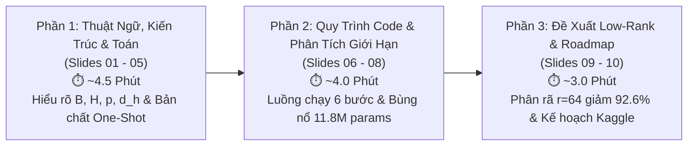
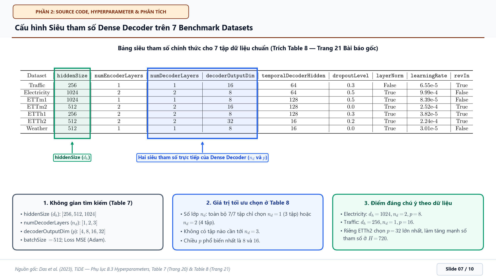
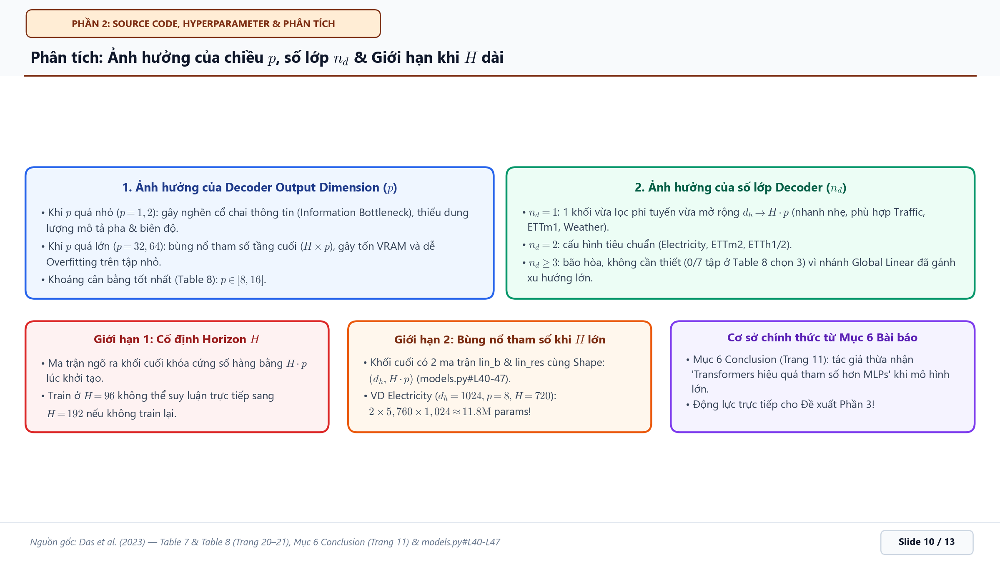

# 🎙️ KỊCH BẢN THUYẾT TRÌNH NỘI BỘ TỪNG SLIDE (INTERNAL TEAM SHARING SCRIPT)
## CHUYÊN ĐỀ: KHỐI DENSE DECODER TRONG KIẾN TRÚC MÔ HÌNH TiDE

> [!NOTE]
> **Bối cảnh sử dụng (Context):**  
> * **Đối tượng người nghe:** Toàn bộ thành viên trong nhóm đồ án / nhóm nghiên cứu TiDE.
> * **Mục tiêu bài nói:** **Giúp tất cả thành viên trong nhóm hiểu cặn kẽ, sâu sắc từng con số, từng ký hiệu, cơ chế ghép ngoại sinh, quy trình luồng code, và bản chất tại sao chọn One-Shot thay vì tuần tự**, giải quyết dứt điểm các câu hỏi phản biện kỹ thuật để nhóm tự tin code và bảo vệ đồ án.
> * **Phong cách trình bày:** Gần gũi, cởi mở, đậm chất trao đổi kỹ thuật (Tech-talk / Code-walkthrough), xưng hô "mình" và "anh em / các bạn trong nhóm". Đi thẳng vào bản chất, bóc tách từng dòng code và giải thích chi tiết các bẫy shape tensor.
> * **Tài liệu tham chiếu:** Khớp chính xác 1-đối-1 theo đúng thứ tự **10 Slide** trong [`slide_images_gallery.md`](./slide_images_gallery.md) (từ **Slide 01 / 10** đến **Slide 10 / 10**) và tuân thủ chuẩn mực [`rule_slide.md`](./rule_slide.md).

---

## ⏱️ PHÂN BỔ THỜI GIAN TOÀN BỘ BÀI NÓI (10 SLIDES)

---

## 📖 PHẦN 1: THUẬT NGỮ, KIẾN TRÚC & TOÁN HỌC (SLIDES 01 – 05)

---

### 🟢 SLIDE 01 / 10 — THUẬT NGỮ CỐT LÕI CHO DENSE DECODER (NỀN TẢNG)

* **Ảnh slide:** `slide_01_bang_thuat_ngu_dense_decoder.png` ([Xem ảnh trong gallery](./slide_images_gallery.md#slide-01--10-thuật-ngữ-cốt-lõi-cho-dense-decoder-nền-tảng))
* **Thời lượng dự kiến:** 60 – 70 giây.
* **Mục tiêu slide:** Thống nhất với cả nhóm 5 khái niệm xương sống; **giải thích cặn kẽ các ký hiệu $B, H, p$ và con số cụ thể của $d_h = \text{hiddenSize}$** để anh em nắm chắc ngay từ giây đầu tiên.

#### 🎙️ Lời thoại trình bày (Team Tech-talk):

> "Chào mọi người, trong kiến trúc TiDE, sau khi `Dense Encoder` nén toàn bộ dữ liệu lịch sử thì trọng trách giải mã tương lai thuộc về khối **`Dense Decoder`**. 
> 
> Trước khi đi vào sơ đồ, anh em nhìn vào bảng ở **Slide 01**, mình muốn giải thích cặn kẽ từng ký hiệu và con số để nhóm mình không ai bị mơ hồ:
> 
> * **Đầu tiên, $B, H, p$ và $d_h$ là cái gì?**
>   * **$B$ là `Batch Size`:** Số lượng mẫu chuỗi thời gian đưa vào huấn luyện cùng một lúc. Trong bài báo, tác giả **cố định $B = 512$** cho toàn bộ 7 bộ dữ liệu.
>   * **$H$ là `Horizon`:** Tầm dự báo tương lai mà mô hình cần đoán trước. Tác giả thí nghiệm ở 4 mốc chuẩn: **$96, 192, 336$ và dài nhất là $720$ bước**.
>   * **$p$ là `decoderOutputDim`:** Số chiều đặc trưng của vector bối cảnh tại mỗi bước thời gian. Khi dự báo một bước $t$, ta không chỉ nén thành 1 con số thô, mà giữ lại một vector gồm $p$ thuộc tính (thường chọn $p = 8, 16$ hoặc $32$) để chứa bối cảnh lịch sử.
>   * **Còn $d_h = \text{hiddenSize}$ là bao nhiêu?** Trong bài báo (Bảng 7 Phụ lục), tác giả khảo sát không gian $\{256, 512, 1024\}$. Với các tập dữ liệu lớn như `Electricity` và `Traffic`, **$d_h$ được chọn tối đa là $1024$**; còn các tập trạm biến áp `ETT` nhỏ hơn thì chọn $d_h = 256$ hoặc $512$.
> 
> * **Từ các ký hiệu đó, 5 khái niệm trên slide gắn kết với nhau như sau:**
>   1. **`MLPResidual`:** Khối cơ sở lặp lại gồm Linear $\to$ ReLU $\to$ Linear $\to$ Dropout $\oplus$ Skip Connection $\to$ LayerNorm.
>   2. **Vector ẩn $\mathbf{e}^{(i)}$:** Đầu vào của Decoder, có `Shape: (B, d_h)` — tức $(512, 1024)$ trên Electricity — nén trọn quá khứ.
>   3. **Khối `Dense Decoder`:** Xếp chồng $n_d$ khối `MLPResidual`, từ chiều ẩn $d_h$ chiếu một phát ra vector phẳng $\mathbf{g}^{(i)}$ có kích thước $H \cdot p$.
>   4. **Thao tác `Reshape` (hay `Unflatten`):** Biến đổi mảng phẳng $(B, H \cdot p)$ thành ma trận 2D $(B, H, p)$ mà không tốn một byte bộ nhớ copy nào!
>   5. **Vector bối cảnh $\mathbf{d}_t^{(i)}$:** Từng lát cắt thứ $t$ trích từ ma trận trên, có `Shape: (B, p)`.
> 
> Nắm chắc các con số này rồi, giờ chúng ta xem vị trí của Dense Decoder trên kiến trúc tổng thể ở Slide 02 nhé!"

* **🎬 Tương tác & Điểm nhấn màn hình (Visual Cues):**
  * Chỉ trực tiếp vào thẻ số 2: *"Nhớ nhé anh em: $B=512$, $d_h = 1024$, $H=96 \to 720$, $p=8 \to 32$"*.
  * Khoanh vào Thẻ 4 và 5: *"Phép Reshape biến từ tích $H \cdot p$ thành $H$ lát cắt độc lập $\mathbf{d}_t$"*.

---

### 🟢 SLIDE 02 / 10 — VỊ TRÍ KHỐI DENSE DECODER & UNFLATTEN TRÊN FIGURE 1

* **Ảnh slide:** `slide_02_vi_tri_dense_decoder.png` ([Xem ảnh trong gallery](./slide_images_gallery.md#slide-02--10-vị-trí-khối-dense-decoder--unflatten-trên-figure-1))
* **Thời lượng dự kiến:** 50 – 60 giây.
* **Mục tiêu slide:** Định vị chính xác vị trí trên Figure 1; **giải thích cụ thể, chi tiết cơ chế ghép nối với ngoại sinh ở tầng kế tiếp** diễn ra như thế nào.

#### 🎙️ Lời thoại trình bày (Team Tech-talk):

> "Nhìn lên Figure 1 trích từ bài báo gốc ở Slide 02:
> 
> Khối `Dense Decoder` (được khoanh vàng ở giữa) nhận vector ẩn toàn cục $\mathbf{e}^{(i)}$ từ Encoder truyền lên, xử lý qua $n_d$ khối để bung ra vector phẳng $\mathbf{g}^{(i)}$ `Shape: (B, H \cdot p)`. Ngay sau đó, phép `Unflatten` bổ đôi kích thước này ra thành $H$ lát cắt vector $\mathbf{d}_t^{(i)}$ (mỗi lát cắt có chiều dài $p$).
> 
> **Ở đây, anh em chắc chắn sẽ thắc mắc: 'Tầng kế tiếp ghép ngoại sinh thì cụ thể là ghép như thế nào?'**
> 
> Mình xin giải thích cặn kẽ luồng ghép nối này:
> * Tầng kế tiếp chính là tầng `Temporal Decoder`.
> * Tại mỗi bước thời gian tương lai $t \in \{1, \dots, H\}$, mô hình lấy đúng vector bối cảnh $\mathbf{d}_t^{(i)}$ (chiều dài $p$) đem **ghép nối tiếp (nối mảng `concatenate`)** với vector biến ngoại sinh tương lai tại đúng bước $t$ đó — ký hiệu là $\tilde{\mathbf{x}}_{L+t}^{(i)}$ (ngoại sinh này đã được chiếu nén về số chiều $\tilde{r} = 4$).
> * Kết quả ghép lại tạo thành một vector tổng hợp có kích thước là:
> 
> $$
> p + \tilde{r} \quad (\text{ví dụ: } 8 + 4 = 12, \text{ hoặc } 16 + 4 = 20)
> $$
> 
> * Vector ghép này được nạp vào một khối `MLPResidual` nhỏ ở cổng ra để xuất ra đúng 1 con số dự báo phi tuyến tại ngày $t$.
> 
> Như vậy, vai trò sống còn của Dense Decoder là **tạo sẵn $H$ bộ khung bối cảnh quá khứ $\mathbf{d}_t$ cho từng ngày**, để sang tầng sau, ngày nào có sự kiện ngoại sinh gì (như khuyến mãi, thời tiết xấu) thì chỉ việc ráp thông tin ngoại sinh của ngày đó vào khung $\mathbf{d}_t$ tương ứng để dự báo!"

* **🎬 Tương tác & Điểm nhấn màn hình (Visual Cues):**
  * Dùng tay chỉ luồng: $\mathbf{e}$ đi vào Decoder $\to$ Unflatten ra $H$ nhánh $\mathbf{d}_t$ $\to$ mỗi nhánh $t$ ghép với ngoại sinh tương lai $\tilde{\mathbf{x}}_{L+t}$ tương ứng $\to$ tạo thành vector $p + \tilde{r}$.

---

### 🟢 SLIDE 03 / 10 — CÁCH DENSE DECODER TẠO BIỂU DIỄN TOÀN HORIZON (ONE-SHOT VS TUẦN TỰ)

* **Ảnh slide:** `slide_03_one_shot_vs_tuan_tu.png` ([Xem ảnh trong gallery](./slide_images_gallery.md#slide-03--10-cách-dense-decoder-tạo-biểu-diễn-toàn-horizon-one-shot-vs-tuần-tự))
* **Thời lượng dự kiến:** 70 – 80 giây.
* **Mục tiêu slide:** **Trả lời sâu sắc 3 câu hỏi cốt lõi**: Vì sao lại trong đúng 1 lần duy nhất? Có phải từ $y_1$ nó đoán $y_H$ luôn không? Và GPU song song hóa ma trận mang lại lợi ích thực tế gì?

#### 🎙️ Lời thoại trình bày (Team Tech-talk):

> "Slide 03 này làm sáng tỏ triết lý giải mã của TiDE so với các mô hình truyền thống:
> 
> **Câu hỏi 1: 'Có phải mô hình lấy từ dự đoán $y_1$ để đoán luôn $y_H$ không?'**
> $\to$ **HOÀN TOÀN KHÔNG!** Đây là điểm mà người mới đọc rất hay hiểu lầm. 
> * Trong các mô hình tự hồi quy cũ (cột bên trái — RNN, Seq2Seq, GPT-style Decoder): Nó mới lấy $\hat{y}_1$ nạp lại để đoán $\hat{y}_2$, lấy $\hat{y}_2$ đoán $\hat{y}_3 \dots$ cho tới $\hat{y}_H$. Cách này làm **tích lũy sai số (Error Accumulation)**: bước đầu đoán lệch 1 ly thì bước $H=720$ đi một dặm!
> * Còn trong TiDE (cột bên phải): **Bước 1 và bước $H$ hoàn toàn độc lập với nhau, không bước nào phụ thuộc vào kết quả của bước nào cả!**
> 
> **Câu hỏi 2: 'Vì sao lại trong đúng một lần duy nhất (One-Shot)?'**
> $\to$ Bởi vì về bản chất toán học, đây là **đúng một phép nhân ma trận thuần túy**: Ma trận trọng số tầng cuối $\mathbf{W} \in \mathbb{R}^{(H \cdot p) \times d_h}$ nhân trực tiếp với vector ẩn toàn cục $\mathbf{e} \in \mathbb{R}^{d_h}$. Trong đại số tuyến tính, 1 phép nhân ma trận là tính ra toàn bộ $H \cdot p$ phần tử song song ngay trong 1 chu kỳ tính toán, không cần bất kỳ vòng lặp nào!
> 
> **Câu hỏi 3: 'GPU song song hóa thì có ích gì trong thực tế?'**
> $\to$ Cực kỳ có ích cho nhóm mình khi chạy thực nghiệm:
> 1. **Vắt kiệt sức mạnh hàng nghìn nhân CUDA:** Card đồ họa như NVIDIA T4 có tới 2,560 nhân CUDA. Nếu chạy vòng lặp tuần tự 720 bước, GPU phải ngồi chờ từng bước một, hiệu suất cực thấp. Còn phép nhân ma trận One-Shot ném toàn bộ $H \cdot p$ phép tính lên hàng nghìn nhân CUDA cùng lúc, tính xong trong tích tắc!
> 2. **Tốc độ train và test nhanh gấp 5 đến 10 lần:** Theo Mục 5.3 của bài báo, TiDE chạy nhanh hơn Transformer từ 5 đến 10 lần, train 1 epoch trên Kaggle chỉ mất vài giây thay vì vài phút.
> 3. **Bảo toàn chất lượng dự báo dài hạn:** Dù dự báo xa tới $H = 720$, chất lượng bước cuối cùng không bị suy thoái do sai số của các bước trước đè lên."

* **🎬 Tương tác & Điểm nhấn màn hình (Visual Cues):**
  * Chỉ vào cột trái: gạch chéo đỏ vào vòng lặp tuần tự và mũi tên tích lũy sai số.
  * Chỉ sang cột phải: nhấn mạnh biểu thức nhân ma trận chiếu 1 phát ra toàn bộ $H \cdot p$ phần tử song song.

---

### 🟢 SLIDE 04 / 10 — KIẾN TRÚC $n_d$ RESIDUAL BLOCKS & CHUYỂN $\mathbf{e}^{(i)}$ THÀNH $\mathbf{g}^{(i)}$

* **Ảnh slide:** `slide_04_kien_truc_nd_residual_blocks.png` ([Xem ảnh trong gallery](./slide_images_gallery.md#slide-04--10-kiến-trúc-n_d-residual-blocks--chuyển-mathbfei-thành-mathbfgi))
* **Thời lượng dự kiến:** 60 – 70 giây.
* **Mục tiêu slide:** Bóc tách hệ phương trình toán học qua từng tầng; giải thích vai trò bắt buộc của ma trận chiếu đường tắt $\mathbf{W}_{\text{skip}}^{(n_d)}$ ở khối cuối cùng.

#### 🎙️ Lời thoại trình bày (Team Tech-talk):

> "Slide 04 đi sâu vào cấu trúc toán học bên trong Dense Decoder khi nhận đầu vào $\mathbf{v}^{(0)} = \mathbf{e}^{(i)} \in \mathbb{R}^{d_h}$:
> 
> Dense Decoder chia làm 2 giai đoạn biến đổi rất rõ ràng:
> 
> **1. Các khối trung gian từ tầng $1$ đến tầng $n_d - 1$ (nếu chọn $n_d \geq 2$):**
> Ở các tầng này, chiều vào và chiều ra đều giữ cố định là `Shape: (B, d_h)`:
> Vector đi qua Linear $\to$ ReLU $\to$ Linear $\to$ Dropout $\oplus$ cộng với đường tắt tuyến tính $\mathbf{W}_{\text{res}}^{(l)} \mathbf{v}^{(l-1)}$ $\to$ chuẩn hóa `LayerNorm`.
> 
> **2. Khối cuối cùng $l = n_d$ — Tầng chiếu mở rộng:**
> Đây là tầng đặc biệt nhất: Chiều đầu ra bị ép bung từ $d_h$ lên kích thước khổng lồ là $H \cdot p$!
> Anh em lưu ý chi tiết kỹ thuật này:
> Vì số chiều đầu vào là $d_h$ còn đầu ra là $H \cdot p$ (hai số này lệch nhau rất lớn, ví dụ $1024$ vs $5760$), nhánh tắt Skip Connection không thể cộng trực tiếp phần tử với phần tử được. Do đó, tác giả **bắt buộc phải đặt một ma trận chiếu đường tắt $\mathbf{W}_{\text{skip}}^{(n_d)}$ có kích thước $(H \cdot p) \times d_h$** để nhân với vector đầu vào, đưa nó lên cùng số chiều $H \cdot p$ rồi mới cộng residual!
> 
> Đầu ra thu được là vector phẳng $\mathbf{g}^{(i)}$ có `Shape: (B, H \cdot p)`. Chính sự xuất hiện của ma trận $\mathbf{W}_{\text{skip}}$ này cộng với ma trận của nhánh chính sẽ dẫn đến bài toán bùng nổ tham số mà chúng ta sẽ mổ xẻ ở Slide 08!"

* **🎬 Tương tác & Điểm nhấn màn hình (Visual Cues):**
  * Chỉ vào phương trình khối cuối: khoanh tròn vào số hạng $\mathbf{W}_{\text{skip}}^{(n_d)} \mathbf{v}^{(n_d-1)}$ để anh em thấy rõ sự xuất hiện của ma trận chiếu đường tắt.

---

### 🟢 SLIDE 05 / 10 — VAI TRÒ RESHAPE (UNFLATTEN) & Ý NGHĨA VECTOR $\mathbf{d}_t^{(i)}$

* **Ảnh slide:** `slide_05_reshape_va_y_nghia_dt.png` ([Xem ảnh trong gallery](./slide_images_gallery.md#slide-05--10-vai-trò-thao-tác-reshape-unflatten--ý-nghĩa-vector-mathbfd_ti))
* **Thời lượng dự kiến:** 60 – 70 giây.
* **Mục tiêu slide:** **Giải thích rõ vì sao PyTorch nhóm mình dùng `(B, H, p)` thay vì theo bài báo gốc `(B, p, H)`**; phân tích tính tối ưu $O(1)$ và ý nghĩa vật lý của $\mathbf{d}_t^{(i)}$.

#### 🎙️ Lời thoại trình bày (Team Tech-talk):

> "Sau khi tầng cuối cho ra vector phẳng $\mathbf{g}^{(i)}$ `Shape: (B, H \cdot p)`, Slide 05 giải thích thao tác `Reshape (Unflatten)` để tách ra các vector bối cảnh $\mathbf{d}_t^{(i)}$.
> 
> **Ở đây có một câu hỏi lập trình cực hay: 'Tại sao nhóm mình không làm y hệt bài báo cho ra Shape `(B, p, H)` mà lại đổi thành `(B, H, p)`?'**
> 
> Mình xin giải thích cặn kẽ lý do đằng sau quyết định này của nhóm mình:
> 1. **Trong bài báo gốc (TensorFlow):** Tác giả viết `tf.reshape(decoder_out, [bsize, -1, self.pred_len])`, chiều thời gian $H$ nằm ở cuối cùng nên shape là `(B, p, H)`. Nhưng anh em để ý xem: Ngay ở dòng code tiếp theo (`models.py#L212`), để đưa dữ liệu vào tầng Dense của Temporal Decoder, tác giả **lại phải mất công gọi thêm lệnh `tf.transpose(final_in, (0, 2, 1))`** để đảo trục đưa $H$ ra giữa và $p$ về cuối!
> 2. **Trong PyTorch của nhóm mình:** Quy ước chuẩn mực của Time-Series và NLP trong PyTorch luôn là `(Batch, Time, Feature)`. Bằng cách dùng lệnh `g.view(-1, H, p)` ngay từ đầu:
>    * Dữ liệu đã ở đúng dạng chuẩn `(B, H, p)`.
>    * Ở tầng sau, khi ghép với ngoại sinh tương lai `enc_fut` (cũng có shape `(B, H, r_tilde)`), ta chỉ việc gọi `torch.cat(..., dim=-1)` là chạy thẳng được luôn, **tiết kiệm được 1 thao tác transpose thừa thãi**, bộ nhớ liên tục hơn và code sạch hơn hẳn!
> 
> Về chi phí, lệnh `view` hay `reshape` này có **chi phí bằng 0 ($O(1)$)**, nó không copy mảng dữ liệu mà chỉ thay đổi metadata bước nhảy (stride). Mỗi lát cắt $\mathbf{d}_t^{(i)}$ lấy ra có kích thước $p$ chứa trọn bối cảnh quá khứ cho thời điểm $t$!"

* **🎬 Tương tác & Điểm nhấn màn hình (Visual Cues):**
  * So sánh trực tiếp: TensorFlow `(B, p, H)` phải thêm bước transpose $\leftrightarrow$ PyTorch `(B, H, p)` chuẩn `(Batch, Time, Feature)` dùng `torch.cat(dim=-1)` mượt mà.

---

## 💻 PHẦN 2: QUY TRÌNH CODE, HYPERPARAMETERS & GIỚI HẠN (SLIDES 06 – 08)

---

### 🟢 SLIDE 06 / 10 — SOURCE CODE CHÍNH THỨC (`models.py`) & ĐỐI CHIẾU PYTORCH

* **Ảnh slide:** `slide_06_source_code_dense_decoder.png` ([Xem ảnh trong gallery](./slide_images_gallery.md#slide-06--10-source-code-chính-thức-modelspy--pytorch))
* **Thời lượng dự kiến:** 70 – 80 giây.
* **Mục tiêu slide:** **Giải thích cặn kẽ, rõ ràng quy trình chạy code 6 bước từ đầu đến cuối**, chỉ rõ luồng dữ liệu biến đổi qua từng dòng code trong `models.py` và `simulate_forward_pass.py`.

#### 🎙️ Lời thoại trình bày (Team Tech-talk):

> "Bây giờ chúng ta cùng soi mã nguồn thực tế ở Slide 06. Để anh em nắm chắc quy trình, mình sẽ đi theo **luồng chạy 6 bước thực tế khi forward pass qua Dense Decoder**:
> 
> * **Bước 1 — Khởi tạo danh sách tầng (`__init__` - Dòng 64–81 trong `models.py`):**
>   Hàm `_make_dnn_residual` dùng vòng lặp tạo ra một danh sách gồm $n_d$ khối `MLPResidual`. Mọi tầng ẩn trung gian đều có kích thước $d_h$.
> * **Bước 2 — Cài đặt tầng chiếu mở rộng (Dòng 136 trong `models.py`):**
>   Tác giả thay thế phần tử cuối cùng: `hidden_dims[-1] = decoder_output_dim * self.pred_len`. Phép gán này biến khối cuối cùng thành tầng mở rộng từ $d_h$ sang $p \cdot H$.
> * **Bước 3 — Tiếp nhận tensor đầu vào (Dòng 207):**
>   Khối Dense Decoder nhận đầu vào là vector ẩn $\mathbf{e}$ từ Encoder truyền lên, với shape chuẩn `(B, d_h)`.
> * **Bước 4 — Chạy qua các tầng MLPResidual:**
>   Tensor $\mathbf{e}$ đi tuần tự qua các khối trung gian (giữ nguyên $d_h$), rồi tới khối cuối cùng, nhân với ma trận chiếu chính và ma trận đường tắt $\mathbf{W}_{\text{skip}}$ để xuất ra vector phẳng `decoder_out` có shape `(B, H \cdot p)`.
> * **Bước 5 — Tái cấu trúc không gian (Unflatten - Dòng 210 TF / Dòng 217 PyTorch):**
>   Trong code PyTorch của nhóm mình: `D = g.view(-1, self.H, self.p)`. Tensor lập tức được chuyển thành ma trận 3 chiều có shape `(B, H, p)`.
> * **Bước 6 — Bàn giao cho Temporal Decoder:**
>   Tensor `D` sau khi tách ra $H$ bước sẽ được ghép nối tiếp với ngoại sinh tương lai `enc_fut` ở chiều cuối cùng `torch.cat([D, enc_fut], dim=-1)` để tiến hành dự báo phi tuyến.
> 
> Như vậy toàn bộ quy trình từ khởi tạo, chiếu phẳng, reshape đến ghép nối ngoại sinh diễn ra hoàn toàn liền mạch!"

* **🎬 Tương tác & Điểm nhấn màn hình (Visual Cues):**
  * Dùng chuột trỏ lần lượt qua 3 khối code trên slide tương ứng với 6 bước: Khởi tạo $\to$ Đổi chiều ngõ ra $\to$ Thực thi forward $\to$ Reshape.

---

### 🟢 SLIDE 07 / 10 — CẤU HÌNH SIÊU THAM SỐ DENSE DECODER TRÊN 7 BENCHMARK DATASETS

* **Ảnh slide:** `slide_07_hyperparameters_dense_decoder.png` ([Xem ảnh trong gallery](./slide_images_gallery.md#slide-07--10-cấu-hình-siêu-tham-số-dense-decoder-trên-7-benchmark-datasets-table-7--8))
* **Thời lượng dự kiến:** 60 – 65 giây.
* **Mục tiêu slide:** Phân tích bảng cấu hình chính thức từ Bảng 7 và 8 Phụ lục B.3; chỉ ra không gian tìm kiếm và các giá trị tối ưu đã được kiểm chứng trên 7 datasets.

#### 🎙️ Lời thoại trình bày (Team Tech-talk):

> "Slide 07 là bảng cấu hình siêu tham số chính thức của Dense Decoder trên toàn bộ 7 bộ dữ liệu chuẩn, trích từ Bảng 7 (trang 20) và Bảng 8 (trang 21) ở Phụ lục bài báo.
> 
> Khi nhìn vào bảng này, anh em cần nắm được 2 thông tin cốt lõi:
> 
> **1. Không gian tìm kiếm mà tác giả khảo sát (Table 7):**
> * Kích thước ẩn `hiddenSize` ($d_h$): Quét trong tập $\{256, 512, 1024\}$.
> * Số lớp Dense Decoder `numDecoderLayers` ($n_d$): Quét trong tập $\{1, 2, 3\}$.
> * Số chiều bối cảnh `decoderOutputDim` ($p$): Quét trong tập $\{4, 8, 16, 32\}$.
> 
> **2. Giá trị thực tế được chọn trên 7 Datasets (Table 8):**
> * **Về số lớp $n_d$ — Một phát hiện rất bất ngờ:** Toàn bộ 7/7 tập dữ liệu **chỉ chọn $n_d = 1$ hoặc $n_d = 2$**. Không có bất kỳ tập dữ liệu nào chọn $n_d = 3$! Nhóm `Traffic`, `ETTm1`, `Weather` chỉ cần đúng 1 khối ($n_d = 1$), trong khi `Electricity` và các tập `ETT` còn lại chọn $n_d = 2$.
> * **Về chiều $p$:** Đa số các tập chọn $p = 8$ (`Electricity`, `ETTm1`, `ETTh1`, `Weather`) hoặc $p = 16$ (`Traffic`, `ETTm2`). Riêng biệt duy nhất có tập **`ETTh2` chọn $p = 32$**.
> 
> Bây giờ, chúng ta cùng đào sâu vào việc chọn $p$ và $n_d$ sẽ gây ra hiện tượng gì ở Slide 08 nhé!"

* **🎬 Tương tác & Điểm nhấn màn hình (Visual Cues):**
  * Khoanh vào cột $n_d$: *"Cả 7 tập chỉ chọn 1 hoặc 2, không ai chọn 3"*.
  * Khoanh vào hàng `ETTh2`: *"Tập này chọn $p = 32$, làm kích thước tầng cuối phình to gấp 4 lần"*.

---

### 🟢 SLIDE 08 / 10 — PHÂN TÍCH ẢNH HƯỞNG CỦA $p, n_d$ & GIỚI HẠN KHI HORIZON $H$ DÀI

* **Ảnh slide:** `slide_08_phan_tich_p_nd_va_gioi_han.png` ([Xem ảnh trong gallery](./slide_images_gallery.md#slide-08--10-phân-tích-ảnh-hưởng-của-p-n_d--giới-hạn-khi-horizon-h-dài))
* **Thời lượng dự kiến:** 75 – 85 giây.
* **Mục tiêu slide:** **Giải thích cặn kẽ với con số cụ thể**: Nghẽn cổ chai khi $p$ nhỏ là nghẽn như thế nào? Số chiều $H \cdot p$ đột biến là đột biến bao nhiêu con số? Vạch trần bài toán bùng nổ 11.8M $\to$ 50M tham số.

#### 🎙️ Lời thoại trình bày (Team Tech-talk):

> "Slide 08 này giải quyết trực tiếp 3 thắc mắc sâu sắc nhất về mặt kỹ thuật:
> 
> **1. 'Chọn $p$ nhỏ gây nghẽn thông tin thì cụ thể là nghẽn như thế nào?'**
> * Hãy thử tưởng tượng anh em đặt $p = 1$ hoặc $p = 2$: Tại mỗi bước tương lai $t$, ta chỉ cho phép mô hình dùng đúng 1 hoặc 2 con số thực để chứa toàn bộ bối cảnh quá khứ! 
> * Trong khi đó, chuỗi thời gian thực tế có vô số động lực học phức tạp: xu hướng dài hạn, chu kỳ ngày/đêm, chu kỳ tuần, và tương tác tương quan chéo giữa hàng trăm biến phụ tải. Ép tất cả các đặc trưng đó vào 1 hay 2 con số thì giống như **bắt nén một video 4K thành 2 pixel mờ tịt** $\to$ Mất sạch thông tin động lực học, mô hình bị Underfitting và dự báo ra một đường thẳng đơ thiếu sức sống!
> 
> **2. 'Số chiều ngõ ra $H \cdot p$ đột biến thì cụ thể là đột biến bao nhiêu?'**
> Hãy nhìn vào các con số thực tế khi dự báo dài hạn $H = 720$:
> * Với $p = 4$: $H \cdot p = 720 \times 4 = 2{,}880$.
> * Với $p = 8$ (chuẩn Electricity): $H \cdot p = 720 \times 8 = 5{,}760$.
> * Nhưng nếu chọn $p = 32$ (như tập `ETTh2`): $H \cdot p = 720 \times 32 = \mathbf{23{,}040}$!
> * **Số chiều ngõ ra nhảy vọt từ 2,880 lên 23,040 — tức tăng đột biến gấp 8 lần!**
> 
> **3. Hậu quả bùng nổ tham số khủng khiếp như thế nào?**
> * Trên `Electricity` ($d_h = 1024, p = 8, H = 720 \Rightarrow H \cdot p = 5760$): Riêng 2 ma trận `lin_b` và `lin_res` ở tầng cuối đã chiếm:
> 
> $$
> 2 \times (5{,}760 \times 1{,}024) \approx \mathbf{11.8\text{ triệu tham số!}}
> $$
> 
> * Còn nếu trên tập `ETTh2` với $p = 32$, con số này nhảy vọt lên tới **gần 50 triệu tham số** cho chỉ riêng 1 tầng chiếu cuối! Trên một tập dữ liệu nhỏ chỉ có vài nghìn dòng, 50 triệu tham số sẽ khiến mô hình lập tức học thuộc lòng nhiễu (Overfitting cực nặng)!
> 
> Đây chính là lý do vì sao ở Mục 6 Conclusion (trang 11), tác giả bài báo phải thừa nhận: *'Transformers generally are more parameter efficient than MLPs'*. Và đây chính là điểm đột phá để nhóm mình đề xuất cải tiến ở Phần 3!"

* **🎬 Tương tác & Điểm nhấn màn hình (Visual Cues):**
  * Chỉ vào phép so sánh: $p=4$ ($2,880$) $\to p=32$ ($23,040$) tăng vọt 8 lần.
  * Khoanh vào con số **11.8M** và **50M tham số**: nhấn mạnh đây là tử huyệt về tham số của TiDE gốc.

---

## 💡 PHẦN 3: ĐỀ XUẤT TỐI ƯU & LỘ TRÌNH THỰC NGHIỆM (SLIDES 09 – 10)

---

### 🟢 SLIDE 09 / 10 — ĐỀ XUẤT TỐT NHẤT: LOW-RANK DENSE DECODER PROJECTION

* **Ảnh slide:** `slide_09_de_xuat_low_rank_decoder.png` ([Xem ảnh trong gallery](./slide_images_gallery.md#slide-09--10-đề-xuất-tốt-nhất--low-rank-dense-decoder-projection))
* **Thời lượng dự kiến:** 75 – 85 giây.
* **Mục tiêu slide:** Trình bày giải pháp Low-Rank Factorized Projection; giải thích nguồn gốc (LoRA & Sainath et al.), chứng minh giảm 92.6% tham số, giảm FLOPs hơn 13 lần và giữ nguyên tính chất One-Shot $O(1)$.

#### 🎙️ Lời thoại trình bày (Team Tech-talk):

> "Để giải quyết triệt để nút thắt 11.8 triệu tham số mà tác giả bài báo để lại, ở Slide 09, mình xin đề xuất phương án tối ưu nhất cho nhóm mình: **Low-Rank Factorized Dense Decoder Projection**.
> 
> **1. Nguồn gốc học thuật vững chắc:**
> Ý tưởng này kế thừa trực tiếp từ bài báo kinh điển **LoRA của Hu et al. (ICLR 2022)** và nghiên cứu nền tảng về **Low-Rank Factorization cho mạng sâu của Sainath et al. (ICASSP 2013)**. 
> Thay vì học một ma trận trọng số khổng lồ $\mathbf{W} \in \mathbb{R}^{(H \cdot p) \times d_h}$ nối trực tiếp từ $d_h$ sang $H \cdot p$, ta **phân rã nó thành tích của hai ma trận hạng thấp qua một nút thắt $r$**:
> 
> $$
> \mathbf{W} \approx \mathbf{A} \cdot \mathbf{B}, \quad \text{với } \mathbf{B} \in \mathbb{R}^{r \times d_h},\; \mathbf{A} \in \mathbb{R}^{(H \cdot p) \times r} \quad (r \ll \min(d_h, H \cdot p))
> $$
> 
> **2. Vì sao đây là phương án TỐT NHẤT cho khối Dense Decoder của nhóm mình?**
> * **Giảm sốc tới 92.6% tham số:** Nếu ta chọn hạng $r = 64$ trên cấu hình `Electricity` ($d_h = 1024, H \cdot p = 5760$), số tham số của 2 ma trận chiếu cuối giảm từ 11.8 triệu xuống chỉ còn:
> 
> $$
> \text{Params}_{\text{Low-Rank}} = 2 \times (1{,}024 \times 64 + 64 \times 5{,}760) \approx \mathbf{0.87\text{ triệu tham số!}}
> $$
> 
> * **Giảm FLOPs tính toán hơn 13 lần:** Thay vì $5760 \times 1024 \approx 5.9 \times 10^6$ phép nhân, ta chỉ tốn $(64 \times 1024) + (5760 \times 64) \approx 4.3 \times 10^5$ phép tính.
> * **Bảo toàn 100% tính chất One-Shot $O(1)$:** Mô hình vẫn chiếu toàn bộ horizon trong 1 lần forward duy nhất, không thêm vòng lặp tuần tự nào, tốc độ GPU giữ nguyên tuyệt đối.
> * **Đóng vai trò điều chuẩn chống Overfitting (Implicit Regularization):** Việc ép thông tin qua cổ chai hạng $r$ buộc mạng chỉ giữ lại các thành phần dao động chính, loại bỏ việc ghi nhớ các điểm nhiễu ngẫu nhiên trong chuỗi dài."

* **🎬 Tương tác & Điểm nhấn màn hình (Visual Cues):**
  * Chỉ vào sơ đồ phân rã: từ $d_h \to$ qua nút thắt $r=64 \to$ bung ra $H \cdot p$.
  * Nhấn mạnh phép so sánh: **11.8M $\to$ 0.87M** (giảm 92.6%).

---

### 🟢 SLIDE 10 / 10 — ĐIỂM CẢI THIỆN CỤ THỂ TRONG TiDE & LỘ TRÌNH THỰC NGHIỆM

* **Ảnh slide:** `slide_10_diem_cai_thien_va_roadmap.png` ([Xem ảnh trong gallery](./slide_images_gallery.md#slide-10--10-điểm-cải-thiện-cụ-thể-trong-tide--validation-protocol))
* **Thời lượng dự kiến:** 65 – 75 giây.
* **Mục tiêu slide:** Chỉ rõ 3 điểm yếu cụ thể trong TiDE mà giải pháp này cải thiện; trình bày lộ trình kiểm chứng thực nghiệm 3 bước và kêu gọi nhóm phân công chạy trên Kaggle.

#### 🎙️ Lời thoại trình bày (Team Tech-talk):

> "Để khép lại bài thuyết trình, Slide 10 chỉ rõ **đề xuất này cải thiện trực tiếp ở 3 điểm nào trong TiDE** và lộ trình thực nghiệm cụ thể của nhóm mình:
> 
> **3 Điểm cải thiện cụ thể:**
> 1. **Khắc phục tầng chiếu cuối tại `models.py#L136`:** Thay vì mở rộng đột ngột $d_h \to H \cdot p$, ta tách thành chuỗi $d_h \to r \to H \cdot p$, giảm hơn 85%–92% tham số nhưng giữ nguyên luồng forward của `MLPResidual`.
> 2. **Giải quyết triệt để nút thắt khi $H=720$ và cho phép tăng $p$:** Nhờ có nút thắt hạng $r$, nhóm mình có thể tự tin tăng kích thước vector bối cảnh lên $p = 16$ hoặc $32$ trên các tập dữ liệu phức tạp mà không sợ mô hình bị phình to hay tràn VRAM.
> 3. **Lấp đầy khoảng trống Ablation của bài báo:** Nhóm tác giả Google chưa từng công bố bảng quét độ nhạy tách riêng cho $p$ và $n_d$ trên 7 datasets. Nhóm mình sẽ bổ sung trọn vẹn thí nghiệm quét nhạy cảm giữa $(p, n_d)$ và các mức hạng $r \in \{32, 64, 128\}$.
> 
> **Lộ trình thực nghiệm 3 bước rất rõ ràng:**
> * **Bước 1:** Chạy đối chứng TiDE gốc vs TiDE Low-Rank ($r \in \{32, 64, 128\}$) trên 3 tập đại diện: `Electricity`, `ETTh2` và `ETTm1` ở các horizon dài $H = 336$ và $720$ với 5 seed độc lập.
> * **Bước 2:** Quét độ nhạy siêu tham số $p \in \{2, 8, 16, 32\}$ và $n_d \in \{1, 2, 3\}$.
> * **Bước 3:** Nghiệm thu tiêu chí: Giảm $\geq 85\%$ tham số tầng cuối, tốc độ suy luận One-Shot $O(1)$ không đổi, và MSE/MAE bằng hoặc tốt hơn TiDE gốc.
> 
> Mình đã chuẩn bị sẵn tài liệu hướng dẫn dùng trình duyệt Brave chạy song song 2 tài khoản Kaggle trong thư mục `kaggle/` để nhóm có 60 giờ GPU/tuần. Giờ anh em mình cùng bắt tay vào thảo luận và phân chia nhiệm vụ chạy thực nghiệm nhé!"

* **🎬 Tương tác & Điểm nhấn màn hình (Visual Cues):**
  * Chỉ vào bảng 3 điểm cải thiện và 3 bước trong Validation Protocol.
  * Mở nụ cười, chuyển sang màn hình code / thảo luận để cả nhóm cùng bắt đầu.

---

## 💬 GỢI Ý GIẢI ĐÁP THẮC MẮC NỘI BỘ (INTERNAL TEAM Q&A & GOTCHAS)

Dưới đây là các câu hỏi mà thành viên trong nhóm rất dễ thắc mắc khi cùng đọc code Dense Decoder và chuẩn bị chạy thực nghiệm:

### ❓ Câu hỏi 1: *"Ủa tại sao trong code PyTorch dùng `g.view(-1, H, p)` mà trong code TensorFlow của Google lại là `[bsize, -1, pred_len]`?"*
> **Giải thích cho bạn:**  
> "Đó là do sự khác biệt về quy ước thứ tự trục giữa hai framework:
> * Trong PyTorch, quy ước phổ biến cho dữ liệu chuỗi là `(Batch, Time, Feature)`, tức `(B, H, p)`. Nhóm mình để chiều thời gian $H$ ở giữa để các bước sau ghép với ngoại sinh tương lai `enc_fut` rất tự nhiên.
> * Còn trong TensorFlow của bài báo gốc, tác giả lại gom chiều đặc trưng ra trước và để chiều thời gian ở cuối, tức `(B, p, H)`. Cả hai bản chất đều lưu đúng $H \cdot p$ phần tử liên tục trong bộ nhớ, chỉ khác nhau góc nhìn trục khi lập trình thôi!"

### ❓ Câu hỏi 2: *"Phép Low-Rank Factorization $\mathbf{W} \approx \mathbf{A} \cdot \mathbf{B}$ có làm chậm tốc độ suy luận của mô hình không?"*
> **Giải thích cho bạn:**  
> "Hoàn toàn không làm chậm, thậm chí còn có thể tính toán nhanh hơn! Vì thay vì phải nhân một ma trận khổng lồ $(5760 \times 1024) \approx 5.9 \times 10^6$ phép nhân cộng, ta chỉ cần nhân hai ma trận nhỏ: $(64 \times 1024) + (5760 \times 64) \approx 4.3 \times 10^5$ phép tính — tức số phép tính nhân ma trận (FLOPs) giảm hơn **13 lần**! Trên GPU, cả hai phép nhân này đều được thực hiện song song cực nhanh."

### ❓ Câu hỏi 3: *"Nếu chọn hạng $r$ quá nhỏ (ví dụ $r=8$ hay $16$) thì mô hình có bị mất thông tin (Underfitting) không?"*
> **Giải thích cho bạn:**  
> "Chắc chắn có rủi ro đó. Nếu $r$ quá nhỏ thì không gian cổ chai không đủ dung lượng để biểu diễn sự biến thiên của 96 hay 720 bước tương lai. Đó là lý do trong lộ trình thực nghiệm Bước 1, nhóm mình sẽ quét các mức hạng $r \in \{32, 64, 128\}$: mức $r=64$ là điểm cân bằng hoàn hảo (Sweet Spot) vừa giảm 92.6% tham số vừa giữ trọn vẹn năng lực biểu diễn của không gian ẩn."
