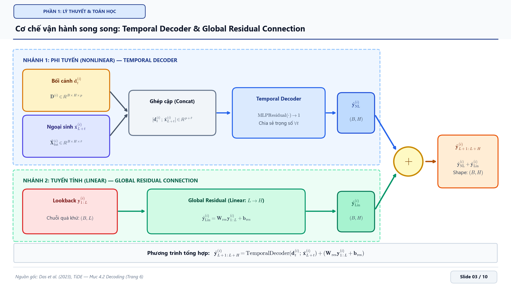
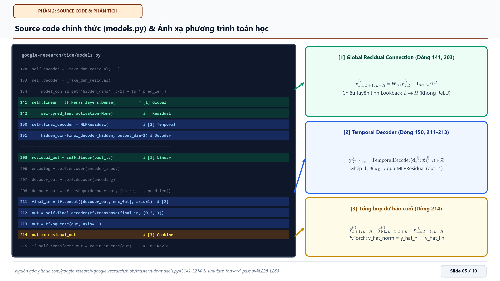
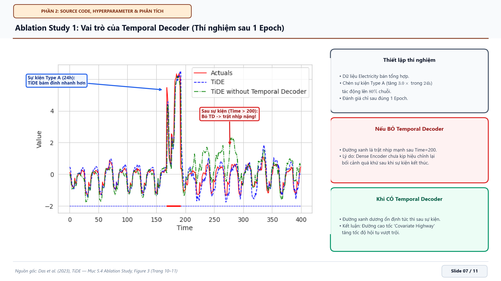
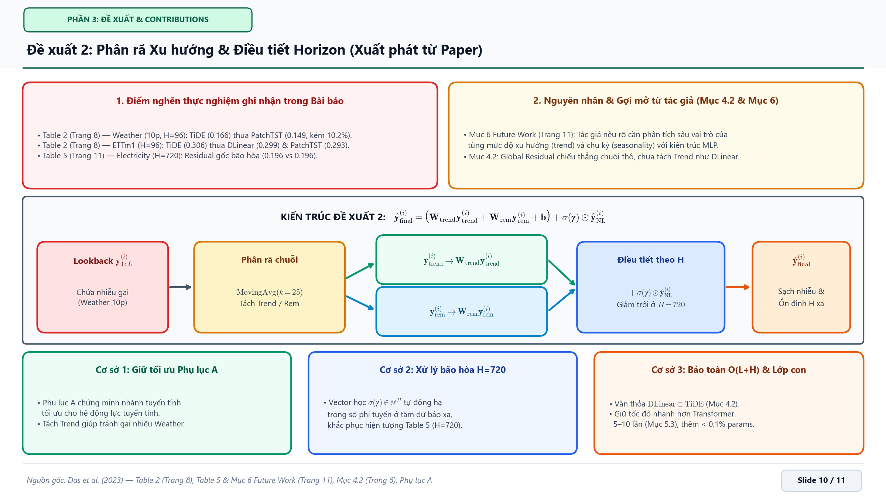

# 🎙️ KỊCH BẢN THUYẾT TRÌNH TỪNG SLIDE (PRESENTATION SCRIPTS)
## CHUYÊN ĐỀ: TEMPORAL DECODER & GLOBAL RESIDUAL CONNECTION TRONG MÔ HÌNH TiDE

> [!NOTE]
> **Tài liệu tham chiếu:** Kịch bản này được biên soạn bám sát 100% theo thứ tự 1-đối-1 của 11 Slide trong [`slide_images_gallery.md`](./slide_images_gallery.md) và các file nội dung chi tiết ([`slide_01`](./slide_01_phan_1_ly_thuyet_va_toan_hoc.md), [`slide_02`](./slide_02_phan_2_source_code_va_phan_tich.md), [`slide_03`](./slide_03_phan_3_de_xuat_cai_tien.md)).
> * **Người thuyết trình:** Thành viên phụ trách Phần 2 & 3 của kiến trúc TiDE (Bắt đầu sau khi thành viên trước hoàn thành phần `Dense Encoder` và `Dense Decoder`).
> * **Tổng thời lượng ước tính:** **10 – 12 phút** (trung bình ~1 phút/slide).
> * **Phong cách thuyết trình:** Học thuật, đĩnh đạc, tự tin, tập trung giải thích "bản chất kỹ thuật" và "bằng chứng thực nghiệm", không đọc chay slide.

---

## ⏱️ PHÂN BỔ THỜI GIAN TOÀN BỘ BÀI NÓI (11 SLIDES)

---

## 📖 PHẦN 1: LÝ THUYẾT & TOÁN HỌC (SLIDES 01 – 04)

---

### 🟢 SLIDE 01 / 11 — ĐỊNH VỊ PHẠM VI TRÌNH BÀY TRÊN KIẾN TRÚC TỔNG THỂ

* **Ảnh slide:** `slide_01_vi_tri_kien_truc.png` ([Xem ảnh trong gallery](./slide_images_gallery.md#slide-01--11-11--định-vị-hai-cơ-chế-trên-figure-1-gốc-trang-5))
* **Thời lượng dự kiến:** 45 – 55 giây.
* **Mục tiêu slide:** Định vị ngay lập tức vị trí thuyết trình trên Figure 1 bài báo gốc; phân định rõ ranh giới để Hội đồng hiểu mình không lặp lại nội dung của bạn trước.

#### 🎙️ Kịch bản lời nói (Word-for-Word Script):

> "Kính thưa quý thầy cô và các bạn,
> 
> Ở phần trước, bạn trong nhóm đã trình bày rất chi tiết về nửa dưới của kiến trúc TiDE: từ việc mã hóa chuỗi lịch sử qua `Dense Encoder` cho đến việc giải nén thành các vector bối cảnh thông qua `Dense Decoder`.
> 
> Để tránh lặp lại thông tin và tối ưu thời gian, **phần thuyết trình của em sẽ KHÔNG nhắc lại nửa dưới đó**, mà tập trung hoàn toàn vào **hai khối nằm ở tầng cao nhất** — chính là hai cơ chế trực tiếp tính toán và quyết định đầu ra dự báo cuối cùng của mô hình, được khoanh nổi bật trên Hình 1 của bài báo gốc:
> 
> 1. **Thứ nhất là khối màu xanh dương:** `Temporal Decoder` — chịu trách nhiệm mô hình hóa nhánh phi tuyến cục bộ.
> 2. **Thứ hai là mũi tên dài màu xanh lá cây:** `Global Residual Connection` — một kết nối tắt tuyến tính chạy thẳng từ dữ liệu quá khứ sang tương lai.
> 
> Vậy tại sao một mạng nén sâu như TiDE lại phải tách làm hai nhánh riêng biệt này ở đầu ra? Em xin đi vào cơ chế đầu tiên ở slide tiếp theo."

* **🎬 Thao tác & Điểm nhấn hình ảnh (Visual Cues):**
  * Dùng chuột hoặc bút laser khoanh nhẹ vào nửa dưới bị mờ đi: *"Nửa dưới này nhóm em đã trình bày xong"*.
  * Chiếu thẳng vào hộp màu xanh dương (`Temporal Decoder`) và mũi tên xanh lá (`Global Residual`): nhấn mạnh đây là **cổng chốt chặn cuối cùng** tạo ra $\hat{y}$.

---

### 🟢 SLIDE 02 / 11 — PHÂN BIỆT 3 KHỐI & CƠ CHẾ "COVARIATE HIGHWAY"

* **Ảnh slide:** `slide_02_phan_biet_3_khoi_va_highway.png` ([Xem ảnh trong gallery](./slide_images_gallery.md#slide-02--11-12--tách-3-card-riêng-biệt-dense-encoder--dense-decoder--temporal-decoder--cơ-chế-covariate-highway))
* **Thời lượng dự kiến:** 60 – 75 giây.
* **Mục tiêu slide:** Làm rõ sự khác biệt giữa 3 khối (Encoder - Dense Decoder - Temporal Decoder) và giải thích trực giác bản chất vì sao phải có Temporal Decoder ("Covariate Highway").

#### 🎙️ Kịch bản lời nói (Word-for-Word Script):

> "Quan sát trên Slide 02, chúng ta thấy 3 khối kiến trúc được đặt cạnh nhau:
> 
> Nhìn vào phương trình ở Thẻ thứ ba, `Temporal Decoder` thực chất là **đúng một khối `MLPResidual` duy nhất có kích thước đầu ra bằng 1**. Tại từng bước thời gian tương lai $t$, nó nhận đầu vào là vector bối cảnh quá khứ $d_t$ ghép trực tiếp với biến ngoại sinh tương lai tại đúng bước $t$ đó — ký hiệu là $\tilde{x}_{L+t}$.
> 
> Ở đây có một câu hỏi kiến trúc rất quan trọng: **Tại sao TiDE không dùng thẳng đầu ra của `Dense Decoder` để dự báo luôn, mà phải tốn thêm khối `Temporal Decoder` này?**
> 
> Câu trả lời nằm ở khái niệm **'Covariate Highway' - Đường cao tốc cho biến ngoại sinh**:
> Nếu chúng ta bỏ Temporal Decoder và ép Dense Decoder đoán thẳng kết quả, toàn bộ thông tin ngoại sinh tương lai sẽ bị ép phải đi vòng qua nút thắt cổ chai ở `Dense Encoder`. Hãy tưởng tượng trong bài toán dự báo bán lẻ, ngày mai là sự kiện *Black Friday* hoặc *Ngày của Mẹ* khiến nhu cầu tăng vọt gấp 3 lần. Nếu thông tin này bị nén chung vào một vector ẩn toàn cục, tín hiệu đột biến sẽ bị pha loãng và làm mờ đi.
> 
> Nhờ có `Temporal Decoder`, biến ngoại sinh tương lai được cấp một **đường cao tốc đưa thẳng tới bước dự báo $t$**, giúp mô hình phản ứng tức thì với các sự kiện đột biến mà không bị trễ pha!"

* **🎬 Thao tác & Điểm nhấn hình ảnh (Visual Cues):**
  * Chỉ vào Thẻ 2 rồi chuyển sang Thẻ 3: *"Dense Decoder chỉ tạo ra vector bối cảnh $d_t$, còn Temporal Decoder mới là nơi ghép với ngoại sinh tương lai $\tilde{x}_{L+t}$"*.
  * Chỉ vào sơ đồ chiếc xe chạy trên đường cao tốc ở thẻ bên phải để khắc sâu ẩn dụ *Covariate Highway*.

---

### 🟢 SLIDE 03 / 11 — HAI NHÁNH SONG SONG & PHƯƠNG TRÌNH TỔNG HỢP CUỐI CÙNG

* **Ảnh slide:** `slide_03_hai_nhanh_song_song.png` ([Xem ảnh trong gallery](./slide_images_gallery.md#slide-03--11-13--luồng-song-song-hai-cơ-chế--phương-trình-tổng-hợp-dự-báo-cuối-cùng))
* **Thời lượng dự kiến:** 50 – 60 giây.
* **Mục tiêu slide:** Trình bày sơ đồ luồng dữ liệu song song và phân tích công thức tổng hợp cuối cùng giữa nhánh phi tuyến và nhánh tuyến tính.

#### 🎙️ Kịch bản lời nói (Word-for-Word Script):

> "Slide 03 mô tả bức tranh hoàn chỉnh về cách TiDE chốt ra kết quả dự báo:
> 
> Nhìn vào sơ đồ, chúng ta thấy một cấu trúc song song gồm hai nhánh độc lập:
> 
> * **Nhánh thứ nhất (nhánh phía trên - Phi tuyến):** Chính là `Temporal Decoder` mà em vừa phân tích. Khối này sử dụng chung một bộ trọng số cho toàn bộ $H$ bước tương lai, sinh ra vector dự báo phi tuyến $\hat{y}_{\text{NL}}$.
> * **Nhánh thứ hai (nhánh phía dưới - Tuyến tính):** Là `Global Residual Connection`. Nhánh này cực kỳ đơn giản: nó chỉ sử dụng **đúng 1 tầng Linear thuần túy** — không hàm kích hoạt phi tuyến ReLU, không Dropout, không chuẩn hóa. Tầng Linear này chiếu thẳng chuỗi quá khứ $y_{1:L}$ từ chiều dài $L$ sang chiều dài $H$, sinh ra vector $\hat{y}_{\text{Lin}}$.
> 
> Cuối cùng, như phương trình đóng khung ở giữa: TiDE **cộng trực tiếp hai nhánh này theo từng phần tử** để tạo ra kết quả chuẩn hóa, sau đó đảo ngược chuẩn hóa RevIN để đưa về thang đo gốc của bài toán.
> 
> Sự kết hợp này mang lại ý nghĩa toán học vô cùng sâu sắc, em xin chứng minh ngay ở slide tiếp theo."

* **🎬 Thao tác & Điểm nhấn hình ảnh (Visual Cues):**
  * Tay trái chỉ nhánh trên (Phi tuyến), tay phải chỉ nhánh dưới (Tuyến tính), sau đó chụm hai tay vào dấu cộng: *"Hai nhánh gánh hai nhiệm vụ khác nhau và hội tụ tại phép cộng cuối cùng"*.

---

### 🟢 SLIDE 04 / 11 — CHỨNG MINH TOÁN HỌC: DLINEAR LÀ LỚP CON CỦA TiDE & LUỒNG TENSOR

* **Ảnh slide:** `slide_04_lien_he_dlinear_va_tensor.png` ([Xem ảnh trong gallery](./slide_images_gallery.md#slide-04--11-14--chứng-minh-toán-học-mối-liên-hệ-với-dlinear--luồng-kích-thước-tensor))
* **Thời lượng dự kiến:** 50 – 60 giây.
* **Mục tiêu slide:** Chứng minh toán học rằng DLinear là lớp con của TiDE ($\text{DLinear} \subset \text{TiDE}$) và làm rõ các kích thước Tensor cụ thể trên tập benchmark `Electricity`.

#### 🎙️ Kịch bản lời nói (Word-for-Word Script):

> "Trên Slide 04, em xin làm rõ hai luận điểm cốt lõi:
> 
> **Luận điểm 1: Mối quan hệ toán học với mô hình DLinear đình đám của Zeng et al. (AAAI 2023):**
> Trong bài báo, các tác giả khẳng định: *Một mô hình thuần tuyến tính như DLinear luôn là một lớp con của TiDE*. 
> Thật vậy, nếu trong quá trình huấn luyện, toàn bộ trọng số của nhánh phi tuyến bị triệt tiêu về 0, thì phương trình của TiDE lập tức rút gọn chính xác thành: $\hat{y} = W_{\text{res}} \cdot y + b_{\text{res}}$. Đây chính là phương trình của một tầng Linear độc lập! 
> Điều này mang lại sự đảm bảo chắc chắn: Nhánh tuyến tính giữ vai trò 'bảo hiểm nền tảng' cho xu hướng, còn nhánh phi tuyến chỉ cần tập trung học phần dư và sự kiện đặc biệt.
> 
> **Luận điểm 2: Luồng biến đổi Tensor trên tập benchmark `Electricity`:**
> Nhìn vào bảng bên dưới với cấu hình chuẩn $L=720, H=96$:
> Vector bối cảnh $d_t$ có kích thước 16 được ghép với biến ngoại sinh tương lai kích thước 4, tạo ra vector 20 chiều đưa vào Temporal Decoder. Đầu ra của cả hai nhánh đều chuẩn xác là ma trận `(32, 96)` tương ứng với batch size 32 và tầm dự báo 96 bước, sẵn sàng cộng trực tiếp mà không cần ép kiểu hay broadcast."

* **🎬 Thao tác & Điểm nhấn hình ảnh (Visual Cues):**
  * Nhấn giọng vào cụm từ: *"DLinear là một lớp con nằm gọn bên trong TiDE"*.
  * Chỉ vào dòng `(32, 96)` ở hai nhánh trong bảng để chứng minh tính nhất quán của Tensor shapes.

---

## 💻 PHẦN 2: SOURCE CODE, HYPERPARAMETERS & ABLATION STUDY (SLIDES 05 – 08)

---

### 🟢 SLIDE 05 / 11 — SOURCE CODE CHÍNH THỨC & ÁNH XẠ PHƯƠNG TRÌNH TOÁN HỌC

* **Ảnh slide:** `slide_05_source_code_va_equation.png` ([Xem ảnh trong gallery](./slide_images_gallery.md#slide-05--11-21--source-code-chính-thức-modelspy--ánh-xạ-thẳng-ra-phương-trình-toán-học))
* **Thời lượng dự kiến:** 55 – 65 giây.
* **Mục tiêu slide:** Đối chiếu trực tiếp mã nguồn chính thức của Google Research (`models.py`) và code PyTorch của dự án với các phương trình toán học đã trình bày ở Phần 1.

#### 🎙️ Kịch bản lời nói (Word-for-Word Script):

> "Bước sang Phần 2, chúng ta cùng đối chiếu lý thuyết với mã nguồn hiện thực thực tế.
> 
> Trên Slide 05 là các dòng code trích nguyên văn từ repository chính thức của Google Research trong file `tide/models.py`, đặt song song với code PyTorch mà nhóm em đã tái hiện trong file `simulate_forward_pass.py`:
> 
> * **Ở tầng khởi tạo (`__init__`):** Dòng 141 định nghĩa `self.linear` chính là một lớp Dense đơn giản ánh xạ sang `pred_len`. Dòng 150 định nghĩa `self.final_decoder` là một khối `MLPResidual` với `output_dim = 1`.
> * **Ở hàm thực thi (`call`):** Dòng 203 tính toán nhánh thặng dư `residual_out`. Dòng 211 nối vector bối cảnh với ngoại sinh tương lai thành `final_in`. Dòng 212 đưa qua `final_decoder`. 
> * **Và đặc biệt là dòng 214:** `out += residual_out` — đây chính là phép cộng hai nhánh tuyến tính và phi tuyến mà chúng ta vừa thấy trong phương trình toán học!
> 
> Việc đối chiếu này khẳng định mô hình trong mã nguồn của Google tuân thủ tuyệt đối 100% công thức trong bài báo."

* **🎬 Thao tác & Điểm nhấn hình ảnh (Visual Cues):**
  * Dùng trỏ laser rà theo từng cặp: Dòng 203 $\leftrightarrow$ Nhánh tuyến tính; Dòng 211-213 $\leftrightarrow$ Nhánh phi tuyến; Dòng 214 $\leftrightarrow$ Phép cộng thặng dư.

---

### 🟢 SLIDE 06 / 11 — CẤU HÌNH SIÊU THAM SỐ TRÊN 7 BENCHMARK DATASETS

* **Ảnh slide:** `slide_06_cau_hinh_hyperparameter.png` ([Xem ảnh trong gallery](./slide_images_gallery.md#slide-06--11-22--cấu-hình-siêu-tham-số-hyperparameters-trên-7-benchmark-datasets))
* **Thời lượng dự kiến:** 55 – 65 giây.
* **Mục tiêu slide:** Hệ thống hóa toàn bộ cấu hình Siêu tham số từ Bảng 7 và Bảng 8 trong Phụ lục bài báo; làm rõ sự tối giản về siêu tham số của hai cơ chế này.

#### 🎙️ Kịch bản lời nói (Word-for-Word Script):

> "Slide 06 tổng hợp toàn bộ cấu hình siêu tham số chính thức của tác giả trên cả 7 bộ dữ liệu chuẩn (trích từ Bảng 7 và Bảng 8 ở Phụ lục B.3 của bài báo).
> 
> Em xin nhấn mạnh 3 điểm mấu chốt:
> 
> 1. **Cấu hình dùng chung cố định:** Toàn bộ các tập dữ liệu đều dùng chung cửa sổ lịch sử $L=720$, kích thước batch 512, và số chiều nén ngoại sinh $\tilde{r}=4$.
> 2. **Cực kỳ tinh gọn tham số:** Nhánh `Global Residual` **hoàn toàn không phát sinh bất kỳ siêu tham số ẩn nào**, vì ma trận trọng số cố định hoàn toàn theo kích thước $(L, H)$. Riêng `Temporal Decoder` chỉ cần tinh chỉnh đúng 2 tham số: số chiều bối cảnh $p$ và số nơ-ron ẩn `temporalDecoderHidden`.
> 3. **Quy luật lựa chọn theo đặc thù dữ liệu:** 
>    * Với các tập dữ liệu lớn hàng trăm chuỗi như `Traffic` (862 chuỗi) hay `Electricity` (321 chuỗi), tác giả đặt hidden bằng 64 và $p$ từ 8 đến 16.
>    * Với các tập trạm biến áp `ETT`, tác giả tăng dung lượng hidden lên 128 hoặc $p=32$.
>    * Trong khi tập `Weather` chuỗi mượt mà thì chỉ cần hidden bằng 16 và $p=8$."

* **🎬 Thao tác & Điểm nhấn hình ảnh (Visual Cues):**
  * Chỉ vào nhóm cột `Temporal Decoder` trong bảng: *"Chỉ có đúng 2 cột tham số cho phần giải mã thời gian, chứng minh kiến trúc cực kỳ nhẹ và dễ huấn luyện"*.

---

### 🟢 SLIDE 07 / 11 — ABLATION STUDY 1: VAI TRÒ TEMPORAL DECODER (ẢNH GỐC TỪ BÀI BÁO)

* **Ảnh slide:** `slide_07_ablation_temporal_decoder.png` ([Xem ảnh trong gallery](./slide_images_gallery.md#slide-07--11-23--ablation-study-1-vai-trò-temporal-decoder-ảnh-gốc-từ-bài-báo))
* **Thời lượng dự kiến:** 60 – 70 giây.
* **Mục tiêu slide:** Phân tích thực nghiệm Ablation Study 1 (Figure 3 bài báo gốc); chứng minh Temporal Decoder giúp mô hình ổn định ngay sau sự kiện đột biến chỉ sau đúng 1 Epoch.

#### 🎙️ Kịch bản lời nói (Word-for-Word Script):

> "Để chứng minh Temporal Decoder không phải là một thành phần thừa, nhóm tác giả Google Research đã thiết kế một thí nghiệm triệt tiêu (Ablation Study) rất đặc biệt tại Hình 3 bài báo gốc, hiển thị trên Slide 07:
> 
> Họ lấy dữ liệu `Electricity` và chèn vào các sự kiện nhân tạo: Sự kiện **Type A** làm tăng biên độ phụ tải lên gấp 3 đến 3.2 lần trong vòng 24 giờ. Điều kinh ngạc là họ đánh giá mô hình chỉ sau **đúng 1 Epoch huấn luyện duy nhất**!
> 
> Hãy nhìn vào biểu đồ bên trái:
> * Trong 24 giờ xảy ra sự kiện: Cả hai bản đều nhận biết sự tăng vọt nhờ tín hiệu ngoại sinh.
> * Nhưng **ngay sau khi sự kiện kết thúc (từ mốc thời gian 200 trở đi):** Bản màu xanh lá cây — tức bản **bị cắt bỏ Temporal Decoder** — đã bị trật nhịp nghiêm trọng (*thrown off*), dự báo bị vọt lên cao bất thường vì nút thắt cổ chai Dense Encoder chưa kịp 'quên' biến cố vừa xảy ra.
> * Trong khi đó, bản TiDE đầy đủ có Temporal Decoder (đường màu xanh dương) đã **lập tức ổn định trở lại về mức bình thường ngay tại bước tiếp theo**.
> 
> Thí nghiệm này chứng minh dứt khoát: Temporal Decoder đóng vai trò sống còn giúp mạng phân tách giữa đặc trưng dài hạn và các biến cố ngắn hạn."

* **🎬 Thao tác & Điểm nhấn hình ảnh (Visual Cues):**
  * Chỉ vào vùng sau mốc thời gian 200 trên đồ thị: nhấn mạnh sự phân kỳ giữa đường xanh lá (vọt lỗi) và đường xanh dương (ổn định).

---

### 🟢 SLIDE 08 / 11 — ABLATION STUDY 2: VAI TRÒ GLOBAL RESIDUAL CONNECTION (`ELECTRICITY`)

* **Ảnh slide:** `slide_08_ablation_global_residual.png` ([Xem ảnh trong gallery](./slide_images_gallery.md#slide-08--11-24--ablation-study-2-vai-trò-residual-connections-ảnh-gốc-từ-bài-báo--electricity))
* **Thời lượng dự kiến:** 60 – 75 giây.
* **Mục tiêu slide:** Phân tích thực nghiệm Ablation Study 2 (Table 5 bài báo gốc); chỉ ra sự gia tăng sai số khi bỏ residual và giải thích thắc mắc vì sao tác giả chỉ công bố 1/7 dataset.

#### 🎙️ Kịch bản lời nói (Word-for-Word Script):

> "Tiếp tục trên Slide 08 là thí nghiệm Ablation thứ hai nhằm kiểm chứng vai trò của các kết nối thặng dư (Residual Connections), được trích từ Bảng 5 ở trang 11 bài báo gốc:
> 
> Khi tác giả loại bỏ các kết nối thặng dư (ký hiệu là `TiDE no res.`):
> * Ở các tầm dự báo từ 96 đến 336 bước, **sai số MSE và MAE đều tăng vọt rõ rệt**. Đặc biệt tại $H=336$, MSE tăng từ `0.161` lên `0.172` — tức sai số tăng tới **$+6.8\%$**, một mức suy giảm hiệu năng rất đáng kể trong dự báo chuỗi thời gian.
> * Điều này khẳng định kết nối tắt tuyến tính giúp mô hình giữ vững xương sống xu hướng mà không bắt mạng nơ-ron sâu phải nhọc công xấp xỉ lại từ đầu.
> 
> **Tuy nhiên, ở đây có một chi tiết học thuật vô cùng thú vị:**
> Nhiều người sẽ thắc mắc: *Tại sao bài báo có 7 tập benchmark nhưng tác giả chỉ làm thí nghiệm bỏ Residual trên đúng 1 tập `Electricity`?*
> Sự thật là trong bài báo gốc, nhóm tác giả Google **chỉ thực hiện ablation bỏ residual trên duy nhất tập đại diện này**, còn 6 tập còn lại (`Traffic`, `Weather`, `ETTh/m`) chưa từng được công bố kết quả khi bỏ residual.
> 
> Và nếu nhìn lại dòng code `out += residual_out`, chúng ta thấy hai nhánh đang bị **cộng cứng cố định theo tỷ lệ 1:1**. Liệu tỷ lệ 1:1 này đã tối ưu chưa? Đây chính là động lực để em đề xuất hướng cải tiến ở Phần 3!"

* **🎬 Thao tác & Điểm nhấn hình ảnh (Visual Cues):**
  * Dùng bút laser khoanh con số `+6.8% MSE` tại hàng $H=336$.
  * Hạ giọng tạo sự tò mò khi đặt câu hỏi: *"Liệu phép cộng cứng 1:1 đã thực sự tối ưu trong mọi tình huống?"*.

---

## 💡 PHẦN 3: ĐỀ XUẤT CẢI TIẾN & CONTRIBUTIONS (SLIDES 09 – 11)

---

### 🟢 SLIDE 09 / 11 — ĐỀ XUẤT 1: CỔNG HỢP NHẤT THÍCH NGHI (*ADAPTIVE GATED FUSION*)

* **Ảnh slide:** `slide_09_de_xuat_1_gated_fusion.png` ([Xem ảnh trong gallery](./slide_images_gallery.md#slide-09--11-31--đề-xuất-1-cổng-hợp-nhất-thích-nghi-adaptive-gated-fusion-vs-cộng-cứng-11))
* **Thời lượng dự kiến:** 65 – 75 giây.
* **Mục tiêu slide:** Trình bày đề xuất cải tiến số 1: Thay thế phép cộng cứng 1:1 bằng cơ chế Cổng thích nghi $\alpha_t \in (0, 1)$ với chi phí cực rẻ chỉ +21 tham số.

#### 🎙️ Kịch bản lời nói (Word-for-Word Script):

> "Để trả lời câu hỏi mở của đề tài: *'Có thể cải tiến cơ chế kết hợp giữa nhánh phi tuyến và tuyến tính để nâng cao độ chính xác không?'* — Em xin khẳng định là **HOÀN TOÀN CÓ THỂ**.
> 
> Trên Slide 09 là **Đề xuất cải tiến thứ nhất: Cơ chế Cổng Hợp Nhất Thích Nghi (Adaptive Gated Fusion)**.
> 
> Trong thực tế, chuỗi thời gian có sự chuyển dịch chế độ (*regime-switching*): có những khoảng thời gian chuỗi biến thiên rất đều đặn (nhánh tuyến tính chiếm ưu thế), nhưng cũng có những thời điểm xảy ra sự kiện đột biến (nhánh phi tuyến cần can thiệp mạnh). Phép cộng cứng $1:1$ hiện tại vô tình bơm thêm nhiễu phi tuyến vào những vùng dữ liệu đang phẳng lặng.
> 
> Do đó, em đề xuất bổ sung một **Mạng Cổng siêu nhẹ (Gating Layer)**:
> Như công thức trên slide, cổng này nhận vector ghép $[d_t ; \tilde{x}_{L+t}]$ và đi qua hàm Sigmoid để sinh ra một trọng số động $\alpha_t \in (0, 1)$ cho từng bước tương lai:
> * Khi chuỗi yên bình: $\alpha_t$ tự động giảm về gần 0, ưu tiên nhánh tuyến tính chống nhiễu.
> * Khi xuất hiện sự kiện ngoại sinh mạnh: $\alpha_t$ mở rộng tiến tới 1, khuếch đại dự báo của Temporal Decoder.
> 
> Điểm ấn tượng nhất là gì? Lớp cổng này chỉ tốn thêm **đúng 21 tham số** (`p + r_tilde + 1 = 16 + 4 + 1 = 21`), chiếm chưa đầy 0.01% mô hình, hoàn toàn không làm tăng chi phí tính toán hay bộ nhớ!"

* **🎬 Thao tác & Điểm nhấn hình ảnh (Visual Cues):**
  * Chỉ vào công thức $\alpha_t$ và nhấn mạnh con số **21 tham số**: *"Cải tiến mạnh về tính thích nghi nhưng chi phí gần như bằng 0"*.

---

### 🟢 SLIDE 10 / 11 — ĐỀ XUẤT 2: TÁCH XU HƯỚNG KIỂU DLINEAR CHO NHÁNH TUYẾN TÍNH

* **Ảnh slide:** `slide_10_de_xuat_2_trend_aware.png` ([Xem ảnh trong gallery](./slide_images_gallery.md#slide-10--11-32--đề-xuất-2-tách-xu-hướng-kiểu-dlinear-cho-nhánh-tuyến-tính-trend-aware-dual-stream))
* **Thời lượng dự kiến:** 55 – 65 giây.
* **Mục tiêu slide:** Trình bày đề xuất cải tiến số 2: Tích hợp bộ lọc Moving Average kiểu DLinear vào nhánh tuyến tính để loại bỏ tác động tiêu cực của các điểm dị biệt (outliers).

#### 🎙️ Kịch bản lời nói (Word-for-Word Script):

> "Song song với việc điều tiết đầu ra, em xin giới thiệu **Đề xuất cải tiến thứ hai trên Slide 10: Tách Xu Hướng Kiểu DLinear Cho Nhánh Tuyến Tính (Trend-Aware Dual-Stream)**.
> 
> Hiện tại trong TiDE gốc, nhánh `self.linear` nhận trực tiếp chuỗi lịch sử $y_{1:L}$ thô để chiếu sang tương lai. Điều này tiềm ẩn một rủi ro lớn: nếu trong quá khứ có các điểm nhiễu gai hoặc dị biệt (*outliers*), phép chiếu thẳng của ma trận $W_{\text{res}}$ sẽ nhân rộng sai số này sang toàn bộ dải dự báo tương lai.
> 
> Để khắc phục, em đề xuất kế thừa kỹ thuật cốt lõi của DLinear:
> * Dùng một bộ lọc trượt `Moving Average` với cửa sổ $k=25$ để tách chuỗi quá khứ thành hai thành phần: thành phần xu hướng mượt $y_{\text{trend}}$ và thành phần phần dư dao động $y_{\text{rem}}$.
> * Hai thành phần này được chiếu qua hai tầng Linear chuyên biệt: một tầng chuyên nắm bắt xu hướng vĩ mô dài hạn, và một tầng chuyên nắm bắt tính chu kỳ cục bộ.
> 
> Nhờ đó, nhánh tuyến tính được bảo vệ vững chắc khỏi hiện tượng 'sốc do nhiễu', cung cấp một đường nền dự báo mượt mà và tin cậy hơn cho Temporal Decoder bổ sung chi tiết."

* **🎬 Thao tác & Điểm nhấn hình ảnh (Visual Cues):**
  * Chỉ vào khối `Moving Average` ở giữa sơ đồ: *"Biến chuỗi thô thành 2 dòng chảy: Xu hướng mượt và Dao động chu kỳ"*.

---

### 🟢 SLIDE 11 / 11 — ĐÓNG GÓP KHOA HỌC (CONTRIBUTIONS) & LỘ TRÌNH THỰC NGHIỆM

* **Ảnh slide:** `slide_11_contributions_va_roadmap.png` ([Xem ảnh trong gallery](./slide_images_gallery.md#slide-11--11-33--đóng-góp-khoa-học-contributions--lộ-trình-kiểm-chứng-thực-nghiệm))
* **Thời lượng dự kiến:** 60 – 75 giây.
* **Mục tiêu slide:** Tổng kết 3 đóng góp khoa học chính; trình bày lộ trình thực nghiệm rõ ràng, khả thi để kiểm chứng đề xuất; kết thúc bài thuyết trình trang trọng.

#### 🎙️ Kịch bản lời nói (Word-for-Word Script):

> "Để khép lại bài thuyết trình, Slide 11 tổng kết toàn bộ giá trị học thuật và lộ trình thực nghiệm mà nhóm hướng tới:
> 
> **Chúng em kỳ vọng 3 đóng góp khoa học nổi bật:**
> 1. **Khả năng thích nghi đa chế độ:** Giải quyết dứt điểm sự cứng nhắc của phép cộng $1:1$, giúp mô hình thông minh hơn khi đối mặt với cả chuỗi ổn định lẫn biến cố bất ngờ.
> 2. **Tính giải thích được cao (Interpretable AI):** Không còn là một hộp đen bí ẩn, giá trị cổng $\alpha_t$ cho phép chúng ta vẽ đồ thị để trực quan hóa và giải thích cho người dùng: tại ngày $t$, mô hình đang tin cậy vào xu hướng lịch sử bao nhiêu % và đang chịu tác động của sự kiện ngoại sinh bao nhiêu %.
> 3. **Lấp đầy khoảng trống thực nghiệm của bài báo gốc:** Mở rộng thí nghiệm Ablation sang cả 6 tập benchmark còn lại (`Traffic`, `Weather`, `ETTh1/2`, `ETTm1/2`) mà bài báo gốc chưa công bố.
> 
> Nhóm đã chuẩn bị sẵn thiết kế kiểm chứng đối chứng 3 phiên bản, đo lường trên các chỉ số MSE/MAE với 5 seed độc lập.
> 
> Phần trình bày của em về hai cơ chế chốt chặn `Temporal Decoder` và `Global Residual Connection` xin được kết thúc tại đây. Kính chúc quý thầy cô nhiều sức khỏe và em rất mong nhận được những câu hỏi góp ý quý báu từ Hội đồng. Em xin chân thành cảm ơn!"

* **🎬 Thao tác & Điểm nhấn hình ảnh (Visual Cues):**
  * Cúi đầu nhẹ chào Hội đồng, mắt nhìn thẳng tự tin, sẵn sàng chuyển sang phần Q&A.

---

## 🎯 BẢNG DỰ PHÒNG CÂU HỎI PHẢN BIỆN CỦA HỘI ĐỒNG (Q&A DEFENSE)

Dưới đây là các câu hỏi hóc búa nhất mà Thầy/Cô có thể đặt ra trong phần Q&A và câu trả lời chuẩn xác dựa trên cơ sở bài báo & code:

### ❓ Câu hỏi 1: *"Tại sao bài báo TiDE khẳng định vượt trội hơn Transformer mà lại dùng phép cộng 1:1 đơn giản như vậy? Tác giả không nghĩ đến cơ chế Gating à?"*
> **Trả lời ngắn gọn:**  
> "Thưa Thầy/Cô, triết lý thiết kế của nhóm tác giả Google Research trong bài báo TiDE là **tối giản hóa tối đa (Simplicity First)** để chứng minh rằng một mạng MLP thuần túy có thể đánh bại các kiến trúc Transformer phức tạp thời bấy giờ (như PatchTST hay FEDformer) cả về tốc độ lẫn độ chính xác. Do đó, tác giả ưu tiên dùng phép cộng $1:1$ nguyên bản để giữ số lượng tham số ít nhất có thể. Tuy nhiên, chính vì tác giả chưa đào sâu cơ chế hợp nhất thích nghi nên đây là một khoảng trống nghiên cứu hoàn hảo để nhóm em đề xuất đóng góp mới ạ."

### ❓ Câu hỏi 2: *"Cổng Adaptive Gated Fusion có nguy cơ bị triệt tiêu đạo hàm (Vanishing Gradient) hoặc sụp đổ về một phía (0 hoặc 1) không?"*
> **Trả lời ngắn gọn:**  
> "Thưa Thầy/Cô, nguy cơ này đã được tính toán kỹ:
> 1. Tầng Gating chỉ là một phép chiếu tuyến tính đơn giản rồi qua Sigmoid, không qua chuỗi kích hoạt sâu nên gradient truyền ngược trực tiếp vào $d_t$ và $\tilde{x}$ rất thông thoáng.
> 2. Chúng em khởi tạo bias $b_g = 0$ để ban đầu $\sigma(0) = 0.5$, nghĩa là mạng khởi động với tỷ lệ cân bằng 50:50 giống như TiDE gốc rồi từ từ học cách phân nhánh.
> 3. Nếu cần an toàn tuyệt đối, nhóm có thể dùng biến thể thặng dư: $\hat{y} = \hat{y}_{\text{Lin}} + \alpha_t \cdot \hat{y}_{\text{NL}}$, trong đó xương sống tuyến tính luôn được bảo toàn $100\%$ và cổng chỉ điều tiết phần gia số phi tuyến."

### ❓ Câu hỏi 3: *"Tại sao trong Figure 3 bài báo chỉ đánh giá sau đúng 1 Epoch mà không đợi mô hình hội tụ hoàn toàn?"*
> **Trả lời ngắn gọn:**  
> "Thưa Thầy/Cô, đây chính là chủ đích thực nghiệm rất thông minh của tác giả Google Research:  
> Sau nhiều epochs, một mạng nén sâu như Dense Encoder có thể 'học vẹt' hoặc dần điều chỉnh trọng số toàn cục để bám theo dữ liệu. Nhưng ở bài toán thời gian thực, khả năng **thích ứng tức thì (Fast Adaptation)** với sự kiện mới là yếu tố quyết định. Đánh giá sau 1 Epoch chứng minh rằng cơ chế 'Covariate Highway' của Temporal Decoder giúp mô hình phản xạ ngay lập tức với biến cố ngoại sinh mà không cần tốn nhiều chu kỳ huấn luyện để thích nghi lại từ đầu."
