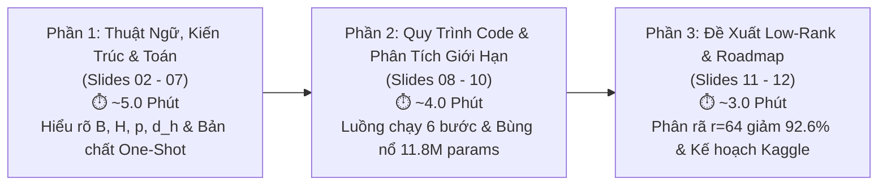
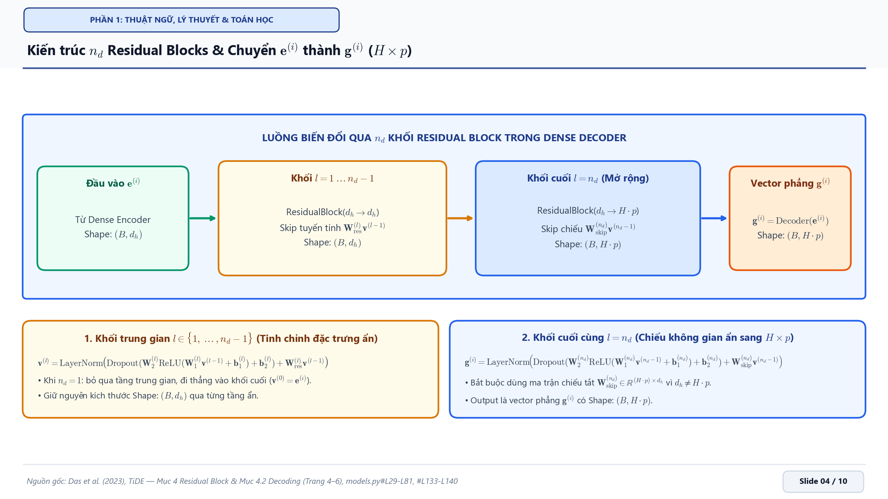

# 🎙️ KỊCH BẢN THUYẾT TRÌNH NỘI BỘ TỪNG SLIDE (INTERNAL TEAM SHARING SCRIPT)
## CHUYÊN ĐỀ: KHỐI DENSE DECODER TRONG KIẾN TRÚC MÔ HÌNH TiDE

> [!NOTE]
> **Bối cảnh sử dụng (Context):**  
> * **Đối tượng người nghe:** Thành viên trong nhóm (kể cả các bạn mới tiếp cận TiDE lần đầu).
> * **Mục tiêu bài nói:** **Vừa chi tiết, chuẩn xác theo code & bài báo gốc, vừa diễn giải thật dễ hiểu bằng hình ảnh trực quan và ví dụ cụ thể** để người mới nghe lần đầu cũng nắm trọn vẹn bản chất từ ký hiệu tensor, luồng chạy code đến đề xuất cải tiến.
> * **Phong cách trình bày:** Gần gũi, cởi mở, xưng hô "mình" và "anh em / các bạn trong nhóm". Hạn chế đọc công thức dài dòng, chỉ trỏ vào slide và giải thích ý nghĩa cốt lõi.
> * **Tài liệu tham chiếu:** Khớp chính xác 1-đối-1 theo đúng thứ tự **13 Slide** trong [`slide_images_gallery.md`](./slide_images_gallery.md) (từ **Slide 01 / 13** đến **Slide 13 / 13**) và tuân thủ chuẩn mực [`rule_slide.md`](./rule_slide.md) cùng [`RULE.md`](../../../RULE.md).

---

## ⏱️ PHÂN BỔ THỜI GIAN TOÀN BỘ BÀI NÓI (13 SLIDES)

---

### 🟢 SLIDE 01 / 13 — INTRO: TỔNG QUAN CHUYÊN ĐỀ DENSE DECODER TRONG TiDE

* **Ảnh slide:** `slide_00_intro.png` ([Xem ảnh trong gallery](./slide_images_gallery.md#slide-01--13-intro--tide-dense-decoder-presenter-le-thanh-hieu))
* **Thời lượng dự kiến:** 45 – 55 giây.
* **Mục tiêu slide:** Chào hỏi nhóm, giới thiệu bài toán dự báo chuỗi thời gian của TiDE một cách dễ hiểu cho người mới, nêu bật vai trò và vấn đề của khối `Dense Decoder`.

#### 🎙️ Lời thoại trình bày (Team Tech-talk):

Chào cả nhóm! Hôm nay mình sẽ chia sẻ chi tiết về **Khối Dense Decoder** trong mô hình dự báo chuỗi thời gian **TiDE** (của nhóm tác giả Google công bố năm 2023).

Để các bạn mới tiếp cận dễ hình dung, bài toán của TiDE là: **nhìn vào dữ liệu quá khứ** (ví dụ: lượng điện tiêu thụ của 720 giờ trước) để **dự báo cho một chuỗi dài các bước tương lai** (96 đến 720 giờ tiếp theo). Trong đó:
* Khối `Dense Encoder` ở phía trước đóng vai trò như người "đọc và tóm tắt" toàn bộ lịch sử quá khứ.
* Còn **`Dense Decoder`** mà mình trình bày hôm nay chính là **"trái tim giải mã"**: nó cầm bản tóm tắt đó để vẽ ra toàn bộ khung dự báo tương lai **chỉ trong đúng 1 lần chạy duy nhất (One-Shot)** — giúp mô hình chạy nhanh hơn Transformer từ 5 đến 10 lần. Tuy nhiên, chính khối này cũng là nơi **ngốn nhiều tham số nhất** khi chúng ta dự báo tầm xa.

Trong khoảng 12 phút tới, mình sẽ đi cùng anh em qua 3 phần rất rõ ràng:
1. **Phần 1 (Slides 02 – 07):** Giải thích thuật ngữ dễ hiểu, xem vị trí trên sơ đồ và hiểu tại sao nó chạy song song được.
2. **Phần 2 (Slides 08 – 10):** Đọc từng dòng code thực tế trong `models.py` và phân tích lý do mô hình bị phình to tham số ở tầng cuối.
3. **Phần 3 (Slides 11 – 12):** Đưa ra giải pháp tối ưu **Low-Rank** (giảm hơn 92% tham số) và chốt kế hoạch chạy thực nghiệm trên Kaggle.

Bây giờ mình vào ngay **Slide 02** để thống nhất các ký hiệu và thuật ngữ cơ bản nhất nhé!

---

## 📖 PHẦN 1: THUẬT NGỮ, KIẾN TRÚC & TOÁN HỌC (SLIDES 02 – 07)

---

### 🟢 SLIDE 02 / 13 — THUẬT NGỮ NỀN TẢNG & KÝ HIỆU KÍCH THƯỚC (`B`, `H`, `p`, `hiddenSize`)

* **Ảnh slide:** `slide_01_bang_thuat_ngu_dense_decoder.png` ([Xem ảnh trong gallery](./slide_images_gallery.md#slide-02--13-vai-trò-5-thuật-ngữ-nền-tảng--ký-hiệu-kích-thước-b-h-p-hiddensize))
* **Thời lượng dự kiến:** 75 – 85 giây.
* **Mục tiêu slide:** Giúp người mới hiểu ngay ý nghĩa thực tế của các ký hiệu $B, H, p, d_h$ và 5 thuật ngữ cốt lõi trước khi xem sơ đồ.

#### 🎙️ Lời thoại trình bày (Team Tech-talk):

Với các bạn mới đọc TiDE lần đầu, rào cản lớn nhất thường là các ký hiệu viết tắt. Nên trước khi vào sơ đồ kiến trúc, mình xin thống nhất nhanh 4 con số kích thước và 5 khái niệm nền tảng để lát nữa nghe là hiểu ngay:

Đầu tiên là 4 ký hiệu kích thước bạn sẽ gặp xuyên suốt bài nói:
* **$B$ là `Batch Size`:** Số lượng mẫu dữ liệu mô hình xử lý cùng lúc trong một lượt — giống như mỗi lần chấm bài thi ta chấm một xấp 512 bài vậy. Bài báo cố định $B = 512$.
* **$H$ là `Horizon`:** Số bước tương lai mình muốn dự báo (thường là 96, 192, 336 hoặc dài nhất là 720 bước).
* **$p$ là `decoderOutputDim`:** Số lượng đặc trưng tóm tắt cho mỗi bước tương lai (thường là 8, 16 hoặc 32). Thay vì đoán ngay 1 con số khô khan cho ngày mai, mô hình tạo ra hẳn một vector gồm $p$ con số mô tả bối cảnh cho ngày mai.
* **$d_h$ là `hiddenSize`:** Độ rộng (số nơ-ron) của các tầng ẩn bên trong mạng. Tác giả thử 3 mức $256, 512, 1024$: tập dữ liệu lớn như `Electricity` hay `Traffic` dùng tới 1024, còn các tập nhỏ hơn thì dùng 256 hoặc 512.

Tiếp theo là 5 thuật ngữ cốt lõi tạo nên khối Dense Decoder:
* Thứ nhất là **`MLPResidual` (Khối xử lý cơ bản):** Đây là "viên gạch" xây nên toàn bộ TiDE. Nó gồm một nhánh chính đi qua 2 lớp tính toán phi tuyến, và một **đường tắt (`Skip Connection`)** đi thẳng từ đầu vào sang đầu ra — giống như chiếc cầu an toàn giúp tín hiệu và gradient truyền qua nhiều tầng mà không bị thất lạc.
* Thứ hai là **`Unflatten` (Thao tác Reshape):** Hiểu đơn giản là "gấp lại". Ngõ ra của Dense Decoder ban đầu là một hàng dài gồm $H \cdot p$ con số (ví dụ $96 \times 8 = 768$ số). `Unflatten` sẽ cắt và xếp hàng dài đó thành một bảng gồm $H$ cột tương ứng với $H$ ngày, mỗi cột dài $p$ số.
* Thứ ba là **`Information Bottleneck` (Nghẽn cổ chai):** Nếu ta ép kích thước $p$ quá nhỏ (như 1 hay 2), lượng thông tin quá khứ truyền sang bị mất mát, không đủ chứa cả xu hướng lẫn chu kỳ. Ngược lại chọn $p$ quá lớn thì mô hình phình to và dễ học vẹt.
* Thứ tư là **`LayerNorm` (Chuẩn hóa theo tầng):** Đóng vai trò như "bộ ổn áp" đặt ở cuối mỗi khối `MLPResidual`, giúp các con số đầu ra không bị nhảy vọt quá lớn hay tụt về 0 khi mạng sâu.
* Cuối cùng là **`Dropout` (Điều chuẩn ngẫu nhiên):** Trong lúc học, nó tạm tắt ngẫu nhiên một tỷ lệ kết nối — giống như việc "che bớt một số gợi ý lúc ôn bài" để mạng không học tủ, chống hiện tượng Overfitting (và khi đi dự báo thật thì mở lại 100%).

Nắm vững 5 khái niệm này rồi, giờ chúng ta cùng xem hành trình của dữ liệu qua khối Dense Decoder trong kiến trúc tổng thể TiDE nhé!

---

### 🟢 SLIDE 03 / 13 — VỊ TRÍ KHỐI DENSE DECODER & UNFLATTEN TRÊN FIGURE 1

* **Ảnh slide:** `slide_02_vi_tri_dense_decoder.png` ([Xem ảnh trong gallery](./slide_images_gallery.md#slide-03--13-vị-trí-khối-dense-decoder--unflatten-trên-figure-1))
* **Thời lượng dự kiến:** 45 – 50 giây.
* **Mục tiêu slide:** Giúp người nghe định vị chính xác khối Dense Decoder trên sơ đồ tổng thể Figure 1 của bài báo và hiểu vai trò cầu nối của nó.

#### 🎙️ Lời thoại trình bày (Team Tech-talk):

Để anh em dễ hình dung vị trí phần của mình trong kiến trúc tổng thể TiDE, mình sẽ kể lại đúng hành trình đi của dữ liệu từ đầu vào cho tới lúc dự báo nhé:

Ban đầu, mô hình tiếp nhận 3 nguồn dữ liệu gồm chuỗi lịch sử `Lookback`, thuộc tính tĩnh `Attributes`, và các biến ngoại sinh `Dynamic Covariates` sau khi đã được nén gọn qua bước `Feature Projection`. Tất cả được gộp phẳng lại rồi đi qua bộ mã hóa `Dense Encoder` gồm $n_e$ tầng để chắt lọc thành một vector tóm tắt duy nhất là $\mathbf{e}^{(i)}$ có kích thước `(B, d_h)`, chứa toàn bộ ngữ cảnh lịch sử.

Song song với nhánh xử lý sâu này, mô hình còn có một đường tắt `Residual` toàn cục nối thẳng từ chuỗi quá khứ `Lookback` lên tận phép cộng cuối cùng để tạo `Predictions`, giúp giữ nguyên vẹn phần xu hướng tuyến tính cơ bản.

Quay lại nhánh chính của chúng ta: vector tóm tắt $\mathbf{e}^{(i)}$ sau khi rời bộ mã hóa sẽ đi thẳng vào khối **`Dense Decoder`**. Khối này gồm $n_d$ khối `Residual Block` xếp chồng lên nhau — trong mỗi khối đó, nhánh chính sẽ lần lượt đi qua lớp `Dense (ReLU)`, `Dense (Linear)` và `Dropout`, rồi cộng với nhánh tắt `Skip Connection`, và cuối cùng đi qua `Layer Norm` để ổn định tín hiệu. Qua quá trình này, `Dense Decoder` giải nén $\mathbf{e}^{(i)}$ thành một vector phẳng $\mathbf{g}^{(i)}$ có kích thước `(B, H * p)`, thực thi song song chỉ trong một lần duy nhất cho cả $H$ bước tương lai.

Ngay sau đó, thao tác `Unflatten` sẽ định hình lại vector phẳng $\mathbf{g}^{(i)}$ thành ma trận $\mathbf{D}^{(i)}$ kích thước `(B, p, H)`, tách ra $H$ vector bối cảnh riêng biệt $\mathbf{d}_t^{(i)}$ với mỗi vector có kích thước `(B, p)` đại diện cho từng bước thời gian tương lai. Cuối cùng, các vector bối cảnh này được xếp chồng (`Stack`) cùng biến ngoại sinh tương lai $\tilde{\mathbf{x}}$ để đi qua `Temporal Decoder` và cộng với đường `Residual` thành kết quả dự báo cuối cùng. Còn việc ghép ngoại sinh cụ thể như thế nào, mình sẽ giải thích rõ ở Slide 07 và Slide 08 nhé!

---

### 🟢 SLIDE 04 / 13 — CÁCH DENSE DECODER TẠO BIỂU DIỄN TOÀN HORIZON (ONE-SHOT VS TUẦN TỰ)

* **Ảnh slide:** `slide_03_one_shot_vs_tuan_tu.png` ([Xem ảnh trong gallery](./slide_images_gallery.md#slide-04--13-cách-dense-decoder-tạo-biểu-diễn-toàn-horizon-one-shot-vs-tuần-tự))
* **Thời lượng dự kiến:** 55 – 65 giây.
* **Mục tiêu slide:** Giải thích thật dễ hiểu sự khác biệt giữa cách đoán nối đuôi truyền thống và cách đoán 1 lần (One-Shot) của TiDE.

#### 🎙️ Lời thoại trình bày (Team Tech-talk):

Để thấy vì sao TiDE lại đột phá về tốc độ, chúng ta thử so sánh cách làm truyền thống với cách của TiDE nhé:

Với các mô hình truyền thống như RNN, LSTM hay Transformer cổ điển, chúng làm việc theo kiểu "cuốn chiếu" tuần tự: muốn đoán ngày mai (bước 2) thì bắt buộc phải đoán xong hôm nay (bước 1) rồi lấy kết quả đó nạp ngược lại vào mô hình để đoán tiếp, cứ thế lặp đi lặp lại $H$ lần. Cách này có hai nhược điểm rất lớn: thứ nhất là chậm vì GPU phải chạy nối đuôi nhau từng lượt một, thứ hai là **tích lũy sai số** — ngày 1 đoán lệch một chút thì ngày 2 lấy cái lệch đó đoán tiếp, kéo dài đến ngày thứ 720 là kết quả bị trôi dạt hoàn toàn.

Ngược lại, TiDE bỏ hẳn vòng lặp nối đuôi đó. Từ vector tóm tắt quá khứ $\mathbf{e}^{(i)}$, khối Dense Decoder dùng phép nhân ma trận chiếu **một phát duy nhất** ra biểu diễn của toàn bộ $H$ ngày tương lai cùng lúc. Bước 1 và bước 720 đều trích xuất trực tiếp từ $\mathbf{e}^{(i)}$, không bước nào phải chờ hay phụ thuộc vào kết quả đoán của bước trước. Nhờ vậy, TiDE **triệt tiêu 100% lỗi tích lũy sai số** và chạy nhanh hơn Transformer tới 5–10 lần!

Nghe tới đây, chắc hẳn bạn mới sẽ thắc mắc: *"Ủa, nếu các ngày tương lai tính độc lập không chờ nhau, vậy làm sao mô hình biết được ngày hôm nay và ngày mai có liên quan chặt chẽ với nhau?"* Mời anh em sang Slide 05 để giải đáp triệt để nhé!

---

### 🟢 SLIDE 05 / 13 — TỪ CÔNG THỨC TOÁN HỌC SUY RA CODE (`models.py`)

* **Ảnh slide:** `slide_03b_ban_chat_toan_hoc.png` ([Xem ảnh trong gallery](./slide_images_gallery.md#slide-05--13-từ-công-thức-toán-học-suy-ra-code-modelspy--độc-lập-tính-toán-vs-tương-quan-biểu-diễn))
* **Thời lượng dự kiến:** 90 – 110 giây.
* **Mục tiêu slide:** Giải thích rõ ràng, bình dân nhất nghịch lý *"các bước tính độc lập nhau nhưng kết quả dự báo vẫn ăn khớp liên tục với nhau"*, đi theo đúng 3 tầng trên từng thẻ: **(1) Công thức Toán học → (2) Nguyên văn code `models.py` → (3) Nhận xét**.

#### 🎙️ Lời thoại trình bày (Team Tech-talk):

Slide 05 này trả lời câu hỏi quan trọng nhất để hiểu bản chất `Dense Decoder`: làm sao TiDE vừa tính song song độc lập $H$ ngày (không ngày nào chờ ngày nào), mà kết quả các ngày liền kề lại không bị rời rạc vô lý? Mời cả nhóm nhìn vào 2 thẻ đối xứng, mỗi thẻ đi theo đúng 3 tầng: **(1) Công thức Toán học → (2) Nguyên văn code `models.py` → (3) Nhận xét**.

**Thẻ trái (xanh lá) — Độc lập lúc tính toán (Tốc độ GPU):**

* **Phần 1 — Công thức Toán học:** Ma trận chiếu tầng cuối $\mathbf{W}$ được tách thành $H$ mảng con $\mathbf{W}_1, \dots, \mathbf{W}_H$. Bước thứ $t$ chỉ lấy biểu diễn ẩn $\mathbf{v}^{(n_d-1)}$ nhân với mảng $\mathbf{W}_t$ của riêng nó để ra $\mathbf{d}_t^{(i)}$. Vì thế đạo hàm chéo $\partial \mathbf{d}_t^{(i)} / \partial \mathbf{d}_s^{(i)} = \mathbf{0}$ — tức bước $t$ (ngày kia) không hề lấy kết quả của bước $s$ (ngày mai) làm đầu vào, hai ngày hoàn toàn không dính vào nhau lúc tính.
* **Phần 2 — Code nguyên văn (`models.py#L133-L137`, `#L207-L208`):** Vì không bước nào chờ bước nào, tác giả bỏ hẳn vòng lặp `for t in range(H)`, chỉ khởi tạo đúng 1 tầng `self.decoder` xuất ra tích `decoder_output_dim * self.pred_len` (bằng $p \cdot H$ chiều). Khi chạy chỉ cần đúng 1 lệnh `decoder_out = self.decoder(encoding)` tính hết cả $H$ bước cùng lúc, rồi dùng `tf.reshape` ở dòng 208 chặt ra thành $H$ lát cắt riêng.
* **Phần 3 — Nhận xét:** Toàn bộ $H$ bước chạy gọn trong một phép nhân ma trận GPU duy nhất ($O(1)$ song song) và **triệt tiêu hoàn toàn lỗi tích lũy sai số dây chuyền**.

**Thẻ phải (xanh dương) — Tương quan lúc biểu diễn (Giữ mạch chuỗi thời gian):**

*Nếu ngày 1 và ngày 2 tính độc lập, sao ngày 1 đoán 30°C mà ngày 2 không tự nhiên vọt về 0°C vô lý?* Câu trả lời nằm ở 3 sợi dây nối ngầm trong thẻ phải:

* **Phần 1 — Công thức Toán học:** Nếu giữ cố định gốc $\mathbf{e}$ ($\mathrm{Cov}(\mathbf{d}_t, \mathbf{d}_s \mid \mathbf{e}) = 0$) thì phép nhân tách rời nhau; nhưng trên toàn bộ phân phối dữ liệu, mọi bước dùng **chung một ma trận gốc** $\Sigma_{\mathbf{e}}$ nên hiệp phương sai biên $\mathrm{Cov}(\mathbf{d}_t, \mathbf{d}_s) \neq \mathbf{0}$. Giống như 2 bạn học sinh không nhìn bài nhau trong phòng thi (độc lập lúc tính), nhưng cùng ôn từ một bộ đề cương chung $\mathbf{e}$ nên đáp án vẫn nhất quán cùng logic. Ngoài ra, lúc huấn luyện, gradient sai số $\nabla_{\mathbf{e}} \mathcal{L}$ của tất cả $H$ ngày cùng cộng dồn ngược về $\mathbf{e}$, kết hợp với nhánh tuyến tính $\hat{y}_{\mathrm{res},t}$ nối thẳng từ quá khứ sang từng bước tương lai.
* **Phần 2 — Code nguyên văn (`models.py#L203-L214`, `#L225`):** Cả 3 cơ chế nối kết đó thể hiện nguyên văn trong code: dòng 206 tạo chung một tensor `encoding = self.encoder(...)` cấp cho mọi bước; dòng 203 và 214 cộng thẳng nhánh tắt `residual_out = self.linear(past_ts)` qua `out += residual_out`; và dòng 225 chấm chung một hàm `loss = train_loss(ytrue, all_preds)` cho cả $H$ ngày.
* **Phần 3 — Nhận xét:** TiDE rất khéo léo: **tính toán độc lập khi chạy** (để đạt tốc độ $O(1)$) nhưng **liên kết chặt chẽ khi học** (nhờ chung `encoding`, chung `loss` và nhánh `linear`). Tuy nhiên, cái giá phải trả là lớp chiếu cuối có kích thước cứng $(H \cdot p) \times d_h$ gây phình tham số ở $H=720$ — đây chính là nút thắt mở đường cho giải pháp Low-Rank ở Phần 3.

* **🎬 Tương tác & Điểm nhấn màn hình (Visual Cues):**
  * Chỉ sang thẻ trái: nhấn mạnh công thức đạo hàm bằng $0$ dẫn thẳng tới việc **không cần vòng lặp `for t`**, chỉ 1 lệnh `self.decoder` + `tf.reshape`.
  * Chỉ sang thẻ phải: nhấn mạnh ba mắt xích nối chung trong code gồm `encoding`, `self.linear(past_ts)`, và `train_loss(ytrue, all_preds)`.

---

### 🟢 SLIDE 06 / 13 — KIẾN TRÚC $n_d$ RESIDUAL BLOCKS & CHUYỂN $\mathbf{e}^{(i)}$ THÀNH $\mathbf{g}^{(i)}$

* **Ảnh slide:** `slide_04_kien_truc_nd_residual_blocks.png` ([Xem ảnh trong gallery](./slide_images_gallery.md#slide-06--13-kiến-trúc-n_d-residual-blocks--chuyển-mathbfei-thành-mathbfgi))
* **Thời lượng dự kiến:** 65 – 75 giây.
* **Mục tiêu slide:** Giải thích rõ luồng biến đổi qua $n_d$ khối `ResidualBlock`, trường hợp đặc biệt khi $n_d = 1$, và lý do bắt buộc phải có ma trận chiếu đường tắt `W_skip` ở khối cuối cùng.

#### 🎙️ Lời thoại trình bày (Team Tech-talk):

Bây giờ chúng ta cùng mở nắp xem bên trong khối Dense Decoder hoạt động như thế nào khi nhận vector tóm tắt $\mathbf{e}^{(i)}$ có kích thước `(B, d_h)` từ Encoder truyền lên. Toàn bộ luồng biến đổi bên trong được chia làm hai giai đoạn rất rõ:

Đầu tiên là **giai đoạn các khối trung gian** (từ khối $1$ đến $n_d - 1$). Ở các tầng này, dữ liệu đi vào kích thước bao nhiêu thì đi ra kích thước bấy nhiêu — giữ nguyên `(B, d_h)`. Bên trong mỗi khối, nhánh chính đi qua hai lớp Linear có ReLU và Dropout, cộng song song với nhánh tắt tuyến tính $\mathbf{W}_{\text{res}}$ rồi chuẩn hóa qua `LayerNorm`, giúp tinh chỉnh các đặc trưng phi tuyến sâu hơn. Còn một lưu ý nhỏ là **nếu ta chọn $n_d = 1$ thì toàn bộ giai đoạn trung gian này sẽ được bỏ qua hoàn toàn**, vector $\mathbf{e}^{(i)}$ đi thẳng luôn vào khối cuối cùng.

Tiếp theo là **giai đoạn khối cuối cùng ($l = n_d$)** — đây là tầng chuyển đổi quan trọng nhất. Tầng này không giữ kích thước $d_h$ nữa, mà **bung rộng ra kích thước rất lớn là $H \cdot p$** để xuất ra vector phẳng $\mathbf{g}^{(i)}$.

Ở đây có một chi tiết kỹ thuật rất hay mà người mới hay thắc mắc: Bình thường, nhánh tắt (`Skip Connection`) chỉ việc lấy đầu vào cộng thẳng với đầu ra. Nhưng ở khối cuối này, **đầu vào chỉ rộng $d_h$ (ví dụ 1024), còn đầu ra lại rộng tới $H \cdot p$ (ví dụ 5760)** — hai vector lệch kích thước nhau nên không thể cộng trực tiếp được! Vì vậy, tác giả **bắt buộc phải đặt thêm một ma trận chiếu đường tắt $\mathbf{W}_{\text{skip}}$** kích thước $(H \cdot p) \times d_h$ để phóng to vector đầu vào từ $d_h$ lên bằng $H \cdot p$ rồi mới cộng lại.

Và chính bộ đôi ma trận ở tầng cuối này (gồm ma trận nhánh chính và ma trận đường tắt $\mathbf{W}_{\text{skip}}$) là thủ phạm làm bùng nổ số lượng tham số mà lát nữa chúng ta sẽ thấy ở Slide 10!

---

### 🟢 SLIDE 07 / 13 — VAI TRÒ RESHAPE (UNFLATTEN) & Ý NGHĨA VECTOR $\mathbf{d}_t^{(i)}$

* **Ảnh slide:** `slide_05_reshape_va_y_nghia_dt.png` ([Xem ảnh trong gallery](./slide_images_gallery.md#slide-07--13-vai-trò-thao-tác-reshape-unflatten--ý-nghĩa-vector-mathbfd_ti))
* **Thời lượng dự kiến:** 65 – 75 giây.
* **Mục tiêu slide:** Giải thích trực quan thao tác `Reshape` ra `(B, p, H)` chuẩn bài báo gốc, chi phí $O(1)$, ý nghĩa vật lý theo độ trễ $t$ của $\mathbf{d}_t^{(i)}$, và cách ghép biến ngoại sinh ở dòng 211 `models.py`.

#### 🎙️ Lời thoại trình bày (Team Tech-talk):

Sau khi khối cuối bung ra một dải vector phẳng $\mathbf{g}^{(i)}$ dài $H \cdot p$ phần tử, bước tiếp theo là thao tác **`Reshape` (hay `Unflatten`)** để khôi phục lại trục thời gian $H$ vốn đã bị gộp phẳng từ tầng Dense Encoder trước đó.

Lấy một ví dụ thực tế trên tập `Electricity` ở Table 8: với `Batch Size` $B = 512$, kích thước ẩn $d_h = 1024$, tầm dự báo $H = 96$ bước và $p = 8$, thì dải vector phẳng $\mathbf{g}^{(i)}$ sẽ dài $96 \times 8 = 768$ con số. Bạn hãy tưởng tượng dải $768$ số đó giống như một sợi dây dài. Lệnh `Reshape` (theo đúng chuẩn bài báo gốc và TensorFlow) sẽ gấp sợi dây đó thành một cái bảng $\mathbf{D}^{(i)}$ có **$p = 8$ dòng và $H = 96$ cột**, tương ứng với batch shape **`(B, p, H)`**.

Khi tách theo $H$ bước thời gian, **mỗi cột thứ $t$ chính là vector bối cảnh $\mathbf{d}_t^{(i)}$** gồm $p$ con số có shape `(B, p)`. Điều quan trọng là vector này không phải con số dự báo thô, mà là **bản tóm tắt bối cảnh quá khứ dành riêng cho mốc tương lai $t$**, mang đúng thông tin xu hướng và chu kỳ ứng với độ trễ $t$ (ví dụ ngày thứ 1 khác ngày thứ 96).

Và để trả lời cho phần hẹn ở Slide 03 về việc tầng kế tiếp ghép ngoại sinh cụ thể thế nào: Ngay sau khi có ma trận `(B, p, H)` ở dòng 210 `models.py`, sang dòng 211 tác giả đem **ghép nối nó với ma trận ngoại sinh tương lai `enc_fut`** có kích thước `(B, r_tilde, H)` dọc theo trục đặc trưng `axis=1`. Ví dụ: 8 đặc trưng quá khứ cộng với 4 đặc trưng ngoại sinh tương lai (như thứ trong tuần, thời tiết, ngày lễ) sẽ gộp thành 12 đặc trưng cho mỗi ngày `(B, 12, H)`, rồi đưa vào `Temporal Decoder` để xuất ra con số dự báo cuối cùng.

Một điểm cộng cực lớn nữa là lệnh `tf.reshape` này **không tốn bộ nhớ copy dữ liệu mới** mà chỉ đổi cách đánh số chỉ mục (stride), nên chi phí tính toán coi như bằng 0 ($O(1)$)!

---

## 💻 PHẦN 2: QUY TRÌNH CODE, HYPERPARAMETERS & GIỚI HẠN (SLIDES 08 – 10)

---

### 🟢 SLIDE 08 / 13 — SOURCE CODE CHÍNH THỨC (`models.py`)

* **Ảnh slide:** `slide_06_source_code_dense_decoder.png` ([Xem ảnh trong gallery](./slide_images_gallery.md#slide-08--13-source-code-chính-thức-modelspy--pytorch))
* **Thời lượng dự kiến:** 75 – 85 giây.
* **Mục tiêu slide:** Dẫn dắt người nghe đọc hiểu mượt mà 3 đoạn code chính thức trong `models.py` (từ lúc xây dựng chuỗi tầng, gán chiều đầu ra tầng cuối, đến lúc forward & reshape).

#### 🎙️ Lời thoại trình bày (Team Tech-talk):

Sang Phần 2, chúng ta đi thẳng vào mã nguồn chính thức `models.py` của Google để thấy toàn bộ lý thuyết vừa rồi được viết thành code gọn gàng như thế nào. Quá trình này chia làm 3 đoạn code nối tiếp nhau rất dễ theo dõi:

**Đầu tiên là đoạn xây dựng chuỗi $n_d$ khối `MLPResidual` (`models.py` dòng 64–80):**
Trong hàm `_make_dnn_residual`, tác giả dùng một vòng lặp `for` duyệt qua danh sách kích thước `hidden_dims` để ghép nối tiếp các khối `MLPResidual` từ tầng `hdim` sang `hidden_dims[i+1]`. Mỗi khối bên trong đều có đủ `Dense(ReLU)` $\to$ `Dense(Linear)` + `Dropout` + nhánh tắt `lin_res` và `LayerNorm`, duy trì kích thước `(B, d_h)` qua các tầng ẩn trung gian.

**Thứ hai là đoạn khởi tạo `self.decoder` để chiếu sang $H \cdot p$ (dòng 133–140):**
Khi khởi tạo khối `self.decoder`, tác giả truyền vào mảng `hidden_dims[:-1]` — tức là giữ nguyên các tầng ẩn phía trước, rồi **thay thế phần tử cuối cùng bằng tích `decoder_output_dim * self.pred_len`**, đồng thời gắn thêm tham số `layer_norm` và `dropout_rate`. Chỉ bằng một phép gán kích thước ở dòng 136 này, khối cuối cùng của Decoder lập tức biến thành tầng chiếu mở rộng từ $d_h$ ra thẳng $H \cdot p$.

**Cuối cùng là đoạn chạy forward và `Reshape` (dòng 207–210):**
Khi dữ liệu thật đi qua, `self.decoder(encoding)` nhận vector `encoding` có shape `(B, d_h)` từ Encoder truyền lên và giải nén ra vector phẳng `decoder_out` có shape `(B, p * H)`. Ngay dòng kế tiếp (dòng 208–209), tác giả gọi `tf.reshape(decoder_out, [bsize, -1, self.pred_len])` để dựng lại thành tensor 3 chiều chuẩn bài báo là **`(B, p, H)`**. Và ngay ở dòng tiếp theo (dòng 211), tensor này được ghép với ngoại sinh tương lai `enc_fut` theo trục `axis=1` trước khi bàn giao cho `Temporal Decoder`.

---

### 🟢 SLIDE 09 / 13 — CẤU HÌNH SIÊU THAM SỐ DENSE DECODER TRÊN 7 BENCHMARK DATASETS

* **Ảnh slide:** `slide_07_hyperparameters_dense_decoder.png` ([Xem ảnh trong gallery](./slide_images_gallery.md#slide-09--13-cấu-hình-siêu-tham-số-dense-decoder-trên-7-benchmark-datasets-table-7--8))
* **Thời lượng dự kiến:** 80 – 90 giây.
* **Mục tiêu slide:** Giúp người nghe nắm được không gian tìm kiếm (Table 7), các cấu hình nổi bật trên 7 datasets (Table 8), và giải thích rõ **tại sao tác giả chọn $n_d = 1$ hay $2$, và không bao giờ chọn $n_d = 3$**.

#### 🎙️ Lời thoại trình bày (Team Tech-talk):

Slide 09 tổng hợp toàn bộ cấu hình siêu tham số chuẩn mà nhóm tác giả Google đã thử nghiệm và chọn ra trên 7 bộ dữ liệu thực tế, trích từ Bảng 7 và Bảng 8 ở Phụ lục bài báo.

Trong quá trình tìm kiếm (Table 7), tác giả cố định `batchSize = 512`, tối ưu hàm loss `MSE` bằng thuật toán `Adam`, và quét 3 siêu tham số chính của Dense Decoder: kích thước ẩn `hiddenSize` ($d_h$) trong $\{256, 512, 1024\}$; chiều bối cảnh `decoderOutputDim` ($p$) trong $\{4, 8, 16, 32\}$; và số lớp `numDecoderLayers` ($n_d$) trong $\{1, 2, 3\}$.

Khi nhìn vào kết quả tối ưu được chọn ở Table 8:
* Về cấu hình từng tập đáng chú ý: tập `Electricity` dùng mô hình rất lớn với $d_h = 1024, n_d = 2, p = 8$; tập `Traffic` dùng $d_h = 256, n_d = 1, p = 16$; **riêng tập `ETTh2` chọn $p = 32$ lớn nhất trong cả 7 tập** — điều này sẽ làm phình to tầng cuối cực mạnh khi dự báo ở $H = 720$. Ngoài ra, hầu hết các tập đều bật `layerNorm = True` (chỉ riêng `Traffic` là `False`) và sử dụng `dropoutLevel` dao động từ $0.0$ đến $0.5$.

Đặc biệt, có một **quy luật rất thú vị về số lớp $n_d$** mà anh em cần hiểu rõ lý do:

**1. Tại sao `Traffic`, `ETTm1`, `Weather` chỉ cần chọn đúng $n_d = 1$ (1 lớp duy nhất)?**
* Với tập `Traffic`, dữ liệu này có tới **862 cảm biến giao thông** chạy song song (số chiều cực lớn), nên giữ $n_d = 1$ giúp mô hình đủ nhẹ để không bị quá tải bộ nhớ GPU.
* Với `Weather` và `ETTm1` (chu kỳ đo 15 phút), đây là các dữ liệu vật lý tự nhiên (nhiệt độ, áp suất) có chu kỳ ngày/đêm lặp lại rất đều đặn và mượt mà. Vì nhánh đường tắt tuyến tính (`Global Residual`) đã gánh phần xu hướng chính rồi, nên chỉ cần 1 lớp phi tuyến là đủ.

**2. Tại sao `Electricity`, `ETTm2`, `ETTh1`, `ETTh2` phải chọn $n_d = 2$?**
* Các tập này (đặc biệt là phụ tải điện) bị ảnh hưởng mạnh bởi **thói quen sinh hoạt phức tạp của con người** (giờ cao điểm, cuối tuần, biến động đột ngột). Cần 2 lớp: lớp đầu xử lý tinh chỉnh trong không gian ẩn, lớp thứ hai mới bung ra toàn horizon để đủ sức học các đường cong phức tạp này.

**3. Điều đặc biệt nhất: Tại sao KHÔNG CÓ BẤT KỲ tập nào ($0/7$) chọn $n_d = 3$?**
* Thứ nhất là **bão hòa hiệu năng**: Dense Decoder không phải làm việc một mình mà đã có `Global Residual` và `Temporal Decoder` hỗ trợ, nên thêm lớp thứ 3 cũng không mang lại thêm độ chính xác.
* Thứ hai là **nguy cơ học vẹt (Overfitting)**: Các tập như ETT có kích thước mẫu khá nhỏ, thêm tầng thứ 3 làm dư thừa tham số, dẫn đến kết quả trên tập kiểm định (validation loss) bị tệ đi nên bị loại ngay lập tức!

---

### 🟢 SLIDE 10 / 13 — PHÂN TÍCH ẢNH HƯỞNG CỦA $p, n_d$ & GIỚI HẠN KHI HORIZON $H$ DÀI

* **Ảnh slide:** `slide_08_phan_tich_p_nd_va_gioi_han.png` ([Xem ảnh trong gallery](./slide_images_gallery.md#slide-10--13-phân-tích-ảnh-hưởng-của-p-n_d--giới-hạn-khi-horizon-h-dài))
* **Thời lượng dự kiến:** 80 – 90 giây.
* **Mục tiêu slide:** Phân tích rõ ảnh hưởng của $p$ và $n_d$, nêu bật **2 giới hạn lớn của Dense Decoder** (cố định horizon $H$ và bùng nổ 11.8M–23.6M tham số), cùng lời thừa nhận từ Mục 6 của bài báo.

#### 🎙️ Lời thoại trình bày (Team Tech-talk):

Từ bảng cấu hình ở Slide 09, Slide 10 này đào sâu vào ảnh hưởng của hai siêu tham số $p$, $n_d$ và tổng hợp **toàn bộ các giới hạn cốt lõi của khối Dense Decoder** khi đưa vào thực tế dự báo tầm xa.

**Trước hết là giới hạn từ việc chọn $p$ (`decoderOutputDim`) và $n_d$:**
* **Giới hạn khi $p$ quá nhỏ ($p = 1, 2$ hay $4$):** Sẽ gây ra **nghẽn cổ chai thông tin (Information Bottleneck)** — vector $\mathbf{d}_t$ quá hẹp nên thiếu dung lượng mô tả đồng thời cả pha chu kỳ lẫn biên độ dao động. Đó là lý do trong cả 7/7 bộ dữ liệu ở Table 8, không tập nào chọn $p = 4$, mà khoảng cân bằng tốt nhất nằm trong $[8, 16]$.
* **Giới hạn khi $p$ quá lớn ($p = 32, 64$):** Kích thước tầng cuối $H \cdot p$ phình to cực nhanh, gây tốn VRAM và rất dễ dẫn đến **Overfitting** (học vẹt) trên các tập dữ liệu nhỏ như ETT.
* **Giới hạn về độ sâu $n_d$:** Khi $n_d \ge 3$, mô hình rơi vào trạng thái **bão hòa** ($0/7$ tập chọn) vì nhánh `Global Linear` đã gánh xu hướng lớn, nên việc xếp thêm tầng không giúp dự báo chính xác hơn mà chỉ gây nặng máy.
* **Khoảng trống thực nghiệm trong bài báo:** Dù $p$ ảnh hưởng lớn như vậy, nhưng nhóm tác giả Google chưa hề công bố thí nghiệm Ablation riêng để khảo sát độ nhạy của $p$.

**Tiếp theo là hai giới hạn kiến trúc chí mạng của Dense Decoder khi dự báo Horizon $H$ dài:**
* **Giới hạn 1 — Bị khóa cứng vào độ dài Horizon $H$:** Vì ma trận ngõ ra của khối cuối khóa cứng số hàng bằng đúng $H \cdot p$ ngay từ lúc khởi tạo mạng (`models.py#L136`), nên kiến trúc này **không thể linh hoạt thay đổi tầm dự báo lúc suy luận**. Cụ thể, một mô hình đã train ở $H = 96$ thì hoàn toàn không thể chạy suy luận trực tiếp cho $H = 192$ hay $720$ nếu không train lại từ đầu (khác với các mô hình tự hồi quy có thể chạy thêm vòng lặp).
* **Giới hạn 2 — Bùng nổ tham số khi $H$ lớn:** Như đã thấy trong `models.py` (dòng 40–47), khối cuối có tới **2 ma trận dày đặc** (`lin_b` ở nhánh chính và `lin_res` ở nhánh tắt) cùng có kích thước `(d_h, H * p)`. Khi dự báo xa $H = 720$: trên `Electricity` ($d_h = 1024, p = 8$), ngõ ra là $5{,}760$, nên chỉ riêng 2 ma trận cuối này đã ngốn mất **~11.8 triệu tham số**! Còn trên `ETTh2` ($d_h = 512, p = 32$), ngõ ra vọt lên $23{,}040$ chiều, tương đương **~23.6 triệu tham số**!

Và chính tác giả bài báo cũng thẳng thắn thừa nhận giới hạn này tại **Mục 6 Conclusion (Trang 11)**: *"Transformers hiệu quả về mặt tham số hơn MLPs khi mô hình lớn"*. Đây chính là động lực trực tiếp dẫn chúng ta tới giải pháp tối ưu ở Phần 3!

---

## 💡 PHẦN 3: ĐỀ XUẤT TỐI ƯU & LỘ TRÌNH THỰC NGHIỆM (SLIDES 11 – 12)

---

### 🟢 SLIDE 11 / 13 — ĐỀ XUẤT TỐT NHẤT: LOW-RANK DENSE DECODER PROJECTION

* **Ảnh slide:** `slide_09_de_xuat_low_rank_decoder.png` ([Xem ảnh trong gallery](./slide_images_gallery.md#slide-11--13-đề-xuất-tốt-nhất--low-rank-dense-decoder-projection))
* **Thời lượng dự kiến:** 75 – 85 giây.
* **Mục tiêu slide:** Giải thích giải pháp Low-Rank cực kỳ dễ hiểu (ý tưởng trạm trung chuyển), nêu rõ kế thừa học thuật (LoRA & Sainath et al.) và so sánh luồng TiDE gốc vs Đề xuất mới.

#### 🎙️ Lời thoại trình bày (Team Tech-talk):

Để giải quyết triệt để nút thắt 11.8 triệu tham số mà tác giả để lại tại Mục 6 và dòng 136 của `models.py`, ở Slide 11 mình đề xuất phương án tối ưu nhất cho nhóm: **Low-Rank Dense Decoder Projection**.

Ý tưởng này kế thừa từ hai nghiên cứu kinh điển là **LoRA (Hu et al., ICLR 2022)** và **Low-Rank DNN (Sainath et al., ICASSP 2013)**: thay vì học một ma trận trọng số dày đặc kích thước khổng lồ $\mathbf{W}$ nối thẳng từ $d_h$ sang $H \cdot p$, ta **phân rã nó thành tích của hai ma trận hạng thấp $\mathbf{A} \cdot \mathbf{B}$** đi qua một hạng trung gian nhỏ $r$.

Để các bạn mới nghe hình dung thật rõ luồng kiến trúc mới thay đổi ra sao so với bản gốc, mình sẽ đi theo từng bước dữ liệu chạy qua tầng cuối:

* **Với luồng TiDE gốc:** Sau khi đi qua các tầng trung gian, vector ẩn $\mathbf{v}^{(n_d-1)}$ có kích thước `(B, d_h)` (ví dụ $d_h = 1024$) sẽ đi thẳng một mạch qua một lớp chiếu dày đặc khổng lồ từ $d_h$ sang thẳng $H \cdot p$ (ví dụ $5{,}760$). Chính bước nhảy vọt trực tiếp này khiến riêng tầng cuối tốn tới **11.8 triệu tham số** để tạo ra vector phẳng $\mathbf{g}^{(i)}$.
* **Với quy trình đề xuất mới (Low-Rank Dense Decoder):** Thay vì để dữ liệu nhảy vọt trực tiếp từ $1{,}024$ lên $5{,}760$, mình tách bước chiếu này thành **4 chặng nối tiếp nhau rất gọn nhẹ** (áp dụng đồng bộ cho cả nhánh chính và nhánh tắt `lin_res` ở tầng cuối):
  1. **Nhận đầu vào:** Đầu vào vẫn là vector ẩn $\mathbf{v}^{(n_d-1)}$ có kích thước `(B, d_h)` không đổi.
  2. **Đi qua nút thắt hạng thấp $\mathbf{B}$ (Nén chiều):** Dữ liệu được đưa qua một lớp Linear nhỏ đóng vai trò như một "trạm trung chuyển" có kích thước $r = 64$, ép vector từ `(B, 1024)` thu gọn lại thành một vector nén rất nhỏ có shape `(B, 64)`. Lúc này, mô hình chỉ giữ lại đúng 64 thành phần dao động cốt lõi nhất.
  3. **Đi qua lớp mở rộng không gian $\mathbf{A}$ (Giải nén ra Horizon):** Từ trạm trung chuyển `(B, 64)` đó, dữ liệu mới đi qua lớp Linear thứ hai để bung từ $r = 64$ ra toàn bộ $H \cdot p = 5{,}760$ phần tử. Nhờ có trạm trung chuyển nhỏ ở giữa, tổng tham số của cả hai bước nén và bung này cộng lại chỉ tốn **0.87 triệu tham số** thay vì 11.8 triệu!
  4. **Reshape thành ma trận bối cảnh $\mathbf{D}^{(i)}$:** Cuối cùng, dải $H \cdot p$ phần tử này được `Reshape` về lại ma trận chuẩn `(B, p, H)` để sẵn sàng ghép với ngoại sinh tương lai ở `Temporal Decoder` hoàn toàn giống như bản gốc.

**Cách tái cấu trúc đơn giản này mang lại 4 lợi ích cực lớn:**
1. **Giảm tới ~92.6% tham số tầng chiếu cuối:** Trên cấu hình `Electricity` ở $H = 720, r = 64$, tổng tham số rớt từ **11.8 triệu xuống chỉ còn 0.87 triệu**!
2. **Giảm lượng phép tính (FLOPs) hơn 13 lần:** Nhẹ hơn rất nhiều khi chạy trên GPU.
3. **Giữ nguyên 100% tính chất One-Shot $O(1)$:** Mô hình vẫn chạy song song một lèo không thêm bất kỳ vòng lặp nào.
4. **Đóng vai trò điều chuẩn chống Overfitting:** Ép thông tin qua nút thắt $r = 64$ buộc mạng chỉ giữ lại các quy luật dao động chính, tự động loại bỏ nhiễu ngẫu nhiên của chuỗi dài.

---

### 🟢 SLIDE 12 / 13 — ĐIỂM CẢI THIỆN CỤ THỂ TRONG TiDE & LỘ TRÌNH THỰC NGHIỆM

* **Ảnh slide:** `slide_10_diem_cai_thien_va_roadmap.png` ([Xem ảnh trong gallery](./slide_images_gallery.md#slide-12--13-điểm-cải-thiện-cụ-thể-trong-tide--validation-protocol))
* **Thời lượng dự kiến:** 75 – 85 giây.
* **Mục tiêu slide:** Tổng kết 3 điểm cải thiện cụ thể trong TiDE và chốt lộ trình thực nghiệm 3 bước (Validation Protocol) thật rõ ràng để cả nhóm bắt tay vào làm trên Kaggle.

#### 🎙️ Lời thoại trình bày (Team Tech-talk):

Để khép lại phần trình bày, Slide 12 tóm tắt **3 điểm giải pháp Low-Rank cải thiện trực tiếp cho TiDE** và **lộ trình thực nghiệm 3 bước** để kiểm chứng tính thuyết phục:

**Về 3 điểm cải thiện cụ thể trong TiDE:**
1. **Tối ưu khối cuối tại `models.py#L136`:** Ở TiDE gốc, hai ma trận dày đặc `lin_b` và `lin_res` phình to trực tiếp theo $H \cdot p$. Khi tách thành $d_h \to r \to H \cdot p$, ta giảm được ~92.6% tham số tầng cuối nhưng vẫn giữ nguyên hoàn toàn logic forward của phần còn lại.
2. **Gỡ nút thắt $H = 720$ và $p$ lớn:** Giải pháp này xử lý trực tiếp hạn chế *"MLP kém hiệu quả tham số"* ở Mục 6 bài báo, giúp nhóm mình tự tin nâng $p = 16, 32$ trên các tập dữ liệu nhỏ như `ETTh2` mà không bị Overfitting nhờ điều chuẩn hạng thấp $r$.
3. **Bổ sung Ablation còn thiếu về $n_d$ và $p$:** Bài báo gốc chưa từng công bố bảng quét độ nhạy riêng cho $p$ và $n_d$ ở Mục 5.4; nhóm mình sẽ kiểm chứng định lượng ảnh hưởng của $p \in [4..32]$, $n_d \in [1..3]$ và các mức hạng $r \in \{32, 64, 128\}$.

**Về lộ trình thực nghiệm 3 bước (Validation Protocol):**
* **Bước 1 — Đối chứng Baseline vs Low-Rank:** Chạy với 5 seed độc lập trên 3 tập đại diện (`Electricity`, `ETTh2`, `ETTm1`) ở tầm xa $H \in \{336, 720\}$, so sánh các mức hạng $r \in \{32, 64, 128\}$ với TiDE gốc.
* **Bước 2 — Quét độ nhạy $p$ và $n_d$:** Đo sai số MSE/MAE theo $p \in \{2, 8, 16, 32\}$ và số tầng $n_d \in \{1, 2, 3\}$ để khẳng định bằng số liệu thực tế điểm nghẽn thông tin và điểm bão hòa.
* **Bước 3 — Tiêu chí nghiệm thu:** Đạt yêu cầu khi tham số tầng chiếu giảm $\ge 85\%$, sai số MSE/MAE giữ nguyên hoặc tốt hơn bản gốc, và giữ nguyên tốc độ $O(1)$ One-Shot.

Mình đã chuẩn bị sẵn hướng dẫn chạy song song 2 tài khoản Kaggle trên trình duyệt Brave trong thư mục `kaggle/` để cả nhóm có 60 giờ GPU miễn phí mỗi tuần. Giờ mời anh em cùng trao đổi và chia task thực nghiệm nhé!

---

### 🟢 SLIDE 13 / 13 — OUTRO: THANKS FOR LISTENING! & Q&A

* **Ảnh slide:** `slide_11_outro.png` ([Xem ảnh trong gallery](./slide_images_gallery.md#slide-13--13-outro--thanks-for-listening))
* **Lời chào kết thúc:** Cảm ơn thầy/cô và các bạn đã lắng nghe phần trình bày chuyên đề `TiDE: Dense Decoder` — chuyển sang phiên hỏi đáp **Q & A Session**.

---

## 💬 GỢI Ý GIẢI ĐÁP THẮC MẮC NỘI BỘ (INTERNAL TEAM Q&A & GOTCHAS)

Dưới đây là các câu hỏi mà thành viên trong nhóm rất dễ thắc mắc khi cùng đọc code Dense Decoder và chuẩn bị chạy thực nghiệm:

### ❓ Câu hỏi 1: *"Tại sao trong bài báo gốc và `models.py` tác giả lại reshape ma trận $\mathbf{D}^{(i)}$ thành shape `(B, p, H)` mà không phải ngược lại?"*

**Giải thích cho bạn:**
* Về mặt đại số tuyến tính (Mục 4.2, Trang 6 bài báo gốc), mỗi bước thời gian $t$ được biểu diễn bằng một vector cột $\mathbf{d}_t^{(i)} \in \mathbb{R}^p$. Ghép $H$ bước thời gian liên tiếp thành một ma trận gồm $H$ cột sẽ tự nhiên cho ra kích thước $\mathbf{D}^{(i)} \in \mathbb{R}^{p \times H}$, tương ứng với batch shape `(B, p, H)`.
* Nhờ để chiều đặc trưng $p$ ở trục giữa (`axis=1`) và chiều thời gian $H$ ở trục cuối (`axis=2`), ở bước ngay sau đó trong `models.py#L211`, tác giả dễ dàng ghép nối tiếp tensor `D` với ngoại sinh tương lai `enc_fut` (cũng có shape `(B, r_tilde, H)`) dọc theo trục đặc trưng `axis=1` để tạo thành `(B, p + r_tilde, H)` trước khi đưa vào `Temporal Decoder`.

### ❓ Câu hỏi 2: *"Phép Low-Rank $\mathbf{W} \approx \mathbf{A} \cdot \mathbf{B}$ có làm chậm tốc độ chạy của mô hình không?"*

**Giải thích cho bạn:**
Hoàn toàn không làm chậm, thậm chí còn nhẹ hơn! Vì thay vì nhân 1 ma trận khổng lồ tốn gần 5.9 triệu phép tính, ta chỉ nhân 2 ma trận nhỏ qua nút thắt $r=64$, tổng cộng tốn khoảng 0.43 triệu phép tính — tức giảm hơn **13 lần** lượng tính toán trên GPU.

### ❓ Câu hỏi 3: *"Nếu chọn hạng $r$ quá nhỏ (ví dụ $r=8$ hay $16$) thì mô hình có bị mất thông tin (Underfitting) không?"*

**Giải thích cho bạn:**
Chắc chắn có rủi ro đó. Nếu trạm trung chuyển $r$ quá hẹp thì không đủ dung lượng truyền tải biến thiên của 96 hay 720 bước tương lai. Đó là lý do ở Bước 1 chúng ta sẽ thử các mức $r \in \{32, 64, 128\}$ để tìm ra điểm cân bằng tối ưu (Sweet Spot) vừa nhẹ vừa chính xác.
