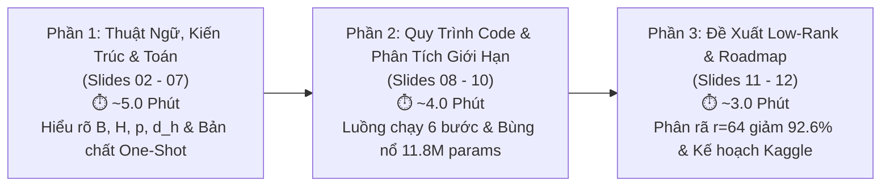

# 🎙️ KỊCH BẢN THUYẾT TRÌNH NỘI BỘ TỪNG SLIDE (INTERNAL TEAM SHARING SCRIPT)
## CHUYÊN ĐỀ: KHỐI DENSE DECODER TRONG KIẾN TRÚC MÔ HÌNH TiDE

> [!NOTE]
> **Bối cảnh sử dụng (Context):**  
> * **Đối tượng người nghe:** Thành viên trong nhóm (kể cả các bạn mới tiếp cận TiDE lần đầu).
> * **Mục tiêu bài nói:** **Vừa chi tiết, chuẩn xác theo code & bài báo gốc, vừa diễn giải thật dễ hiểu bằng hình ảnh trực quan và ví dụ cụ thể** để người mới nghe lần đầu cũng nắm trọn vẹn bản chất từ ký hiệu tensor, luồng chạy code đến đề xuất cải tiến.
> * **Phong cách trình bày:** Gần gũi, cởi mở, xưng hô "mình" và "anh em / các bạn trong nhóm". Hạn chế đọc công thức dài dòng, chỉ trỏ vào slide và giải thích ý nghĩa cốt lõi.
> * **Tài liệu tham chiếu:** Khớp chính xác 1-đối-1 theo đúng thứ tự **13 Slide** trong [`slide_images_gallery.md`](./slide_images_gallery.md) (từ **Slide 01 / 13** đến **Slide 13 / 13**) và tuân thủ chuẩn mực [`rule_slide.md`](./rule_slide.md) cùng [`RULE.md`](../../../RULE.md).

---

## ⏱️ PHÂN BỔ THỜI GIAN TOÀN BỘ BÀI NÓI (13 SLIDES)

---

### 🟢 SLIDE 01 / 13 — INTRO: TỔNG QUAN CHUYÊN ĐỀ DENSE DECODER TRONG TiDE

* **Ảnh slide:** `slide_00_intro.png` ([Xem ảnh trong gallery](./slide_images_gallery.md#slide-01--13-intro--tide-dense-decoder-presenter-le-thanh-hieu))
* **Thời lượng dự kiến:** 45 – 55 giây.
* **Mục tiêu slide:** Chào hỏi nhóm, giới thiệu bài toán dự báo chuỗi thời gian của TiDE một cách dễ hiểu cho người mới, nêu bật vai trò và vấn đề của khối `Dense Decoder`.

#### 🎙️ Lời thoại trình bày (Team Tech-talk):

Chào cả nhóm! Hôm nay mình sẽ chia sẻ chi tiết về **Khối Dense Decoder** trong mô hình dự báo chuỗi thời gian **TiDE** (của nhóm tác giả Google công bố năm 2023).

Để các bạn mới tiếp cận dễ hình dung, bài toán của TiDE là: **nhìn vào dữ liệu quá khứ** (ví dụ: lượng điện tiêu thụ của 720 giờ trước) để **dự báo cho một chuỗi dài các bước tương lai** (96 đến 720 giờ tiếp theo). Trong đó:
* Khối `Dense Encoder` ở phía trước đóng vai trò như người "đọc và tóm tắt" toàn bộ lịch sử quá khứ.
* Còn **`Dense Decoder`** mà mình trình bày hôm nay chính là **"trái tim giải mã"**: nó cầm bản tóm tắt đó để vẽ ra toàn bộ khung dự báo tương lai **chỉ trong đúng 1 lần chạy duy nhất (One-Shot)** — giúp mô hình chạy nhanh hơn Transformer từ 5 đến 10 lần. Tuy nhiên, chính khối này cũng là nơi **ngốn nhiều tham số nhất** khi chúng ta dự báo tầm xa.

Trong khoảng 12 phút tới, mình sẽ đi cùng anh em qua 3 phần rất rõ ràng:
1. **Phần 1 (Slides 02 – 07):** Giải thích thuật ngữ dễ hiểu, xem vị trí trên sơ đồ và hiểu tại sao nó chạy song song được.
2. **Phần 2 (Slides 08 – 10):** Đọc từng dòng code thực tế trong `models.py` và phân tích lý do mô hình bị phình to tham số ở tầng cuối.
3. **Phần 3 (Slides 11 – 12):** Đưa ra giải pháp tối ưu **Low-Rank** (giảm hơn 92% tham số) và chốt kế hoạch chạy thực nghiệm trên Kaggle.

Bây giờ mình vào ngay **Slide 02** để thống nhất các ký hiệu và thuật ngữ cơ bản nhất nhé!

---

## 📖 PHẦN 1: THUẬT NGỮ, KIẾN TRÚC & TOÁN HỌC (SLIDES 02 – 07)

---

### 🟢 SLIDE 02 / 13 — THUẬT NGỮ NỀN TẢNG & KÝ HIỆU KÍCH THƯỚC (`B`, `H`, `p`, `hiddenSize`)

* **Ảnh slide:** `slide_01_bang_thuat_ngu_dense_decoder.png` ([Xem ảnh trong gallery](./slide_images_gallery.md#slide-02--13-vai-trò-5-thuật-ngữ-nền-tảng--ký-hiệu-kích-thước-b-h-p-hiddensize))
* **Thời lượng dự kiến:** 75 – 85 giây.
* **Mục tiêu slide:** Giúp người mới hiểu ngay ý nghĩa thực tế của các ký hiệu $B, H, p, d_h$ và 5 thuật ngữ cốt lõi trước khi xem sơ đồ.

#### 🎙️ Lời thoại trình bày (Team Tech-talk):

Với các bạn mới đọc TiDE lần đầu, rào cản lớn nhất thường là các ký hiệu viết tắt. Nên trước khi vào sơ đồ kiến trúc, mình xin thống nhất nhanh 4 con số kích thước và 5 khái niệm nền tảng để lát nữa nghe là hiểu ngay:

Đầu tiên là 4 ký hiệu kích thước bạn sẽ gặp xuyên suốt bài nói:
* **$B$ là `Batch Size`:** Số lượng mẫu dữ liệu mô hình xử lý cùng lúc trong một lượt — giống như mỗi lần chấm bài thi ta chấm một xấp 512 bài vậy. Bài báo cố định $B = 512$.
* **$H$ là `Horizon`:** Số bước tương lai mình muốn dự báo (thường là 96, 192, 336 hoặc dài nhất là 720 bước).
* **$p$ là `decoderOutputDim`:** Số lượng đặc trưng tóm tắt cho mỗi bước tương lai (thường là 8, 16 hoặc 32). Thay vì đoán ngay 1 con số khô khan cho ngày mai, mô hình tạo ra hẳn một vector gồm $p$ con số mô tả bối cảnh cho ngày mai.
* **$d_h$ là `hiddenSize`:** Độ rộng (số nơ-ron) của các tầng ẩn bên trong mạng. Tác giả thử 3 mức $256, 512, 1024$: tập dữ liệu lớn như `Electricity` hay `Traffic` dùng tới 1024, còn các tập nhỏ hơn thì dùng 256 hoặc 512.

Tiếp theo là 5 thuật ngữ cốt lõi tạo nên khối Dense Decoder:
* Thứ nhất là **`MLPResidual` (Khối xử lý cơ bản):** Đây là "viên gạch" xây nên toàn bộ TiDE. Nó gồm một nhánh chính đi qua 2 lớp tính toán phi tuyến, và một **đường tắt (`Skip Connection`)** đi thẳng từ đầu vào sang đầu ra — giống như chiếc cầu an toàn giúp tín hiệu và gradient truyền qua nhiều tầng mà không bị thất lạc.
* Thứ hai là **`Unflatten` (Thao tác Reshape):** Hiểu đơn giản là "gấp lại". Ngõ ra của Dense Decoder ban đầu là một hàng dài gồm $H \cdot p$ con số (ví dụ $96 \times 8 = 768$ số). `Unflatten` sẽ cắt và xếp hàng dài đó thành một bảng gồm $H$ cột tương ứng với $H$ ngày, mỗi cột dài $p$ số.
* Thứ ba là **`Information Bottleneck` (Nghẽn cổ chai):** Nếu ta ép kích thước $p$ quá nhỏ (như 1 hay 2), lượng thông tin quá khứ truyền sang bị mất mát, không đủ chứa cả xu hướng lẫn chu kỳ. Ngược lại chọn $p$ quá lớn thì mô hình phình to và dễ học vẹt.
* Thứ tư là **`LayerNorm` (Chuẩn hóa theo tầng):** Đóng vai trò như "bộ ổn áp" đặt ở cuối mỗi khối `MLPResidual`, giúp các con số đầu ra không bị nhảy vọt quá lớn hay tụt về 0 khi mạng sâu.
* Cuối cùng là **`Dropout` (Điều chuẩn ngẫu nhiên):** Trong lúc học, nó tạm tắt ngẫu nhiên một tỷ lệ kết nối — giống như việc "che bớt một số gợi ý lúc ôn bài" để mạng không học tủ, chống hiện tượng Overfitting (và khi đi dự báo thật thì mở lại 100%).

Nắm vững 5 khái niệm này rồi, giờ chúng ta cùng xem hành trình của dữ liệu qua khối Dense Decoder trong kiến trúc tổng thể TiDE nhé!

---

### 🟢 SLIDE 03 / 13 — VỊ TRÍ KHỐI DENSE DECODER & UNFLATTEN TRÊN FIGURE 1

* **Ảnh slide:** `slide_02_vi_tri_dense_decoder.png` ([Xem ảnh trong gallery](./slide_images_gallery.md#slide-03--13-vị-trí-khối-dense-decoder--unflatten-trên-figure-1))
* **Thời lượng dự kiến:** 45 – 50 giây.
* **Mục tiêu slide:** Giúp người nghe định vị chính xác khối Dense Decoder trên sơ đồ tổng thể Figure 1 của bài báo và hiểu vai trò cầu nối của nó.

#### 🎙️ Lời thoại trình bày (Team Tech-talk):

Để anh em dễ hình dung vị trí phần của mình trong kiến trúc tổng thể TiDE, mình sẽ kể lại đúng hành trình đi của dữ liệu từ đầu vào cho tới lúc dự báo nhé:

Ban đầu, mô hình tiếp nhận 3 nguồn dữ liệu gồm chuỗi lịch sử `Lookback`, thuộc tính tĩnh `Attributes`, và các biến ngoại sinh `Dynamic Covariates` sau khi đã được nén gọn qua bước `Feature Projection`. Tất cả được gộp phẳng lại rồi đi qua bộ mã hóa `Dense Encoder` gồm $n_e$ tầng để chắt lọc thành một vector tóm tắt duy nhất là $\mathbf{e}^{(i)}$ có kích thước `(B, d_h)`, chứa toàn bộ ngữ cảnh lịch sử.

Song song với nhánh xử lý sâu này, mô hình còn có một đường tắt `Residual` toàn cục nối thẳng từ chuỗi quá khứ `Lookback` lên tận phép cộng cuối cùng để tạo `Predictions`, giúp giữ nguyên vẹn phần xu hướng tuyến tính cơ bản.

Quay lại nhánh chính của chúng ta: vector tóm tắt $\mathbf{e}^{(i)}$ sau khi rời bộ mã hóa sẽ đi thẳng vào khối **`Dense Decoder`**. Khối này gồm $n_d$ khối `Residual Block` xếp chồng lên nhau — trong mỗi khối đó, nhánh chính sẽ lần lượt đi qua lớp `Dense (ReLU)`, `Dense (Linear)` và `Dropout`, rồi cộng với nhánh tắt `Skip Connection`, và cuối cùng đi qua `Layer Norm` để ổn định tín hiệu. Qua quá trình này, `Dense Decoder` giải nén $\mathbf{e}^{(i)}$ thành một vector phẳng $\mathbf{g}^{(i)}$ có kích thước `(B, H * p)`, thực thi song song chỉ trong một lần duy nhất cho cả $H$ bước tương lai.

Ngay sau đó, thao tác `Unflatten` sẽ định hình lại vector phẳng $\mathbf{g}^{(i)}$ thành ma trận $\mathbf{D}^{(i)}$ kích thước `(B, p, H)`, tách ra $H$ vector bối cảnh riêng biệt $\mathbf{d}_t^{(i)}$ với mỗi vector có kích thước `(B, p)` đại diện cho từng bước thời gian tương lai. Cuối cùng, các vector bối cảnh này được xếp chồng (`Stack`) cùng biến ngoại sinh tương lai $\tilde{\mathbf{x}}$ để đi qua `Temporal Decoder` và cộng với đường `Residual` thành kết quả dự báo cuối cùng. Còn việc ghép ngoại sinh cụ thể như thế nào, mình sẽ giải thích rõ ở Slide 07 và Slide 08 nhé!

---

### 🟢 SLIDE 04 / 13 — CÁCH DENSE DECODER TẠO BIỂU DIỄN TOÀN HORIZON (ONE-SHOT VS TUẦN TỰ)

* **Ảnh slide:** `slide_03_one_shot_vs_tuan_tu.png` ([Xem ảnh trong gallery](./slide_images_gallery.md#slide-04--13-cách-dense-decoder-tạo-biểu-diễn-toàn-horizon-one-shot-vs-tuần-tự))
* **Thời lượng dự kiến:** 55 – 65 giây.
* **Mục tiêu slide:** Giải thích thật dễ hiểu sự khác biệt giữa cách đoán nối đuôi truyền thống và cách đoán 1 lần (One-Shot) của TiDE.

#### 🎙️ Lời thoại trình bày (Team Tech-talk):

Để thấy vì sao TiDE lại đột phá về tốc độ, chúng ta thử so sánh cách làm truyền thống với cách của TiDE nhé:

Với các mô hình truyền thống như RNN, LSTM hay Transformer cổ điển, chúng làm việc theo kiểu "cuốn chiếu" tuần tự: muốn đoán ngày mai (bước 2) thì bắt buộc phải đoán xong hôm nay (bước 1) rồi lấy kết quả đó nạp ngược lại vào mô hình để đoán tiếp, cứ thế lặp đi lặp lại $H$ lần. Cách này có hai nhược điểm rất lớn: thứ nhất là chậm vì GPU phải chạy nối đuôi nhau từng lượt một, thứ hai là **tích lũy sai số** — ngày 1 đoán lệch một chút thì ngày 2 lấy cái lệch đó đoán tiếp, kéo dài đến ngày thứ 720 là kết quả bị trôi dạt hoàn toàn.

Ngược lại, TiDE bỏ hẳn vòng lặp nối đuôi đó. Từ vector tóm tắt quá khứ $\mathbf{e}^{(i)}$, khối Dense Decoder dùng phép nhân ma trận chiếu **một phát duy nhất** ra biểu diễn của toàn bộ $H$ ngày tương lai cùng lúc. Bước 1 và bước 720 đều trích xuất trực tiếp từ $\mathbf{e}^{(i)}$, không bước nào phải chờ hay phụ thuộc vào kết quả đoán của bước trước. Nhờ vậy, TiDE **triệt tiêu 100% lỗi tích lũy sai số** và chạy nhanh hơn Transformer tới 5–10 lần!

Nghe tới đây, chắc hẳn bạn mới sẽ thắc mắc: *"Ủa, nếu các ngày tương lai tính độc lập không chờ nhau, vậy làm sao mô hình biết được ngày hôm nay và ngày mai có liên quan chặt chẽ với nhau?"* Mời anh em sang Slide 05 để giải đáp triệt để nhé!

---

### 🟢 SLIDE 05 / 13 — TỪ CÔNG THỨC TOÁN HỌC SUY RA CODE (`models.py`)

* **Ảnh slide:** `slide_03b_ban_chat_toan_hoc.png` ([Xem ảnh trong gallery](./slide_images_gallery.md#slide-05--13-từ-công-thức-toán-học-suy-ra-code-modelspy--độc-lập-tính-toán-vs-tương-quan-biểu-diễn))
* **Thời lượng dự kiến:** 65 – 75 giây.
* **Mục tiêu slide:** Giúp người nghe hiểu bản chất "vừa độc lập tính toán, vừa tương quan biểu diễn" theo mạch logic: từ bản chất toán học suy thẳng ra cách viết code trong `models.py`.

#### 🎙️ Lời thoại trình bày (Team Tech-talk):

Để trả lời câu hỏi vừa rồi một cách thuyết phục nhất, chúng ta đi theo đúng 3 phần trên từng cột của **Slide 05**: **từ (1) Công thức Toán học $\rightarrow$ (2) Đoạn code nguyên văn trong `models.py` $\rightarrow$ (3) Nhận xét trực tiếp**.

Ở cột trái — **Độc lập tính toán ($O(1)$ trên GPU)**:
* Mục **1 (Công thức Toán)** chỉ rõ đạo hàm riêng $\partial \mathbf{d}_t / \partial \mathbf{d}_s = \mathbf{0}$ giữa hai bước khác nhau.
* Bê sang mục **2 (Code nguyên văn `models.py#L133-L137` và `#L207-L208`)**: tác giả chỉ cần định nghĩa đúng một tầng `self.decoder = _make_dnn_residual(... decoder_output_dim * self.pred_len)` rồi gọi `decoder_out = self.decoder(encoding)` và `tf.reshape(decoder_out, [bsize, -1, self.pred_len])`.
* Từ đó rút ra mục **3 (Nhận xét)**: toàn bộ $H$ bước tính gói gọn trong một phép nhân ma trận GPU ($O(1)$), tuyệt đối không có vòng lặp tuần tự `for t in range(H)` nên vừa nhanh vừa triệt tiêu tích lũy sai số.

Sang cột phải — **Tương quan biểu diễn**:
* Mục **1 (Công thức Toán)** cho thấy hiệp phương sai biên giữa $\mathbf{d}_t$ và $\mathbf{d}_s$ khác $0$, gradient của cả $H$ bước cùng dội về $\mathbf{e}^{(i)}$, kèm nhánh tuyến tính $\hat{y}_{\mathrm{res},t}$.
* Chiếu thẳng vào mục **2 (Code nguyên văn `models.py#L203-L214` và `#L225`)**: mọi nhánh đều đọc chung `encoding = self.encoder(encoder_input)`, cộng thêm `residual_out = self.linear(past_ts)` qua dòng `out += residual_out`, và tối ưu chung một hàm `loss = train_loss(ytrue, all_preds)` cho cả $H$ bước.
* Kết luận ở mục **3 (Nhận xét)**: các bước vẫn giữ đồng bộ chu kỳ & xu hướng toàn cục nhờ chung gốc `encoding` và `loss`, nhưng cái giá phải trả là ma trận chiếu tầng cuối có kích thước cứng $(H \cdot p) \times d_h$ gây phình tham số ở $H=720$ — đây chính là cầu nối sang đề xuất Phần 3!

---

### 🟢 SLIDE 06 / 13 — KIẾN TRÚC $n_d$ RESIDUAL BLOCKS & CHUYỂN $\mathbf{e}^{(i)}$ THÀNH $\mathbf{g}^{(i)}$

* **Ảnh slide:** `slide_04_kien_truc_nd_residual_blocks.png` ([Xem ảnh trong gallery](./slide_images_gallery.md#slide-06--13-kiến-trúc-n_d-residual-blocks--chuyển-mathbfei-thành-mathbfgi))
* **Thời lượng dự kiến:** 55 – 65 giây.
* **Mục tiêu slide:** Giải thích rõ cách xếp chồng $n_d$ khối `MLPResidual` và lý do bắt buộc phải có ma trận chiếu đường tắt `W_skip` ở khối cuối cùng.

#### 🎙️ Lời thoại trình bày (Team Tech-talk):

Bây giờ chúng ta mở nắp xem bên trong khối Dense Decoder có gì. Luồng xử lý bên trong chia làm hai giai đoạn rất rõ:

Ở giai đoạn đầu gồm các khối trung gian (nếu ta chọn số lớp $n_d \geq 2$), dữ liệu đi vào kích thước bao nhiêu thì đi ra kích thước bấy nhiêu, giữ nguyên `(B, d_h)`, mục đích là tinh chỉnh thông tin phi tuyến sâu hơn. Còn ở giai đoạn cuối cùng ($l = n_d$), tầng này không giữ kích thước $d_h$ nữa, mà **bung rộng ra kích thước rất lớn là $H \cdot p$**.

Ở đây có một chi tiết kỹ thuật rất hay mà người mới hay thắc mắc: Bình thường, nhánh tắt (`Skip Connection`) chỉ việc lấy đầu vào cộng thẳng với đầu ra. Nhưng ở khối cuối này, **đầu vào chỉ rộng $d_h$ (ví dụ 1024), còn đầu ra lại rộng tới $H \cdot p$ (ví dụ 5760)** — hai vector lệch kích thước nhau nên không thể cộng trực tiếp được! Vì vậy, tác giả **bắt buộc phải đặt thêm một ma trận chiếu $\mathbf{W}_{\text{skip}}$** để phóng to vector đầu vào từ $d_h$ lên bằng $H \cdot p$ rồi mới cộng lại.

Và chính bộ đôi ma trận ở tầng cuối này (gồm ma trận nhánh chính và ma trận đường tắt $\mathbf{W}_{\text{skip}}$) là thủ phạm làm bùng nổ số lượng tham số mà lát nữa chúng ta sẽ thấy ở Slide 10!

---

### 🟢 SLIDE 07 / 13 — VAI TRÒ RESHAPE (UNFLATTEN) & Ý NGHĨA VECTOR $\mathbf{d}_t^{(i)}$

* **Ảnh slide:** `slide_05_reshape_va_y_nghia_dt.png` ([Xem ảnh trong gallery](./slide_images_gallery.md#slide-07--13-vai-trò-thao-tác-reshape-unflatten--ý-nghĩa-vector-mathbfd_ti))
* **Thời lượng dự kiến:** 55 – 65 giây.
* **Mục tiêu slide:** Giải thích trực quan thao tác `Reshape` ra `(B, p, H)` chuẩn bài báo gốc, chi phí $O(1)$ và cách ghép biến ngoại sinh ở dòng 211 `models.py`.

#### 🎙️ Lời thoại trình bày (Team Tech-talk):

Sau khi khối cuối bung ra một dải vector phẳng dài $H \cdot p$ phần tử, bước tiếp theo là thao tác **`Reshape` (hay `Unflatten`)** — bám sát 100% theo đúng bài báo gốc và mã nguồn TensorFlow:

Bạn hãy tưởng tượng dải vector phẳng dài $768$ số ($H=96, p=8$) giống như một sợi dây dài. Lệnh `Reshape` sẽ gấp sợi dây đó thành một cái bảng $\mathbf{D}^{(i)}$ có **$p = 8$ dòng và $H = 96$ cột**, tương ứng với batch shape **`(B, p, H)`**. Khi đó, **mỗi cột thứ $t$ chính là vector bối cảnh $\mathbf{d}_t$ gồm 8 con số dành riêng cho ngày thứ $t$**.

Và để trả lời cho phần hẹn ở Slide 03 về việc tầng kế tiếp ghép ngoại sinh cụ thể thế nào: Ngay sau khi có ma trận `(B, p, H)` ở dòng 210 `models.py`, sang dòng 211 tác giả đem **ghép nối nó với ma trận ngoại sinh tương lai `enc_fut`** có kích thước `(B, r_tilde, H)` dọc theo trục đặc trưng `axis=1`. Ví dụ: 8 đặc trưng quá khứ cộng với 4 đặc trưng ngoại sinh tương lai (như thứ trong tuần, thời tiết, ngày lễ) sẽ gộp thành 12 đặc trưng cho mỗi ngày `(B, 12, H)`, rồi đưa vào `Temporal Decoder` để xuất ra con số dự báo cuối cùng.

Một điểm cộng cực lớn nữa là lệnh `tf.reshape` này **không tốn bộ nhớ copy dữ liệu mới** mà chỉ đổi cách đánh số chỉ mục (stride), nên chi phí tính toán coi như bằng 0 ($O(1)$)!

---

## 💻 PHẦN 2: QUY TRÌNH CODE, HYPERPARAMETERS & GIỚI HẠN (SLIDES 08 – 10)

---

### 🟢 SLIDE 08 / 13 — SOURCE CODE CHÍNH THỨC (`models.py`)

* **Ảnh slide:** `slide_06_source_code_dense_decoder.png` ([Xem ảnh trong gallery](./slide_images_gallery.md#slide-08--13-source-code-chính-thức-modelspy--pytorch))
* **Thời lượng dự kiến:** 70 – 80 giây.
* **Mục tiêu slide:** Dẫn dắt người nghe đi qua **6 bước chạy thực tế từ lúc khởi tạo đến lúc ra tensor `(B, p, H)`** trong `models.py` sao cho dễ theo dõi nhất.

#### 🎙️ Lời thoại trình bày (Team Tech-talk):

Sang Phần 2, Slide 08 đưa chúng ta vào thẳng mã nguồn chính thức `models.py` của Google. Để anh em lần đầu đọc code không bị rối, mình chia luồng chạy của Dense Decoder thành **6 bước tuần tự từ lúc tạo mạng đến lúc chạy dữ liệu**:

* **Bước 1 — Khởi tạo các khối (`__init__`, dòng 64–81):** Hàm `_make_dnn_residual` dùng vòng lặp tạo sẵn $n_d$ khối `MLPResidual`, lúc này các tầng ẩn đều có kích thước bằng nhau là $d_h$.
* **Bước 2 — Đổi kích thước đầu ra của tầng cuối (dòng 136):** Tác giả gán lại `hidden_dims[-1] = decoder_output_dim * self.pred_len`. Chỉ bằng một dòng lệnh này, khối cuối cùng được biến hình thành tầng mở rộng ra kích thước $p \cdot H$.
* **Bước 3 — Nhận dữ liệu vào (dòng 207):** Khi chạy thật (`call`), Dense Decoder nhận vector tóm tắt `encoded` có shape `(B, d_h)` từ Encoder truyền lên.
* **Bước 4 — Cho dữ liệu đi qua các khối Residual:** Dữ liệu đi qua các khối trung gian (nếu có), rồi tới khối cuối cùng để bung thành một vector phẳng `decoder_out` có shape `(B, H * p)`.
* **Bước 5 — Gấp lại thành bảng 3 chiều (`Unflatten`, dòng 210):** Lệnh `tf.reshape(decoder_out, [bsize, -1, self.pred_len])` lập tức biến vector phẳng thành ma trận chuẩn bài báo có shape `(B, p, H)`.
* **Bước 6 — Ghép ngoại sinh & Chuyển tiếp (dòng 211):** Cuối cùng, bảng `(B, p, H)` được ghép với ngoại sinh tương lai `enc_fut` dọc theo trục đặc trưng `axis=1` thành `(B, p + r_tilde, H)` để bàn giao cho `Temporal Decoder`.

Chỉ gói gọn trong 6 bước như vậy, toàn bộ quá trình giải mã diễn ra liền mạch từ đầu đến cuối!

---

### 🟢 SLIDE 09 / 13 — CẤU HÌNH SIÊU THAM SỐ DENSE DECODER TRÊN 7 BENCHMARK DATASETS

* **Ảnh slide:** `slide_07_hyperparameters_dense_decoder.png` ([Xem ảnh trong gallery](./slide_images_gallery.md#slide-09--13-cấu-hình-siêu-tham-số-dense-decoder-trên-7-benchmark-datasets-table-7--8))
* **Thời lượng dự kiến:** 75 – 85 giây.
* **Mục tiêu slide:** Giúp người nghe đọc hiểu bảng siêu tham số (Table 7 & 8) và giải thích dễ hiểu **tại sao tác giả chọn $n_d = 1$ hay $2$, và không bao giờ chọn $n_d = 3$**.

#### 🎙️ Lời thoại trình bày (Team Tech-talk):

Slide 09 tổng hợp toàn bộ cấu hình tối ưu mà nhóm tác giả Google đã thử nghiệm trên 7 bộ dữ liệu chuẩn (trích từ Bảng 7 & 8 ở Phụ lục bài báo).

Trong quá trình tìm kiếm cấu hình tốt nhất, tác giả quét kích thước ẩn $d_h$ trong $\{256, 512, 1024\}$; chiều bối cảnh $p$ trong $\{4, 8, 16, 32\}$; và số lớp Dense Decoder $n_d$ trong $\{1, 2, 3\}$.

Khi chọn ra bộ thông số tối ưu cho từng tập dữ liệu, có một **quy luật rất thú vị về số lớp $n_d$** mà mình muốn giải thích rõ cho anh em:

**1. Tại sao `Traffic`, `ETTm1`, `Weather` chỉ cần chọn đúng $n_d = 1$ (1 lớp duy nhất)?**
* **Tập `Traffic`:** Tập này có tới **862 cảm biến giao thông** chạy song song (số chiều cực lớn). Chỉ cần 1 lớp giải mã là đủ nhẹ để không bị quá tải bộ nhớ GPU.
* **Tập `Weather` và `ETTm1` (đo mỗi 15 phút):** Đây là các dữ liệu vật lý tự nhiên (nhiệt độ, áp suất) có chu kỳ ngày/đêm lặp lại rất đều đặn và mượt mà. Vì nhánh đường tắt tuyến tính (`Global Residual`) đã gánh phần xu hướng chính rồi, nên chỉ cần 1 lớp phi tuyến là đủ.

**2. Tại sao `Electricity`, `ETTm2`, `ETTh1`, `ETTh2` phải chọn $n_d = 2$?**
* Các tập này (đặc biệt là phụ tải điện) bị ảnh hưởng mạnh bởi **thói quen sinh hoạt phức tạp của con người** (giờ cao điểm, cuối tuần, biến động đột ngột). Cần 2 lớp: lớp đầu xử lý lọc nhiễu trong không gian ẩn, lớp thứ hai mới bung ra toàn horizon để đủ sức học các đường cong phức tạp này.

**3. Điều đặc biệt nhất: Tại sao KHÔNG CÓ BẤT KỲ tập nào ($0/7$) chọn $n_d = 3$?**
* Thứ nhất là **bão hòa hiệu năng**: Dense Decoder không phải làm việc một mình mà đã có `Global Residual` và `Temporal Decoder` hỗ trợ, nên thêm lớp thứ 3 cũng không mang lại thêm độ chính xác.
* Thứ hai là **nguy cơ học vẹt (Overfitting)**: Các tập như ETT có kích thước mẫu khá nhỏ, thêm tầng thứ 3 làm dư thừa tham số, dẫn đến kết quả trên tập kiểm định (validation loss) bị tệ đi nên bị loại ngay lập tức!

---

### 🟢 SLIDE 10 / 13 — PHÂN TÍCH ẢNH HƯỞNG CỦA $p, n_d$ & GIỚI HẠN KHI HORIZON $H$ DÀI

* **Ảnh slide:** `slide_08_phan_tich_p_nd_va_gioi_han.png` ([Xem ảnh trong gallery](./slide_images_gallery.md#slide-10--13-phân-tích-ảnh-hưởng-của-p-n_d--giới-hạn-khi-horizon-h-dài))
* **Thời lượng dự kiến:** 75 – 85 giây.
* **Mục tiêu slide:** Chỉ rõ vị trí của $p$ trong bài báo, khẳng định khoảng trống thực nghiệm (tác giả chưa làm ablation cho $p$), và tính toán cụ thể để thấy rõ bài toán phình to 11.8M $\to$ 23.6M tham số.

#### 🎙️ Lời thoại trình bày (Team Tech-talk):

Slide 10 này bóc tách một vấn đề cực kỳ quan trọng khi mô hình phải dự báo tầm xa ($H = 720$): **Cách chọn $p$ ảnh hưởng thế nào, bài báo nói gì về nó, và tại sao tầng cuối lại phình to tới hơn chục triệu tham số?**

**1. Bài báo nói gì về $p$?**
Tác giả định nghĩa $p$ (`decoderOutputDim`) ở Mục 4.2 (Trang 6) và quét trong $\{4, 8, 16, 32\}$ ở Phụ lục B.3 (Table 7 & 8). Kết quả thực tế là cả **7/7 tập dữ liệu đều loại bỏ $p=4$** và chỉ chọn từ $8, 16$ đến $32$. Tuy nhiên, **tác giả KHÔNG hề làm thí nghiệm Ablation riêng để phân tích độ nhạy của $p$**! Đây chính là khoảng trống thực nghiệm mà nhóm mình có thể khai thác.

**2. Cơ sở dẫn đến hiện tượng nghẽn cổ chai và bùng nổ tham số:**
* **Khi $p$ quá nhỏ ($p \le 4$):** Việc cả 7 tập đều loại bỏ $p=4$ chứng tỏ nếu ép quá nhỏ, vector $\mathbf{d}_t$ bị nghẽn cổ chai thông tin, không đủ chỗ chứa đồng thời xu hướng dài và các chu kỳ ngắn.
* **Khi $p$ lớn và dự báo xa ($H = 720$):** Tầng cuối phải bung ra kích thước $H \cdot p$. Với $H=720$: nếu $p=8$ thì ngõ ra là $5{,}760$; còn nếu $p=32$ (như tập `ETTh2`) thì ngõ ra nhảy vọt lên **$23{,}040$ chiều** (gấp 8 lần so với $p=4$).
* Như chúng ta đã biết ở Slide 06, tầng cuối có tới **2 ma trận lớn** (1 ở nhánh chính và 1 ở nhánh tắt `lin_res`), mỗi ma trận nối từ $d_h$ sang $H \cdot p$. Nhân thử con số thực tế từ code: trên tập `Electricity` ($d_h = 1024, p = 8, H = 720$), chỉ riêng 2 ma trận ở tầng cuối cùng này đã ngốn mất **~11.8 triệu tham số**, còn trên `ETTh2` ($d_h = 512, p = 32$) thì vọt lên **~23.6 triệu tham số**!
* Và ở phần Kết luận (Mục 6, Trang 11), chính tác giả cũng thẳng thắn thừa nhận điểm yếu của kiến trúc MLP là **kém hiệu quả về mặt số lượng tham số (less parameter efficient)** hơn so với Transformer.

Đây chính là lý do trực tiếp dẫn chúng ta tới giải pháp cải tiến ở Slide 11!

---

## 💡 PHẦN 3: ĐỀ XUẤT TỐI ƯU & LỘ TRÌNH THỰC NGHIỆM (SLIDES 11 – 12)

---

### 🟢 SLIDE 11 / 13 — ĐỀ XUẤT TỐT NHẤT: LOW-RANK DENSE DECODER PROJECTION

* **Ảnh slide:** `slide_09_de_xuat_low_rank_decoder.png` ([Xem ảnh trong gallery](./slide_images_gallery.md#slide-11--13-đề-xuất-tốt-nhất--low-rank-dense-decoder-projection))
* **Thời lượng dự kiến:** 75 – 85 giây.
* **Mục tiêu slide:** Giải thích giải pháp Low-Rank cực kỳ dễ hiểu cho người mới (ý tưởng trạm trung chuyển), nêu nguồn gốc học thuật (LoRA) và chứng minh hiệu quả giảm 92.6% tham số.

#### 🎙️ Lời thoại trình bày (Team Tech-talk):

Để giải quyết triệt để nút thắt 11.8 triệu tham số vừa nêu, ở Slide 11 mình đề xuất phương án tối ưu nhất cho nhóm: **Low-Rank Factorized Dense Decoder Projection**.

Để các bạn mới nghe dễ hình dung nhất: Hãy tưởng tượng bạn cần nối đường từ $1{,}024$ điểm đầu vào sang $5{,}760$ điểm đầu ra. Với cách gốc của TiDE, ta phải xây một cây cầu khổng lồ nối thẳng từ $1{,}024$ sang $5{,}760$, tốn tới $11.8$ triệu tham số. Còn với **cách Low-Rank (kế thừa từ kỹ thuật LoRA nổi tiếng của Hu et al., 2022)**, thay vì nối thẳng một ma trận khổng lồ, ta **tách đôi nó thành 2 ma trận nhỏ đi qua một "trạm trung chuyển" có kích thước nhỏ $r = 64$**: tức là nén từ $1{,}024 \to 64$, rồi từ $64 \to 5{,}760$.

**Cách làm đơn giản này mang lại 4 lợi ích cực lớn:**
1. **Giảm sốc tới 92.6% tham số:** Trên cấu hình `Electricity`, số tham số của tầng cuối rớt từ **11.8 triệu xuống chỉ còn ~0.87 triệu**.
2. **Giảm phép tính (FLOPs) hơn 13 lần:** Máy tính tính toán nhẹ nhàng hơn rất nhiều.
3. **Giữ nguyên 100% tốc độ One-Shot $O(1)$:** Mô hình vẫn chạy song song một lèo không thêm vòng lặp nào.
4. **Chống Overfitting tự nhiên:** Việc ép thông tin đi qua trạm trung chuyển $r = 64$ buộc mô hình chỉ giữ lại những quy luật cốt lõi, tự động gạt bỏ nhiễu ngẫu nhiên của chuỗi dài.

---

### 🟢 SLIDE 12 / 13 — ĐIỂM CẢI THIỆN CỤ THỂ TRONG TiDE & LỘ TRÌNH THỰC NGHIỆM

* **Ảnh slide:** `slide_10_diem_cai_thien_va_roadmap.png` ([Xem ảnh trong gallery](./slide_images_gallery.md#slide-12--13-điểm-cải-thiện-cụ-thể-trong-tide--validation-protocol))
* **Thời lượng dự kiến:** 65 – 75 giây.
* **Mục tiêu slide:** Tổng kết 3 điểm cải thiện cụ thể và chốt lộ trình thực nghiệm 3 bước rõ ràng để cả nhóm cùng thực hiện trên Kaggle.

#### 🎙️ Lời thoại trình bày (Team Tech-talk):

Để khép lại phần trình bày, Slide 12 tóm tắt **3 điểm giải pháp Low-Rank cải thiện trực tiếp cho TiDE** và **kế hoạch thực nghiệm 3 bước của nhóm mình**:

**Về 3 điểm cải thiện cụ thể:**
1. **Thay thế tầng chiếu cuối tại `models.py#L136`:** Biến phép chiếu phình to đột ngột thành chuỗi $d_h \to r \to H \cdot p$, giảm hơn 85%–92% tham số nhưng vẫn giữ nguyên cấu trúc `MLPResidual`.
2. **Mở khóa việc tăng $p$ khi $H = 720$:** Nhờ mô hình nhẹ đi rất nhiều, nhóm mình có thể mạnh dạn tăng $p$ lên 16 hoặc 32 trên các tập dữ liệu phức tạp mà không sợ tràn VRAM.
3. **Lấp đầy khoảng trống Ablation của bài báo:** Nhóm tác giả Google chưa từng công bố bảng quét độ nhạy cho $p$ và $n_d$, nhóm mình sẽ chạy bổ sung trọn vẹn thí nghiệm này.

**Về lộ trình thực nghiệm 3 bước:**
* **Bước 1:** Chạy so sánh TiDE gốc vs TiDE Low-Rank ($r \in \{32, 64, 128\}$) trên 3 tập đại diện (`Electricity`, `ETTh2`, `ETTm1`) ở các tầm xa $H = 336, 720$ với 5 seed độc lập cho khách quan.
* **Bước 2:** Quét độ nhạy siêu tham số $p \in \{2, 8, 16, 32\}$ và $n_d \in \{1, 2, 3\}$.
* **Bước 3:** Chốt nghiệm thu nếu giảm được $\geq 85\%$ tham số tầng cuối, giữ nguyên tốc độ $O(1)$ và sai số MSE/MAE bằng hoặc tốt hơn bản gốc.

Mình đã chuẩn bị sẵn hướng dẫn chạy song song 2 tài khoản Kaggle trên Brave trong thư mục `kaggle/` để cả nhóm có 60 giờ GPU miễn phí mỗi tuần. Giờ mời anh em cùng trao đổi và chia task nhé!

---

### 🟢 SLIDE 13 / 13 — OUTRO: THANKS FOR LISTENING! & Q&A

* **Ảnh slide:** `slide_11_outro.png` ([Xem ảnh trong gallery](./slide_images_gallery.md#slide-13--13-outro--thanks-for-listening))
* **Lời chào kết thúc:** Cảm ơn thầy/cô và các bạn đã lắng nghe phần trình bày chuyên đề `TiDE: Dense Decoder` — chuyển sang phiên hỏi đáp **Q & A Session**.

---

## 💬 GỢI Ý GIẢI ĐÁP THẮC MẮC NỘI BỘ (INTERNAL TEAM Q&A & GOTCHAS)

Dưới đây là các câu hỏi mà thành viên trong nhóm rất dễ thắc mắc khi cùng đọc code Dense Decoder và chuẩn bị chạy thực nghiệm:

### ❓ Câu hỏi 1: *"Tại sao trong bài báo gốc và `models.py` tác giả lại reshape ma trận $\mathbf{D}^{(i)}$ thành shape `(B, p, H)` mà không phải ngược lại?"*

**Giải thích cho bạn:**
* Về mặt đại số tuyến tính (Mục 4.2, Trang 6 bài báo gốc), mỗi bước thời gian $t$ được biểu diễn bằng một vector cột $\mathbf{d}_t^{(i)} \in \mathbb{R}^p$. Ghép $H$ bước thời gian liên tiếp thành một ma trận gồm $H$ cột sẽ tự nhiên cho ra kích thước $\mathbf{D}^{(i)} \in \mathbb{R}^{p \times H}$, tương ứng với batch shape `(B, p, H)`.
* Nhờ để chiều đặc trưng $p$ ở trục giữa (`axis=1`) và chiều thời gian $H$ ở trục cuối (`axis=2`), ở bước ngay sau đó trong `models.py#L211`, tác giả dễ dàng ghép nối tiếp tensor `D` với ngoại sinh tương lai `enc_fut` (cũng có shape `(B, r_tilde, H)`) dọc theo trục đặc trưng `axis=1` để tạo thành `(B, p + r_tilde, H)` trước khi đưa vào `Temporal Decoder`.

### ❓ Câu hỏi 2: *"Phép Low-Rank $\mathbf{W} \approx \mathbf{A} \cdot \mathbf{B}$ có làm chậm tốc độ chạy của mô hình không?"*

**Giải thích cho bạn:**
Hoàn toàn không làm chậm, thậm chí còn nhẹ hơn! Vì thay vì nhân 1 ma trận khổng lồ tốn gần 5.9 triệu phép tính, ta chỉ nhân 2 ma trận nhỏ qua nút thắt $r=64$, tổng cộng tốn khoảng 0.43 triệu phép tính — tức giảm hơn **13 lần** lượng tính toán trên GPU.

### ❓ Câu hỏi 3: *"Nếu chọn hạng $r$ quá nhỏ (ví dụ $r=8$ hay $16$) thì mô hình có bị mất thông tin (Underfitting) không?"*

**Giải thích cho bạn:**
Chắc chắn có rủi ro đó. Nếu trạm trung chuyển $r$ quá hẹp thì không đủ dung lượng truyền tải biến thiên của 96 hay 720 bước tương lai. Đó là lý do ở Bước 1 chúng ta sẽ thử các mức $r \in \{32, 64, 128\}$ để tìm ra điểm cân bằng tối ưu (Sweet Spot) vừa nhẹ vừa chính xác.
