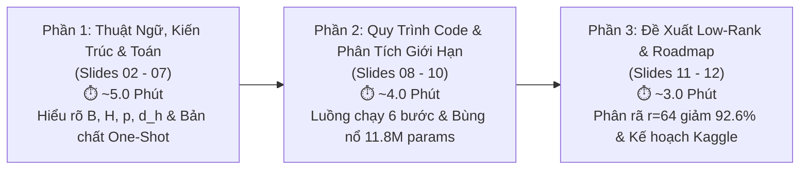
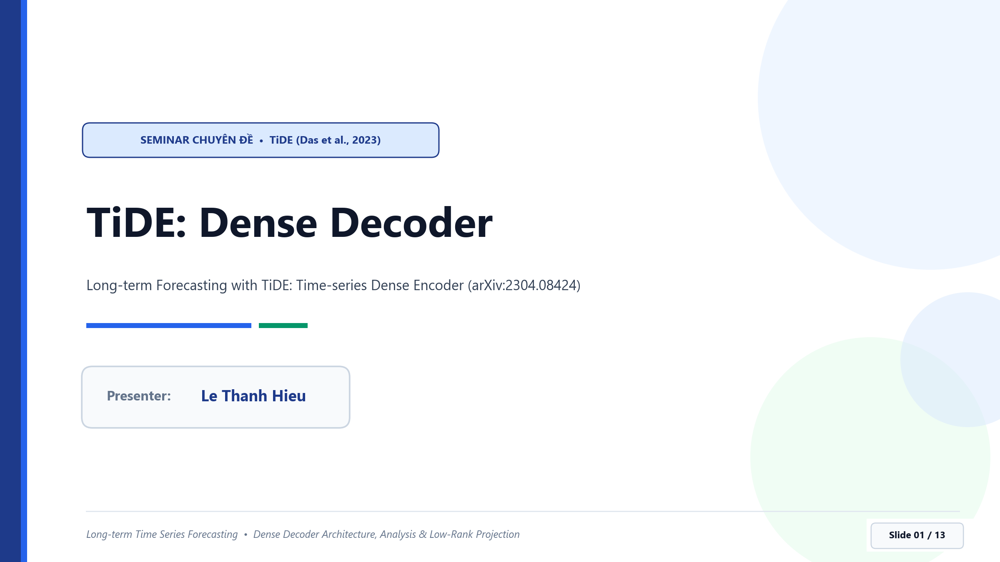

# 🎙️ KỊCH BẢN THUYẾT TRÌNH NỘI BỘ TỪNG SLIDE (INTERNAL TEAM SHARING SCRIPT)
## CHUYÊN ĐỀ: KHỐI DENSE DECODER TRONG KIẾN TRÚC MÔ HÌNH TiDE

> [!NOTE]
> **Bối cảnh sử dụng (Context):**  
> * **Đối tượng người nghe:** Thành viên trong nhóm (kể cả các bạn mới tiếp cận TiDE lần đầu).
> * **Mục tiêu bài nói:** **Vừa chi tiết, chuẩn xác theo code & bài báo gốc, vừa diễn giải thật dễ hiểu bằng hình ảnh trực quan và ví dụ cụ thể** để người mới nghe lần đầu cũng nắm trọn vẹn bản chất từ ký hiệu tensor, luồng chạy code đến đề xuất cải tiến.
> * **Phong cách trình bày:** Gần gũi, cởi mở, xưng hô "mình" và "anh em / các bạn trong nhóm". Hạn chế đọc công thức dài dòng, chỉ trỏ vào slide và giải thích ý nghĩa cốt lõi.
> * **Tài liệu tham chiếu:** Khớp chính xác 1-đối-1 theo đúng thứ tự **13 Slide** trong [`slide_images_gallery.md`](./slide_images_gallery.md) (từ **Slide 01 / 13** đến **Slide 13 / 13**) và tuân thủ chuẩn mực [`rule_slide.md`](./rule_slide.md) cùng [`RULE.md`](../../../RULE.md).

---

## ⏱️ PHÂN BỔ THỜI GIAN TOÀN BỘ BÀI NÓI (13 SLIDES)

---

### 🟢 SLIDE 01 / 13 — INTRO: TỔNG QUAN CHUYÊN ĐỀ DENSE DECODER TRONG TiDE

* **Ảnh slide:** `slide_00_intro.png` ([Xem ảnh trong gallery](./slide_images_gallery.md#slide-01--13-intro--tide-dense-decoder-presenter-le-thanh-hieu))
* **Thời lượng dự kiến:** 45 – 55 giây.
* **Mục tiêu slide:** Chào hỏi nhóm, giới thiệu bài toán dự báo chuỗi thời gian của TiDE một cách dễ hiểu cho người mới, nêu bật vai trò và vấn đề của khối `Dense Decoder`.

#### 🎙️ Lời thoại trình bày (Team Tech-talk):

Chào cả nhóm! Hôm nay mình sẽ chia sẻ chi tiết về **Khối Dense Decoder** trong mô hình dự báo chuỗi thời gian **TiDE** (của nhóm tác giả Google công bố năm 2023).

Để các bạn mới tiếp cận dễ hình dung, bài toán của TiDE là: **nhìn vào dữ liệu quá khứ** (ví dụ: lượng điện tiêu thụ của 720 giờ trước) để **dự báo cho một chuỗi dài các bước tương lai** (96 đến 720 giờ tiếp theo). Trong đó:
* Khối `Dense Encoder` ở phía trước đóng vai trò như người "đọc và tóm tắt" toàn bộ lịch sử quá khứ.
* Còn **`Dense Decoder`** mà mình trình bày hôm nay chính là **"trái tim giải mã"**: nó cầm bản tóm tắt đó để vẽ ra toàn bộ khung dự báo tương lai **chỉ trong đúng 1 lần chạy duy nhất (One-Shot)** — giúp mô hình chạy nhanh hơn Transformer từ 5 đến 10 lần. Tuy nhiên, chính khối này cũng là nơi **ngốn nhiều tham số nhất** khi chúng ta dự báo tầm xa.

Trong khoảng 12 phút tới, mình sẽ đi cùng anh em qua 3 phần rất rõ ràng:
1. **Phần 1 (Slides 02 – 07):** Giải thích thuật ngữ dễ hiểu, xem vị trí trên sơ đồ và hiểu tại sao nó chạy song song được.
2. **Phần 2 (Slides 08 – 10):** Đọc từng dòng code thực tế trong `models.py` và phân tích lý do mô hình bị phình to tham số ở tầng cuối.
3. **Phần 3 (Slides 11 – 12):** Đưa ra giải pháp tối ưu **Low-Rank** (giảm hơn 92% tham số) và chốt kế hoạch chạy thực nghiệm trên Kaggle.

Bây giờ mình vào ngay **Slide 02** để thống nhất các ký hiệu và thuật ngữ cơ bản nhất nhé!

* **🎬 Tương tác & Điểm nhấn màn hình (Visual Cues):**
  * Chiếu Slide Bìa, nói chậm rãi rõ ràng, nhấn mạnh hai ý chính: **"Giải mã One-Shot cực nhanh"** và **"Nút thắt tham số khi dự báo xa"**.

---

## 📖 PHẦN 1: THUẬT NGỮ, KIẾN TRÚC & TOÁN HỌC (SLIDES 02 – 07)

---

### 🟢 SLIDE 02 / 13 — THUẬT NGỮ NỀN TẢNG CỐT LÕI (`MLPResidual`, `Unflatten`, `Information Bottleneck`, `LayerNorm`, `Dropout`)

* **Ảnh slide:** `slide_01_bang_thuat_ngu_dense_decoder.png` ([Xem ảnh trong gallery](./slide_images_gallery.md#slide-02--13-thuật-ngữ-nền-tảng-cốt-lõi-mlpresidual-unflatten-information-bottleneck-layernorm-dropout))
* **Thời lượng dự kiến:** 75 – 85 giây.
* **Mục tiêu slide:** Giúp người mới hiểu ngay ý nghĩa thực tế của các ký hiệu $B, H, p, d_h$ và 5 thuật ngữ cốt lõi trước khi xem sơ đồ.

#### 🎙️ Lời thoại trình bày (Team Tech-talk):

Với các bạn mới đọc TiDE lần đầu, rào cản lớn nhất là các ký hiệu viết tắt. Nên ở Slide 02 này, mình thống nhất nhanh 4 con số kích thước và 5 khái niệm nền tảng để lát nữa nhìn sơ đồ là hiểu ngay:

**1. Bốn ký hiệu kích thước bạn sẽ gặp xuyên suốt bài nói:**
* **$B$ (`Batch Size`):** Số lượng mẫu dữ liệu mô hình xử lý cùng lúc trong 1 lượt (giống như mỗi lần chấm bài thi chấm 1 xấp 512 bài). Bài báo **cố định $B = 512$**.
* **$H$ (`Horizon`):** Số bước tương lai mình muốn dự báo (thường là 96, 192, 336 hoặc dài nhất là **720 bước**).
* **$p$ (`decoderOutputDim`):** Số lượng đặc trưng tóm tắt cho mỗi bước tương lai (thường chọn là **8, 16 hoặc 32**). Tức là thay vì đoán ngay 1 con số khô khan cho ngày mai, mô hình tạo ra hẳn một vector gồm $p$ con số mô tả bối cảnh cho ngày mai.
* **$d_h$ (`hiddenSize`):** Độ rộng (số nơ-ron) của các tầng ẩn bên trong mạng. Tác giả thử 3 mức $\{256, 512, 1024\}$: tập dữ liệu lớn như `Electricity` hay `Traffic` dùng tới **1024**, tập nhỏ hơn thì dùng **256 hoặc 512**.

**2. Năm thuật ngữ cốt lõi trên slide:**
* **Thẻ 1 — `MLPResidual` (Khối xử lý cơ bản):** Là "viên gạch" xây nên toàn bộ TiDE. Nó gồm 1 nhánh chính đi qua 2 lớp tính toán phi tuyến, và 1 **đường tắt (Skip Connection)** đi thẳng từ đầu vào sang đầu ra — giống như chiếc cầu an toàn giúp tín hiệu và gradient truyền qua nhiều tầng mà không bị thất lạc.
* **Thẻ 2 — `Unflatten` (Thao tác Reshape):** Hiểu đơn giản là "gấp lại". Ngõ ra của Dense Decoder ban đầu là 1 hàng dài gồm $H \cdot p$ con số (ví dụ $96 \times 8 = 768$ số). `Unflatten` sẽ cắt và xếp hàng dài đó thành một bảng gồm $H$ cột tương ứng với $H$ ngày, mỗi cột dài $p$ số.
* **Thẻ 3 — `Information Bottleneck` (Nghẽn cổ chai):** Nếu ta ép kích thước $p$ quá nhỏ (như 1 hay 2), lượng thông tin quá khứ truyền sang bị mất mát, không đủ chứa cả xu hướng lẫn chu kỳ. Ngược lại chọn $p$ quá lớn thì mô hình phình to và dễ học vẹt.
* **Thẻ 4 — `LayerNorm` (Chuẩn hóa theo tầng):** Đóng vai trò như "bộ ổn áp" đặt ở cuối mỗi khối `MLPResidual`, giúp các con số đầu ra không bị nhảy vọt quá lớn hay tụt về 0 khi mạng sâu.
* **Thẻ 5 — `Dropout` (Điều chuẩn ngẫu nhiên):** Trong lúc học, nó tạm tắt ngẫu nhiên một tỷ lệ kết nối — giống như việc "che bớt một số gợi ý lúc ôn bài" để mạng không học tủ, chống hiện tượng Overfitting (và khi đi thi/dự báo thật thì mở lại 100%).

Nắm vững 5 khái niệm này rồi, giờ chúng ta nhìn xem khối Dense Decoder nằm ở đâu trong toàn bộ kiến trúc TiDE ở Slide 03 nhé!

* **🎬 Tương tác & Điểm nhấn màn hình (Visual Cues):**
  * Chỉ lần lượt qua 3 thẻ hàng trên và 2 thẻ hàng dưới khi giải thích từng thuật ngữ.

---

### 🟢 SLIDE 03 / 13 — VỊ TRÍ KHỐI DENSE DECODER & UNFLATTEN TRÊN FIGURE 1

* **Ảnh slide:** `slide_02_vi_tri_dense_decoder.png` ([Xem ảnh trong gallery](./slide_images_gallery.md#slide-03--13-vị-trí-khối-dense-decoder--unflatten-trên-figure-1))
* **Thời lượng dự kiến:** 45 – 50 giây.
* **Mục tiêu slide:** Giúp người nghe định vị chính xác khối Dense Decoder trên sơ đồ tổng thể Figure 1 của bài báo và hiểu vai trò cầu nối của nó.

#### 🎙️ Lời thoại trình bày (Team Tech-talk):

Slide 03 là sơ đồ kiến trúc tổng thể trích từ trang 5 bài báo gốc. Nhìn vào khung màu vàng ở giữa:

Đầu tiên, `Dense Encoder` ở dưới gom toàn bộ lịch sử quá khứ thành một vector tóm tắt duy nhất gọi là $\mathbf{e}^{(i)}$. Sau đó, vector này được đẩy vào khối **`Dense Decoder`** của chúng ta.

`Dense Decoder` chạy qua $n_d$ khối xử lý để bung vector tóm tắt đó thành một dải dài gồm $H \cdot p$ phần tử. Ngay lập tức, phép `Unflatten` xếp dải dài này thành ma trận $\mathbf{D}^{(i)}$ có kích thước `(B, p, H)` — tức là tạo ra **$H$ bộ khung bối cảnh riêng biệt $\mathbf{d}_t$ cho từng ngày tương lai**.

Tóm lại, vai trò của khối này là **chuẩn bị sẵn $H$ bộ khung bối cảnh quá khứ**. Còn việc mỗi bộ khung đó được ráp nối tiếp với các yếu tố tương lai (như thời tiết, ngày lễ) ở khối `Temporal Decoder` phía trên cụ thể như thế nào, mình sẽ giải thích chi tiết ở Slide 07 và Slide 08 nhé!

* **🎬 Tương tác & Điểm nhấn màn hình (Visual Cues):**
  * Dùng con trỏ đi theo mũi tên từ `Dense Encoder` $\to$ vùng khoanh vàng `Dense Decoder` $\to$ `Unflatten` $\to$ `Temporal Decoder`.

---

### 🟢 SLIDE 04 / 13 — CÁCH DENSE DECODER TẠO BIỂU DIỄN TOÀN HORIZON (ONE-SHOT VS TUẦN TỰ)

* **Ảnh slide:** `slide_03_one_shot_vs_tuan_tu.png` ([Xem ảnh trong gallery](./slide_images_gallery.md#slide-04--13-cách-dense-decoder-tạo-biểu-diễn-toàn-horizon-one-shot-vs-tuần-tự))
* **Thời lượng dự kiến:** 55 – 65 giây.
* **Mục tiêu slide:** Giải thích thật dễ hiểu sự khác biệt giữa cách đoán nối đuôi truyền thống và cách đoán 1 lần (One-Shot) của TiDE.

#### 🎙️ Lời thoại trình bày (Team Tech-talk):

Ở Slide 04, để thấy vì sao TiDE lại đột phá về tốc độ, anh em hãy nhìn 2 cột đối chiếu trên màn hình:

**1. Cột bên trái — Cách truyền thống (Sinh tuần tự / Autoregressive):**
* Các mô hình cũ như RNN, LSTM hay Transformer cổ điển làm việc theo kiểu "cuốn chiếu": muốn đoán ngày mai (bước 2) thì bắt buộc phải đoán xong hôm nay (bước 1) rồi lấy kết quả đó nạp ngược lại vào mô hình để đoán tiếp, cứ thế lặp đi lặp lại $H$ lần.
* Cách này có 2 nhược điểm chết người: Thứ nhất là **chậm**, GPU phải chạy nối đuôi nhau $H$ lượt chứ không tính song song được. Thứ hai là **tích lũy sai số**: ngày 1 đoán lệch 1 chút $\to$ ngày 2 lấy cái lệch đó đoán tiếp nên lệch nhiều hơn $\to$ đến ngày thứ 720 kết quả bị trôi dạt hoàn toàn!

**2. Cột bên phải — Cách của TiDE (Sinh song song / One-Shot):**
* TiDE bỏ hẳn vòng lặp nối đuôi đó. Từ vector tóm tắt quá khứ $\mathbf{e}^{(i)}$, khối Dense Decoder dùng phép nhân ma trận chiếu **một phát duy nhất** ra biểu diễn của toàn bộ $H$ ngày tương lai cùng lúc.
* Bước 1 và bước 720 đều trích xuất trực tiếp từ $\mathbf{e}^{(i)}$, không bước nào chờ hay phụ thuộc vào kết quả đoán của bước trước.
* Nhờ vậy, TiDE **triệt tiêu 100% lỗi tích lũy sai số** và chạy nhanh hơn Transformer tới 5–10 lần!

Nghe tới đây, chắc hẳn bạn mới sẽ thắc mắc: *"Ủa, nếu các ngày tương lai tính độc lập không chờ nhau, vậy làm sao mô hình biết được ngày hôm nay và ngày mai có liên quan chặt chẽ với nhau?"* Mời anh em sang Slide 05 để giải đáp triệt để nhé!

* **🎬 Tương tác & Điểm nhấn màn hình (Visual Cues):**
  * Chỉ vào các mũi tên nối đuôi đỏ ở cột trái để minh họa sai số cộng dồn.
  * Chỉ sang cột phải, nhấn mạnh cụm từ **"1 lần forward duy nhất"**.

---

### 🟢 SLIDE 05 / 13 — TỪ CÔNG THỨC TOÁN HỌC SUY RA CODE (`models.py`)

* **Ảnh slide:** `slide_03b_ban_chat_toan_hoc.png` ([Xem ảnh trong gallery](./slide_images_gallery.md#slide-05--13-từ-công-thức-toán-học-suy-ra-code-modelspy--độc-lập-tính-toán-vs-tương-quan-biểu-diễn))
* **Thời lượng dự kiến:** 65 – 75 giây.
* **Mục tiêu slide:** Giúp người nghe hiểu bản chất "vừa độc lập tính toán, vừa tương quan biểu diễn" theo đúng mạch logic: từ công thức toán ở trên suy thẳng ra cách viết code trong `models.py` ở dưới.

#### 🎙️ Lời thoại trình bày (Team Tech-talk):

Slide 05 này giải đáp câu hỏi vừa rồi theo đúng mạch: **Nhìn công thức toán học ở khung trên $\to$ để hiểu cách tác giả viết code trong `models.py` ở khung dưới**. Anh em nhìn theo 2 cột:

**Cột bên trái — Tại sao nó Độc lập tính toán ($O(1)$ trên GPU)?**
* **Về Toán học (khung trên):** Như hai công thức trên màn hình, khi tách ma trận chiếu tầng cuối thành từng khối cho mỗi ngày $t$, đạo hàm giữa ngày $t$ và ngày $s$ khác bằng $0$. Nói nôm na là trên sơ đồ tính toán **không có sợi dây nào nối ngang giữa ngày này với ngày kia** — toàn bộ chỉ là một phép nhân ma trận lớn.
* **Suy ra trong Code `models.py` (khung dưới):** Chính vì không phụ thuộc ngang, tác giả **không cần viết vòng lặp `for t in range(H)`**. Trong code chỉ cần đúng **1 lớp `Dense(p * H)`** duy nhất để GPU tính song song cả $H$ ngày trong 1 nhịp, sau đó gọi `tf.reshape` là ra tensor `(B, p, H)`.

**Cột bên phải — Nhưng tại sao các ngày vẫn Tương quan chặt chẽ với nhau?**
* **Về Toán học (khung trên):** Ba công thức ở khung trên chứng minh 3 lý do:
  1. Tuy tính độc lập, nhưng mọi ngày đều "sinh ra từ một gốc mẹ" là vector tóm tắt quá khứ $\mathbf{e}$, nên xét tổng thể chúng vẫn có hiệp phương sai tương quan với nhau.
  2. Lúc huấn luyện, gradient sai số của tất cả $H$ ngày cùng dội ngược về cập nhật chung cho vector $\mathbf{e}$, ép các trọng số phải học phối hợp nhịp nhàng, mượt mà theo thời gian.
  3. Ngoài ra còn có công thức đường tắt `Global Residual` nối thẳng quá khứ sang tương lai.
* **Suy ra trong Code `models.py` (khung dưới):** Ba điều trên tương ứng với 3 dòng cài đặt thực tế trong code:
  1. Cả $H$ cột $\mathbf{d}_t$ đều cắt ra từ **chung 1 tensor `encoded`**.
  2. Toàn bộ mô hình tối ưu **chung 1 hàm Loss `MSE`** chấm điểm đồng thời cả $H$ ngày.
  3. Code cộng trực tiếp nhánh tắt tuyến tính `+ self.linear_skip(past_y)`.

* **🎬 Tương tác & Điểm nhấn màn hình (Visual Cues):**
  * Chỉ từ khung trên xuống khung dưới của từng cột để anh em thấy mối liên hệ 1-1 giữa Toán và Code.

---

### 🟢 SLIDE 06 / 13 — KIẾN TRÚC $n_d$ RESIDUAL BLOCKS & CHUYỂN $\mathbf{e}^{(i)}$ THÀNH $\mathbf{g}^{(i)}$

* **Ảnh slide:** `slide_04_kien_truc_nd_residual_blocks.png` ([Xem ảnh trong gallery](./slide_images_gallery.md#slide-06--13-kiến-trúc-n_d-residual-blocks--chuyển-mathbfei-thành-mathbfgi))
* **Thời lượng dự kiến:** 55 – 65 giây.
* **Mục tiêu slide:** Giải thích rõ cách xếp chồng $n_d$ khối `MLPResidual` và lý do bắt buộc phải có ma trận chiếu đường tắt `W_skip` ở khối cuối cùng.

#### 🎙️ Lời thoại trình bày (Team Tech-talk):

Bây giờ ở Slide 06, chúng ta mở nắp xem bên trong khối Dense Decoder có gì. Nhìn vào hai phương trình trên slide, luồng xử lý bên trong chia làm 2 giai đoạn rất rõ:

* **Giai đoạn 1 — Các khối trung gian (nếu chọn số lớp $n_d \geq 2$):** Ở các tầng này, dữ liệu đi vào kích thước bao nhiêu thì đi ra kích thước bấy nhiêu (giữ nguyên `Shape: (B, d_h)`), mục đích là tinh chỉnh thông tin phi tuyến sâu hơn.
* **Giai đoạn 2 — Khối cuối cùng ($l = n_d$):** Đây là tầng chuyển đổi quan trọng nhất theo phương trình thứ hai trên màn hình. Tầng này không giữ kích thước $d_h$ nữa, mà **bung rộng ra kích thước rất lớn là $H \cdot p$**.

Ở đây có một chi tiết kỹ thuật rất hay mà người mới hay thắc mắc:
Bình thường, nhánh tắt (Skip Connection) chỉ việc lấy đầu vào cộng thẳng với đầu ra. Nhưng ở khối cuối này, **đầu vào chỉ rộng $d_h$ (ví dụ 1024), còn đầu ra lại rộng tới $H \cdot p$ (ví dụ 5760)** — hai vector lệch kích thước nhau nên không thể cộng trực tiếp được! Vì vậy, tác giả **bắt buộc phải đặt thêm một ma trận chiếu $\mathbf{W}_{\text{skip}}$** (như khoanh tròn trên slide) để phóng to vector đầu vào từ $d_h$ lên bằng $H \cdot p$ rồi mới cộng lại.

Và chính bộ đôi ma trận ở tầng cuối này (nhánh chính + nhánh tắt $\mathbf{W}_{\text{skip}}$) là thủ phạm làm bùng nổ số lượng tham số mà lát nữa chúng ta sẽ thấy ở Slide 10!

* **🎬 Tương tác & Điểm nhấn màn hình (Visual Cues):**
  * Khoanh tròn vào số hạng $\mathbf{W}_{\text{skip}}^{(n_d)}$ ở phương trình dưới để nhấn mạnh vai trò đồng bộ kích thước khi cộng residual.

---

### 🟢 SLIDE 07 / 13 — VAI TRÒ RESHAPE (UNFLATTEN) & Ý NGHĨA VECTOR $\mathbf{d}_t^{(i)}$

* **Ảnh slide:** `slide_05_reshape_va_y_nghia_dt.png` ([Xem ảnh trong gallery](./slide_images_gallery.md#slide-07--13-vai-trò-thao-tác-reshape-unflatten--ý-nghĩa-vector-mathbfd_ti))
* **Thời lượng dự kiến:** 55 – 65 giây.
* **Mục tiêu slide:** Giải thích trực quan thao tác `Reshape` ra `(B, p, H)` chuẩn bài báo gốc, chi phí $O(1)$ và cách ghép biến ngoại sinh ở dòng 211 `models.py`.

#### 🎙️ Lời thoại trình bày (Team Tech-talk):

Sau khi khối cuối bung ra một dải vector phẳng dài $H \cdot p$ phần tử, Slide 07 giải thích thao tác **`Reshape` (hay `Unflatten`)** — bám sát 100% theo đúng bài báo gốc và mã nguồn TensorFlow:

**1. Về cấu trúc ma trận $\mathbf{D}^{(i)}$ trên slide:**
* Bạn hãy tưởng tượng dải vector phẳng dài $768$ số ($H=96, p=8$) giống như một sợi dây dài. Lệnh `Reshape` sẽ gấp sợi dây đó thành một cái bảng $\mathbf{D}^{(i)}$ có **$p = 8$ dòng và $H = 96$ cột**, tương ứng với batch shape **`(B, p, H)`**.
* Khi đó, **mỗi cột thứ $t$ chính là vector bối cảnh $\mathbf{d}_t$ gồm 8 con số dành riêng cho ngày thứ $t$**.

**2. Chi tiết ghép ngoại sinh trong code (`models.py#L210-L211`):**
* Để trả lời cho phần hẹn ở Slide 03 về việc tầng kế tiếp ghép ngoại sinh cụ thể thế nào: Ngay sau khi có ma trận `(B, p, H)` ở dòng 210, sang dòng 211 tác giả đem **ghép nối nó với ma trận ngoại sinh tương lai `enc_fut`** có kích thước `(B, r_tilde, H)` dọc theo trục đặc trưng `axis=1`.
* Ví dụ: 8 đặc trưng quá khứ + 4 đặc trưng ngoại sinh tương lai (như thứ trong tuần, thời tiết, ngày lễ) $\to$ gộp thành 12 đặc trưng cho mỗi ngày `(B, 12, H)`, rồi đưa vào `Temporal Decoder` để xuất ra con số dự báo cuối cùng.

**3. Chi phí bằng 0 ($O(1)$):**
* Một điểm cộng cực lớn: Lệnh `tf.reshape` này **không tốn bộ nhớ copy dữ liệu mới** mà chỉ đổi cách đánh số chỉ mục (stride), nên chi phí tính toán coi như bằng 0!

* **🎬 Tương tác & Điểm nhấn màn hình (Visual Cues):**
  * Chỉ vào sơ đồ ma trận $p \times H$ trên slide, chỉ từng cột $\mathbf{d}_1, \mathbf{d}_2, \dots, \mathbf{d}_H$.

---

## 💻 PHẦN 2: QUY TRÌNH CODE, HYPERPARAMETERS & GIỚI HẠN (SLIDES 08 – 10)

---

### 🟢 SLIDE 08 / 13 — SOURCE CODE CHÍNH THỨC (`models.py`)

* **Ảnh slide:** `slide_06_source_code_dense_decoder.png` ([Xem ảnh trong gallery](./slide_images_gallery.md#slide-08--13-source-code-chính-thức-modelspy--pytorch))
* **Thời lượng dự kiến:** 70 – 80 giây.
* **Mục tiêu slide:** Dẫn dắt người nghe đi qua **6 bước chạy thực tế từ lúc khởi tạo đến lúc ra tensor `(B, p, H)`** trong `models.py` sao cho dễ theo dõi nhất.

#### 🎙️ Lời thoại trình bày (Team Tech-talk):

Sang Phần 2, Slide 08 đưa chúng ta vào thẳng mã nguồn chính thức `models.py` của Google. Để anh em lần đầu đọc code không bị rối, mình chia luồng chạy của Dense Decoder thành **6 bước tuần tự từ lúc tạo mạng đến lúc chạy dữ liệu**:

* **Bước 1 — Khởi tạo các khối (`__init__`, dòng 64–81):** Hàm `_make_dnn_residual` dùng vòng lặp tạo sẵn $n_d$ khối `MLPResidual`, lúc này các tầng ẩn đều có kích thước bằng nhau là $d_h$.
* **Bước 2 — Đổi kích thước đầu ra của tầng cuối (dòng 136):** Tác giả gán lại `hidden_dims[-1] = decoder_output_dim * self.pred_len`. Chỉ bằng một dòng lệnh này, khối cuối cùng được biến hình thành tầng mở rộng ra kích thước $p \cdot H$.
* **Bước 3 — Nhận dữ liệu vào (dòng 207):** Khi chạy thật (`call`), Dense Decoder nhận vector tóm tắt `encoded` có shape `(B, d_h)` từ Encoder truyền lên.
* **Bước 4 — Cho dữ liệu đi qua các khối Residual:** Dữ liệu đi qua các khối trung gian (nếu có), rồi tới khối cuối cùng để bung thành một vector phẳng `decoder_out` có shape `(B, H * p)`.
* **Bước 5 — Gấp lại thành bảng 3 chiều (`Unflatten`, dòng 210):** Lệnh `tf.reshape(decoder_out, [bsize, -1, self.pred_len])` lập tức biến vector phẳng thành ma trận chuẩn bài báo có shape `(B, p, H)`.
* **Bước 6 — Ghép ngoại sinh & Chuyển tiếp (dòng 211):** Cuối cùng, bảng `(B, p, H)` được ghép với ngoại sinh tương lai `enc_fut` dọc theo trục đặc trưng `axis=1` thành `(B, p + r_tilde, H)` để bàn giao cho `Temporal Decoder`.

Chỉ gói gọn trong 6 bước như vậy, toàn bộ quá trình giải mã diễn ra liền mạch từ đầu đến cuối!

* **🎬 Tương tác & Điểm nhấn màn hình (Visual Cues):**
  * Trỏ chuột lần lượt theo 3 khung code trên slide tương ứng với lúc Khởi tạo $\to$ Đổi chiều tầng cuối $\to$ Chạy forward & Reshape.

---

### 🟢 SLIDE 09 / 13 — CẤU HÌNH SIÊU THAM SỐ DENSE DECODER TRÊN 7 BENCHMARK DATASETS

* **Ảnh slide:** `slide_07_hyperparameters_dense_decoder.png` ([Xem ảnh trong gallery](./slide_images_gallery.md#slide-09--13-cấu-hình-siêu-tham-số-dense-decoder-trên-7-benchmark-datasets-table-7--8))
* **Thời lượng dự kiến:** 75 – 85 giây.
* **Mục tiêu slide:** Giúp người nghe đọc hiểu bảng siêu tham số (Table 7 & 8) và giải thích dễ hiểu **tại sao tác giả chọn $n_d = 1$ hay $2$, và không bao giờ chọn $n_d = 3$**.

#### 🎙️ Lời thoại trình bày (Team Tech-talk):

Slide 09 tổng hợp toàn bộ cấu hình tối ưu mà nhóm tác giả Google đã thử nghiệm trên 7 bộ dữ liệu chuẩn (trích từ Bảng 7 & 8 ở Phụ lục bài báo).

Nhìn vào dải thử nghiệm: kích thước ẩn $d_h$ quét $\{256, 512, 1024\}$; chiều bối cảnh $p$ quét $\{4, 8, 16, 32\}$; và số lớp Dense Decoder $n_d$ quét $\{1, 2, 3\}$.

Nhưng khi chọn ra bộ thông số tốt nhất cho từng tập dữ liệu ở bảng dưới, có một **quy luật rất thú vị về số lớp $n_d$** mà mình muốn giải thích rõ cho anh em:

**1. Tại sao `Traffic`, `ETTm1`, `Weather` chỉ cần chọn đúng $n_d = 1$ (1 lớp duy nhất)?**
* **Tập `Traffic`:** Tập này có tới **862 cảm biến giao thông** chạy song song (số chiều cực lớn). Chỉ cần 1 lớp giải mã là đủ nhẹ để không bị quá tải bộ nhớ GPU.
* **Tập `Weather` và `ETTm1` (đo mỗi 15 phút):** Đây là các dữ liệu vật lý tự nhiên (nhiệt độ, áp suất) có chu kỳ ngày/đêm lặp lại rất đều đặn và mượt mà. Vì nhánh đường tắt tuyến tính (`Global Residual`) đã gánh phần xu hướng chính rồi, nên chỉ cần 1 lớp phi tuyến là đủ.

**2. Tại sao `Electricity`, `ETTm2`, `ETTh1`, `ETTh2` phải chọn $n_d = 2$?**
* Các tập này (đặc biệt là phụ tải điện) bị ảnh hưởng mạnh bởi **thói quen sinh hoạt phức tạp của con người** (giờ cao điểm, cuối tuần, biến động đột ngột). Cần 2 lớp: lớp đầu xử lý lọc nhiễu trong không gian ẩn, lớp thứ hai mới bung ra toàn horizon để đủ sức học các đường cong phức tạp này.

**3. Điều đặc biệt nhất: Tại sao KHÔNG CÓ BẤT KỲ tập nào ($0/7$) chọn $n_d = 3$?**
* Thứ nhất là **bão hòa hiệu năng**: Dense Decoder không phải làm việc một mình mà đã có `Global Residual` và `Temporal Decoder` hỗ trợ, nên thêm lớp thứ 3 cũng không mang lại thêm độ chính xác.
* Thứ hai là **nguy cơ học vẹt (Overfitting)**: Các tập như ETT có kích thước mẫu khá nhỏ, thêm tầng thứ 3 làm dư thừa tham số, dẫn đến kết quả trên tập kiểm định (validation loss) bị tệ đi nên bị loại ngay lập tức!

* **🎬 Tương tác & Điểm nhấn màn hình (Visual Cues):**
  * Chỉ vào cột $n_d$ để anh em thấy sự phân hóa giữa 1 và 2, và gạch chân con số **$0/7$ tập chọn $n_d = 3$**.
  * Khoanh vào hàng `ETTh2`: *"Riêng tập này chọn $p = 32$ rất lớn"*.

---

### 🟢 SLIDE 10 / 13 — PHÂN TÍCH ẢNH HƯỞNG CỦA $p, n_d$ & GIỚI HẠN KHI HORIZON $H$ DÀI

* **Ảnh slide:** `slide_08_phan_tich_p_nd_va_gioi_han.png` ([Xem ảnh trong gallery](./slide_images_gallery.md#slide-10--13-phân-tích-ảnh-hưởng-của-p-n_d--giới-hạn-khi-horizon-h-dài))
* **Thời lượng dự kiến:** 75 – 85 giây.
* **Mục tiêu slide:** Chỉ rõ vị trí của $p$ trong bài báo, khẳng định khoảng trống thực nghiệm (tác giả chưa làm ablation cho $p$), và tính toán cụ thể để thấy rõ bài toán phình to 11.8M $\to$ 23.6M tham số.

#### 🎙️ Lời thoại trình bày (Team Tech-talk):

Slide 10 này bóc tách một vấn đề cực kỳ quan trọng khi mô hình phải dự báo tầm xa ($H = 720$): **Cách chọn $p$ ảnh hưởng thế nào, bài báo nói gì về nó, và tại sao tầng cuối lại phình to tới hơn chục triệu tham số?**

**1. Bài báo nói gì về $p$?**
* Tác giả định nghĩa $p$ (`decoderOutputDim`) ở Mục 4.2 (Trang 6) và quét trong $\{4, 8, 16, 32\}$ ở Phụ lục B.3 (Table 7 & 8). Kết quả thực tế: cả **7/7 tập dữ liệu đều loại bỏ $p=4$** và chỉ chọn từ $8, 16$ đến $32$.
* **Tuy nhiên, tác giả KHÔNG hề làm thí nghiệm Ablation riêng để phân tích độ nhạy của $p$**! Đây chính là khoảng trống thực nghiệm mà nhóm mình có thể khai thác.

**2. Cơ sở dẫn đến các con số nghẽn cổ chai và bùng nổ tham số trên slide:**
* **Khi $p$ quá nhỏ ($p \le 4$):** Việc cả 7 tập đều "chê" $p=4$ chứng tỏ nếu ép quá nhỏ, vector $\mathbf{d}_t$ bị nghẽn cổ chai thông tin, không đủ chỗ chứa đồng thời xu hướng dài và các chu kỳ ngắn.
* **Khi $p$ lớn và dự báo xa ($H = 720$):** Tầng cuối phải bung ra kích thước $H \cdot p$. Với $H=720$: nếu $p=8$ thì ngõ ra là $5{,}760$; còn nếu $p=32$ (như tập `ETTh2`) thì ngõ ra nhảy vọt lên **$23{,}040$ chiều** (gấp 8 lần so với $p=4$)!
* Như chúng ta đã biết ở Slide 06, tầng cuối có tới **2 ma trận lớn** (1 ở nhánh chính và 1 ở nhánh tắt `lin_res`), mỗi ma trận nối từ $d_h$ sang $H \cdot p$.
* Nhân thử con số thực tế từ code: Trên tập `Electricity` ($d_h = 1024, p = 8, H = 720$), chỉ riêng 2 ma trận ở tầng cuối cùng này đã ngốn mất **~11.8 triệu tham số**! Còn trên `ETTh2` ($d_h = 512, p = 32$) thì vọt lên **~23.6 triệu tham số**!
* Và ở phần Kết luận (Mục 6, Trang 11), chính tác giả cũng thẳng thắn thừa nhận điểm yếu của kiến trúc MLP là **kém hiệu quả về mặt số lượng tham số (less parameter efficient)** hơn so với Transformer.

Đây chính là lý do trực tiếp dẫn chúng ta tới giải pháp cải tiến ở Slide 11!

* **🎬 Tương tác & Điểm nhấn màn hình (Visual Cues):**
  * Chỉ vào dòng trích dẫn Mục 4.2, Table 7–8, Mục 6 và con số **11.8M $\to$ 23.6M tham số**.

---

## 💡 PHẦN 3: ĐỀ XUẤT TỐI ƯU & LỘ TRÌNH THỰC NGHIỆM (SLIDES 11 – 12)

---

### 🟢 SLIDE 11 / 13 — ĐỀ XUẤT TỐT NHẤT: LOW-RANK DENSE DECODER PROJECTION

* **Ảnh slide:** `slide_09_de_xuat_low_rank_decoder.png` ([Xem ảnh trong gallery](./slide_images_gallery.md#slide-11--13-đề-xuất-tốt-nhất--low-rank-dense-decoder-projection))
* **Thời lượng dự kiến:** 75 – 85 giây.
* **Mục tiêu slide:** Giải thích giải pháp Low-Rank cực kỳ dễ hiểu cho người mới (ý tưởng trạm trung chuyển), nêu nguồn gốc học thuật (LoRA) và chứng minh hiệu quả giảm 92.6% tham số.

#### 🎙️ Lời thoại trình bày (Team Tech-talk):

Để giải quyết triệt để nút thắt 11.8 triệu tham số vừa nêu, ở Slide 11 mình đề xuất phương án tối ưu nhất cho nhóm: **Low-Rank Factorized Dense Decoder Projection**.

Để các bạn mới nghe dễ hình dung nhất:
Hãy tưởng tượng bạn cần nối đường từ $1{,}024$ điểm đầu vào sang $5{,}760$ điểm đầu ra.
* **Cách gốc của TiDE:** Xây một cây cầu khổng lồ nối thẳng từ $1{,}024$ sang $5{,}760$ $\to$ tốn tới $11.8$ triệu tham số.
* **Cách Low-Rank (kế thừa từ kỹ thuật LoRA nổi tiếng của Hu et al., 2022):** Thay vì nối thẳng một ma trận khổng lồ, ta **tách đôi nó thành 2 ma trận nhỏ đi qua một "trạm trung chuyển" có kích thước nhỏ $r = 64$**: tức là nén từ $1{,}024 \to 64$, rồi từ $64 \to 5{,}760$.

**Cách làm đơn giản này mang lại 4 lợi ích cực lớn:**
1. **Giảm sốc tới 92.6% tham số:** Trên cấu hình `Electricity`, số tham số của tầng cuối rớt từ **11.8 triệu xuống chỉ còn ~0.87 triệu**!
2. **Giảm phép tính (FLOPs) hơn 13 lần:** Máy tính tính toán nhẹ nhàng hơn rất nhiều.
3. **Giữ nguyên 100% tốc độ One-Shot $O(1)$:** Mô hình vẫn chạy song song một lèo không thêm vòng lặp nào.
4. **Chống Overfitting tự nhiên:** Việc ép thông tin đi qua trạm trung chuyển $r = 64$ buộc mô hình chỉ giữ lại những quy luật cốt lõi, tự động gạt bỏ nhiễu ngẫu nhiên của chuỗi dài.

* **🎬 Tương tác & Điểm nhấn màn hình (Visual Cues):**
  * Chỉ vào sơ đồ phân rã trên slide: từ $d_h \to$ qua nút thắt $r=64 \to$ bung ra $H \cdot p$.
  * Nhấn mạnh con số: **11.8M $\to$ 0.87M (giảm 92.6%)**.

---

### 🟢 SLIDE 12 / 13 — ĐIỂM CẢI THIỆN CỤ THỂ TRONG TiDE & LỘ TRÌNH THỰC NGHIỆM

* **Ảnh slide:** `slide_10_diem_cai_thien_va_roadmap.png` ([Xem ảnh trong gallery](./slide_images_gallery.md#slide-12--13-điểm-cải-thiện-cụ-thể-trong-tide--validation-protocol))
* **Thời lượng dự kiến:** 65 – 75 giây.
* **Mục tiêu slide:** Tổng kết 3 điểm cải thiện cụ thể và chốt lộ trình thực nghiệm 3 bước rõ ràng để cả nhóm cùng thực hiện trên Kaggle.

#### 🎙️ Lời thoại trình bày (Team Tech-talk):

Để khép lại phần trình bày, Slide 12 tóm tắt **3 điểm giải pháp Low-Rank cải thiện trực tiếp cho TiDE** và **kế hoạch thực nghiệm 3 bước của nhóm mình**:

**3 Điểm cải thiện cụ thể:**
1. **Thay thế tầng chiếu cuối tại `models.py#L136`:** Biến phép chiếu phình to đột ngột thành chuỗi $d_h \to r \to H \cdot p$, giảm hơn 85%–92% tham số nhưng vẫn giữ nguyên cấu trúc `MLPResidual`.
2. **Mở khóa việc tăng $p$ khi $H = 720$:** Nhờ mô hình nhẹ đi rất nhiều, nhóm mình có thể mạnh dạn tăng $p$ lên 16 hoặc 32 trên các tập dữ liệu phức tạp mà không sợ tràn VRAM.
3. **Lấp đầy khoảng trống Ablation của bài báo:** Nhóm tác giả Google chưa từng công bố bảng quét độ nhạy cho $p$ và $n_d$, nhóm mình sẽ chạy bổ sung trọn vẹn thí nghiệm này.

**Lộ trình thực nghiệm 3 bước:**
* **Bước 1:** Chạy so sánh TiDE gốc vs TiDE Low-Rank ($r \in \{32, 64, 128\}$) trên 3 tập đại diện (`Electricity`, `ETTh2`, `ETTm1`) ở các tầm xa $H = 336, 720$ với 5 seed độc lập cho khách quan.
* **Bước 2:** Quét độ nhạy siêu tham số $p \in \{2, 8, 16, 32\}$ và $n_d \in \{1, 2, 3\}$.
* **Bước 3:** Chốt nghiệm thu nếu giảm được $\geq 85\%$ tham số tầng cuối, giữ nguyên tốc độ $O(1)$ và sai số MSE/MAE bằng hoặc tốt hơn bản gốc.

Mình đã chuẩn bị sẵn hướng dẫn chạy song song 2 tài khoản Kaggle trên Brave trong thư mục `kaggle/` để cả nhóm có 60 giờ GPU miễn phí mỗi tuần. Giờ mời anh em cùng trao đổi và chia task nhé!

* **🎬 Tương tác & Điểm nhấn màn hình (Visual Cues):**
  * Chỉ lần lượt vào bảng 3 điểm cải thiện và 3 bước trong Validation Protocol.

---

### 🟢 SLIDE 13 / 13 — OUTRO: THANKS FOR LISTENING! & Q&A

* **Ảnh slide:** `slide_11_outro.png` ([Xem ảnh trong gallery](./slide_images_gallery.md#slide-13--13-outro--thanks-for-listening))
* **Lời chào kết thúc:** Cảm ơn thầy/cô và các bạn đã lắng nghe phần trình bày chuyên đề `TiDE: Dense Decoder` — chuyển sang phiên hỏi đáp **Q & A Session**.

---

## 💬 GỢI Ý GIẢI ĐÁP THẮC MẮC NỘI BỘ (INTERNAL TEAM Q&A & GOTCHAS)

Dưới đây là các câu hỏi mà thành viên trong nhóm rất dễ thắc mắc khi cùng đọc code Dense Decoder và chuẩn bị chạy thực nghiệm:

### ❓ Câu hỏi 1: *"Tại sao trong bài báo gốc và `models.py` tác giả lại reshape ma trận $\mathbf{D}^{(i)}$ thành shape `(B, p, H)` mà không phải ngược lại?"*

**Giải thích cho bạn:**
* Về mặt đại số tuyến tính (Mục 4.2, Trang 6 bài báo gốc), mỗi bước thời gian $t$ được biểu diễn bằng một vector cột $\mathbf{d}_t^{(i)} \in \mathbb{R}^p$. Ghép $H$ bước thời gian liên tiếp thành một ma trận gồm $H$ cột sẽ tự nhiên cho ra kích thước $\mathbf{D}^{(i)} \in \mathbb{R}^{p \times H}$, tương ứng với batch shape `(B, p, H)`.
* Nhờ để chiều đặc trưng $p$ ở trục giữa (`axis=1`) và chiều thời gian $H$ ở trục cuối (`axis=2`), ở bước ngay sau đó trong `models.py#L211`, tác giả dễ dàng ghép nối tiếp tensor `D` với ngoại sinh tương lai `enc_fut` (cũng có shape `(B, r_tilde, H)`) dọc theo trục đặc trưng `axis=1` để tạo thành `(B, p + r_tilde, H)` trước khi đưa vào `Temporal Decoder`.

### ❓ Câu hỏi 2: *"Phép Low-Rank $\mathbf{W} \approx \mathbf{A} \cdot \mathbf{B}$ có làm chậm tốc độ chạy của mô hình không?"*

**Giải thích cho bạn:**
Hoàn toàn không làm chậm, thậm chí còn nhẹ hơn! Vì thay vì nhân 1 ma trận khổng lồ tốn gần 5.9 triệu phép tính, ta chỉ nhân 2 ma trận nhỏ qua nút thắt $r=64$, tổng cộng tốn khoảng 0.43 triệu phép tính — tức giảm hơn **13 lần** lượng tính toán trên GPU.

### ❓ Câu hỏi 3: *"Nếu chọn hạng $r$ quá nhỏ (ví dụ $r=8$ hay $16$) thì mô hình có bị mất thông tin (Underfitting) không?"*

**Giải thích cho bạn:**
Chắc chắn có rủi ro đó. Nếu trạm trung chuyển $r$ quá hẹp thì không đủ dung lượng truyền tải biến thiên của 96 hay 720 bước tương lai. Đó là lý do ở Bước 1 chúng ta sẽ thử các mức $r \in \{32, 64, 128\}$ để tìm ra điểm cân bằng tối ưu (Sweet Spot) vừa nhẹ vừa chính xác.
