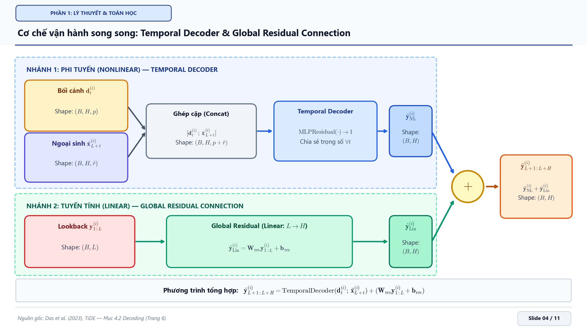
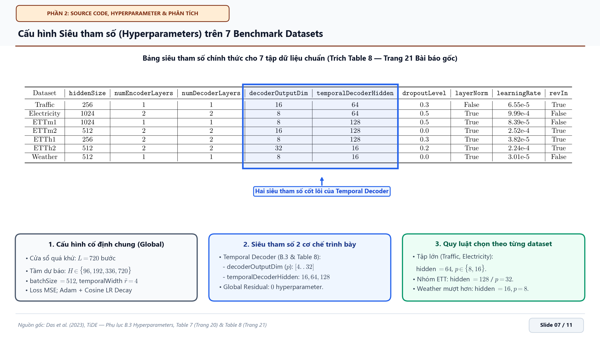
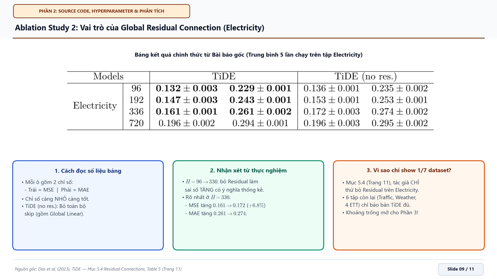
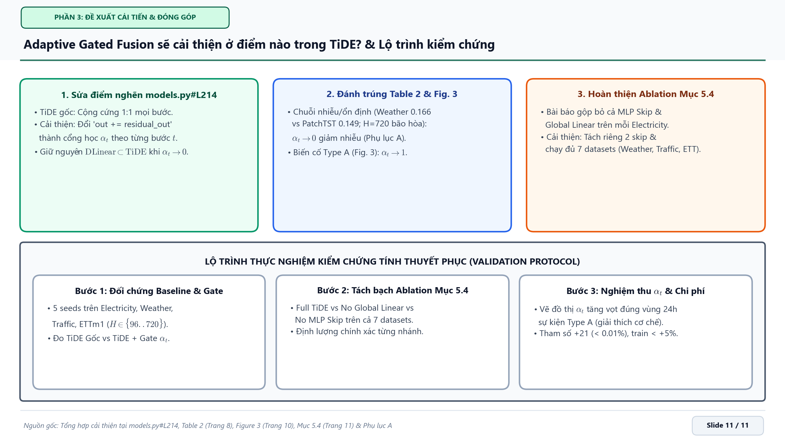

# 🎙️ KỊCH BẢN THUYẾT TRÌNH NỘI BỘ TỪNG SLIDE (INTERNAL TEAM SHARING SCRIPT)
## CHUYÊN ĐỀ: TEMPORAL DECODER & GLOBAL RESIDUAL CONNECTION TRONG MÔ HÌNH TiDE

> [!NOTE]
> **Bối cảnh sử dụng (Context):**  
> * **Đối tượng người nghe:** Toàn bộ thành viên trong nhóm đồ án / nhóm nghiên cứu TiDE.
> * **Mục tiêu bài nói:** **Giúp tất cả thành viên trong nhóm hiểu cặn kẽ, sâu sắc từ 5 thuật ngữ nền tảng, bản chất toán học, luồng tensor, mã nguồn thực tế đến lý do thiết kế và các kết quả thực nghiệm**, từ đó cả nhóm thống nhất tư duy để cùng triển khai đề xuất cải tiến và phân công chạy thực nghiệm.
> * **Phong cách trình bày:** Gần gũi, cởi mở, đậm chất trao đổi kỹ thuật (Tech-talk / Code-walkthrough), xưng hô "mình" và "anh em / các bạn trong nhóm". Đi thẳng vào bản chất, bóc tách từng dòng code và lưu ý các bẫy shape tensor khi lập trình.
> * **Tài liệu tham chiếu:** Khớp chính xác 1-đối-1 theo đúng thứ tự **11 Slide** trong [`slide_images_gallery.md`](./slide_images_gallery.md) (từ **Slide 01 / 11** đến **Slide 11 / 11**) và tuân thủ chuẩn mực [`rule_slide.md`](./rule_slide.md).

---

## ⏱️ PHÂN BỔ THỜI GIAN TOÀN BỘ BÀI NÓI (11 SLIDES)

---

## 📖 PHẦN 1: THUẬT NGỮ, LÝ THUYẾT & TOÁN HỌC (SLIDES 01 – 05)

---

### 🟢 SLIDE 01 / 11 — BẢNG THUẬT NGỮ CỐT LÕI TRONG TiDE

* **Ảnh slide:** `slide_01_bang_thuat_ngu_cot_loi.png` ([Xem ảnh trong gallery](./slide_images_gallery.md#slide-01--11-10--bảng-thuật-ngữ-cốt-lõi-trong-tide-mlpresidual-dense-encoder-dense-decoder-temporal-decoder-covariate-highway))
* **Thời lượng dự kiến:** 55 – 65 giây.
* **Mục tiêu slide:** Thống nhất với cả nhóm 5 thuật ngữ xương sống nhất của TiDE trước khi đi vào chi tiết, giúp các thành viên không bị nhầm lẫn giữa các khối.

#### 🎙️ Lời thoại trình bày (Team Tech-talk):

> "Chào mọi người, trước khi mình đi sâu vào chi tiết hai cơ chế chốt chặn ở đầu ra, ở **Slide 01** mở đầu này mình muốn cùng cả nhóm **thống nhất chuẩn xác 5 thuật ngữ cốt lõi** sẽ xuyên suốt toàn bộ bài báo TiDE và code của nhóm mình:
> 
> 1. **Thứ nhất là `MLPResidual` (Residual Block):** Đây là viên gạch nền tảng của mọi tầng trong TiDE. Nó gồm 1 tầng ẩn ReLU $\to$ 1 tầng Linear kèm Dropout $\oplus$ một đường tắt tuyến tính (`Skip Connection`) rồi qua `LayerNorm`. Toàn bộ các khối lớn từ chiếu đặc trưng, Encoder, Decoder đều xếp chồng từ khối này mà ra.
> 2. **Thứ hai là `Dense Encoder`:** Bạn trước đã phân tích rồi, đây là một chồng gồm $n_e$ khối `MLPResidual` nén toàn bộ chuỗi quá khứ, biến ngoại sinh và thuộc tính tĩnh thành **đúng 1 vector ẩn toàn cục duy nhất** $e$.
> 3. **Thứ ba là `Dense Decoder`:** Cũng là một chồng gồm $n_d$ khối `MLPResidual`, làm nhiệm vụ giải nén vector $e$ thành $H$ vector bối cảnh $d_t$ cho từng bước tương lai.
> 4. **Thứ tư — trọng tâm của phần mình — `Temporal Decoder`:** Anh em chú ý, nó không phải là một mạng sâu nhiều tầng nữa, mà chỉ là **đúng 1 khối `MLPResidual` đơn lẻ có đầu ra bằng 1**, dùng để ghép vector bối cảnh $d_t$ với biến ngoại sinh tương lai tại bước $t$.
> 5. **Và thứ năm là `Covariate Highway` (Đường cao tốc ngoại sinh):** Đây là thuật ngữ hình tượng mà tác giả đặt cho vai trò của `Temporal Decoder` — mở một làn đường cao tốc đi tắt đưa thẳng biến ngoại sinh tương lai vào phép dự báo mà không bị nghẽn qua cổ chai Encoder.
> 
> Nắm chắc 5 viên gạch này rồi, giờ chúng ta cùng nhìn lên kiến trúc tổng thể ở Slide 02 nhé."

* **🎬 Tương tác & Điểm nhấn màn hình (Visual Cues):**
  * Chỉ lướt qua 3 thẻ phía trên: *"3 khối này nhóm mình đã nắm sơ bộ ở phần trước"*.
  * Khoanh vùng vào 2 thẻ lớn phía dưới (`Temporal Decoder` $\to$ `Covariate Highway`): *"Phần của mình sẽ tập trung mổ xẻ sâu 2 khái niệm này"*.

---

### 🟢 SLIDE 02 / 11 — ĐỊNH VỊ PHẠM VI TRÌNH BÀY TRÊN KIẾN TRÚC TỔNG THỂ

* **Ảnh slide:** `slide_02_vi_tri_kien_truc.png` ([Xem ảnh trong gallery](./slide_images_gallery.md#slide-02--11-11--định-vị-hai-cơ-chế-trên-figure-1-gốc-trang-5))
* **Thời lượng dự kiến:** 45 – 50 giây.
* **Mục tiêu slide:** Định vị ngay vị trí trên Hình 1 bài báo gốc; phân định ranh giới rõ ràng với phần của bạn trước để nhóm theo dõi mạch lạc.

#### 🎙️ Lời thoại trình bày (Team Tech-talk):

> "Nhìn lên Hình 1 trích từ trang 5 của bài báo gốc ở Slide 02:
> 
> Như bạn trước vừa trình bày, nửa dưới của TiDE lo toàn bộ việc nén lịch sử qua `Dense Encoder` và bung ra các vector bối cảnh qua `Dense Decoder`. 
> 
> **Phần trình bày của mình sẽ KHÔNG lặp lại nửa dưới đó nữa**, mà chúng ta sẽ tập trung vào **hai khối nằm ở tầng cao nhất** — chính là hai cơ chế trực tiếp tính toán và quyết định đầu ra dự báo cuối cùng $\hat{y}$:
> 
> 1. **Khối màu xanh dương ở trên cùng:** `Temporal Decoder` — nhánh mô hình hóa phi tuyến cục bộ.
> 2. **Mũi tên dài màu xanh lá cây ở bên phải:** `Global Residual Connection` — nhánh tuyến tính nối tắt trực tiếp từ chuỗi quá khứ sang tương lai.
> 
> Anh em có thể tự hỏi: *'Tại sao một mạng nơ-ron sâu như TiDE đã có Encoder-Decoder rồi mà ở đầu ra lại phải chia làm 2 nhánh như thế này?'*. Chúng ta cùng sang Slide 03 để so sánh trực diện nhé."

* **🎬 Tương tác & Điểm nhấn màn hình (Visual Cues):**
  * Rê chuột lướt nhẹ qua nửa dưới bị làm mờ: *"Phần này bạn trước đã giải thích xong"*.
  * Trỏ laser vào hộp xanh dương và mũi tên xanh lá: *"Hai chốt chặn cuối cùng này chính là nội dung cốt lõi của mình"*.

---

### 🟢 SLIDE 03 / 11 — SO SÁNH 2 CỘT: KHÔNG CÓ VS CÓ TEMPORAL DECODER ("COVARIATE HIGHWAY")

* **Ảnh slide:** `slide_03_phan_biet_3_khoi_va_highway.png` ([Xem ảnh trong gallery](./slide_images_gallery.md#slide-03--11-12--so-sánh-2-cột-không-có-vs-có-temporal-decoder-covariate-highway))
* **Thời lượng dự kiến:** 65 – 75 giây.
* **Mục tiêu slide:** Đặt câu hỏi bản chất và phân tích bảng so sánh 2 cột đối chiếu trực diện để nhóm hiểu lý do sống còn vì sao phải có Temporal Decoder.

#### 🎙️ Lời thoại trình bày (Team Tech-talk):

> "Slide 03 này giải quyết một câu hỏi kiến trúc cực kỳ quan trọng mà lúc đọc bài báo nhóm mình rất dễ thắc mắc:
> **'Tại sao tác giả không để `Dense Decoder` dự báo thẳng ra kết quả luôn, mà lại phải đẻ thêm khối `Temporal Decoder` làm gì cho rườm rà?'**
> 
> Nhìn vào hai cột đối chiếu trên slide, anh em sẽ thấy ngay bản chất:
> 
> * **Cột bên trái — Nếu KHÔNG CÓ Temporal Decoder (Bị nghẽn cổ chai):**
>   Toàn bộ thông tin về biến ngoại sinh tương lai $\tilde{x}_{L+t}$ bắt buộc phải đi vòng qua nút thắt cổ chai ở `Dense Encoder`. Hãy tưởng tượng trong bài toán dự báo bán lẻ, ngày mai là *Black Friday* hoặc *Ngày của Mẹ*, nhu cầu mua sắm tăng đột biến gấp 3 lần. Nếu thông tin ngày lễ này bị nén chung vào một vector ẩn toàn cục $e$, tín hiệu sự kiện cục bộ sẽ bị hòa tan, pha loãng và mô hình học rất chậm!
> 
> * **Cột bên phải — Khi CÓ Temporal Decoder (Làn đường cao tốc):**
>   Tác giả mở một **đường cao tốc đưa thẳng biến ngoại sinh tương lai $\tilde{x}_{L+t}$ tới bước dự báo tại đúng ngày $t$**. Tại đây, `Temporal Decoder` lấy vector bối cảnh $d_t$ ghép trực tiếp với $\tilde{x}_{L+t}$ để tính ra dự báo phi tuyến $\hat{y}_{\text{NL}}$. 
> 
> Nhờ làn đường cao tốc này, mô hình bắt sóng các sự kiện đột biến cực kỳ nhạy bén mà không làm xáo trộn nhận thức dài hạn của bộ mã hóa!"

* **🎬 Tương tác & Điểm nhấn màn hình (Visual Cues):**
  * Chỉ vào cột trái: *"Bị nghẽn cổ chai, thông tin sự kiện bị pha loãng"*.
  * Chuyển sang cột phải: *"Đường cao tốc nối thẳng, phản ứng tức thì với sự kiện đột biến"*.

---

### 🟢 SLIDE 04 / 11 — HAI NHÁNH SONG SONG & PHƯƠNG TRÌNH TỔNG HỢP CUỐI CÙNG (KÈM SHAPE)

* **Ảnh slide:** `slide_04_hai_nhanh_song_song.png` ([Xem ảnh trong gallery](./slide_images_gallery.md#slide-04--11-13--luồng-song-song-hai-cơ-chế--phương-trình-tổng-hợp-dự-báo-cuối-cùng-kèm-shape-rõ-ràng))
* **Thời lượng dự kiến:** 55 – 65 giây.
* **Mục tiêu slide:** Chỉ rõ cho nhóm luồng dữ liệu chạy song song, công thức tổng hợp cuối cùng và các ký hiệu `Shape: (...)` chuẩn chỉnh trên từng khối.

#### 🎙️ Lời thoại trình bày (Team Tech-talk):

> "Slide 04 thể hiện trọn vẹn luồng dữ liệu song song mà khi code nhóm mình sẽ hiện thực:
> 
> Nhìn vào sơ đồ, anh em thấy TiDE chia làm hai nhánh chạy độc lập hoàn toàn:
> 
> * **Nhánh trên (Phi tuyến):** Là `Temporal Decoder`. Nó nhận đầu vào là vector ghép $[d_t ; \tilde{x}_{L+t}]$ có `Shape: (B, H, p + r_tilde)`. Dùng chung một khối `MLPResidual(out=1)` cho toàn bộ $H$ bước tương lai, sinh ra tensor phi tuyến $\hat{y}_{\text{NL}}$ có `Shape: (B, H)`.
> * **Nhánh dưới (Tuyến tính):** Là `Global Residual Connection`. Nhánh này siêu gọn: nó chỉ là **đúng 1 tầng Linear thuần túy** — không ReLU, không Dropout, không chuẩn hóa. Chiếu thẳng chuỗi lịch sử $y_{\text{norm}}$ có `Shape: (B, L)` sang `Shape: (B, H)`, sinh ra tensor tuyến tính $\hat{y}_{\text{Lin}}$.
> 
> Và như phương trình đóng khung ở giữa: TiDE **cộng trực tiếp hai nhánh này lại theo từng phần tử**:
> 
> $$
> \hat{\mathbf{y}}_{L+1:L+H}^{(i)} = \hat{\mathbf{y}}_{\mathrm{NL}, L+1:L+H}^{(i)} + \hat{\mathbf{y}}_{\mathrm{Lin}, L+1:L+H}^{(i)}
> $$
> 
> Sau khi cộng xong, nếu lúc đầu có bật RevIN thì ta chỉ cần nhân lại độ lệch chuẩn $\sigma$ và cộng giá trị trung bình $\mu$ để đưa về thang đo thực tế của dữ liệu.
> 
> Một nhánh tuyến tính đơn giản như vậy kết hợp với mạng sâu mang lại ý nghĩa toán học gì? Chúng ta cùng xem Slide 05."

* **🎬 Tương tác & Điểm nhấn màn hình (Visual Cues):**
  * Nhấn vào chữ `Shape: (B, H)` ở cả hai nhánh: *"Anh em thấy không, cả hai nhánh đều đưa về đúng Shape `(B, H)` nên cộng thẳng vào nhau cực kỳ gọn"*.

---

### 🟢 SLIDE 05 / 11 — CHỨNG MINH TOÁN HỌC: DLINEAR LÀ LỚP CON CỦA TiDE & TENSOR TỔNG QUÁT

* **Ảnh slide:** `slide_05_lien_he_dlinear_va_tensor.png` ([Xem ảnh trong gallery](./slide_images_gallery.md#slide-05--11-14--chứng-minh-toán-học-mối-liên-hệ-với-dlinear--luồng-kích-thước-tensor-tổng-quát))
* **Thời lượng dự kiến:** 60 – 70 giây.
* **Mục tiêu slide:** Chứng minh toán học mối liên hệ với DLinear và chuẩn hóa bảng Shape tổng quát ($B, L, H, p, \tilde{r}$) để anh em code PyTorch không bị nhầm chiều.

#### 🎙️ Lời thoại trình bày (Team Tech-talk):

> "Trên Slide 05, mình muốn làm rõ 2 điểm mấu chốt:
> 
> **Thứ nhất là chứng minh toán học — DLinear là một lớp con của TiDE:**
> Trong bài báo, các tác giả khẳng định một câu rất đanh thép: *'Một mô hình thuần tuyến tính như DLinear luôn là một tập con nghiêm ngặt của mô hình chúng tôi'*. 
> Thật vậy, nếu trong quá trình huấn luyện, toàn bộ trọng số của nhánh phi tuyến triệt tiêu về 0, thì công thức của TiDE lập tức rút gọn chính xác thành: $\hat{y} = W_{\text{res}} \cdot y + b_{\text{res}}$. Đây chính là phương trình của một tầng Linear độc lập của DLinear! 
> Điều này mang lại sự bảo đảm vững chắc: Nhánh Linear đóng vai trò cái neo an toàn gánh vác phần xu hướng nền tảng, còn nhánh nơ-ron sâu chỉ cần tập trung học phần dư khó nhằn.
> 
> **Thứ hai là luồng Tensor tổng quát — anh em code cần ghi nhớ bảng này:**
> * $B$: Batch size, $L$: Lookback (720), $H$: Horizon (96, 192, 336, 720).
> * $p$: Số chiều bối cảnh của Decoder (thường chọn 8 hoặc 16).
> * $\tilde{r}$: Số chiều nén của biến ngoại sinh (cố định bằng 4).
> * Khi ghép bối cảnh và ngoại sinh, ta concat ở chiều cuối cùng: `p + r_tilde` = 16 + 4 = 20. Đưa qua `MLPResidual(out=1)` rồi squeeze là ra đúng `(B, H)`.
> 
> Ví dụ trên tập `Electricity` với $B=512, L=720, H=96, p=8$, mọi thứ khớp hoàn hảo từng chiều một!"

* **🎬 Tương tác & Điểm nhấn màn hình (Visual Cues):**
  * Nhấn giọng: *"DLinear $\subset$ TiDE — nghĩa là TiDE thừa hưởng toàn bộ sức mạnh tuyến tính của DLinear nhưng có thêm cánh tay phi tuyến"*.
  * Chỉ vào bảng định nghĩa ký hiệu $B, L, H, p, \tilde{r}$.

---

## 💻 PHẦN 2: SOURCE CODE, HYPERPARAMETERS & ABLATION STUDY (SLIDES 06 – 09)

---

### 🟢 SLIDE 06 / 11 — SOURCE CODE CHÍNH THỨC & ÁNH XẠ PHƯƠNG TRÌNH TOÁN HỌC

* **Ảnh slide:** `slide_06_source_code_va_equation.png` ([Xem ảnh trong gallery](./slide_images_gallery.md#slide-06--11-21--source-code-chính-thức-modelspy--ánh-xạ-thẳng-ra-phương-trình-toán-học))
* **Thời lượng dự kiến:** 60 – 70 giây.
* **Mục tiêu slide:** Cùng nhóm đi soi trực tiếp từng dòng code TensorFlow trong repo chính thức của Google Research (`models.py`) đặt cạnh code PyTorch của nhóm mình.

#### 🎙️ Lời thoại trình bày (Team Tech-talk):

> "Bây giờ chúng ta cùng soi mã nguồn thực tế ở Slide 06.
> 
> Bên trái là code TensorFlow trong repo chính thức của Google Research ở file `tide/models.py`, còn bên phải là code PyTorch trong file `simulate_forward_pass.py` của nhóm mình:
> 
> * **Đoạn khởi tạo `__init__`:**
>   * Dòng 141: `self.linear = tf.keras.layers.Dense(self.pred_len)` — chính là nhánh Global Residual.
>   * Dòng 150: `self.final_decoder = MLPResidual(output_dim=1)` — chính là Temporal Decoder.
> * **Đoạn thực thi `call`:**
>   * Dòng 203: `residual_out = self.linear(past_ts)` tính nhánh tuyến tính, shape ra `[B, H]`.
>   * Dòng 211: `final_in = tf.concat([decoder_out, enc_fut], axis=1)` — ghép bối cảnh và ngoại sinh. 
>   * *Anh em lưu ý chỗ này:* Bên TensorFlow tác giả để chiều thời gian ở cuối nên dòng 212 họ phải dùng `tf.transpose(final_in, (0, 2, 1))` để đưa số chiều đặc trưng về cuối trước khi đưa vào MLPResidual. Còn bên PyTorch nhóm mình đã chủ động để sẵn dạng `[B, H, C]` nên chỉ cần `torch.cat` ở `dim=-1` là chạy thẳng được luôn, code gọn hơn hẳn!
>   * **Và mấu chốt là dòng 214:** `out += residual_out` — đúng một dòng code cộng dồn!
> 
> Code của Google viết cực kỳ bám sát toán học, không có mánh lới gì phức tạp cả."

* **🎬 Tương tác & Điểm nhấn màn hình (Visual Cues):**
  * Dùng chuột rà theo 3 khối: Khởi tạo $\leftrightarrow$ Ghép Tensor $\leftrightarrow$ Dòng 214 cộng kết quả.
  * Nhấn mạnh sự khác biệt giữa trục TensorFlow vs PyTorch để anh em code không bị nhầm.

---

### 🟢 SLIDE 07 / 11 — CẤU HÌNH SIÊU THAM SỐ TRÊN 7 BENCHMARK DATASETS

* **Ảnh slide:** `slide_07_cau_hinh_hyperparameter.png` ([Xem ảnh trong gallery](./slide_images_gallery.md#slide-07--11-22--cấu-hình-siêu-tham-số-hyperparameters-trên-7-benchmark-datasets))
* **Thời lượng dự kiến:** 55 – 65 giây.
* **Mục tiêu slide:** Hướng dẫn nhóm cách tác giả tinh chỉnh siêu tham số từ Bảng 7 và 8 trong Phụ lục; nắm vững quy luật để áp dụng khi nhóm chạy thực nghiệm trên Kaggle.

#### 🎙️ Lời thoại trình bày (Team Tech-talk):

> "Slide 07 là bảng cấu hình siêu tham số chính thức của bài báo trên cả 7 bộ dữ liệu (trích từ Bảng 7 và 8 ở Phụ lục B.3).
> 
> Khi nhóm mình chạy thực nghiệm hoặc tune mô hình, anh em cần nhớ 3 quy luật này:
> 
> 1. **Những tham số cố định chung:** Cửa sổ quá khứ $L=720$, batch size 512, và số chiều nén ngoại sinh $\tilde{r}=4$.
> 2. **Sự tối giản của 2 cơ chế mình phụ trách:** Nhánh `Global Residual` **hoàn toàn không có bất kỳ siêu tham số ẩn nào cần tune**, vì ma trận cố định $720 \times H$. Còn `Temporal Decoder` chỉ có đúng 2 siêu tham số: số chiều bối cảnh $p$ và số nơ-ron ẩn `temporalDecoderHidden`.
> 3. **Quy luật chọn theo độ phức tạp dữ liệu:**
>    * Với các tập dữ liệu lớn hàng trăm chuỗi như `Traffic` (862 chuỗi) hay `Electricity` (321 chuỗi): tác giả chọn `hidden = 64`, $p$ từ 8 đến 16.
>    * Với các tập trạm biến áp `ETT` (chỉ có 7 chuỗi nhưng biến động phức tạp): họ tăng `hidden = 128` hoặc $p=32$.
>    * Với tập `Weather` (chuỗi khí tượng biến thiên mượt): chỉ cần `hidden = 16` và $p=8$ là đủ.
> 
> Như vậy khi nhóm mình train thử nghiệm, không cần tốn công Grid Search vu vơ, cứ bám sát các mức 16, 64, 128 này là chuẩn xác."

* **🎬 Tương tác & Điểm nhấn màn hình (Visual Cues):**
  * Chỉ vào hai cột $p$ và `temporalDecoderHidden`: *"Cả phần decoder này chỉ cần nhớ 2 cột tham số này thôi"*.

---

### 🟢 SLIDE 08 / 11 — ABLATION STUDY 1: VAI TRÒ TEMPORAL DECODER (ẢNH GỐC TỪ BÀI BÁO)

* **Ảnh slide:** `slide_08_ablation_temporal_decoder.png` ([Xem ảnh trong gallery](./slide_images_gallery.md#slide-08--11-23--ablation-study-1-vai-trò-temporal-decoder-ảnh-gốc-từ-bài-báo))
* **Thời lượng dự kiến:** 65 – 75 giây.
* **Mục tiêu slide:** Phân tích thí nghiệm Ablation Study 1 (Figure 3 bài báo gốc); giải thích cho nhóm hiểu hiện tượng mô hình bị "trật nhịp" sau sự kiện đột biến nếu thiếu Temporal Decoder.

#### 🎙️ Lời thoại trình bày (Team Tech-talk):

> "Để xem Temporal Decoder có thực sự cần thiết hay không, tác giả làm một thí nghiệm rất thông minh ở Hình 3 bài báo gốc, thể hiện trên Slide 08:
> 
> Họ lấy dữ liệu phụ tải điện `Electricity` và chèn vào một sự kiện đột biến nhân tạo gọi là **Type A**: nhân biên độ phụ tải lên gấp 3 đến 3.2 lần trong 24 giờ. Và họ đánh giá mô hình chỉ sau **đúng 1 Epoch huấn luyện duy nhất**!
> 
> Mọi người nhìn kỹ biểu đồ bên trái:
> * Trong 24 giờ xảy ra sự kiện: Cả hai bản đều nhận biết phụ tải tăng cao nhờ biến ngoại sinh.
> * Nhưng **ngay sau khi sự kiện kết thúc (từ mốc thời gian 200 trở đi):** Bản màu xanh lá cây — tức bản **bỏ đi Temporal Decoder** — bị 'ngáo' hoàn toàn! Dự báo bị vọt lên cao bất thường, tác giả dùng từ là *'thrown off'*, vì nút thắt cổ chai Dense Encoder bị ám ảnh bởi biến cố cũ và chưa kịp điều chỉnh lại.
> * Trong khi đó, bản TiDE đầy đủ có Temporal Decoder (đường màu xanh dương) đã **lập tức hồi phục về mức bình thường ngay tại bước tiếp theo**.
> 
> Thí nghiệm này chứng minh rõ cho nhóm mình: Temporal Decoder chính là chiếc 'van an toàn' giúp mô hình phản xạ nhạy bén với sự kiện cục bộ mà không làm loạn nhận thức dài hạn của bộ mã hóa."

* **🎬 Tương tác & Điểm nhấn màn hình (Visual Cues):**
  * Dùng chuột rê vào đoạn sau mốc 200 trên đồ thị: chỉ rõ đường xanh lá vọt lên sai số lớn, trong khi đường xanh dương bám sát đường thực tế màu đen.

---

### 🟢 SLIDE 09 / 11 — ABLATION STUDY 2: VAI TRÒ GLOBAL RESIDUAL CONNECTION (`ELECTRICITY`)

* **Ảnh slide:** `slide_09_ablation_global_residual.png` ([Xem ảnh trong gallery](./slide_images_gallery.md#slide-09--11-24--ablation-study-2-vai-trò-residual-connections-ảnh-gốc-từ-bài-báo--electricity))
* **Thời lượng dự kiến:** 65 – 75 giây.
* **Mục tiêu slide:** Cho nhóm thấy bằng chứng số liệu khi bỏ residual (MSE tăng +6.8%) và "bóc tách" khoảng trống nghiên cứu của bài báo để nhóm mình khai thác.

#### 🎙️ Lời thoại trình bày (Team Tech-talk):

> "Sang Slide 09 là thí nghiệm Ablation thứ hai: Chuyện gì sẽ xảy ra nếu ta bỏ các kết nối thặng dư (Residual Connections)?
> 
> Nhìn vào Bảng 5 từ bài báo gốc:
> * Khi bỏ residual (`TiDE no res.`): ở mọi tầm dự báo từ 96 đến 336, sai số MSE và MAE đều tăng vọt. Đặc biệt tại $H=336$, MSE tăng từ `0.161` lên `0.172` — tức **sai số tăng tới $+6.8\%$**.
> * Điều này khẳng định: Bắt một mạng nơ-ron sâu tự học lại xu hướng tuyến tính từ đầu là một sai lầm; đường tắt Linear giúp mô hình giữ vững phong độ ổn định hơn rất nhiều.
> 
> **Nhưng anh em để ý chi tiết này — đây chính là cơ hội cho nhóm mình:**
> Tác giả làm thí nghiệm trên 7 bộ dữ liệu, nhưng **chỉ công bố kết quả bỏ residual trên đúng 1 tập duy nhất là `Electricity`**, còn 6 tập kia (`Traffic`, `Weather`, `ETTh1/2`, `ETTm1/2`) họ không hề công bố bảng so sánh khi bỏ residual!
> 
> Thêm vào đó, nếu nhìn lại dòng code lúc nãy: `out += residual_out`, hai nhánh đang bị **cộng cứng cố định 1:1** ở mọi thời điểm và mọi chuỗi. Liệu tỷ lệ 1:1 có luôn luôn đúng không? Đây chính là điểm tựa để mình đề xuất hướng cải tiến tối ưu cho nhóm ở Phần 3."

* **🎬 Tương tác & Điểm nhấn màn hình (Visual Cues):**
  * Khoanh vào con số `+6.8% MSE`: nhấn mạnh tác động to lớn của kết nối tắt.
  * Nhấn mạnh: *"Tác giả bỏ ngỏ 6 tập dữ liệu, đây là đất diễn để nhóm mình làm thực nghiệm"*.

---

## 💡 PHẦN 3: ĐỀ XUẤT TỐI ƯU & LỘ TRÌNH THỰC NGHIỆM (SLIDES 10 – 11)

---

### 🟢 SLIDE 10 / 11 — ĐỀ XUẤT TỐT NHẤT: CỔNG HỢP NHẤT THÍCH NGHI (*ADAPTIVE GATED FUSION*)

* **Ảnh slide:** `slide_10_de_xuat_adaptive_gated_fusion.png` ([Xem ảnh trong gallery](./slide_images_gallery.md#slide-10--11-31--đề-xuất-tốt-nhất-cổng-hợp-nhất-thích-nghi-adaptive-gated-fusion--cơ-sở-bài-báo--lý-do-lựa-chọn))
* **Thời lượng dự kiến:** 75 – 85 giây.
* **Mục tiêu slide:** Trình bày đề xuất cải tiến tối ưu duy nhất cho nhóm; giải thích rõ cơ sở bài báo kế thừa (TFT & Highway Networks), lý do chọn lựa, công thức toán và mã nguồn PyTorch cực nhẹ chỉ +21 tham số.

#### 🎙️ Lời thoại trình bày (Team Tech-talk):

> "Để trả lời câu hỏi: *'Có thể cải tiến cơ chế kết hợp giữa nhánh phi tuyến và tuyến tính trong TiDE không?'*, mình đề xuất nhóm mình tập trung vào **1 phương án tối ưu và khả thi nhất: Adaptive Gated Fusion** ở Slide 10.
> 
> **Đầu tiên, ý tưởng này kế thừa từ bài báo nào?**
> Nó không phải tự nghĩ ra vu vơ, mà kế thừa trực tiếp từ cơ chế **Gated Residual Network (GRN)** trong bài báo kinh điển *Temporal Fusion Transformers (TFT)* của Lim et al. (2021) trên tạp chí *IJF*, kết hợp với nguyên lý mạng cổng của *Highway Networks* (Srivastava et al., 2015).
> 
> **Vì sao mình chọn đây là phương án tốt nhất cho nhóm mình?**
> 1. **Đánh trúng điểm nghẽn duy nhất:** Nó can thiệp trực tiếp tại dòng code 214 `out += residual_out` mà không làm đảo lộn cấu trúc Encoder/Decoder bên dưới.
> 2. **Bảo toàn tốc độ siêu nhanh của TiDE:** Mạng cổng này chỉ tốn thêm đúng **21 tham số** (`p + r_tilde + 1 = 16 + 4 + 1 = 21`), chiếm chưa đầy 0.01% mô hình, giữ trọn ưu thế chạy nhanh gấp 5–10 lần Transformer.
> 3. **Tăng tính giải thích được (Interpretable AI):** Chúng ta có thể vẽ biểu đồ trọng số $\alpha_t$ để chỉ ra cho thầy cô thấy lúc nào mô hình dựa vào xu hướng tuyến tính, lúc nào dựa vào sự kiện ngoại sinh.
> 
> **Công thức toán và code cực kỳ dễ hiểu:**
> Ta dùng một mạng cổng Linear + Sigmoid nhận đầu vào $[d_t ; \tilde{x}_{L+t}]$ để sinh ra trọng số $\alpha_t \in (0, 1)$ cho từng bước:
> 
> $$
> \alpha_t^{(i)} = \sigma\Big( \mathbf{W}_g \cdot \big[ \mathbf{d}_t^{(i)} \; ; \; \tilde{\mathbf{x}}_{L+t}^{(i)} \big] + b_g \Big) \in (0, 1)
> $$
> 
> $$
> \hat{\mathbf{y}}_{\mathrm{Gated}, L+t}^{(i)} = \alpha_t^{(i)} \cdot \hat{\mathbf{y}}_{\mathrm{NL}, L+t}^{(i)} + \big(1 - \alpha_t^{(i)}\big) \cdot \hat{\mathbf{y}}_{\mathrm{Lin}, L+t}^{(i)}
> $$
> 
> Code PyTorch mình đã viết sẵn trong class `AdaptiveGatedTiDEHead`, chỉ cần thay thế đúng dòng 265 của file `simulate_forward_pass.py` là xong!"

* **🎬 Tương tác & Điểm nhấn màn hình (Visual Cues):**
  * Chỉ vào hai bài báo nền tảng (TFT 2021 & Highway 2015): khẳng định tính vững chắc về mặt học thuật.
  * Nhấn mạnh con số **21 tham số** và đoạn code PyTorch bên dưới.

---

### 🟢 SLIDE 11 / 11 — ADAPTIVE GATED FUSION CẢI THIỆN ĐIỂM NÀO TRONG TiDE? & LỘ TRÌNH KIỂM CHỨNG

* **Ảnh slide:** `slide_11_diem_cai_thien_va_roadmap.png` ([Xem ảnh trong gallery](./slide_images_gallery.md#slide-11--11-32--adaptive-gated-fusion-cải-thiện-ở-điểm-nào-trong-tide--lộ-trình-kiểm-chứng))
* **Thời lượng dự kiến:** 65 – 75 giây.
* **Mục tiêu slide:** Chỉ rõ 3 điểm yếu cụ thể trong bài báo mà đề xuất này khắc phục; trình bày lộ trình thực nghiệm 3 bước và kêu gọi nhóm phân công chạy trên Kaggle.

#### 🎙️ Lời thoại trình bày (Team Tech-talk):

> "Để khép lại bài chia sẻ, Slide 11 chỉ rõ **đề xuất này sẽ cải thiện trực tiếp ở những điểm yếu nào của TiDE trong bài báo**:
> 
> 1. **Khắc phục các tập dữ liệu nhiều nhiễu mà TiDE đang thua:** Nhìn vào Bảng 2 bài báo gốc, ở tập `Weather` tầm ngắn $H=96$, TiDE (0.166) đang bị thua PatchTST (0.149); hay ở tập `Electricity` tầm siêu dài $H=720$, bản có residual và không có residual hòa nhau ở mức 0.196. Khi đó, cổng thích nghi sẽ tự động ép $\alpha_t \to 0$ để triệt tiêu nhiễu phi tuyến theo đúng chứng minh toán học ở Phụ lục A.
> 2. **Khuếch đại độ nhạy biến cố:** Khi gặp sự kiện đột biến như Type A (Hình 3), $\alpha_t \to 1$ giúp Temporal Decoder phản ứng tức thì.
> 3. **Lấp đầy lỗ hổng thực nghiệm:** Tác giả Google mới chỉ chạy bỏ residual trên 1 tập `Electricity` và gộp chung cả 2 loại skip. Nhóm mình sẽ tách bạch riêng `Global Linear` với `MLP Skip` và chạy kiểm chứng đủ cả 7 datasets.
> 
> **Lộ trình hành động cụ thể cho nhóm mình:**
> * Mình đã chuẩn bị sẵn file hướng dẫn dùng Brave chạy song song 2 tài khoản Kaggle trong thư mục `kaggle/` để nhóm mình có **60 giờ GPU/tuần**.
> * Nhóm mình chia nhau chạy 3 bước trong bảng: Bước 1 chạy đối chứng Baseline vs Gated trên 4 tập (`Electricity`, `Weather`, `Traffic`, `ETTm1`); Bước 2 chạy mở rộng Ablation; và Bước 3 vẽ biểu đồ $\alpha_t$ để đưa vào báo cáo đồ án.
> 
> Toàn bộ phần phân tích về `Temporal Decoder` và `Global Residual Connection` của mình đến đây là hoàn tất. Bây giờ mời anh em cùng thảo luận và phân chia nhiệm vụ nhé!"

* **🎬 Tương tác & Điểm nhấn màn hình (Visual Cues):**
  * Chỉ vào 3 bước kiểm chứng trong bảng lộ trình: *"Mọi thứ đã sẵn sàng từ code tới tài nguyên Kaggle"*.
  * Chuyển sang màn hình thảo luận để cả nhóm cùng bàn bạc.

---

## 💬 GỢI Ý GIẢI ĐÁP THẮC MẮC NỘI BỘ (INTERNAL TEAM Q&A & GOTCHAS)

Dưới đây là các câu hỏi mà thành viên trong nhóm rất dễ thắc mắc khi cùng đọc code và làm đồ án, kèm câu trả lời cặn kẽ để bạn giải thích cho nhóm:

### ❓ Câu hỏi 1: *"Ủa lúc code PyTorch, tại sao `decoder_out` có shape `(B, H, p)` mà `enc_fut` lại có shape `(B, H, r_tilde)`? Sao ghép vào nhau được?"*
> **Giải thích cho bạn:**  
> "Vì ở bước tiền xử lý, toàn bộ biến ngoại sinh tương lai $x_{L+1:L+H}$ đã được chiếu qua một tầng nén `Linear` độc lập để đưa số chiều về đúng $\tilde{r} = 4$. Do cả hai tensor đều có chung 2 chiều đầu là batch size $B$ và horizon $H$, nên ta dùng `torch.cat([decoder_out, enc_fut], dim=-1)` thì tensor mới sẽ có shape là `(B, H, p + r_tilde)` = `(B, H, 20)`. Chiều thời gian $H$ được giữ nguyên cho từng bước!"

### ❓ Câu hỏi 2: *"Sao trong code của Google họ lại dùng `tf.transpose(final_in, (0, 2, 1))` làm gì cho phức tạp vậy?"*
> **Giải thích cho bạn:**  
> "À, đó là do cách tổ chức dữ liệu của TensorFlow trong code gốc của Google: họ xếp chiều đặc trưng $C$ ở vị trí thứ 1 và chiều thời gian $H$ ở vị trí thứ 2, tức dạng `(B, C, H)`. Nhưng khối `MLPResidual` lại yêu cầu chiều cần biến đổi phải nằm ở cuối cùng, nên họ phải hoán vị trục `transpose` để đưa $H$ ra giữa và $C$ về cuối thành `(B, H, C)`. Bên PyTorch nhóm mình đã chủ động để dạng `[B, H, C]` ngay từ đầu nên không cần transpose dòng này nữa, code nhìn sạch hơn hẳn!"

### ❓ Câu hỏi 3: *"Nếu thêm Cổng Gating $\alpha_t$, lúc mới train chưa học được gì thì mô hình có bị mất ổn định không?"*
> **Giải thích cho bạn:**  
> "Không hề bị nhé! Mẹo ở đây là khi khởi tạo lớp Linear của cổng, mình đặt bias $b_g = 0$ và khởi tạo trọng số $W_g$ rất nhỏ quanh 0. Khi đó $\text{Sigmoid}(0) \approx 0.5$, nghĩa là tại epoch đầu tiên, mô hình sẽ tự động chia đều tỷ lệ 50:50 cho cả hai nhánh — tức hoạt động tương đương hệt như TiDE gốc. Sau đó qua từng epoch, cổng mới từ từ học cách ưu tiên nhánh nào tùy theo bối cảnh."

### ❓ Câu hỏi 4: *"Tại sao nhóm mình chỉ chọn duy nhất đề xuất Adaptive Gated Fusion mà không làm thêm các nhánh tách chuỗi như DLinear?"*
> **Giải thích cho bạn:**  
> "Vì theo nguyên tắc thiết kế và nghiên cứu khoa học, ta cần tập trung vào giải pháp có tính khả thi cao nhất và ít làm phình to mô hình. Đề xuất Adaptive Gated Fusion chỉ tốn thêm đúng 21 tham số, đánh trúng điểm nghẽn duy nhất ở dòng code 214 mà giữ nguyên toàn bộ ưu thế tốc độ $O(L+H)$ của TiDE. Thêm các bộ lọc tách chuỗi phức tạp sẽ làm tăng độ trễ và số lượng siêu tham số phải tune, làm mất đi triết lý tối giản của TiDE."
