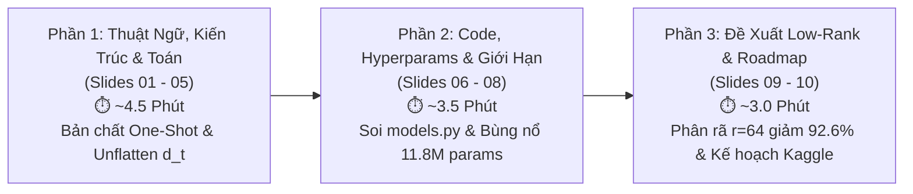
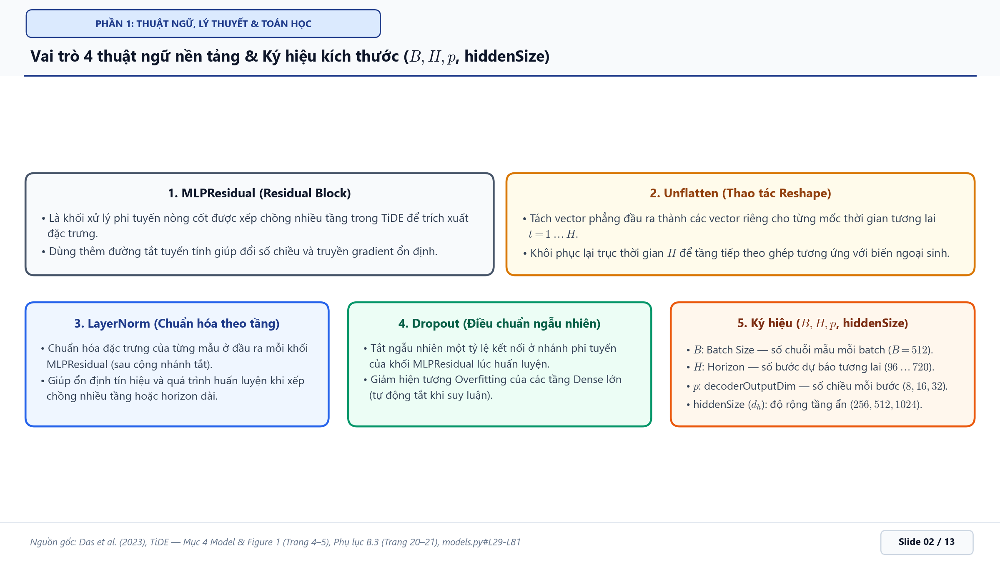
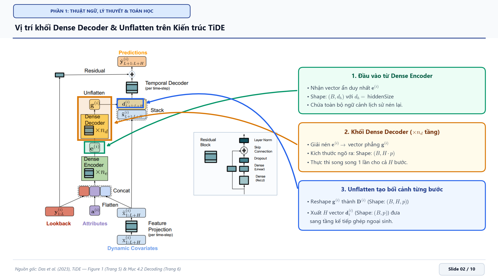
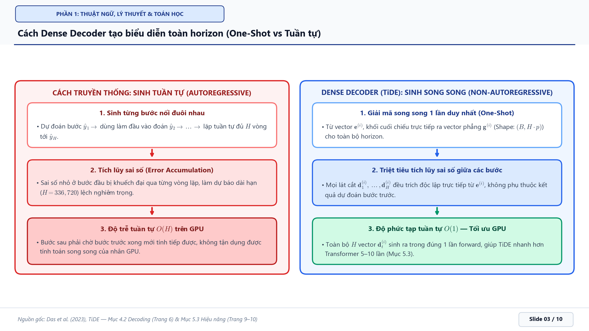
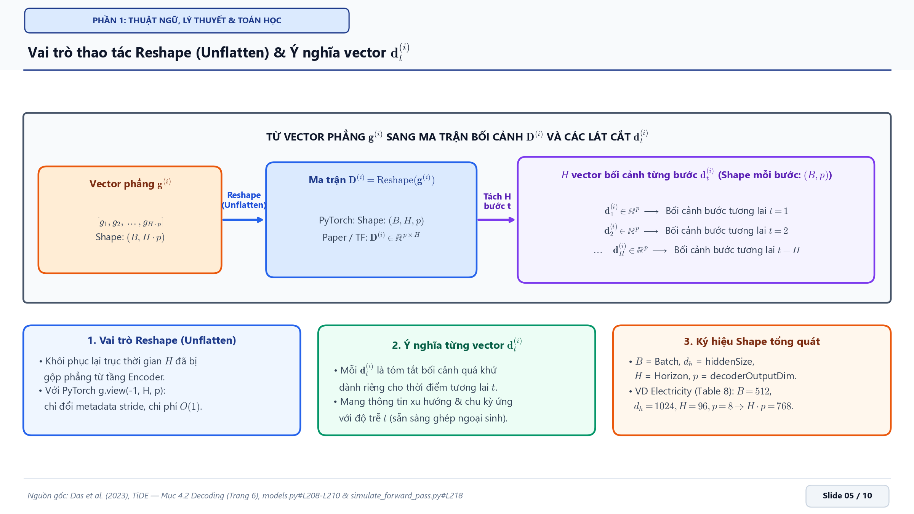
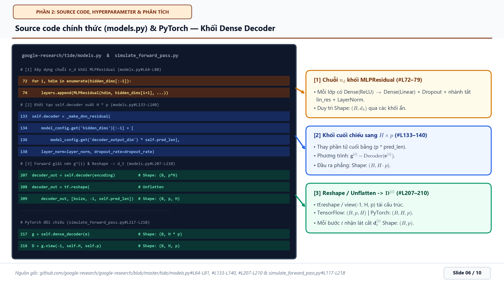
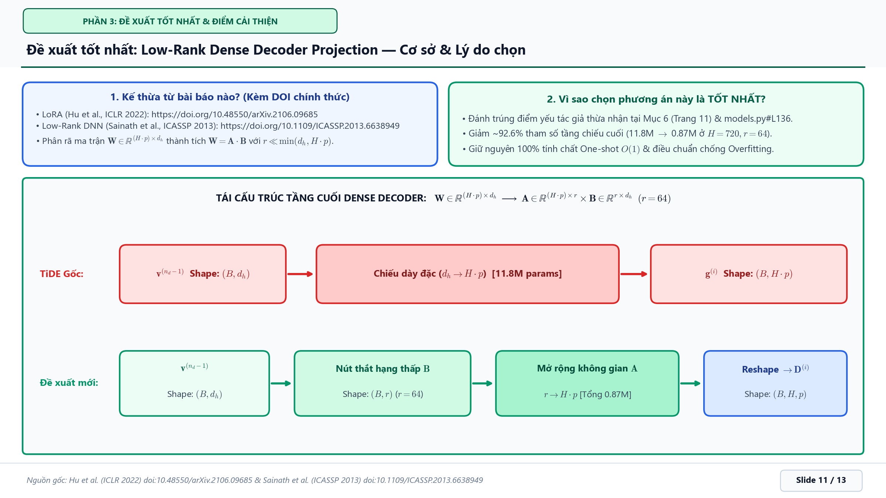
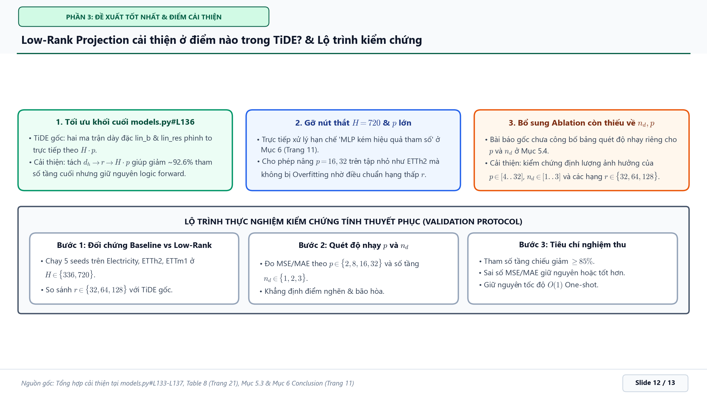

# 🎙️ KỊCH BẢN THUYẾT TRÌNH NỘI BỘ TỪNG SLIDE (INTERNAL TEAM SHARING SCRIPT)
## CHUYÊN ĐỀ: KHỐI DENSE DECODER TRONG KIẾN TRÚC MÔ HÌNH TiDE

> [!NOTE]
> **Bối cảnh sử dụng (Context):**  
> * **Đối tượng người nghe:** Toàn bộ thành viên trong nhóm đồ án / nhóm nghiên cứu TiDE.
> * **Mục tiêu bài nói:** **Giúp tất cả thành viên trong nhóm hiểu cặn kẽ, sâu sắc từ 5 thuật ngữ nền tảng, bản chất cơ chế giải mã One-Shot $O(1)$, cấu trúc $n_d$ khối `MLPResidual`, phép Reshape (Unflatten), mã nguồn thực tế đến phân tích bùng nổ tham số và đề xuất cải tiến Low-Rank Projection**, từ đó cả nhóm thống nhất tư duy kỹ thuật để cùng triển khai code và chạy thực nghiệm.
> * **Phong cách trình bày:** Gần gũi, cởi mở, đậm chất trao đổi kỹ thuật (Tech-talk / Code-walkthrough), xưng hô "mình" và "anh em / các bạn trong nhóm". Đi thẳng vào bản chất, bóc tách từng dòng code và lưu ý các bẫy shape tensor khi lập trình.
> * **Tài liệu tham chiếu:** Khớp chính xác 1-đối-1 theo đúng thứ tự **10 Slide** trong [`slide_images_gallery.md`](./slide_images_gallery.md) (từ **Slide 01 / 10** đến **Slide 10 / 10**) và tuân thủ chuẩn mực [`rule_slide.md`](./rule_slide.md).

---

## ⏱️ PHÂN BỔ THỜI GIAN TOÀN BỘ BÀI NÓI (10 SLIDES)

---

## 📖 PHẦN 1: THUẬT NGỮ, KIẾN TRÚC & TOÁN HỌC (SLIDES 01 – 05)

---

### 🟢 SLIDE 01 / 10 — THUẬT NGỮ CỐT LÕI CHO DENSE DECODER (NỀN TẢNG)

* **Ảnh slide:** `slide_01_bang_thuat_ngu_dense_decoder.png` ([Xem ảnh trong gallery](./slide_images_gallery.md#slide-01--10-thuật-ngữ-cốt-lõi-cho-dense-decoder-nền-tảng))
* **Thời lượng dự kiến:** 55 – 65 giây.
* **Mục tiêu slide:** Thống nhất với cả nhóm 5 khái niệm xương sống của Dense Decoder trước khi đi sâu vào sơ đồ, giúp anh em hình dung rõ ràng chức năng và shape của từng thành phần.

#### 🎙️ Lời thoại trình bày (Team Tech-talk):

> "Chào mọi người, trong kiến trúc TiDE, sau khi `Dense Encoder` nén toàn bộ dữ liệu lịch sử thì trọng trách giải mã tương lai thuộc về khối **`Dense Decoder`**. Để nhóm mình theo dõi một cách mượt mà và không bị nhầm lẫn giữa các tensor, ở **Slide 01** mở đầu này mình muốn cùng anh em **thống nhất chuẩn xác 5 thuật ngữ nền tảng**:
> 
> 1. **Khối cơ sở `MLPResidual` (Residual Block):** Đây là đơn vị lặp lại cơ bản của TiDE. Mỗi khối gồm 1 nhánh phi tuyến Linear $\to$ ReLU $\to$ Linear $\to$ Dropout, cộng với một nhánh tắt tuyến tính (`lin_res`), rồi đi qua `LayerNorm`. Trong Dense Decoder, khối này được xếp chồng $n_d$ lần.
> 2. **Vector ẩn toàn cục $\mathbf{e}^{(i)}$:** Đây là đầu vào của Dense Decoder, do Encoder truyền lên. Nó có `Shape: (B, d_h)` với $d_h = \text{hiddenSize}$ — nén trọn gói toàn bộ chuỗi quá khứ, biến ngoại sinh và thuộc tính tĩnh.
> 3. **Khối `Dense Decoder`:** Là một stack gồm $n_d$ khối `MLPResidual`. Các tầng đầu giữ nguyên kích thước $d_h$, riêng tầng cuối cùng sẽ chiếu một phát từ $d_h$ ra vector phẳng $\mathbf{g}^{(i)}$ có kích thước bằng $H \cdot p$.
> 4. **Thao tác `Reshape` (hay `Unflatten`):** Là phép biến đổi mảng 1D $\mathbf{g}^{(i)}$ thành ma trận 2D $\mathbf{D}^{(i)}$ có `Shape: (B, H, p)`. Phép này cực kỳ đặc biệt: chi phí bằng 0 trên bộ nhớ!
> 5. **Vector bối cảnh $\mathbf{d}_t^{(i)}$:** Chính là từng lát cắt thứ $t$ trích từ ma trận $\mathbf{D}^{(i)}$, có `Shape: (B, p)`. Mỗi vector này mang thông tin bối cảnh quá khứ được 'may đo' riêng cho đúng thời điểm tương lai $t$.
> 
> Bây giờ, chúng ta cùng nhìn lên Figure 1 của bài báo để xem vị trí của Dense Decoder nằm ở đâu nhé!"

* **🎬 Tương tác & Điểm nhấn màn hình (Visual Cues):**
  * Lướt qua 2 thẻ đầu (`MLPResidual` $\to \mathbf{e}^{(i)}$) và nhấn mạnh: *"Đây là dữ liệu đầu vào và công cụ xây dựng"*.
  * Khoanh vùng vào 3 thẻ sau (`Dense Decoder` $\to$ `Reshape` $\to \mathbf{d}_t^{(i)}$): *"Đây là 3 khái niệm trọng tâm mà phần thuyết trình hôm nay sẽ giải phẫu chi tiết"*.

---

### 🟢 SLIDE 02 / 10 — VỊ TRÍ KHỐI DENSE DECODER & UNFLATTEN TRÊN FIGURE 1

* **Ảnh slide:** `slide_02_vi_tri_dense_decoder.png` ([Xem ảnh trong gallery](./slide_images_gallery.md#slide-02--10-vị-trí-khối-dense-decoder--unflatten-trên-figure-1))
* **Thời lượng dự kiến:** 45 – 55 giây.
* **Mục tiêu slide:** Định vị chính xác vị trí của Dense Decoder trên Hình 1 bài báo gốc; chỉ rõ luồng giao tiếp giữa Encoder $\to$ Decoder $\to$ Unflatten $\to$ Temporal Decoder.

#### 🎙️ Lời thoại trình bày (Team Tech-talk):

> "Anh em nhìn lên Hình 1 trích từ trang 5 của bài báo gốc ở Slide 02:
> 
> Khối `Dense Decoder` (được khoanh viền vàng nổi bật) nằm ở vị trí bản lề ngay trung tâm của mạng:
> 
> * **Ở phía dưới — Đầu vào:** Nó tiếp nhận duy nhất vector ẩn toàn cục $\mathbf{e}^{(i)}$ từ `Dense Encoder`, với `Shape: (B, d_h)`.
> * **Ở giữa — Quá trình xử lý:** Bên trong Dense Decoder là một chuỗi $n_d$ khối `MLPResidual`. Nó giải phóng thông tin bị nén và bung ra toàn bộ chân trời dự báo $H$ bước cùng lúc thành vector phẳng $\mathbf{g}^{(i)}$ có `Shape: (B, H \cdot p)`.
> * **Ở phía trên — Đầu ra sau Unflatten:** Ngay sau khi ra khỏi khối cuối, một thao tác `Reshape (Unflatten)` lập tức định hình lại tensor thành ma trận $\mathbf{D}^{(i)}$ và tách ra $H$ lát cắt $\mathbf{d}_t^{(i)}$ (mỗi lát cắt có chiều dài $p$). Các vector này sẽ được ghép đôi với biến ngoại sinh tương lai $\tilde{\mathbf{x}}_{L+t}^{(i)}$ ở tầng kế tiếp.
> 
> Như vậy, Dense Decoder đóng vai trò chiếc cầu nối chuyển đổi từ **'bối cảnh tĩnh toàn cục $\mathbf{e}^{(i)}$'** sang **'chuỗi biểu diễn động theo thời gian $\mathbf{d}_t^{(i)}$'**. Cơ chế giải mã này có gì khác biệt so với các mô hình truyền thống? Mời mọi người xem Slide 03."

* **🎬 Tương tác & Điểm nhấn màn hình (Visual Cues):**
  * Rê chuột theo luồng mũi tên đi từ dưới lên: từ hộp Encoder $\to$ hộp vàng Dense Decoder $\to$ phép Unflatten $\to$ phân tách thành các nhánh thời gian $t$.

---

### 🟢 SLIDE 03 / 10 — CÁCH DENSE DECODER TẠO BIỂU DIỄN TOÀN HORIZON (ONE-SHOT VS TUẦN TỰ)

* **Ảnh slide:** `slide_03_one_shot_vs_tuan_tu.png` ([Xem ảnh trong gallery](./slide_images_gallery.md#slide-03--10-cách-dense-decoder-tạo-biểu-diễn-toàn-horizon-one-shot-vs-tuần-tự))
* **Thời lượng dự kiến:** 65 – 75 giây.
* **Mục tiêu slide:** Phân tích trực giác và bản chất toán học: Vì sao cơ chế One-Shot Non-autoregressive của Dense Decoder triệt tiêu hoàn toàn lỗi tích lũy sai số và nhanh hơn Transformer 5–10 lần.

#### 🎙️ Lời thoại trình bày (Team Tech-talk):

> "Slide 03 này làm sáng tỏ lý do vì sao TiDE lại chạy nhanh khủng khiếp và vượt trội hơn các mô hình Transformer hay RNN truyền thống:
> 
> Nhìn vào hai cột đối chiếu trên slide:
> 
> * **Cột bên trái — Giải mã tự hồi quy truyền thống (Autoregressive - RNN, Seq2Seq, Decoder Transformer cổ điển):**
>   Muốn dự báo $H$ bước, mô hình phải chạy theo vòng lặp tuần tự: đoán bước 1 ($\hat{y}_1$) $\to$ lấy chính $\hat{y}_1$ nạp lại làm đầu vào để đoán bước 2 ($\hat{y}_2$) $\to$ cứ thế lặp lại $H$ lần. Cách này có **hai điểm yếu chí mạng**:
>   1. Độ phức tạp tuần tự là $O(H)$, bắt GPU phải chờ từng bước, không song song hóa được.
>   2. **Hiện tượng tích lũy sai số (Error Accumulation):** Chỉ cần bước 1 đoán lệch một chút, sai số đó sẽ bị khuếch đại theo cấp số nhân qua các bước sau. Với horizon dài như $H = 336$ hay $720$, dự báo về đuôi gần như bị trôi dạt hoàn toàn!
> 
> * **Cột bên phải — Khối Dense Decoder trong TiDE (One-Shot Non-autoregressive):**
>   Từ vector ẩn $\mathbf{e}^{(i)}$, tầng chiếu cuối bung ra toàn bộ $H \cdot p$ phần tử trong **đúng một lần forward duy nhất (One-Shot)**!
>   * Vì không dùng lại kết quả bước trước để đoán bước sau, TiDE **triệt tiêu 100% hiện tượng tích lũy sai số**.
>   * Độ phức tạp tính toán là $O(1)$, GPU song song hóa ma trận tối đa. Theo Mục 5.3 của bài báo, đây chính là lý do TiDE **nhanh hơn các mô hình Transformer từ 5 đến 10 lần** cả khi train lẫn lúc suy luận!
> 
> Bây giờ chúng ta hãy mở nắp hộp để xem bên trong Dense Decoder biến đổi toán học như thế nào ở Slide 04."

* **🎬 Tương tác & Điểm nhấn màn hình (Visual Cues):**
  * Chỉ vào cột trái: *"Chạy tuần tự từng bước $1 \to 2 \to H$, sai số bước trước đè lên bước sau"*.
  * Chỉ sang cột phải: *"Chiếu 1 phát ra trọn vẹn toàn bộ horizon, tận dụng triệt để sức mạnh song song của GPU"*.

---

### 🟢 SLIDE 04 / 10 — KIẾN TRÚC $n_d$ RESIDUAL BLOCKS & CHUYỂN $\mathbf{e}^{(i)}$ THÀNH $\mathbf{g}^{(i)}$

* **Ảnh slide:** `slide_04_kien_truc_nd_residual_blocks.png` ([Xem ảnh trong gallery](./slide_images_gallery.md#slide-04--10-kiến-trúc-n_d-residual-blocks--chuyển-mathbfei-thành-mathbfgi))
* **Thời lượng dự kiến:** 60 – 70 giây.
* **Mục tiêu slide:** Bóc tách hệ phương trình toán học chi tiết qua từng tầng: sự khác biệt giữa các khối trung gian (giữ nguyên $d_h$) và khối cuối cùng (chiếu sang $H \cdot p$ kèm ma trận đường tắt $\mathbf{W}_{\text{skip}}$).

#### 🎙️ Lời thoại trình bày (Team Tech-talk):

> "Slide 04 là cấu trúc toán học chi tiết bên trong Dense Decoder. Giả sử đầu vào là $\mathbf{v}^{(0)} = \mathbf{e}^{(i)}$ có kích thước ẩn $d_h$:
> 
> Dense Decoder chia làm 2 giai đoạn rất rõ ràng:
> 
> **Giai đoạn 1: Các khối trung gian từ tầng $1$ đến tầng $n_d - 1$ (nếu $n_d \geq 2$):**
> Như công thức ở Mục 1, mỗi tầng trung gian là một khối `MLPResidual` chuẩn:
> Vector đi qua lớp Linear thứ nhất $\to$ hàm kích hoạt ReLU $\to$ lớp Linear thứ hai $\to$ Dropout $\oplus$ cộng với đường tắt tuyến tính $\mathbf{W}_{\text{res}}^{(l)} \mathbf{v}^{(l-1)}$ $\to$ qua `LayerNorm`.
> Ở các tầng này, chiều vào và chiều ra đều giữ cố định là `Shape: (B, d_h)`.
> 
> **Giai đoạn 2: Khối cuối cùng $l = n_d$ — tầng chiếu mở rộng:**
> Ở khối cuối này, chiều đầu ra không còn là $d_h$ nữa, mà được mở rộng ra kích thước khổng lồ: $H \cdot p$!
> Anh em đặc biệt lưu ý: Vì số chiều đầu vào là $d_h$ còn đầu ra là $H \cdot p$, nhánh tắt (skip connection) không thể cộng trực tiếp được. Tác giả **bắt buộc phải bổ sung một ma trận chiếu đường tắt $\mathbf{W}_{\text{skip}}^{(n_d)}$ có kích thước $(H \cdot p) \times d_h$** để đưa vector $\mathbf{v}^{(n_d-1)}$ từ chiều $d_h$ lên chiều $H \cdot p$ trước khi cộng residual!
> 
> Đầu ra thu được là vector phẳng $\mathbf{g}^{(i)}$ có `Shape: (B, H \cdot p)`. Nhớ kỹ ma trận $\mathbf{W}_{\text{skip}}$ này nhé, lát nữa ở phần bùng nổ tham số chúng ta sẽ gặp lại nó!"

* **🎬 Tương tác & Điểm nhấn màn hình (Visual Cues):**
  * Dùng laser rà theo sơ đồ Mermaid: từ vector $\mathbf{e}^{(i)}$ `(B, d_h)` $\to$ qua các tầng trung gian $\to$ tới khối cuối có $\mathbf{W}_{\text{skip}}$ $\to$ bung ra $\mathbf{g}^{(i)}$ `(B, H * p)`.

---

### 🟢 SLIDE 05 / 10 — VAI TRÒ RESHAPE (UNFLATTEN) & Ý NGHĨA VECTOR $\mathbf{d}_t^{(i)}$

* **Ảnh slide:** `slide_05_reshape_va_y_nghia_dt.png` ([Xem ảnh trong gallery](./slide_images_gallery.md#slide-05--10-vai-trò-thao-tác-reshape-unflatten--ý-nghĩa-vector-mathbfd_ti))
* **Thời lượng dự kiến:** 55 – 65 giây.
* **Mục tiêu slide:** Giải phẫu thao tác Reshape (Unflatten) tách chiều thời gian; giải thích vì sao chi phí tính toán bằng 0 ($O(1)$) và làm rõ ý nghĩa vật lý của vector bối cảnh $\mathbf{d}_t^{(i)}$.

#### 🎙️ Lời thoại trình bày (Team Tech-talk):

> "Sau khi có vector phẳng $\mathbf{g}^{(i)}$ `(B, H \cdot p)`, Slide 05 giải thích bước chuyển hóa kỳ diệu sang không gian thời gian qua phép **`Reshape` (hay `Unflatten`)**:
> 
> **Về mặt kỹ thuật lập trình:**
> * Trong PyTorch, nhóm mình dùng lệnh `g.view(-1, H, p)` để tách ra tensor 3 chiều có `Shape: (B, H, p)`.
> * Còn trong TensorFlow của bài báo gốc, tác giả dùng `tf.reshape(decoder_out, [bsize, -1, pred_len])` cho ra `Shape: (B, p, H)`.
> * **Điểm đặc biệt cần nhớ:** Phép `view` hay `reshape` này có **chi phí tính toán và bộ nhớ bằng 0 ($O(1)$)**! Nó hoàn toàn không copy hay cấp phát thêm bất kỳ byte RAM nào, mà chỉ thay đổi thông số bước nhảy (*stride metadata*) trên dải ô nhớ liên tục sẵn có.
> 
> **Về mặt ý nghĩa biểu diễn của từng vector $\mathbf{d}_t^{(i)}$:**
> Khi cắt ma trận theo trục thời gian $t$, mỗi bước $t \in [H]$ sẽ sở hữu một vector bối cảnh riêng $\mathbf{d}_t^{(i)}$ có `Shape: (B, p)`:
> * Đây **không phải là dự báo thô**, mà là một **vector tóm tắt thông tin quá khứ dành riêng cho thời điểm tương lai $t$**.
> * Nó mã hóa đúng pha chu kỳ (ví dụ: giờ cao điểm hay thấp điểm) và xu hướng dài hạn ứng với độ trễ $t$. Nhờ đó, ở tầng kế tiếp, nó có thể kết hợp hoàn hảo với biến ngoại sinh tương lai $\tilde{\mathbf{x}}_{L+t}^{(i)}$ để đưa ra con số chính xác nhất!
> 
> Bây giờ, chúng ta cùng xem mã nguồn thực tế của Google và PyTorch được viết như thế nào ở Slide 06."

* **🎬 Tương tác & Điểm nhấn màn hình (Visual Cues):**
  * Chỉ vào công thức ma trận $\mathbf{D}^{(i)}$: *"Một chuỗi gồm $H$ vector cột $\mathbf{d}_1, \mathbf{d}_2, \dots, \mathbf{d}_H$"*.
  * Nhấn mạnh: *"Chi phí phép reshape là $O(1)$, chỉ đổi cách nhìn vùng nhớ"*.

---

## 💻 PHẦN 2: SOURCE CODE, HYPERPARAMETERS & PHÂN TÍCH GIỚI HẠN (SLIDES 06 – 08)

---

### 🟢 SLIDE 06 / 10 — SOURCE CODE CHÍNH THỨC (`models.py`) & ĐỐI CHIẾU PYTORCH

* **Ảnh slide:** `slide_06_source_code_dense_decoder.png` ([Xem ảnh trong gallery](./slide_images_gallery.md#slide-06--10-source-code-chính-thức-modelspy--pytorch))
* **Thời lượng dự kiến:** 65 – 75 giây.
* **Mục tiêu slide:** Cùng nhóm đi soi trực tiếp từng dòng code TensorFlow trong repo chính thức của Google Research (`models.py`) đặt cạnh code PyTorch của nhóm mình trong `simulate_forward_pass.py`.

#### 🎙️ Lời thoại trình bày (Team Tech-talk):

> "Bây giờ chúng ta cùng đối chiếu lý thuyết toán với mã nguồn thực tế ở Slide 06.
> 
> Bên trái là code TensorFlow trong repo chính thức của Google Research ở file `tide/models.py`, bên phải là code PyTorch trong file `simulate_forward_pass.py` của nhóm mình:
> 
> * **Khối [1] — Chuỗi $n_d$ khối `MLPResidual` (Dòng 64–81 trong `_make_dnn_residual`):**
>   Tác giả dùng một vòng lặp để tạo danh sách các khối `MLPResidual`. Các tầng ẩn đầu tiên giữ nguyên kích thước `hidden_dim = d_h`.
> * **Khối [2] — Tầng chiếu cuối ra $H \cdot p$ (Dòng 133–140 trong `TideModel.__init__`):**
>   Anh em để ý dòng 136: `hidden_dims[-1] = decoder_output_dim * self.pred_len`. Tác giả thay thế phần tử cuối cùng của danh sách chiều ẩn bằng chính tích số $p \cdot H$! Đây chính là lệnh biến tầng cuối cùng thành tầng chiếu mở rộng sang không gian horizon phẳng $\mathbf{g}^{(i)}$.
> * **Khối [3] — Forward và Reshape / Unflatten (Dòng 207–210):**
>   Sau khi cho vector $\mathbf{e}$ đi qua `self.decoder`, tác giả gọi ngay lệnh `tf.reshape(decoder_out, [bsize, -1, self.pred_len])`. 
>   * *Anh em lưu ý sự khác biệt:* TensorFlow xếp chiều thời gian ở cuối thành `[B, p, H]`, còn bên PyTorch của nhóm mình ở dòng 217–218, ta dùng `g.view(-1, self.H, self.p)` để đưa về dạng chuẩn `[B, H, p]`. Lúc này, mỗi bước $t$ ta lấy ra được đúng lát cắt $\mathbf{d}_t$ có kích thước $p$!
> 
> Mọi dòng code đều ánh xạ 1-đối-1 cực kỳ chuẩn xác với phương trình toán học mà mình vừa trình bày."

* **🎬 Tương tác & Điểm nhấn màn hình (Visual Cues):**
  * Rà chuột theo 3 mốc: Khởi tạo danh sách layer $\leftrightarrow$ Thay đổi chiều tầng cuối $\leftrightarrow$ Lệnh `reshape` / `view`.
  * Nhắc anh em lưu ý thứ tự trục giữa TensorFlow `[B, p, H]` và PyTorch `[B, H, p]`.

---

### 🟢 SLIDE 07 / 10 — CẤU HÌNH SIÊU THAM SỐ DENSE DECODER TRÊN 7 BENCHMARK DATASETS

* **Ảnh slide:** `slide_07_hyperparameters_dense_decoder.png` ([Xem ảnh trong gallery](./slide_images_gallery.md#slide-07--10-cấu-hình-siêu-tham-số-dense-decoder-trên-7-benchmark-datasets-table-7--8))
* **Thời lượng dự kiến:** 60 – 70 giây.
* **Mục tiêu slide:** Phân tích bảng cấu hình chính thức từ Bảng 7 và 8 Phụ lục B.3 của bài báo; chỉ ra không gian tìm kiếm và các giá trị tối ưu đã được kiểm chứng trên 7 datasets.

#### 🎙️ Lời thoại trình bày (Team Tech-talk):

> "Slide 07 là bảng cấu hình siêu tham số chính thức của Dense Decoder trên toàn bộ 7 bộ dữ liệu chuẩn, trích từ Bảng 7 (trang 20) và Bảng 8 (trang 21) ở Phụ lục bài báo.
> 
> Khi nhìn vào bảng này, anh em cần nắm được 2 thông tin cốt lõi:
> 
> **1. Không gian tìm kiếm mà tác giả khảo sát (Table 7):**
> * Kích thước ẩn `hiddenSize` ($d_h$): Quét trong tập $\{256, 512, 1024\}$.
> * Số lớp Dense Decoder `numDecoderLayers` ($n_d$): Quét trong tập $\{1, 2, 3\}$.
> * Số chiều bối cảnh `decoderOutputDim` ($p$): Quét trong tập $\{4, 8, 16, 32\}$.
> 
> **2. Giá trị thực tế được chọn trên 7 Datasets (Table 8):**
> * **Về số lớp $n_d$ — Một phát hiện rất bất ngờ:** Toàn bộ 7/7 tập dữ liệu **chỉ chọn $n_d = 1$ hoặc $n_d = 2$**. Không có bất kỳ tập dữ liệu nào chọn $n_d = 3$! Nhóm `Traffic`, `ETTm1`, `Weather` chỉ cần đúng 1 khối ($n_d = 1$), trong khi `Electricity` và các tập `ETT` còn lại chọn $n_d = 2$.
> * **Về chiều $p$:** Đa số các tập chọn $p = 8$ (`Electricity`, `ETTm1`, `ETTh1`, `Weather`) hoặc $p = 16$ (`Traffic`, `ETTm2`). Riêng biệt duy nhất có tập **`ETTh2` chọn $p = 32$**.
> 
> Tại sao tác giả lại chọn $p$ và $n_d$ như vậy? Việc chọn $p$ lớn và $n_d \geq 3$ có mang lại hiệu quả không? Mời anh em sang Slide 08 để xem phân tích chuyên sâu."

* **🎬 Tương tác & Điểm nhấn màn hình (Visual Cues):**
  * Khoanh vào cột $n_d$: *"Cả 7 tập chỉ chọn 1 hoặc 2, không ai chọn 3"*.
  * Khoanh vào hàng `ETTh2`: *"Tập này chọn $p = 32$, làm kích thước tầng cuối phình to gấp 4 lần"*.

---

### 🟢 SLIDE 08 / 10 — PHÂN TÍCH ẢNH HƯỞNG CỦA $p, n_d$ & GIỚI HẠN KHI HORIZON $H$ DÀI

* **Ảnh slide:** `slide_08_phan_tich_p_nd_va_gioi_han.png` ([Xem ảnh trong gallery](./slide_images_gallery.md#slide-08--10-phân-tích-ảnh-hưởng-của-p-n_d--giới-hạn-khi-horizon-h-dài))
* **Thời lượng dự kiến:** 70 – 80 giây.
* **Mục tiêu slide:** Phân tích bản chất hiện tượng nghẽn cổ chai khi $p$ nhỏ vs bùng nổ tham số khi $p$ lớn; chỉ ra hiện tượng bão hòa $n_d \geq 3$ và vạch trần con số 11.8 triệu tham số ở tầng chiếu cuối khi $H=720$.

#### 🎙️ Lời thoại trình bày (Team Tech-talk):

> "Slide 08 này chính là slide phân tích kỹ thuật quan trọng nhất của Phần 2, chỉ ra căn nguyên vì sao nhóm mình phải đề xuất cải tiến:
> 
> **Thứ nhất — Ảnh hưởng của chiều bối cảnh `decoderOutputDim` ($p$):**
> * *Nếu chọn $p$ quá nhỏ ($p = 1, 2$):* Vector $\mathbf{d}_t$ quá hẹp, gây ra **nghẽn cổ chai thông tin (Information Bottleneck)** — mô hình không đủ dung lượng để mã hóa cùng lúc xu hướng, pha chu kỳ và sự tương tác giữa các chuỗi.
> * *Nếu chọn $p$ quá lớn ($p = 32, 64$):* Số chiều ngõ ra $H \cdot p$ phình to đột biến, dẫn đến nguy cơ **Overfitting cực nặng** trên các tập dữ liệu nhỏ như ETT. Do đó khoảng tối ưu an toàn luôn là $p \in [8, 16]$.
> 
> **Thứ hai — Hiện tượng bão hòa số lớp $n_d$:**
> Vì sao không tập nào chọn $n_d = 3$? Bởi vì TiDE đã có nhánh `Global Residual` chạy song song gánh trọn phần xu hướng chính rồi. Nhánh Dense Decoder chỉ cần 1 đến 2 tầng để bóc tách đặc trưng phi tuyến là đã bão hòa năng lực biểu diễn, thêm tầng thứ 3 chỉ làm tăng chi phí tính toán mà không cải thiện độ chính xác.
> 
> **Thứ ba — VÀ ĐÂY LÀ GIỚI HẠN LỚN NHẤT CỦA DENSE DECODER GỐC:**
> Hãy nhìn vào bài toán bùng nổ tham số ở góc dưới:
> Trong khối `MLPResidual` cuối cùng, cả ma trận nhánh chính `lin_b` lẫn ma trận đường tắt `lin_res` đều có kích thước là $(d_h \times H \cdot p)$.
> Trên tập `Electricity` ở tầm dự báo dài nhất $H = 720$, với $d_h = 1024, p = 8 \Rightarrow H \cdot p = 5760$:
> 
> $$
> \text{Params}_{\text{last}} \approx 2 \times (5{,}760 \times 1{,}024) \approx 11.8\text{ triệu tham số!}
> $$
> 
> Riêng 2 ma trận ở tầng chiếu cuối này đã ngốn tới **11.8 triệu tham số**! 
> Đây chính là lý do vì sao ở Mục 6 Conclusion (trang 11), tác giả bài báo phải cay đắng thừa nhận: *'Transformers generally are more parameter efficient than MLPs'* — tức MLP tốn tham số hơn Transformer khi horizon dài.
> 
> Nhận diện được điểm yếu chí mạng này, nhóm mình có giải pháp gì để khắc phục? Xin mời anh em sang Phần 3."

* **🎬 Tương tác & Điểm nhấn màn hình (Visual Cues):**
  * Nhấn mạnh con số **11.8 triệu tham số**: *"Một con số khổng lồ chỉ tập trung vào đúng 2 ma trận ở ngõ ra"*.
  * Trích dẫn nhận định của tác giả ở Mục 6 bài báo để tạo tiền đề thuyết phục cho đề xuất cải tiến.

---

## 💡 PHẦN 3: ĐỀ XUẤT TỐI ƯU & LỘ TRÌNH KIỂM CHỨNG (SLIDES 09 – 10)

---

### 🟢 SLIDE 09 / 10 — ĐỀ XUẤT TỐT NHẤT: LOW-RANK DENSE DECODER PROJECTION

* **Ảnh slide:** `slide_09_de_xuat_low_rank_decoder.png` ([Xem ảnh trong gallery](./slide_images_gallery.md#slide-09--10-đề-xuất-tốt-nhất--low-rank-dense-decoder-projection))
* **Thời lượng dự kiến:** 75 – 85 giây.
* **Mục tiêu slide:** Giới thiệu giải pháp cải tiến duy nhất tốt nhất: Phân rã ma trận chiếu hạng thấp (Low-Rank Factorization); chỉ rõ nguồn gốc học thuật (LoRA & Sainath et al.), chứng minh giảm 92.6% tham số và giữ nguyên tính chất One-Shot $O(1)$.

#### 🎙️ Lời thoại trình bày (Team Tech-talk):

> "Để giải quyết triệt để nút thắt 11.8 triệu tham số mà tác giả bài báo để lại, ở Slide 09, mình xin đề xuất phương án tối ưu nhất cho nhóm mình: **Low-Rank Factorized Dense Decoder Projection**.
> 
> **1. Nguồn gốc học thuật vững chắc:**
> Ý tưởng này kế thừa trực tiếp từ bài báo kinh điển **LoRA của Hu et al. (ICLR 2022)** và nghiên cứu nền tảng về **Low-Rank Factorization cho mạng sâu của Sainath et al. (ICASSP 2013)**. 
> Thay vì học một ma trận trọng số khổng lồ $\mathbf{W} \in \mathbb{R}^{(H \cdot p) \times d_h}$ nối trực tiếp từ $d_h$ sang $H \cdot p$, ta **phân rã nó thành tích của hai ma trận hạng thấp qua một nút thắt $r$**:
> 
> $$
> \mathbf{W} \approx \mathbf{A} \cdot \mathbf{B}, \quad \text{với } \mathbf{B} \in \mathbb{R}^{r \times d_h},\; \mathbf{A} \in \mathbb{R}^{(H \cdot p) \times r} \quad (r \ll \min(d_h, H \cdot p))
> $$
> 
> **2. Vì sao đây là phương án TỐT NHẤT cho khối Dense Decoder của nhóm mình?**
> * **Giảm sốc tới 92.6% tham số:** Nếu ta chọn hạng $r = 64$ trên cấu hình `Electricity` ($d_h = 1024, H \cdot p = 5760$), số tham số của 2 ma trận chiếu cuối giảm từ 11.8 triệu xuống chỉ còn:
> 
> $$
> \text{Params}_{\text{Low-Rank}} = 2 \times (1{,}024 \times 64 + 64 \times 5{,}760) \approx 0.87\text{ triệu tham số!}
> $$
> 
> Giảm hơn 92% dung lượng tham số, nhẹ máy hơn rất nhiều!
> * **Bảo toàn 100% tính chất One-Shot $O(1)$:** Mô hình vẫn chiếu toàn bộ horizon trong 1 lần forward duy nhất, không thêm vòng lặp tuần tự nào, tốc độ GPU giữ nguyên tuyệt đối.
> * **Đóng vai trò điều chuẩn chống Overfitting (Implicit Regularization):** Việc ép thông tin qua cổ chai hạng $r$ buộc mạng chỉ giữ lại các thành phần dao động chính, loại bỏ việc ghi nhớ các điểm nhiễu ngẫu nhiên trong chuỗi dài."

* **🎬 Tương tác & Điểm nhấn màn hình (Visual Cues):**
  * Chỉ vào sơ đồ phân rã: từ $d_h \to$ qua nút thắt $r=64 \to$ bung ra $H \cdot p$.
  * Nhấn mạnh phép so sánh: **11.8M $\to$ 0.87M** (giảm 92.6%).

---

### 🟢 SLIDE 10 / 10 — ĐIỂM CẢI THIỆN CỤ THỂ TRONG TiDE & LỘ TRÌNH THỰC NGHIỆM

* **Ảnh slide:** `slide_10_diem_cai_thien_va_roadmap.png` ([Xem ảnh trong gallery](./slide_images_gallery.md#slide-10--10-điểm-cải-thiện-cụ-thể-trong-tide--validation-protocol))
* **Thời lượng dự kiến:** 65 – 75 giây.
* **Mục tiêu slide:** Chỉ rõ 3 điểm yếu cụ thể trong TiDE mà giải pháp này cải thiện; trình bày lộ trình kiểm chứng thực nghiệm 3 bước và kêu gọi nhóm phân công chạy trên Kaggle.

#### 🎙️ Lời thoại trình bày (Team Tech-talk):

> "Để khép lại bài thuyết trình, Slide 10 chỉ rõ **đề xuất này cải thiện trực tiếp ở 3 điểm nào trong TiDE** và lộ trình thực nghiệm cụ thể của nhóm mình:
> 
> **3 Điểm cải thiện cụ thể:**
> 1. **Khắc phục tầng chiếu cuối tại `models.py#L136`:** Thay vì mở rộng đột ngột $d_h \to H \cdot p$, ta tách thành chuỗi $d_h \to r \to H \cdot p$, giảm hơn 85%–92% tham số nhưng giữ nguyên luồng forward của `MLPResidual`.
> 2. **Giải quyết triệt để nút thắt khi $H=720$ và cho phép tăng $p$:** Nhờ có nút thắt hạng $r$, nhóm mình có thể tự tin tăng kích thước vector bối cảnh lên $p = 16$ hoặc $32$ trên các tập dữ liệu phức tạp mà không sợ mô hình bị phình to hay tràn VRAM.
> 3. **Lấp đầy khoảng trống Ablation của bài báo:** Nhóm tác giả Google chưa từng công bố bảng quét độ nhạy tách riêng cho $p$ và $n_d$ trên 7 datasets. Nhóm mình sẽ bổ sung trọn vẹn thí nghiệm quét nhạy cảm giữa $(p, n_d)$ và các mức hạng $r \in \{32, 64, 128\}$.
> 
> **Lộ trình thực nghiệm 3 bước rất rõ ràng:**
> * **Bước 1:** Chạy đối chứng TiDE gốc vs TiDE Low-Rank ($r \in \{32, 64, 128\}$) trên 3 tập đại diện: `Electricity`, `ETTh2` và `ETTm1` ở các horizon dài $H = 336$ và $720$ với 5 seed độc lập.
> * **Bước 2:** Quét độ nhạy siêu tham số $p \in \{2, 8, 16, 32\}$ và $n_d \in \{1, 2, 3\}$.
> * **Bước 3:** Nghiệm thu tiêu chí: Giảm $\geq 85\%$ tham số tầng cuối, tốc độ suy luận One-Shot $O(1)$ không đổi, và MSE/MAE bằng hoặc tốt hơn TiDE gốc.
> 
> Mình đã chuẩn bị sẵn tài liệu hướng dẫn dùng trình duyệt Brave chạy song song 2 tài khoản Kaggle trong thư mục `kaggle/` để nhóm có 60 giờ GPU/tuần. Giờ anh em mình cùng bắt tay vào thảo luận và phân chia nhiệm vụ chạy thực nghiệm nhé!"

* **🎬 Tương tác & Điểm nhấn màn hình (Visual Cues):**
  * Chỉ vào bảng 3 điểm cải thiện và 3 bước trong Validation Protocol.
  * Mở nụ cười, chuyển sang màn hình code / thảo luận để cả nhóm cùng bắt đầu.

---

## 💬 GỢI Ý GIẢI ĐÁP THẮC MẮC NỘI BỘ (INTERNAL TEAM Q&A & GOTCHAS)

Dưới đây là các câu hỏi mà thành viên trong nhóm rất dễ thắc mắc khi cùng đọc code Dense Decoder và chuẩn bị chạy thực nghiệm:

### ❓ Câu hỏi 1: *"Ủa tại sao trong code PyTorch dùng `g.view(-1, H, p)` mà trong code TensorFlow của Google lại là `[bsize, -1, pred_len]`?"*
> **Giải thích cho bạn:**  
> "Đó là do sự khác biệt về quy ước thứ tự trục giữa hai framework:
> * Trong PyTorch, quy ước phổ biến cho dữ liệu chuỗi là `(Batch, Time, Feature)`, tức `(B, H, p)`. Nhóm mình để chiều thời gian $H$ ở giữa để các bước sau ghép với ngoại sinh tương lai `enc_fut` rất tự nhiên.
> * Còn trong TensorFlow của bài báo gốc, tác giả lại gom chiều đặc trưng ra trước và để chiều thời gian ở cuối, tức `(B, p, H)`. Cả hai bản chất đều lưu đúng $H \cdot p$ phần tử liên tục trong bộ nhớ, chỉ khác nhau góc nhìn trục khi lập trình thôi!"

### ❓ Câu hỏi 2: *"Phép Low-Rank Factorization $\mathbf{W} \approx \mathbf{A} \cdot \mathbf{B}$ có làm chậm tốc độ suy luận của mô hình không?"*
> **Giải thích cho bạn:**  
> "Hoàn toàn không làm chậm, thậm chí còn có thể tính toán nhanh hơn! Vì thay vì phải nhân một ma trận khổng lồ $(5760 \times 1024) \approx 5.9 \times 10^6$ phép nhân cộng, ta chỉ cần nhân hai ma trận nhỏ: $(64 \times 1024) + (5760 \times 64) \approx 4.3 \times 10^5$ phép tính — tức số phép tính nhân ma trận (FLOPs) giảm hơn **13 lần**! Trên GPU, cả hai phép nhân này đều được thực hiện song song cực nhanh."

### ❓ Câu hỏi 3: *"Nếu chọn hạng $r$ quá nhỏ (ví dụ $r=8$ hay $16$) thì mô hình có bị mất thông tin (Underfitting) không?"*
> **Giải thích cho bạn:**  
> "Chắc chắn có rủi ro đó. Nếu $r$ quá nhỏ thì không gian cổ chai không đủ dung lượng để biểu diễn sự biến thiên của 96 hay 720 bước tương lai. Đó là lý do trong lộ trình thực nghiệm Bước 1, nhóm mình sẽ quét các mức hạng $r \in \{32, 64, 128\}$: mức $r=64$ là điểm cân bằng hoàn hảo (Sweet Spot) vừa giảm 92.6% tham số vừa giữ trọn vẹn năng lực biểu diễn của không gian ẩn."
