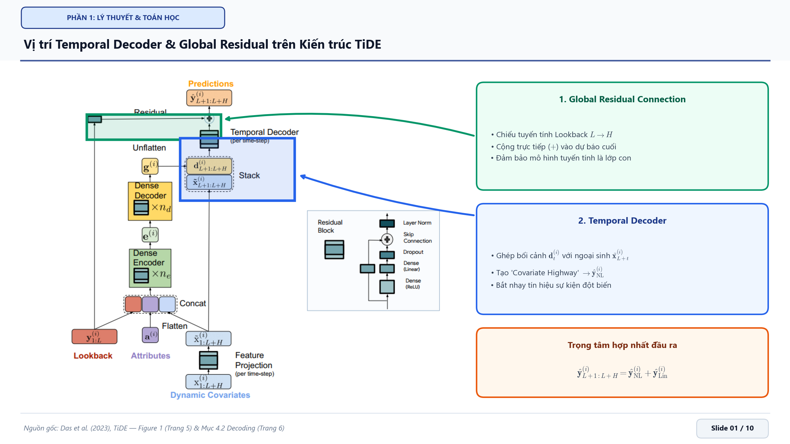
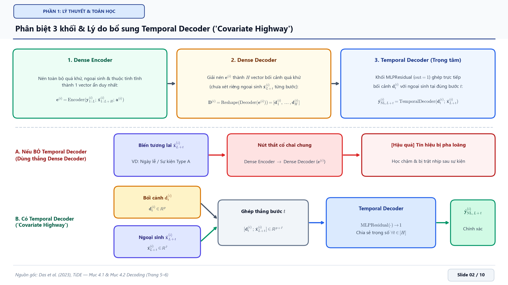
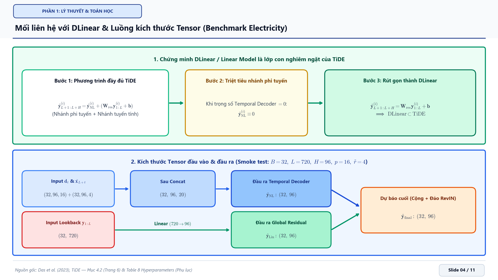
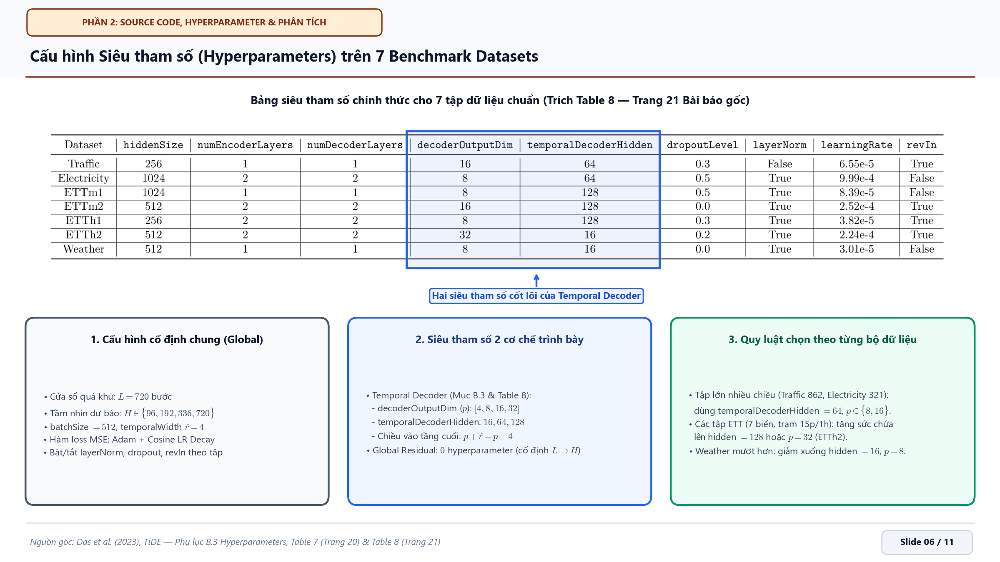
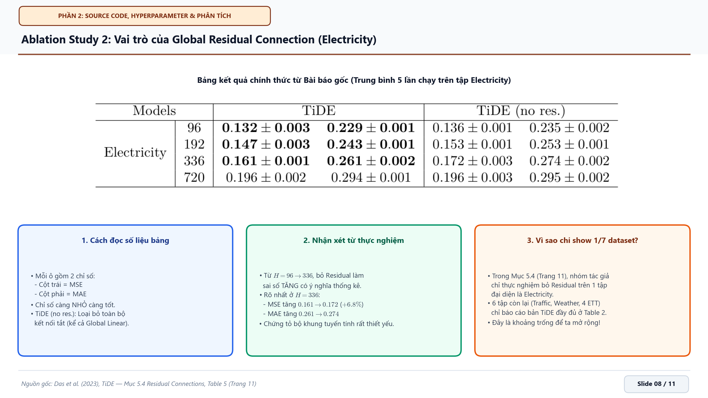
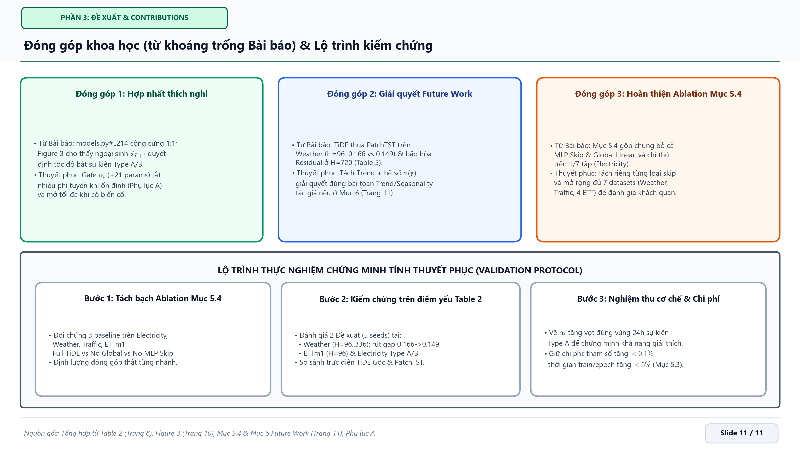

# 🎙️ KỊCH BẢN THUYẾT TRÌNH NỘI BỘ TỪNG SLIDE (INTERNAL TEAM SHARING SCRIPT)
## CHUYÊN ĐỀ: TEMPORAL DECODER & GLOBAL RESIDUAL CONNECTION TRONG MÔ HÌNH TiDE

> [!NOTE]
> **Bối cảnh sử dụng (Context):**  
> * **Đối tượng người nghe:** Toàn bộ thành viên trong nhóm đồ án / nhóm nghiên cứu TiDE.
> * **Mục tiêu bài nói:** **Giúp tất cả thành viên hiểu cặn kẽ, sâu sắc từ bản chất toán học, luồng tensor, mã nguồn thực tế đến lý do bài báo thiết kế như vậy**, từ đó cả nhóm thống nhất tư duy để cùng code và chạy thực nghiệm các đề xuất cải tiến.
> * **Phong cách trình bày:** Gần gũi, cởi mở, đậm chất kỹ thuật (Tech-talk / Code-walkthrough), xưng hô "mình" và "anh em / các bạn trong nhóm". Đi thẳng vào bản chất vấn đề, chỉ rõ các "bẫy" khi code và các cơ hội làm thực nghiệm cho nhóm.
> * **Tài liệu tham chiếu:** Khớp chính xác 1-đối-1 với **11 Slide** trong [`slide_images_gallery.md`](./slide_images_gallery.md) (Slide 01/11 đến Slide 11/11).

---

## ⏱️ PHÂN BỔ THỜI GIAN TOÀN BỘ BÀI NÓI (11 SLIDES)

---

## 📖 PHẦN 1: LÝ THUYẾT & TOÁN HỌC (SLIDES 01 – 04)

---

### 🟢 SLIDE 01 / 11 — ĐỊNH VỊ PHẠM VI TRÌNH BÀY TRÊN KIẾN TRÚC TỔNG THỂ

* **Ảnh slide:** `slide_01_vi_tri_kien_truc.png` ([Xem ảnh trong gallery](./slide_images_gallery.md#slide-01--11-11--định-vị-hai-cơ-chế-trên-figure-1-gốc-trang-5))
* **Thời lượng dự kiến:** 45 – 50 giây.
* **Mục tiêu slide:** Định vị ngay vị trí trên Hình 1 bài báo gốc; giải thích rõ nhóm mình đã đi tới đâu để anh em nắm được bức tranh tổng thể.

#### 🎙️ Lời thoại trình bày (Team Tech-talk):

> "Chào mọi người, như bạn trước vừa trình bày rất chi tiết cho nhóm mình, nửa dưới của kiến trúc TiDE đảm nhận việc nén toàn bộ chuỗi quá khứ và biến ngoại sinh qua `Dense Encoder`, rồi giải nén sơ bộ qua `Dense Decoder` để tạo ra các vector bối cảnh $d_t$.
> 
> Sang phần của mình, **mình sẽ không nói lại nửa dưới đó nữa**, mà chúng ta sẽ cùng mổ xẻ **hai khối nằm ở tầng cao nhất** — chính là hai cơ chế trực tiếp chốt ra kết quả dự báo $\hat{y}$ mà tác giả khoanh trên Hình 1 bài báo gốc:
> 
> 1. **Khối màu xanh dương ở trên:** `Temporal Decoder` — nhánh phi tuyến cục bộ.
> 2. **Mũi tên dài màu xanh lá cây ở bên phải:** `Global Residual Connection` — nhánh tuyến tính nối tắt từ quá khứ sang tương lai.
> 
> Anh em có thể tự hỏi: *'Tại sao một mạng nơ-ron sâu như TiDE đã có Encoder-Decoder rồi mà ở đầu ra lại phải chia làm 2 nhánh như thế này?'*. Chúng ta cùng sang Slide 02 để bóc tách lý do tại sao tác giả lại đẻ ra khối `Temporal Decoder` nhé."

* **🎬 Tương tác & Điểm nhấn màn hình (Visual Cues):**
  * Rê chuột hoặc trỏ vào nửa dưới bị làm mờ: *"Phần này bạn trước đã giải thích xong"*.
  * Khoanh vùng vào hộp xanh dương và mũi tên xanh lá: *"Phần của mình là 2 chốt chặn cuối cùng này"*.

---

### 🟢 SLIDE 02 / 11 — PHÂN BIỆT 3 KHỐI & CƠ CHẾ "COVARIATE HIGHWAY"

* **Ảnh slide:** `slide_02_phan_biet_3_khoi_va_highway.png` ([Xem ảnh trong gallery](./slide_images_gallery.md#slide-02--11-12--tách-3-card-riêng-biệt-dense-encoder--dense-decoder--temporal-decoder--cơ-chế-covariate-highway))
* **Thời lượng dự kiến:** 65 – 75 giây.
* **Mục tiêu slide:** Giúp nhóm phân biệt rạch ròi nhiệm vụ của 3 khối (Encoder - Dense Decoder - Temporal Decoder) và hiểu sâu trực giác khái niệm "Covariate Highway".

#### 🎙️ Lời thoại trình bày (Team Tech-talk):

> "Anh em nhìn vào Slide 02, mình tách riêng 3 khối đặt cạnh nhau để nhóm mình không bao giờ bị nhầm lẫn:
> 
> * `Dense Encoder`: Nén tất cả thành 1 vector ẩn toàn cục $e$.
> * `Dense Decoder`: Bung $e$ ra thành $H$ vector bối cảnh $d_t$ cho từng bước tương lai.
> * Còn **`Temporal Decoder`**: Anh em để ý công thức ở Thẻ 3, nó thực chất chỉ là **đúng một khối `MLPResidual` duy nhất có đầu ra bằng 1**. Ở mỗi bước thời gian $t$, nó lấy vector bối cảnh $d_t$ ghép với biến ngoại sinh tương lai tại đúng bước đó — tức $\tilde{x}_{L+t}$ — để tính ra một con số dự báo.
> 
> Chỗ này cực kỳ thú vị: **Tại sao tác giả không cho `Dense Decoder` dự báo thẳng ra luôn mà lại phải mất công tạo thêm `Temporal Decoder`?**
> 
> Tác giả gọi đây là cơ chế **'Covariate Highway' - Đường cao tốc cho biến ngoại sinh**:
> Giả sử ngày mai là *Black Friday* hoặc *Ngày của Mẹ*, nhu cầu mua sắm đột ngột tăng vọt gấp 3 lần. Nếu không có Temporal Decoder, thông tin sự kiện này bắt buộc phải đi vòng qua nút thắt cổ chai ở `Dense Encoder`. Mà nút thắt này lại nén chung mọi thứ, nên tín hiệu sự kiện cục bộ rất dễ bị pha loãng, làm mờ đi hoặc học rất chậm.
> 
> Nhờ có `Temporal Decoder`, biến ngoại sinh tương lai $\tilde{x}_{L+t}$ được đi trên một **đường cao tốc nối thẳng vào phép dự báo tại đúng ngày $t$**. Điều này giúp mô hình bắt sóng sự kiện đột biến cực kỳ nhạy bén!"

* **🎬 Tương tác & Điểm nhấn màn hình (Visual Cues):**
  * Chỉ vào Thẻ 2 rồi sang Thẻ 3: *"Dense Decoder chỉ làm nhiệm vụ giải nén bối cảnh, còn Temporal Decoder mới là nơi đón biến ngoại sinh tương lai"*.
  * Chỉ vào hình xe chạy trên cao tốc ở thẻ bên phải để anh em dễ hình dung ẩn dụ.

---

### 🟢 SLIDE 03 / 11 — HAI NHÁNH SONG SONG & PHƯƠNG TRÌNH TỔNG HỢP CUỐI CÙNG

* **Ảnh slide:** `slide_03_hai_nhanh_song_song.png` ([Xem ảnh trong gallery](./slide_images_gallery.md#slide-03--11-13--luồng-song-song-hai-cơ-chế--phương-trình-tổng-hợp-dự-báo-cuối-cùng))
* **Thời lượng dự kiến:** 55 – 65 giây.
* **Mục tiêu slide:** Chỉ rõ cho nhóm luồng dữ liệu chạy song song và công thức tổng hợp cuối cùng giữa nhánh phi tuyến và tuyến tính.

#### 🎙️ Lời thoại trình bày (Team Tech-talk):

> "Slide 03 thể hiện trọn vẹn luồng dữ liệu song song mà khi code nhóm mình sẽ hiện thực:
> 
> Nhìn vào sơ đồ, anh em thấy TiDE chia làm hai nhánh chạy độc lập hoàn toàn:
> 
> * **Nhánh trên (Phi tuyến):** Là `Temporal Decoder` vừa nói. Nó dùng chung một bộ trọng số cho toàn bộ $H$ bước tương lai, sinh ra vector dự báo phi tuyến $\hat{y}_{\text{NL}}$.
> * **Nhánh dưới (Tuyến tính):** Là `Global Residual Connection`. Nhánh này siêu đơn giản: nó chỉ là **đúng 1 tầng Linear thuần túy** — không ReLU, không Dropout, không chuẩn hóa gì cả. Tầng Linear này chiếu thẳng chuỗi quá khứ $y_{1:L}$ độ dài $L$ thành chuỗi tương lai độ dài $H$, sinh ra vector $\hat{y}_{\text{Lin}}$.
> 
> Và như công thức đóng khung ở giữa: TiDE **cộng trực tiếp hai nhánh này lại theo từng phần tử**:
> 
> $$
> \hat{y} = \hat{y}_{\text{NL}} + \hat{y}_{\text{Lin}}
> $$
> 
> Sau khi cộng xong, nếu lúc đầu có dùng RevIN thì ta chỉ cần thực hiện phép biến đổi ngược (nhân độ lệch chuẩn $\sigma$ rồi cộng trung bình $\mu$) để đưa về thang đo gốc.
> 
> Tại sao lại thiết kế một nhánh tuyến tính đơn giản như vậy chạy song song với mạng sâu? Mời mọi người xem chứng minh toán học ở Slide 04."

* **🎬 Tương tác & Điểm nhấn màn hình (Visual Cues):**
  * Dùng tay phân tách 2 luồng: nhánh trên gánh phi tuyến, nhánh dưới gánh tuyến tính, rồi chụm vào dấu cộng: *"Cộng thẳng hai mảng lại với nhau"*.

---

### 🟢 SLIDE 04 / 11 — CHỨNG MINH TOÁN HỌC: DLINEAR LÀ LỚP CON CỦA TiDE & LUỒNG TENSOR

* **Ảnh slide:** `slide_04_lien_he_dlinear_va_tensor.png` ([Xem ảnh trong gallery](./slide_images_gallery.md#slide-04--11-14--chứng-minh-toán-học-mối-liên-hệ-với-dlinear--luồng-kích-thước-tensor))
* **Thời lượng dự kiến:** 60 – 70 giây.
* **Mục tiêu slide:** Chứng minh toán học mối liên hệ với DLinear và chuẩn hóa kích thước Tensor cụ thể để anh em khi code PyTorch không bị lỗi mismatch shape.

#### 🎙️ Lời thoại trình bày (Team Tech-talk):

> "Slide 04 này có hai phần rất quan trọng cho cả lý thuyết lẫn lúc anh em mình code:
> 
> **Thứ nhất là vẻ đẹp toán học:**
> Nhóm tác giả bài báo có một nhận định rất tự tin: *Mô hình thuần tuyến tính như DLinear luôn là một lớp con của TiDE*. 
> Tại sao? Anh em nhìn vào công thức: Nếu trong quá trình train, toàn bộ nhánh phi tuyến bị triệt tiêu về 0, thì công thức TiDE lập tức trở thành: $\hat{y} = W_{\text{res}} \cdot y + b_{\text{res}}$. Đây chính là mô hình tuyến tính đơn tầng! 
> Điều này có nghĩa là TiDE có một 'lưới an toàn': Nhánh Linear lo trọn phần xu hướng cơ bản, còn nhánh nơ-ron sâu chỉ cần tập trung học phần dư khó nhằn.
> 
> **Thứ hai là luồng Tensor cụ thể — anh em code lưu ý kỹ bảng này:**
> Xét trên tập `Electricity` với cấu hình chuẩn $L=720, H=96, \text{batch}=32$:
> * Vector bối cảnh $d_t$ có shape `(32, 96, 16)`.
> * Ngoại sinh tương lai được nén thành `(32, 96, 4)`.
> * Ghép lại theo chiều cuối (`dim=-1`) ta được tensor `(32, 96, 20)`. Đưa qua `MLPResidual(out=1)` rồi squeeze chiều cuối, ta thu được đầu ra phi tuyến đúng bằng `(32, 96)`.
> * Nhánh Linear chiếu thẳng `(32, 720)` qua ma trận `(720, 96)` cũng ra đúng `(32, 96)`.
> * Cả hai đều là `(32, 96)` nên cộng thẳng vào nhau rất mượt, không cần broadcast."

* **🎬 Tương tác & Điểm nhấn màn hình (Visual Cues):**
  * Chỉ vào bảng Tensor: *"Nhớ là concat ở chiều cuối cùng `dim=-1`, lát nữa mình sẽ chỉ vị trí dòng code này trong repo"*.

---

## 💻 PHẦN 2: SOURCE CODE, HYPERPARAMETERS & ABLATION STUDY (SLIDES 05 – 08)

---

### 🟢 SLIDE 05 / 11 — SOURCE CODE CHÍNH THỨC & ÁNH XẠ PHƯƠNG TRÌNH TOÁN HỌC

* **Ảnh slide:** `slide_05_source_code_va_equation.png` ([Xem ảnh trong gallery](./slide_images_gallery.md#slide-05--11-21--source-code-chính-thức-modelspy--ánh-xạ-thẳng-ra-phương-trình-toán-học))
* **Thời lượng dự kiến:** 60 – 70 giây.
* **Mục tiêu slide:** Dẫn anh em đi soi trực tiếp từng dòng code TensorFlow trong repo chính thức của Google Research (`models.py`) đặt cạnh code PyTorch của nhóm mình.

#### 🎙️ Lời thoại trình bày (Team Tech-talk):

> "Bây giờ chúng ta cùng soi mã nguồn thực tế ở Slide 05.
> 
> Bên trái là code TensorFlow trong repo chính thức của Google Research ở file `tide/models.py`, còn bên phải là code PyTorch trong file `simulate_forward_pass.py` của nhóm mình:
> 
> * **Đoạn khởi tạo `__init__`:**
>   * Dòng 141: `self.linear = tf.keras.layers.Dense(self.pred_len)` — chính là nhánh Global Residual.
>   * Dòng 150: `self.final_decoder = MLPResidual(output_dim=1)` — chính là Temporal Decoder.
> * **Đoạn thực thi `call`:**
>   * Dòng 203: `residual_out = self.linear(past_ts)` tính nhánh tuyến tính, shape ra `[B, H]`.
>   * Dòng 211: `final_in = tf.concat([decoder_out, enc_fut], axis=1)` — ghép bối cảnh và ngoại sinh. Anh em chú ý: bên TensorFlow tác giả để chiều thời gian ở cuối nên họ dùng `tf.transpose` ở dòng 212, còn bên PyTorch nhóm mình để sẵn dạng `[B, H, C]` nên `torch.cat` ở `dim=-1` là chạy thẳng được luôn.
>   * **Và mấu chốt là dòng 214:** `out += residual_out` — đúng một dòng code cộng dồn!
> 
> Nhìn vào đây anh em thấy code của Google viết cực kỳ bám sát toán học, không có mánh lới gì phức tạp cả."

* **🎬 Tương tác & Điểm nhấn màn hình (Visual Cues):**
  * Rà chuột theo 3 cặp tương ứng: Khởi tạo $\leftrightarrow$ Tính toán $\leftrightarrow$ Dòng 214 cộng kết quả.
  * Nhắc anh em lưu ý sự khác nhau giữa thứ tự trục trong TensorFlow vs PyTorch.

---

### 🟢 SLIDE 06 / 11 — CẤU HÌNH SIÊU THAM SỐ TRÊN 7 BENCHMARK DATASETS

* **Ảnh slide:** `slide_06_cau_hinh_hyperparameter.png` ([Xem ảnh trong gallery](./slide_images_gallery.md#slide-06--11-22--cấu-hình-siêu-tham-số-hyperparameters-trên-7-benchmark-datasets))
* **Thời lượng dự kiến:** 55 – 65 giây.
* **Mục tiêu slide:** Hướng dẫn nhóm cách tác giả tinh chỉnh siêu tham số từ Bảng 7 và 8 trong Phụ lục; nắm quy luật để áp dụng khi nhóm chạy thực nghiệm.

#### 🎙️ Lời thoại trình bày (Team Tech-talk):

> "Slide 06 là bảng cấu hình siêu tham số chính thức của bài báo trên cả 7 bộ dữ liệu (trích từ Bảng 7 và 8 ở Phụ lục B.3).
> 
> Khi nhóm mình chạy thực nghiệm hoặc tune mô hình, anh em cần nhớ 3 quy luật này:
> 
> 1. **Những tham số giữ cố định cho mọi tập:** Cửa sổ quá khứ $L=720$, batch size 512, và số chiều nén ngoại sinh $\tilde{r}=4$.
> 2. **Sự tối giản của 2 cơ chế mình phụ trách:** Nhánh `Global Residual` **không có bất kỳ siêu tham số ẩn nào cần tune**, vì ma trận cố định $720 \times H$. Còn `Temporal Decoder` chỉ có đúng 2 siêu tham số: số chiều bối cảnh $p$ và số nơ-ron ẩn `temporalDecoderHidden`.
> 3. **Quy luật chọn theo độ phức tạp dữ liệu:**
>    * Với tập dữ liệu lớn nhiều chuỗi như `Traffic` (862 chuỗi) hay `Electricity` (321 chuỗi): tác giả chọn `hidden = 64`, $p$ từ 8 đến 16.
>    * Với các tập trạm biến áp `ETT` (chỉ có 7 chuỗi nhưng biến động phức tạp): họ tăng `hidden = 128` hoặc $p=32$.
>    * Với tập `Weather` (chuỗi khí tượng biến thiên mượt): chỉ cần `hidden = 16` và $p=8$ là đủ.
> 
> Như vậy khi nhóm mình train thử, không cần tốn công Grid Search quá nhiều biến, cứ bám sát các mức 16, 64, 128 này là ổn."

* **🎬 Tương tác & Điểm nhấn màn hình (Visual Cues):**
  * Chỉ vào hai cột $p$ và `temporalDecoderHidden`: *"Cả phần decoder này chỉ cần nhớ 2 cột này thôi"*.

---

### 🟢 SLIDE 07 / 11 — ABLATION STUDY 1: VAI TRÒ TEMPORAL DECODER (ẢNH GỐC TỪ BÀI BÁO)

* **Ảnh slide:** `slide_07_ablation_temporal_decoder.png` ([Xem ảnh trong gallery](./slide_images_gallery.md#slide-07--11-23--ablation-study-1-vai-trò-temporal-decoder-ảnh-gốc-từ-bài-báo))
* **Thời lượng dự kiến:** 65 – 75 giây.
* **Mục tiêu slide:** Phân tích thí nghiệm Ablation Study 1 (Figure 3 bài báo gốc); giải thích cho nhóm hiểu hiện tượng mô hình bị "trật nhịp" sau sự kiện đột biến nếu thiếu Temporal Decoder.

#### 🎙️ Lời thoại trình bày (Team Tech-talk):

> "Để xem Temporal Decoder có thực sự cần thiết hay không, tác giả làm một thí nghiệm rất thông minh ở Hình 3 bài báo gốc, thể hiện trên Slide 07:
> 
> Họ lấy dữ liệu phụ tải điện `Electricity` và chèn vào một sự kiện đột biến nhân tạo gọi là **Type A**: nhân biên độ phụ tải lên gấp 3 đến 3.2 lần trong 24 giờ. Và họ đánh giá mô hình chỉ sau **đúng 1 Epoch huấn luyện duy nhất**!
> 
> Mọi người nhìn kỹ biểu đồ bên trái:
> * Trong 24 giờ xảy ra sự kiện: Cả hai bản đều nhận biết phụ tải tăng cao nhờ biến ngoại sinh.
> * Nhưng **ngay sau khi sự kiện kết thúc (từ mốc thời gian 200 trở đi):** Bản màu xanh lá cây — tức bản **bỏ đi Temporal Decoder** — bị 'ngáo' hoàn toàn! Dự báo bị vọt lên cao bất thường, tác giả dùng từ là *'thrown off'*, vì nút thắt cổ chai Dense Encoder bị ám ảnh bởi biến cố cũ và chưa kịp điều chỉnh lại.
> * Trong khi đó, bản TiDE đầy đủ có Temporal Decoder (đường màu xanh dương) đã **lập tức hồi phục về mức bình thường ngay tại bước tiếp theo**.
> 
> Thí nghiệm này cho nhóm mình thấy: Temporal Decoder chính là chiếc 'van an toàn' giúp mô hình phản xạ nhạy bén với sự kiện cục bộ mà không làm loạn nhận thức dài hạn của bộ mã hóa."

* **🎬 Tương tác & Điểm nhấn màn hình (Visual Cues):**
  * Dùng chuột rê vào đoạn sau mốc 200 trên đồ thị: chỉ rõ đường xanh lá vọt lên sai số lớn, trong khi đường xanh dương bám sát đường thực tế màu đen.

---

### 🟢 SLIDE 08 / 11 — ABLATION STUDY 2: VAI TRÒ GLOBAL RESIDUAL CONNECTION (`ELECTRICITY`)

* **Ảnh slide:** `slide_08_ablation_global_residual.png` ([Xem ảnh trong gallery](./slide_images_gallery.md#slide-08--11-24--ablation-study-2-vai-trò-residual-connections-ảnh-gốc-từ-bài-báo--electricity))
* **Thời lượng dự kiến:** 65 – 75 giây.
* **Mục tiêu slide:** Cho nhóm thấy bằng chứng số liệu khi bỏ residual (MSE tăng +6.8%) và "bóc tách" khoảng trống nghiên cứu của bài báo để nhóm mình khai thác.

#### 🎙️ Lời thoại trình bày (Team Tech-talk):

> "Sang Slide 08 là thí nghiệm Ablation thứ hai: Chuyện gì sẽ xảy ra nếu ta bỏ các kết nối thặng dư (Residual Connections)?
> 
> Nhìn vào Bảng 5 từ bài báo gốc:
> * Khi bỏ residual (`TiDE no res.`): ở mọi tầm dự báo từ 96 đến 336, sai số MSE và MAE đều tăng vọt. Đặc biệt tại $H=336$, MSE tăng từ `0.161` lên `0.172` — tức **sai số tăng tới $+6.8\%$**.
> * Điều này khẳng định: Bắt một mạng nơ-ron sâu tự học lại xu hướng tuyến tính từ đầu là một sai lầm; đường tắt Linear giúp mô hình giữ vững phong độ ổn định hơn rất nhiều.
> 
> **Nhưng anh em để ý chi tiết này — đây chính là cơ hội cho nhóm mình:**
> Tác giả làm thí nghiệm trên 7 bộ dữ liệu, nhưng **chỉ công bố kết quả bỏ residual trên đúng 1 tập duy nhất là `Electricity`**, còn 6 tập kia (`Traffic`, `Weather`, `ETTh1/2`, `ETTm1/2`) họ không hề công bố bảng so sánh khi bỏ residual!
> 
> Thêm vào đó, nếu nhìn lại dòng code lúc nãy: `out += residual_out`, hai nhánh đang bị **cộng cứng cố định 1:1** ở mọi thời điểm và mọi chuỗi. Liệu tỷ lệ 1:1 có luôn luôn đúng không? Đây chính là điểm tựa để mình đề xuất hướng cải tiến cho đồ án nhóm ở Phần 3."

* **🎬 Tương tác & Điểm nhấn màn hình (Visual Cues):**
  * Khoanh vào con số `+6.8% MSE`: nhấn mạnh tác động to lớn của kết nối tắt.
  * Nhấn mạnh: *"Tác giả bỏ ngỏ 6 tập dữ liệu, đây là đất diễn để nhóm mình làm thực nghiệm"*.

---

## 💡 PHẦN 3: ĐỀ XUẤT CẢI TIẾN & PHÂN CÔNG THỰC NGHIỆM (SLIDES 09 – 11)

---

### 🟢 SLIDE 09 / 11 — ĐỀ XUẤT 1: CỔNG HỢP NHẤT THÍCH NGHI (*ADAPTIVE GATED FUSION*)

* **Ảnh slide:** `slide_09_de_xuat_1_gated_fusion.png` ([Xem ảnh trong gallery](./slide_images_gallery.md#slide-09--11-31--đề-xuất-1-cổng-hợp-nhất-thích-nghi-adaptive-gated-fusion-vs-cộng-cứng-11))
* **Thời lượng dự kiến:** 70 – 80 giây.
* **Mục tiêu slide:** Trình bày đề xuất cải tiến 1 cho nhóm: Thay phép cộng cứng 1:1 bằng Cổng thích nghi $\alpha_t$; chứng minh chi phí cực rẻ chỉ +21 tham số.

#### 🎙️ Lời thoại trình bày (Team Tech-talk):

> "Như mình vừa đặt vấn đề, phép cộng `out += residual_out` trong code gốc là cộng cứng 1:1. Nhưng chuỗi thời gian thực tế luôn có sự chuyển đổi chế độ: lúc thì êm ả phẳng lặng, lúc thì biến động dữ dội. Khi chuỗi đang êm ả mà ta cứ cộng 1:1 thì nhánh phi tuyến sẽ vô tình bơm thêm nhiễu vào kết quả.
> 
> Vì vậy, ở Slide 09, mình đề xuất nhóm mình triển khai: **Adaptive Gated Fusion - Cổng hợp nhất thích nghi theo thời gian**.
> 
> Thay vì cộng 1:1, ta cho đi qua một mạng cổng siêu nhẹ để sinh ra hệ số $\alpha_t \in (0, 1)$ cho từng bước tương lai:
> 
> $$
> \hat{y}_t = \alpha_t \cdot \hat{y}_{\text{NL}, t} + (1 - \alpha_t) \cdot \hat{y}_{\text{Lin}, t}
> $$
> 
> * Khi chuỗi bình yên: $\alpha_t \to 0$, mô hình tự động tin vào nhánh tuyến tính để tránh nhiễu.
> * Khi có biến cố ngoại sinh mạnh: $\alpha_t \to 1$, cổng mở rộng để ưu tiên nhánh Temporal Decoder xử lý sự kiện.
> 
> **Anh em trong nhóm yên tâm về mặt tài nguyên:**
> Mạng cổng này chỉ nhận đầu vào là vector ghép $[d_t ; \tilde{x}_{L+t}]$ đi qua một lớp Linear rồi qua Sigmoid. Với $p=16, \tilde{r}=4$, số tham số phát sinh thêm chỉ là:
> 
> $$
> 16 + 4 + 1 = 21 \text{ tham số!}
> $$
> 
> Thêm đúng 21 tham số, chiếm chưa tới 0.01% mô hình, hoàn toàn không lo nặng máy hay tràn VRAM khi train trên Kaggle!"

* **🎬 Tương tác & Điểm nhấn màn hình (Visual Cues):**
  * Chỉ vào sơ đồ so sánh TiDE gốc (cộng 1:1) vs Gated Fusion (có van điều tiết $\alpha_t$).
  * Nhấn mạnh con số **21 tham số** để giải tỏa nỗi lo mô hình bị nặng của anh em.

---

### 🟢 SLIDE 10 / 11 — ĐỀ XUẤT 2: TÁCH XU HƯỚNG KIỂU DLINEAR CHO NHÁNH TUYẾN TÍNH

* **Ảnh slide:** `slide_10_de_xuat_2_trend_aware.png` ([Xem ảnh trong gallery](./slide_images_gallery.md#slide-10--11-32--đề-xuất-2-tách-xu-hướng-kiểu-dlinear-cho-nhánh-tuyến-tính-trend-aware-dual-stream))
* **Thời lượng dự kiến:** 60 – 70 giây.
* **Mục tiêu slide:** Trình bày đề xuất cải tiến 2: Tích hợp bộ lọc trượt Moving Average kiểu DLinear vào nhánh tuyến tính để chống nhiễu gai (outliers).

#### 🎙️ Lời thoại trình bày (Team Tech-talk):

> "Bên cạnh việc can thiệp ở đầu ra, Slide 10 là **Đề xuất cải tiến thứ hai: Tách xu hướng kiểu DLinear cho nhánh tuyến tính (Trend-Aware Dual-Stream)**.
> 
> Anh em xem lại code gốc: nhánh `self.linear` nhận trực tiếp toàn bộ chuỗi quá khứ $y_{1:L}$ thô để chiếu sang tương lai. Điều này có một rủi ro: Nếu trong quá khứ xuất hiện vài điểm nhiễu gai (*outliers*), phép nhân ma trận tuyến tính sẽ nhân rộng sai số này sang toàn bộ 96 bước tương lai.
> 
> Để khắc phục, mình đề xuất áp dụng đúng triết lý của bài báo DLinear:
> * Dùng một bộ lọc trượt `Moving Average` ($k=25$) để bóc tách chuỗi quá khứ thành 2 phần: thành phần xu hướng mượt $y_{\text{trend}}$ và thành phần dao động dư $y_{\text{rem}}$.
> * Cho mỗi thành phần đi qua một lớp Linear riêng: một tầng chuyên học đường xu hướng dài hạn, một tầng chuyên học chu kỳ dao động ngắn hạn.
> 
> Nhờ đó, đường nền tuyến tính sẽ cực kỳ mượt và ổn định, không bị méo mó khi gặp dữ liệu có nhiều gai nhiễu."

* **🎬 Tương tác & Điểm nhấn màn hình (Visual Cues):**
  * Chỉ vào khối `Moving Average` ở giữa sơ đồ: *"Biến 1 chuỗi thô thành 2 thành phần độc lập trước khi chiếu tuyến tính"*.

---

### 🟢 SLIDE 11 / 11 — ĐÓNG GÓP KHOA HỌC & PHÂN CÔNG THỰC NGHIỆM TRÊN KAGGLE

* **Ảnh slide:** `slide_11_contributions_va_roadmap.png` ([Xem ảnh trong gallery](./slide_images_gallery.md#slide-11--11-33--đóng-góp-khoa-học-contributions--lộ-trình-kiểm-chứng-thực-nghiệm))
* **Thời lượng dự kiến:** 60 – 75 giây.
* **Mục tiêu slide:** Chốt lại 3 đóng góp khoa học cho đồ án của nhóm và kêu gọi anh em thảo luận phân công chạy thực nghiệm đối chứng trên Kaggle.

#### 🎙️ Lời thoại trình bày (Team Tech-talk):

> "Để chốt lại bài chia sẻ, Slide 11 tổng hợp 3 giá trị học thuật mà nhóm mình có thể đưa vào báo cáo đồ án:
> 
> 1. **Khắc phục sự cứng nhắc của phép cộng 1:1:** Giúp mô hình linh hoạt thích ứng với chuỗi thời gian đa chế độ.
> 2. **Tăng tính giải thích được (Explainability):** Không còn là hộp đen, nhóm mình có thể vẽ biểu đồ giá trị $\alpha_t$ theo thời gian để minh họa cho thầy cô thấy: lúc nào mô hình đang tin vào lịch sử tuyến tính, lúc nào mô hình đang dựa vào sự kiện ngoại sinh.
> 
> **Kế hoạch hành động cụ thể cho nhóm mình:**
> * Mình đã chuẩn bị sẵn file script hướng dẫn chạy song song 2 tài khoản Kaggle trong thư mục `kaggle/` để nhân đôi GPU lên 60 giờ/tuần.
> * Nhóm mình có thể chia nhau chạy 3 phiên bản đối chứng: (1) TiDE Gốc, (2) TiDE + Gated Fusion, và (3) TiDE + Trend-Aware trên các tập `Electricity` và `ETTh1`.
> * Mỗi bản chạy 5 seed độc lập để lấy trung bình MSE và MAE, đảm bảo kết quả thực nghiệm hoàn toàn khách quan và thuyết phục.
> 
> Toàn bộ phần phân tích về `Temporal Decoder` và `Global Residual` của mình đến đây là hoàn tất. Bây giờ mời anh em cùng thảo luận, chỗ nào chưa rõ hoặc cần chỉnh sửa code thì anh em mình cùng bàn luôn nhé!"

* **🎬 Tương tác & Điểm nhấn màn hình (Visual Cues):**
  * Chỉ vào bảng lộ trình thực nghiệm: *"Nhóm mình đã có sẵn code và tài nguyên Kaggle, chỉ cần bấm máy chạy"*.
  * Mở nụ cười, chuyển sang màn hình thảo luận / terminal code để cả nhóm cùng trao đổi.

---

## 💬 GỢI Ý GIẢI ĐÁP THẮC MẮC NỘI BỘ (INTERNAL TEAM Q&A & GOTCHAS)

Dưới đây là các câu hỏi mà thành viên trong nhóm rất dễ thắc mắc khi cùng đọc code và làm đồ án, kèm câu trả lời cặn kẽ để bạn giải thích cho nhóm:

### ❓ Câu hỏi 1: *"Ủa lúc code PyTorch, tại sao `decoder_out` có shape `(B, H, p)` mà `enc_fut` lại có shape `(B, H, r_tilde)`? Sao ghép vào nhau được?"*
> **Giải thích cho bạn:**  
> "Vì ở bước tiền xử lý, toàn bộ biến ngoại sinh tương lai $x_{L+1:L+H}$ đã được chiếu qua một tầng nén `Linear` độc lập để đưa số chiều về đúng $\tilde{r} = 4$. Do cả hai tensor đều có chung 2 chiều đầu là batch size $B$ và horizon $H$, nên ta dùng `torch.cat([decoder_out, enc_fut], dim=-1)` thì tensor mới sẽ có shape là `(B, H, p + r_tilde)` = `(B, H, 20)`. Chiều thời gian $H$ được giữ nguyên cho từng bước!"

### ❓ Câu hỏi 2: *"Sao trong code của Google họ lại dùng `tf.transpose(final_in, (0, 2, 1))` làm gì cho phức tạp vậy?"*
> **Giải thích cho bạn:**  
> "À, đó là do cách tổ chức dữ liệu của TensorFlow trong code gốc của Google: họ xếp chiều đặc trưng $C$ ở vị trí thứ 1 và chiều thời gian $H$ ở vị trí thứ 2, tức dạng `(B, C, H)`. Nhưng khối `MLPResidual` lại yêu cầu chiều cần biến đổi phải nằm ở cuối cùng, nên họ phải hoán vị trục `transpose` để đưa $H$ ra giữa và $C$ về cuối thành `(B, H, C)`. Bên PyTorch nhóm mình đã chủ động để dạng `[B, H, C]` ngay từ đầu nên không cần transpose dòng này nữa, code nhìn sạch hơn hẳn!"

### ❓ Câu hỏi 3: *"Nếu thêm Cổng Gating $\alpha_t$, lúc mới train chưa học được gì thì mô hình có bị mất ổn định không?"*
> **Giải thích cho bạn:**  
> "Không hề bị nhé! Mẹo ở đây là khi khởi tạo lớp Linear của cổng, mình đặt bias $b_g = 0$ và trọng số $W_g$ rất nhỏ quanh 0. Khi đó $\text{Sigmoid}(0) \approx 0.5$, nghĩa là tại epoch đầu tiên, mô hình sẽ tự động chia đều tỷ lệ 50:50 cho cả hai nhánh — tức hoạt động tương đương hệt như TiDE gốc. Sau đó qua từng epoch, cổng mới từ từ học cách ưu tiên nhánh nào tùy theo bối cảnh."
