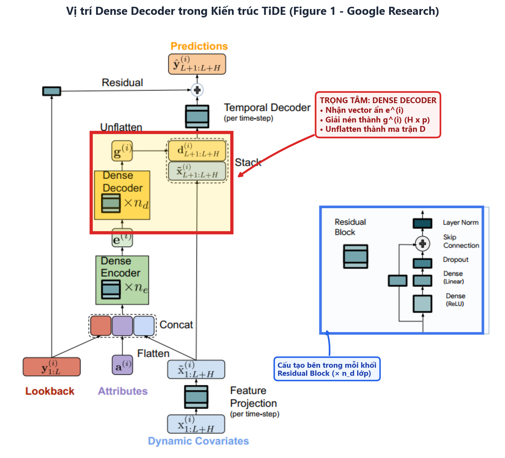
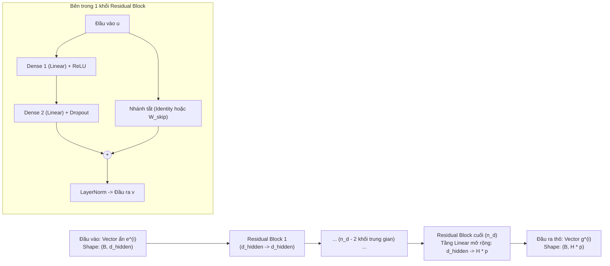

# SLIDE 01: KIẾN TRÚC DENSE DECODER ($n_d$ RESIDUAL BLOCKS) & LÝ DO THIẾT KẾ

> **Mục tiêu Slide 01:** Giúp người nghe định vị chính xác khối `Dense Decoder` nằm ở đâu trong kiến trúc TiDE, cấu tạo bên trong gồm $n_d$ khối `ResidualBlock`, chức năng và lý do thiết kế phi truyền thống (không dùng RNN/Attention).

---

## 🖼️ Hình Ảnh & Sơ Đồ Minh Họa Đưa Lên Slide

### Sơ đồ kiến trúc chi tiết cấu tạo bên trong $n_d$ Residual Blocks:

---

## 📋 Nội Dung Cụ Thể Trình Bày Trên Slide (Hiển thị cho khán giả)

### 1. Chức năng cốt lõi
* **Cầu nối giải mã:** Tiếp nhận duy nhất **1 vector bối cảnh ẩn toàn cục** $e^{(i)}$ (do Dense Encoder nén từ quá khứ và ngoại sinh).
* **Chuyển đổi không gian:** Giải nén vector toàn cục này thành ma trận đặc trưng tương lai, phân bổ **riêng biệt cho từng bước thời gian dự báo** $t \in \{1, \dots, H\}$.

### 2. Kiến trúc phần cứng ($n_d$ Residual Blocks)
* Không sử dụng tầng hồi quy (RNN/LSTM) hay cơ chế tự chú ý (Self-Attention).
* Cấu tạo thuần từ chuỗi $n_d$ khối **Residual Block** xếp chồng nối tiếp (mặc định $n_d = 1$ hoặc $2$):
  * **Các khối trung gian ($1 \dots n_d - 1$):** Bảo toàn số chiều ẩn ($d_{\text{hidden}} \to d_{\text{hidden}}$), nhánh tắt truyền thẳng (`Identity`), giúp trích xuất đặc trưng phi tuyến sâu.
  * **Khối cuối cùng ($n_d$):** Tầng chiếu ngõ ra mở rộng số chiều từ $d_{\text{hidden}} \to \mathbf{H \times p}$, buộc phải dùng ma trận chiếu tuyến tính $W_{\text{skip}}$ ở nhánh tắt để khớp chiều.

### 3. Tại sao Google Research thiết kế như vậy?
1. **Triệt tiêu tích lũy sai số:** Sinh biểu diễn cho cả $H$ bước cùng lúc thay vì đoán từng bước nối đuôi nhau.
2. **Tận dụng tối đa GPU:** Mạng MLP thuần túy cho phép tính toán song song toàn bộ ma trận trọng số với độ trễ tuần tự $O(1)$.
3. **Tách bạch trách nhiệm:** Dense Decoder lo phần **bối cảnh quá khứ**; việc ghép với **biến ngoại sinh tương lai** được nhường cho tầng Temporal Decoder phía sau.

---

## 🔗 Vị Trí Mã Nguồn Tham Chiếu Cho Slide 01
* **Repo gốc Google Research (`models.py`):**
  * Lớp khối thặng dư `MLPResidual`: [models.py#L29-L61](https://github.com/google-research/google-research/blob/master/tide/models.py#L29-L61)
  * Hàm xếp chồng $n_d$ khối `_make_dnn_residual`: [models.py#L64-L81](https://github.com/google-research/google-research/blob/master/tide/models.py#L64-L81)
  * Khởi tạo `self.decoder`: [models.py#L133-L140](https://github.com/google-research/google-research/blob/master/tide/models.py#L133-L140)
* **Code PyTorch mô phỏng trong dự án:**
  * Lớp `ResidualBlock`: [simulate_forward_pass.py#L35-L67](../../../simulate_forward_pass.py#L35-L67)
  * Khởi tạo `self.dense_decoder`: [simulate_forward_pass.py#L115-L126](../../../simulate_forward_pass.py#L115-L126)

---

## 🎙️ Kịch Bản Lời Nói Thuyết Trình (Speaker Notes)

> *"Xin chào các bạn. Nhìn vào sơ đồ tổng thể Figure 1 của bài báo bên trái màn hình, ngay phía trên khối Dense Encoder màu xanh chính là phần trọng tâm của em: **Dense Decoder** (được khoanh khung đỏ).*
>
> *Sau khi Encoder nén toàn bộ chuỗi lịch sử và biến ngoại sinh thành một vector bối cảnh duy nhất là $e^{(i)}$, nhiệm vụ của Dense Decoder là phải 'giải nén' vector cô đọng này để tạo ra nguyên liệu dự báo cho toàn bộ $H$ bước tương lai.*
>
> *Về mặt cấu tạo bên trong, Dense Decoder cực kỳ tinh gọn: nó gồm $n_d$ khối Residual Block xếp chồng lên nhau—thường chỉ cần 2 khối. Mỗi khối gồm 2 tầng Linear, hàm kích hoạt ReLU, Dropout chống học vẹt, cộng nhánh tắt Skip Connection và chuẩn hóa LayerNorm. Điểm mấu chốt các bạn cần nhớ là: các khối đầu giữ nguyên chiều ẩn $d_{\text{hidden}}$, nhưng riêng **khối cuối cùng thứ $n_d$** sẽ có tầng ngõ ra mở rộng thành $H \times p$ chiều. Vậy tại sao lại là $H \times p$ và nó biến đổi toán học ra sao, chúng ta cùng sang Slide tiếp theo."*
