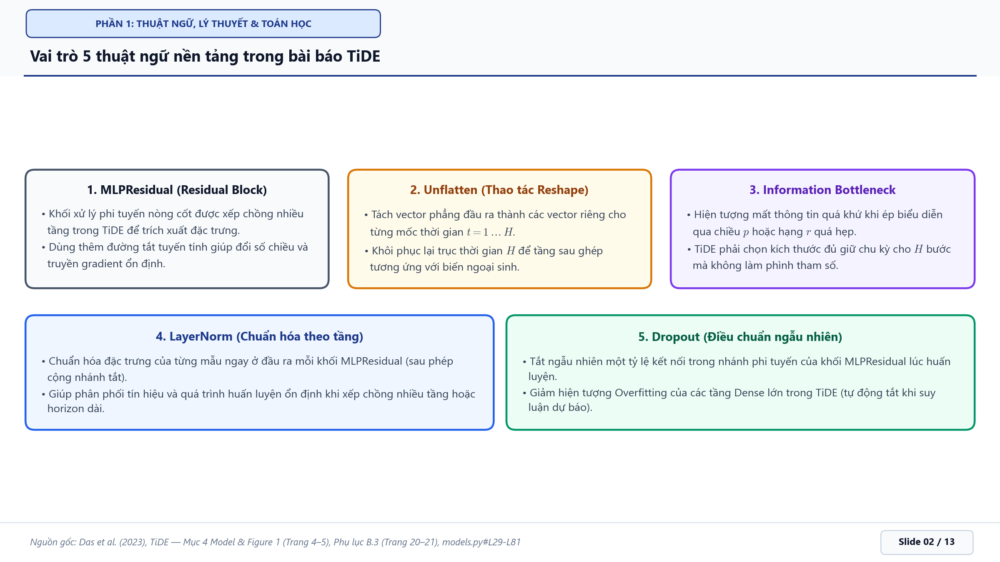
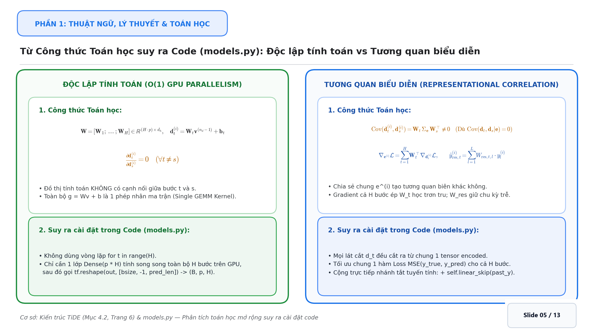
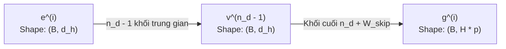

# PHẦN 1: Thuật Ngữ, Kiến Trúc & Toán Học Khối Dense Decoder (Slide 02 – 07)

> **Phạm vi:** 5 Slide đầu tiên xây dựng nền tảng từ điển thuật ngữ, định vị khối Dense Decoder trên kiến trúc tổng thể TiDE, làm rõ cơ chế One-Shot Non-autoregressive, công thức toán học qua $n_d$ khối Residual Block và phép `Reshape (Unflatten)` sinh ra các vector bối cảnh từng bước $\mathbf{d}_t^{(i)}$.

---

## Slide 02 / 13 — Vai trò 5 thuật ngữ nền tảng trong bài báo TiDE

### Giải thích ngắn gọn vai trò từng thuật ngữ trong bài báo TiDE

| STT | Thuật ngữ | Vai trò trong bài báo TiDE |
| :--- | :--- | :--- |
| **1** | **MLPResidual (Residual Block)** | Khối xử lý phi tuyến nòng cốt được xếp chồng nhiều tầng trong TiDE để trích xuất đặc trưng; dùng thêm đường tắt tuyến tính giúp đổi số chiều và truyền gradient ổn định. |
| **2** | **Unflatten (Thao tác Reshape)** | Tách vector phẳng đầu ra thành các vector riêng cho từng mốc thời gian $t = 1 \dots H$, khôi phục trục thời gian $H$ để tầng sau ghép tương ứng với biến ngoại sinh. |
| **3** | **Information Bottleneck** | Hiện tượng mất thông tin quá khứ khi ép biểu diễn qua chiều $p$ hoặc hạng $r$ quá hẹp; TiDE phải chọn kích thước đủ giữ chu kỳ cho $H$ bước mà không làm phình tham số. |
| **4** | **LayerNorm (Chuẩn hóa theo tầng)** | Chuẩn hóa đặc trưng của từng mẫu ngay ở đầu ra mỗi khối `MLPResidual` (sau phép cộng nhánh tắt), giúp phân phối tín hiệu và quá trình huấn luyện ổn định khi xếp chồng nhiều tầng hoặc horizon dài. |
| **5** | **Dropout (Điều chuẩn ngẫu nhiên)** | Tắt ngẫu nhiên một tỷ lệ kết nối trong nhánh phi tuyến của khối `MLPResidual` lúc huấn luyện nhằm giảm Overfitting của các tầng Dense lớn (tự động tắt khi suy luận dự báo). |

---

## Slide 03 / 13 — Vị trí khối Dense Decoder & Unflatten trên Kiến trúc TiDE

### Điểm nhấn trên Figure 1 (Trang 5 Bài báo gốc)

- **Đầu vào:** Vector ẩn $\mathbf{e}^{(i)}$ có Shape: $(B, d_h)$ do Dense Encoder truyền lên.
- **Xử lý bên trong Dense Decoder:** Đi qua $n_d$ khối Residual Block để giải nén toàn bộ horizon cùng lúc thành $\mathbf{g}^{(i)}$ có Shape: $(B, H \cdot p)$.
- **Đầu ra sau Unflatten:** Vector phẳng $\mathbf{g}^{(i)}$ được reshape thành ma trận $\mathbf{D}^{(i)}$ và tách ra $H$ lát cắt $\mathbf{d}_t^{(i)}$ để xếp chồng cùng ngoại sinh $\tilde{\mathbf{x}}_{L+t}^{(i)}$ ở tầng kế tiếp.

---

## Slide 04 / 13 — Cách Dense Decoder tạo biểu diễn toàn horizon (One-Shot vs Tuần tự)

### So sánh trực diện hai cơ chế giải mã

1. **Autoregressive truyền thống (RNN / Seq2Seq / Decoder tự hồi quy):** Sinh $\hat{y}_1 \rightarrow$ nạp lại dự đoán đó làm đầu vào đoán $\hat{y}_2 \rightarrow \dots \rightarrow \hat{y}_H$. Độ phức tạp tuần tự $O(H)$ trên GPU và làm **tích lũy sai số (Error Accumulation)** nghiêm trọng khi $H = 336, 720$.

$$
P(y_1, y_2, \dots, y_H \mid y_{1:L}) = \prod_{t=1}^H P(y_t \mid y_{1:L}, y_1, \dots, y_{t-1})
$$

2. **Dense Decoder (TiDE — Non-autoregressive / One-Shot):** Từ vector toàn cục $\mathbf{e}^{(i)}$, khối cuối $n_d$ chiếu 1 lần duy nhất ra vector phẳng $\mathbf{g}^{(i)}$ có Shape: $(B, H \cdot p)$ chứa trọn vẹn biểu diễn của toàn bộ $H$ bước tương lai. Không phụ thuộc kết quả dự đoán bước trước, triệt tiêu hoàn toàn tích lũy sai số giữa các bước và đạt độ phức tạp $O(1)$ song song hóa triệt để trên GPU (nhanh hơn Transformer 5–10 lần theo Mục 5.3).

---

## Slide 05 / 13 — Từ Công thức Toán học suy ra Code (`models.py`): Độc lập tính toán vs Tương quan biểu diễn

### Liên kết từ Công thức Toán học sang cài đặt `models.py`

#### A. Độc lập tính toán ($O(1)$ GPU Parallelism)

* **1. Công thức Toán học:** Tách ma trận chiếu tầng cuối $\mathbf{W} \in \mathbb{R}^{(H\cdot p)\times d_h}$ thành $H$ khối con $\mathbf{W}_t \in \mathbb{R}^{p\times d_h}$ theo từng bước thời gian:

$$
\mathbf{d}_t^{(i)} = \mathbf{W}_t \mathbf{v}^{(n_d-1)} + \mathbf{b}_t \implies \frac{\partial \mathbf{d}_t^{(i)}}{\partial \mathbf{d}_s^{(i)}} = \mathbf{0} \quad (\forall t \neq s)
$$

Đồ thị tính toán không có cạnh nối giữa bước $t$ và $s$; toàn bộ $\mathbf{g} = \mathbf{W}\mathbf{v} + \mathbf{b}$ là 1 phép nhân ma trận duy nhất (Single GEMM Kernel).

* **2. Suy ra cài đặt trong Code (`models.py`):** Không dùng vòng lặp `for t in range(H)`. Tác giả chỉ cần đúng **1 lớp `Dense(p * H)`** tính song song toàn bộ $H$ bước trên GPU, rồi gọi `tf.reshape(out, [bsize, -1, pred_len])` để tạo tensor `(B, p, H)`.

#### B. Tương quan biểu diễn (Representational Correlation)

* **1. Công thức Toán học:**

$$
\mathrm{Cov}(\mathbf{d}_t^{(i)}, \mathbf{d}_s^{(i)}) = \mathbf{W}_t \, \mathbf{\Sigma}_{\mathbf{e}} \, \mathbf{W}_s^\top \neq \mathbf{0}, \qquad \nabla_{\mathbf{e}^{(i)}} \mathcal{L} = \sum_{t=1}^H \mathbf{W}_t^\top \nabla_{\mathbf{d}_t^{(i)}} \mathcal{L}, \qquad \hat{y}_{\mathrm{res}, t}^{(i)} = \sum_{l=1}^L W_{\mathrm{res}, t, l} \cdot y_l^{(i)}
$$

Việc chia sẻ chung vector ẩn $\mathbf{e}^{(i)}$ tạo ra hiệp phương sai biên khác không; Gradient tổng hợp từ cả $H$ bước ép $\mathbf{W}_t$ học tính trơn tru; và $\mathbf{W}_{\mathrm{res}}$ giữ trực tiếp chu kỳ trễ.

* **2. Suy ra cài đặt trong Code (`models.py`):** Mọi lát cắt $\mathbf{d}_t$ đều cắt ra từ chung 1 tensor `encoded`; tối ưu chung 1 hàm Loss `MSE(y_true, y_pred)` cho cả $H$ bước; và cộng trực tiếp nhánh tắt tuyến tính `+ self.linear_skip(past_y)`.

---

## Slide 06 / 13 — Kiến trúc $n_d$ Residual Blocks & Chuyển $\mathbf{e}^{(i)}$ thành $\mathbf{g}^{(i)}$

### Hệ phương trình biến đổi qua từng tầng

Đặt đầu vào $\mathbf{v}^{(0)} = \mathbf{e}^{(i)} \in \mathbb{R}^{d_h}$ (Shape: $(B, d_h)$):

**1. Với các khối trung gian** $l \in \{1, \dots, n_d - 1\}$ (khi $n_d = 1$ thì bỏ qua tầng này):

$$
\mathbf{v}^{(l)} = \mathrm{LayerNorm}\!\left(\mathrm{Dropout}\!\left(\mathbf{W}_2^{(l)}\,\mathrm{ReLU}\!\left(\mathbf{W}_1^{(l)}\mathbf{v}^{(l-1)} + \mathbf{b}_1^{(l)}\right) + \mathbf{b}_2^{(l)}\right) + \mathbf{W}_{\mathrm{res}}^{(l)}\mathbf{v}^{(l-1)}\right)
$$

Mỗi khối trung gian duy trì kích thước Shape: $(B, d_h)$.

**2. Với khối cuối cùng** $l = n_d$ (Chiếu từ không gian ẩn $d_h$ sang không gian phẳng $H \cdot p$):

$$
\mathbf{g}^{(i)} = \mathrm{LayerNorm}\!\left(\mathrm{Dropout}\!\left(\mathbf{W}_2^{(n_d)}\,\mathrm{ReLU}\!\left(\mathbf{W}_1^{(n_d)}\mathbf{v}^{(n_d-1)} + \mathbf{b}_1^{(n_d)}\right) + \mathbf{b}_2^{(n_d)}\right) + \mathbf{W}_{\mathrm{skip}}^{(n_d)}\mathbf{v}^{(n_d-1)}\right)
$$

Vì chiều đầu ra $(H \cdot p) \neq d_h$, khối cuối **bắt buộc** dùng ma trận chiếu đường tắt $\mathbf{W}_{\mathrm{skip}}^{(n_d)} \in \mathbb{R}^{(H \cdot p) \times d_h}$ để đồng bộ kích thước cộng residual. Đầu ra $\mathbf{g}^{(i)}$ có Shape: $(B, H \cdot p)$.

---

## Slide 07 / 13 — Vai trò Reshape (Unflatten) & Ý nghĩa vector $\mathbf{d}_t^{(i)}$

### Giải phẫu thao tác tách chiều thời gian

Từ vector phẳng $\mathbf{g}^{(i)}$ (Shape: $(B, H \cdot p)$), phép Unflatten định hình lại ma trận 2 chiều:

$$
\mathbf{D}^{(i)} = \mathrm{Reshape}\!\left(\mathbf{g}^{(i)}\right) = \begin{bmatrix} \mathbf{d}_1^{(i)} & \mathbf{d}_2^{(i)} & \dots & \mathbf{d}_H^{(i)} \end{bmatrix} \in \mathbb{R}^{p \times H}
$$

- **Ký hiệu Shape tổng quát:** PyTorch dùng `g.view(-1, H, p)` cho Shape: $(B, H, p)$ (còn TensorFlow trong bài báo gốc reshape thành Shape: $(B, p, H)$). Khi lấy ví dụ thực tế trên Electricity (Table 8): $B = 512, d_h = 1024, H = 96, p = 8 \Rightarrow H \cdot p = 768$.
- **Chi phí bằng 0** ($O(1)$): `view` / `reshape` chỉ thay đổi thông số bước nhảy (stride metadata) trên vùng nhớ liên tục, không cấp phát hay sao chép bộ nhớ mới.
- **Ý nghĩa từng lát cắt** $\mathbf{d}_t^{(i)}$ (Shape mỗi bước: $(B, p)$): Là vector tóm tắt bối cảnh quá khứ **dành riêng cho thời điểm tương lai** $t$, mang đúng pha chu kỳ và xu hướng tương ứng với độ trễ $t$ để đưa sang tầng kế tiếp kết hợp ngoại sinh $\tilde{\mathbf{x}}_{L+t}^{(i)}$.
