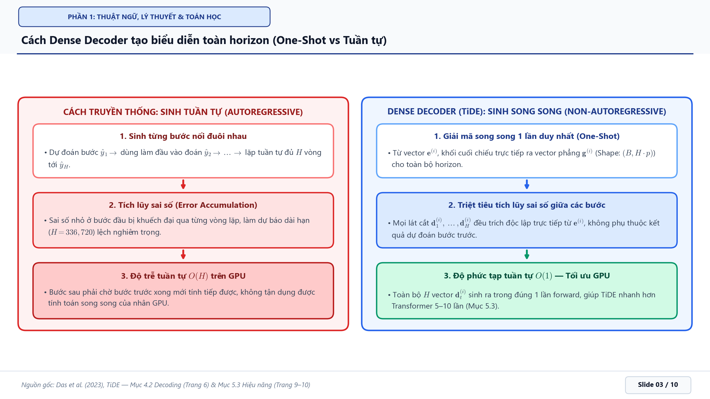
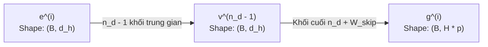

# PHẦN 1: Thuật Ngữ, Kiến Trúc & Toán Học Khối Dense Decoder (Slide 01 – 05)

> **Phạm vi:** 5 Slide đầu tiên xây dựng nền tảng từ điển thuật ngữ, định vị khối Dense Decoder trên kiến trúc tổng thể TiDE, làm rõ cơ chế One-Shot Non-autoregressive, công thức toán học qua $n_d$ khối Residual Block và phép `Reshape (Unflatten)` sinh ra các vector bối cảnh từng bước $\mathbf{d}_t^{(i)}$.

---

## Slide 01 / 10 — Thuật ngữ nền tảng cốt lõi (Nền tảng trước khi vào kiến trúc)

### Giải thích chi tiết 5 thuật ngữ nền tảng trước khi đi vào kiến trúc

| STT | Thuật ngữ | Bản chất & Ký hiệu Shape tổng quát |
| :--- | :--- | :--- |
| **1** | **MLPResidual (Residual Block)** | Đơn vị xử lý cơ sở xếp thành chuỗi tầng trong TiDE: nhánh chính gồm `Dense(ReLU)` $\rightarrow$ `Dense(Linear)` + Dropout, cộng song song với nhánh tắt tuyến tính `lin_res` và `LayerNorm`. |
| **2** | **Unflatten (Thao tác Reshape)** | Phép biến đổi hình học khôi phục lại trục thời gian $H$ từ một vector phẳng có Shape: $(B, H \cdot p)$ sang ma trận 2 chiều Shape: $(B, H, p)$ trong PyTorch (hoặc $(B, p, H)$ trong TF), chi phí bộ nhớ $O(1)$. |
| **3** | **Information Bottleneck (Nghẽn cổ chai thông tin)** | Hiện tượng mất mát thông tin khi ép biểu diễn đi qua không gian có số chiều $p$ (hoặc hạng $r$) quá nhỏ ($p = 1, 2$), thiếu dung lượng mã hóa đồng thời pha chu kỳ và xu hướng; ngược lại $p$ quá lớn ($32, 64$) gây bùng nổ tham số và Overfitting. |
| **4** | **LayerNorm (Chuẩn hóa theo tầng)** | Chuẩn hóa trên chiều đặc trưng của từng mẫu độc lập ($\hat{\mathbf{x}} = \frac{\mathbf{x} - \mu}{\sqrt{\sigma^2 + \epsilon}} \odot \gamma + \beta$), đặt ở đầu ra sau phép cộng nhánh tắt (`+ lin_res`) giúp ổn định phân phối và gradient; điều chỉnh qua cờ `use_layer_norm` $\in \{\text{True}, \text{False}\}$. |
| **5** | **Dropout (Điều chuẩn ngẫu nhiên)** | Tắt ngẫu nhiên một tỷ lệ $p_{\mathrm{drop}}$ các nơ-ron nhánh phi tuyến lúc train (nhân bù $\frac{1}{1 - p_{\mathrm{drop}}}$), đặt ngay sau `Dense(Linear)` để chống Overfitting; tỷ lệ `dropout_rate` $\in \{0.0, 0.1, 0.2, 0.3, 0.5\}$ và tự động tắt khi inference. |

---

## Slide 02 / 10 — Vị trí khối Dense Decoder & Unflatten trên Kiến trúc TiDE

### Điểm nhấn trên Figure 1 (Trang 5 Bài báo gốc)

- **Đầu vào:** Vector ẩn $\mathbf{e}^{(i)}$ có Shape: $(B, d_h)$ do Dense Encoder truyền lên.
- **Xử lý bên trong Dense Decoder:** Đi qua $n_d$ khối Residual Block để giải nén toàn bộ horizon cùng lúc thành $\mathbf{g}^{(i)}$ có Shape: $(B, H \cdot p)$.
- **Đầu ra sau Unflatten:** Vector phẳng $\mathbf{g}^{(i)}$ được reshape thành ma trận $\mathbf{D}^{(i)}$ và tách ra $H$ lát cắt $\mathbf{d}_t^{(i)}$ để xếp chồng cùng ngoại sinh $\tilde{\mathbf{x}}_{L+t}^{(i)}$ ở tầng kế tiếp.

---

## Slide 03A / 10 — Cách Dense Decoder tạo biểu diễn toàn horizon (One-Shot vs Tuần tự)

### So sánh trực diện hai cơ chế giải mã

1. **Autoregressive truyền thống (RNN / Seq2Seq / Decoder tự hồi quy):** Sinh $\hat{y}_1 \rightarrow$ nạp lại dự đoán đó làm đầu vào đoán $\hat{y}_2 \rightarrow \dots \rightarrow \hat{y}_H$. Độ phức tạp tuần tự $O(H)$ trên GPU và làm **tích lũy sai số (Error Accumulation)** nghiêm trọng khi $H = 336, 720$.

$$
P(y_1, y_2, \dots, y_H \mid y_{1:L}) = \prod_{t=1}^H P(y_t \mid y_{1:L}, y_1, \dots, y_{t-1})
$$

2. **Dense Decoder (TiDE — Non-autoregressive / One-Shot):** Từ vector toàn cục $\mathbf{e}^{(i)}$, khối cuối $n_d$ chiếu 1 lần duy nhất ra vector phẳng $\mathbf{g}^{(i)}$ có Shape: $(B, H \cdot p)$ chứa trọn vẹn biểu diễn của toàn bộ $H$ bước tương lai. Không phụ thuộc kết quả dự đoán bước trước, triệt tiêu hoàn toàn tích lũy sai số giữa các bước và đạt độ phức tạp $O(1)$ song song hóa triệt để trên GPU (nhanh hơn Transformer 5–10 lần theo Mục 5.3).

---

## Slide 03B / 10 — Bản chất toán học: Độc lập tính toán vs Tương quan biểu diễn

### Hệ thống công thức toán học chứng minh

#### A. Công thức chứng minh: Độc lập tính toán triệt để ($O(1)$ Hardware Parallelism)

Xét ma trận chiếu tầng cuối cùng $\mathbf{W} \in \mathbb{R}^{(H \cdot p) \times d_h}$ và vector định thiên $\mathbf{b} \in \mathbb{R}^{H \cdot p}$. Ta phân rã $\mathbf{W}$ và $\mathbf{b}$ thành $H$ khối con xếp chồng theo trục thời gian:

$$
\mathbf{W} = \begin{bmatrix} \mathbf{W}_1 \\ \mathbf{W}_2 \\ \vdots \\ \mathbf{W}_H \end{bmatrix}, \quad \mathbf{b} = \begin{bmatrix} \mathbf{b}_1 \\ \mathbf{b}_2 \\ \vdots \\ \mathbf{b}_H \end{bmatrix} \quad (\text{với } \mathbf{W}_t \in \mathbb{R}^{p \times d_h},\; \mathbf{b}_t \in \mathbb{R}^p)
$$

Lát cắt vector bối cảnh tại từng thời điểm $t \in \{1, \dots, H\}$ được tính trực tiếp từ tầng ẩn $\mathbf{v}^{(n_d-1)} \in \mathbb{R}^{d_h}$:

$$
\mathbf{d}_t^{(i)} = \mathbf{W}_t \mathbf{v}^{(n_d-1)} + \mathbf{b}_t \in \mathbb{R}^p
$$

Đạo hàm riêng chéo giữa hai thời điểm bất kỳ $t$ và $s$ ($t \neq s$):

$$
\frac{\partial \mathbf{d}_t^{(i)}}{\partial \mathbf{d}_s^{(i)}} = \mathbf{0}, \quad \forall t \neq s
$$

> [!NOTE]
> **Ý nghĩa Độc lập tính toán:** Đồ thị tính toán hoàn toàn không tồn tại cạnh nối giữa bước $t$ và bước $s$. Phép tính $\mathbf{g}^{(i)} = \mathbf{W}\mathbf{v} + \mathbf{b}$ được GPU thực thi như 1 toán tử GEMM (General Matrix Multiply) song song đa luồng duy nhất với độ sâu đồ thị là $O(1)$.

#### B. Công thức chứng minh: Tương quan biểu diễn sâu sắc (Representational Correlation)

Dù độc lập về đồ thị tính toán, các vector bối cảnh $\{\mathbf{d}_t^{(i)}\}_{t=1}^H$ vẫn tương quan chặt chẽ nhờ 3 cơ chế toán học:

**1. Luật Hiệp phương sai toàn phần (Law of Total Covariance / Latent Coupling):**

Theo mô hình biến ẩn, khi đã biết trạng thái toàn cục $\mathbf{e}^{(i)}$, các bước tương lai độc lập có điều kiện: $\mathrm{Cov}(\mathbf{d}_t^{(i)}, \mathbf{d}_s^{(i)} \mid \mathbf{e}^{(i)}) = \mathbf{0}$. Tuy nhiên, hiệp phương sai biên giữa hai bước thời gian bất kỳ $t$ và $s$ ($t \neq s$) được khai triển:

$$
\mathrm{Cov}(\mathbf{d}_t^{(i)}, \mathbf{d}_s^{(i)}) = \mathbb{E}_{\mathbf{e}}\!\left[\underbrace{\mathrm{Cov}(\mathbf{d}_t^{(i)}, \mathbf{d}_s^{(i)} \mid \mathbf{e}^{(i)})}_{= \mathbf{0}}\right] + \mathrm{Cov}_{\mathbf{e}}\!\left(\mathbb{E}[\mathbf{d}_t^{(i)} \mid \mathbf{e}^{(i)}], \, \mathbb{E}[\mathbf{d}_s^{(i)} \mid \mathbf{e}^{(i)}]\right)
$$

$$
\mathrm{Cov}(\mathbf{d}_t^{(i)}, \mathbf{d}_s^{(i)}) = \mathbf{W}_t \, \mathbf{\Sigma}_{\mathbf{e}} \, \mathbf{W}_s^\top \neq \mathbf{0}
$$

Trong đó $\mathbf{\Sigma}_{\mathbf{e}} = \mathrm{Cov}(\mathbf{e}^{(i)}) \in \mathbb{R}^{d_h \times d_h}$ là ma trận hiệp phương sai của vector bối cảnh toàn cục. Vì $\mathbf{\Sigma}_{\mathbf{e}}$ có các phần tử khác không, ma trận $\mathbf{W}_t \mathbf{\Sigma}_{\mathbf{e}} \mathbf{W}_s^\top$ kích hoạt mối tương quan qua lại liên tục giữa mọi cặp bước thời gian $(t, s)$.

**2. Động lực học liên kết Gradient khi Backpropagation (Joint Optimization):**

Với hàm mất mát toàn horizon $\mathcal{L} = \sum_{t=1}^H \ell(\hat{y}_t^{(i)}, y_t^{(i)})$, gradient cập nhật vector ẩn chung $\mathbf{e}^{(i)}$ nhận thông tin từ toàn bộ $H$ bước đồng thời:

$$
\nabla_{\mathbf{e}^{(i)}} \mathcal{L} = \sum_{t=1}^H \mathbf{W}_t^\top \nabla_{\mathbf{d}_t^{(i)}} \mathcal{L}
$$

Mọi bước $t$ cùng đồng thời kéo vector $\mathbf{e}^{(i)}$ về một nghiệm tối ưu trên đa tạp dữ liệu chung, buộc các khối $\mathbf{W}_t$ phải học được tính trơn tru thời gian (temporal smoothness) nhịp nhàng qua từng bước.

**3. Khóa tương quan chuỗi trực tiếp qua Global Residual:**

$$
\hat{\mathbf{y}}_{\mathrm{res}}^{(i)} = \mathbf{W}_{\mathrm{res}} \mathbf{y}_{1:L}^{(i)} \implies \hat{y}_{\mathrm{res}, t}^{(i)} = \sum_{l=1}^L W_{\mathrm{res}, t, l} \cdot y_l^{(i)}
$$

Ma trận $\mathbf{W}_{\mathrm{res}} \in \mathbb{R}^{H \times L}$ nối trực tiếp từ lịch sử sang tương lai, bảo đảm mọi tương quan trễ tuyến tính (như chu kỳ 24h, 168h) được truyền dẫn nguyên vẹn sang từng bước dự báo $t$.

---

## Slide 04 / 10 — Kiến trúc $n_d$ Residual Blocks & Chuyển $\mathbf{e}^{(i)}$ thành $\mathbf{g}^{(i)}$

### Hệ phương trình biến đổi qua từng tầng

Đặt đầu vào $\mathbf{v}^{(0)} = \mathbf{e}^{(i)} \in \mathbb{R}^{d_h}$ (Shape: $(B, d_h)$):

**1. Với các khối trung gian** $l \in \{1, \dots, n_d - 1\}$ (khi $n_d = 1$ thì bỏ qua tầng này):

$$
\mathbf{v}^{(l)} = \mathrm{LayerNorm}\!\left(\mathrm{Dropout}\!\left(\mathbf{W}_2^{(l)}\,\mathrm{ReLU}\!\left(\mathbf{W}_1^{(l)}\mathbf{v}^{(l-1)} + \mathbf{b}_1^{(l)}\right) + \mathbf{b}_2^{(l)}\right) + \mathbf{W}_{\mathrm{res}}^{(l)}\mathbf{v}^{(l-1)}\right)
$$

Mỗi khối trung gian duy trì kích thước Shape: $(B, d_h)$.

**2. Với khối cuối cùng** $l = n_d$ (Chiếu từ không gian ẩn $d_h$ sang không gian phẳng $H \cdot p$):

$$
\mathbf{g}^{(i)} = \mathrm{LayerNorm}\!\left(\mathrm{Dropout}\!\left(\mathbf{W}_2^{(n_d)}\,\mathrm{ReLU}\!\left(\mathbf{W}_1^{(n_d)}\mathbf{v}^{(n_d-1)} + \mathbf{b}_1^{(n_d)}\right) + \mathbf{b}_2^{(n_d)}\right) + \mathbf{W}_{\mathrm{skip}}^{(n_d)}\mathbf{v}^{(n_d-1)}\right)
$$

Vì chiều đầu ra $(H \cdot p) \neq d_h$, khối cuối **bắt buộc** dùng ma trận chiếu đường tắt $\mathbf{W}_{\mathrm{skip}}^{(n_d)} \in \mathbb{R}^{(H \cdot p) \times d_h}$ để đồng bộ kích thước cộng residual. Đầu ra $\mathbf{g}^{(i)}$ có Shape: $(B, H \cdot p)$.

---

## Slide 05 / 10 — Vai trò Reshape (Unflatten) & Ý nghĩa vector $\mathbf{d}_t^{(i)}$

### Giải phẫu thao tác tách chiều thời gian

Từ vector phẳng $\mathbf{g}^{(i)}$ (Shape: $(B, H \cdot p)$), phép Unflatten định hình lại ma trận 2 chiều:

$$
\mathbf{D}^{(i)} = \mathrm{Reshape}\!\left(\mathbf{g}^{(i)}\right) = \begin{bmatrix} \mathbf{d}_1^{(i)} & \mathbf{d}_2^{(i)} & \dots & \mathbf{d}_H^{(i)} \end{bmatrix} \in \mathbb{R}^{p \times H}
$$

- **Ký hiệu Shape tổng quát:** PyTorch dùng `g.view(-1, H, p)` cho Shape: $(B, H, p)$ (còn TensorFlow trong bài báo gốc reshape thành Shape: $(B, p, H)$). Khi lấy ví dụ thực tế trên Electricity (Table 8): $B = 512, d_h = 1024, H = 96, p = 8 \Rightarrow H \cdot p = 768$.
- **Chi phí bằng 0** ($O(1)$): `view` / `reshape` chỉ thay đổi thông số bước nhảy (stride metadata) trên vùng nhớ liên tục, không cấp phát hay sao chép bộ nhớ mới.
- **Ý nghĩa từng lát cắt** $\mathbf{d}_t^{(i)}$ (Shape mỗi bước: $(B, p)$): Là vector tóm tắt bối cảnh quá khứ **dành riêng cho thời điểm tương lai** $t$, mang đúng pha chu kỳ và xu hướng tương ứng với độ trễ $t$ để đưa sang tầng kế tiếp kết hợp ngoại sinh $\tilde{\mathbf{x}}_{L+t}^{(i)}$.
