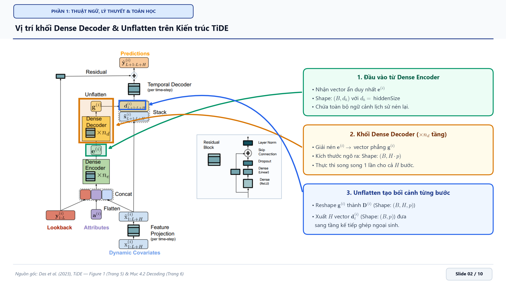
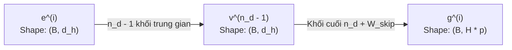

# PHẦN 1: Thuật Ngữ, Kiến Trúc & Toán Học Khối Dense Decoder (Slide 01 – 05)

> **Phạm vi:** 5 Slide đầu tiên xây dựng nền tảng từ điển thuật ngữ, định vị khối Dense Decoder trên kiến trúc tổng thể TiDE, làm rõ cơ chế One-Shot Non-autoregressive, công thức toán học qua $n_d$ khối Residual Block và phép `Reshape (Unflatten)` sinh ra các vector bối cảnh từng bước $\mathbf{d}_t^{(i)}$.

---

## Slide 01 / 10 — Thuật ngữ nền tảng cốt lõi (Nền tảng trước khi vào kiến trúc)

### Giải thích chi tiết 3 thuật ngữ nền tảng trước khi đi vào kiến trúc

| STT | Thuật ngữ | Bản chất & Ký hiệu Shape tổng quát |
| :--- | :--- | :--- |
| **1** | **MLPResidual (Residual Block)** | Đơn vị xử lý cơ sở xếp thành chuỗi tầng trong TiDE: nhánh chính gồm `Dense(ReLU)` $\rightarrow$ `Dense(Linear)` + Dropout, cộng song song với nhánh tắt tuyến tính `lin_res` và `LayerNorm`. |
| **2** | **Unflatten (Thao tác Reshape)** | Phép biến đổi hình học khôi phục lại trục thời gian $H$ từ một vector phẳng có Shape: $(B, H \cdot p)$ sang ma trận 2 chiều Shape: $(B, H, p)$ trong PyTorch (hoặc $(B, p, H)$ trong TF), chi phí bộ nhớ $O(1)$. |
| **3** | **Information Bottleneck (Nghẽn cổ chai thông tin)** | Hiện tượng mất mát thông tin khi ép biểu diễn đi qua không gian có số chiều $p$ (hoặc hạng $r$) quá nhỏ ($p = 1, 2$), thiếu dung lượng mã hóa đồng thời pha chu kỳ và xu hướng; ngược lại $p$ quá lớn ($32, 64$) gây bùng nổ tham số và Overfitting. |

---

## Slide 02 / 10 — Vị trí khối Dense Decoder & Unflatten trên Kiến trúc TiDE

### Điểm nhấn trên Figure 1 (Trang 5 Bài báo gốc)

- **Đầu vào:** Vector ẩn $\mathbf{e}^{(i)}$ có Shape: $(B, d_h)$ do Dense Encoder truyền lên.
- **Xử lý bên trong Dense Decoder:** Đi qua $n_d$ khối Residual Block để giải nén toàn bộ horizon cùng lúc thành $\mathbf{g}^{(i)}$ có Shape: $(B, H \cdot p)$.
- **Đầu ra sau Unflatten:** Vector phẳng $\mathbf{g}^{(i)}$ được reshape thành ma trận $\mathbf{D}^{(i)}$ và tách ra $H$ lát cắt $\mathbf{d}_t^{(i)}$ để xếp chồng cùng ngoại sinh $\tilde{\mathbf{x}}_{L+t}^{(i)}$ ở tầng kế tiếp.

---

## Slide 03 / 10 — Cách Dense Decoder tạo biểu diễn toàn horizon (One-Shot vs Tuần tự)

### So sánh trực diện hai cơ chế giải mã

1. **Autoregressive truyền thống (RNN / Seq2Seq / Decoder tự hồi quy):** Sinh $\hat{y}_1 \rightarrow$ nạp lại dự đoán đó làm đầu vào đoán $\hat{y}_2 \rightarrow \dots \rightarrow \hat{y}_H$. Độ phức tạp tuần tự $O(H)$ trên GPU và làm **tích lũy sai số (Error Accumulation)** nghiêm trọng khi $H = 336, 720$.
2. **Dense Decoder (TiDE — Non-autoregressive / One-Shot):** Từ $\mathbf{e}^{(i)}$, khối cuối $n_d$ chiếu 1 phát duy nhất ra vector phẳng $\mathbf{g}^{(i)}$ có Shape: $(B, H \cdot p)$ chứa biểu diễn của toàn bộ $H$ bước tương lai. Không phụ thuộc kết quả dự đoán bước trước, triệt tiêu hoàn toàn tích lũy sai số giữa các bước và đạt độ phức tạp $O(1)$ song song hóa triệt để trên GPU (nhanh hơn Transformer 5–10 lần theo Mục 5.3).

---

## Slide 04 / 10 — Kiến trúc $n_d$ Residual Blocks & Chuyển $\mathbf{e}^{(i)}$ thành $\mathbf{g}^{(i)}$

### Hệ phương trình biến đổi qua từng tầng

Đặt đầu vào $\mathbf{v}^{(0)} = \mathbf{e}^{(i)} \in \mathbb{R}^{d_h}$ (Shape: $(B, d_h)$):

**1. Với các khối trung gian** $l \in \{1, \dots, n_d - 1\}$ (khi $n_d = 1$ thì bỏ qua tầng này):

$$
\mathbf{v}^{(l)} = \mathrm{LayerNorm}\!\left(\mathrm{Dropout}\!\left(\mathbf{W}_2^{(l)}\,\mathrm{ReLU}\!\left(\mathbf{W}_1^{(l)}\mathbf{v}^{(l-1)} + \mathbf{b}_1^{(l)}\right) + \mathbf{b}_2^{(l)}\right) + \mathbf{W}_{\mathrm{res}}^{(l)}\mathbf{v}^{(l-1)}\right)
$$

Mỗi khối trung gian duy trì kích thước Shape: $(B, d_h)$.

**2. Với khối cuối cùng** $l = n_d$ (Chiếu từ không gian ẩn $d_h$ sang không gian phẳng $H \cdot p$):

$$
\mathbf{g}^{(i)} = \mathrm{LayerNorm}\!\left(\mathrm{Dropout}\!\left(\mathbf{W}_2^{(n_d)}\,\mathrm{ReLU}\!\left(\mathbf{W}_1^{(n_d)}\mathbf{v}^{(n_d-1)} + \mathbf{b}_1^{(n_d)}\right) + \mathbf{b}_2^{(n_d)}\right) + \mathbf{W}_{\mathrm{skip}}^{(n_d)}\mathbf{v}^{(n_d-1)}\right)
$$

Vì chiều đầu ra $(H \cdot p) \neq d_h$, khối cuối **bắt buộc** dùng ma trận chiếu đường tắt $\mathbf{W}_{\mathrm{skip}}^{(n_d)} \in \mathbb{R}^{(H \cdot p) \times d_h}$ để đồng bộ kích thước cộng residual. Đầu ra $\mathbf{g}^{(i)}$ có Shape: $(B, H \cdot p)$.

---

## Slide 05 / 10 — Vai trò Reshape (Unflatten) & Ý nghĩa vector $\mathbf{d}_t^{(i)}$

### Giải phẫu thao tác tách chiều thời gian

Từ vector phẳng $\mathbf{g}^{(i)}$ (Shape: $(B, H \cdot p)$), phép Unflatten định hình lại ma trận 2 chiều:

$$
\mathbf{D}^{(i)} = \mathrm{Reshape}\!\left(\mathbf{g}^{(i)}\right) = \begin{bmatrix} \mathbf{d}_1^{(i)} & \mathbf{d}_2^{(i)} & \dots & \mathbf{d}_H^{(i)} \end{bmatrix} \in \mathbb{R}^{p \times H}
$$

- **Ký hiệu Shape tổng quát:** PyTorch dùng `g.view(-1, H, p)` cho Shape: $(B, H, p)$ (còn TensorFlow trong bài báo gốc reshape thành Shape: $(B, p, H)$). Khi lấy ví dụ thực tế trên Electricity (Table 8): $B = 512, d_h = 1024, H = 96, p = 8 \Rightarrow H \cdot p = 768$.
- **Chi phí bằng 0** ($O(1)$): `view` / `reshape` chỉ thay đổi thông số bước nhảy (stride metadata) trên vùng nhớ liên tục, không cấp phát hay sao chép bộ nhớ mới.
- **Ý nghĩa từng lát cắt** $\mathbf{d}_t^{(i)}$ (Shape mỗi bước: $(B, p)$): Là vector tóm tắt bối cảnh quá khứ **dành riêng cho thời điểm tương lai** $t$, mang đúng pha chu kỳ và xu hướng tương ứng với độ trễ $t$ để đưa sang tầng kế tiếp kết hợp ngoại sinh $\tilde{\mathbf{x}}_{L+t}^{(i)}$.
