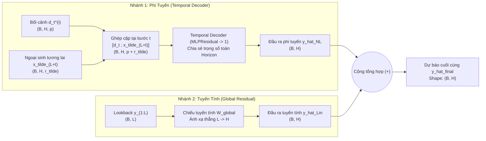

# SLIDE 01 (PHẦN 1): LÝ THUYẾT & TOÁN HỌC — TEMPORAL DECODER VÀ GLOBAL RESIDUAL CONNECTION

> **Mục tiêu Slide 01 (Phần 1):** Trình bày trọn vẹn lý thuyết, lý do thiết kế, công thức toán học và kích thước Tensor của **hai cơ chế trực tiếp tạo ra dự báo cuối cùng**, giải quyết các nội dung:
> 1. Cách **Temporal Decoder** kết hợp $d_t^{(i)}$ với *future covariates* tại thời điểm tương ứng.
> 2. **Vì sao** TiDE bổ sung Temporal Decoder thay vì sử dụng trực tiếp đầu ra Dense Decoder?
> 3. Cách **Global Residual Connection** ánh xạ tuyến tính *lookback* thành *horizon*.
> 4. Cách **tổng hợp đầu ra nonlinear và linear** để tạo dự báo cuối cùng.
> 5. **Mối liên hệ với DLinear** (chứng minh DLinear là tập con nghiêm ngặt của TiDE).

---

## 🖼️ Hình Ảnh & Sơ Đồ Minh Họa Đưa Lên Slide

---

## 📋 Nội Dung Cụ Thể Trình Bày Trên Slide (Hiển thị cho khán giả)

### 1. Cơ chế 1: Temporal Decoder ("Covariate Highway")
* **Cách kết hợp tại từng bước $t$:** Ghép nối vector bối cảnh $d_t^{(i)} \in \mathbb{R}^p$ (từ Dense Decoder) với biến ngoại sinh tương lai đã nén $\tilde{x}_{L+t}^{(i)} \in \mathbb{R}^{\tilde{r}}$ tại đúng thời điểm tương ứng, rồi đưa qua một khối `ResidualBlock` có đầu ra kích thước $1$ (chia sẻ trọng số qua mọi bước $t$):

$$
\hat{y}_{\text{NL}, L+t}^{(i)} = \text{TemporalDecoder}\Big(\big[ d_t^{(i)} \; ; \; \tilde{x}_{L+t}^{(i)} \big]\Big) \in \mathbb{R}, \quad \forall t \in \{1, 2, \dots, H\}
$$

* **Vì sao bổ sung Temporal Decoder thay vì dùng thẳng đầu ra Dense Decoder?**
  * Nếu đi đường vòng qua Encoder $\to$ Dense Decoder, các tín hiệu ngoại sinh đột biến cục bộ tại thời điểm $L+t$ (ví dụ: *Ngày của Mẹ* trong bán lẻ, ngày lễ, hay sự kiện cực đoan) dễ bị làm mờ qua nút thắt nén hoặc học rất chậm.
  * Temporal Decoder mở một **đường cao tốc trực tiếp ("Covariate Highway")** từ $\tilde{x}_{L+t}^{(i)}$ thẳng tới phép dự báo $\hat{y}_{L+t}^{(i)}$, giúp mô hình thích nghi tức thì với các biến ngoại sinh tương lai.

### 2. Cơ chế 2: Global Residual Connection & Mối liên hệ với DLinear
* **Ánh xạ tuyến tính Lookback $\to$ Horizon:** Một tầng Linear thuần túy (**không ReLU, không Dropout, không LayerNorm**) chiếu thẳng chuỗi quá khứ $y_{1:L}^{(i)}$ sang chiều dài dự báo $H$:

$$
\hat{y}_{\text{Lin}, L+1:L+H}^{(i)} = W_{\text{global}} \cdot y_{1:L}^{(i)} + b_{\text{global}} \in \mathbb{R}^H
$$

* **Tổng hợp đầu ra Nonlinear và Linear tạo dự báo cuối cùng:** Cộng theo từng phần tử hai nhánh song song (và hoàn nguyên thang đo gốc qua $\mu, \sigma$ nếu bật RevIN):

$$
\hat{y}_{\text{norm}}^{(i)} = \hat{y}_{\text{NL}}^{(i)} + \hat{y}_{\text{Lin}}^{(i)} \quad \Longrightarrow \quad \hat{y}_{\text{final}}^{(i)} = \hat{y}_{\text{norm}}^{(i)} \cdot \sigma^{(i)} + \mu^{(i)}
$$

* **Mối liên hệ với DLinear (Zeng et al., 2023):**
  * Bài báo TiDE khẳng định: **DLinear / mô hình tuyến tính thuần túy là một tập con nghiêm ngặt (strict subclass) của TiDE**.
  * Khi nhánh phi tuyến triệt tiêu ($\hat{y}_{\text{NL}} \equiv 0$), TiDE rút gọn chính xác thành mô hình dự báo tuyến tính thuần túy. Nhờ vậy, nhánh Linear giữ vai trò "xương sống an toàn" gánh vác xu hướng/chu kỳ mạnh, giải phóng cho nhánh phi tuyến tập trung học phần dư phức tạp và ngoại sinh.

### 3. Bảng kích thước Tensor đầu vào & đầu ra (Benchmark `Electricity`)
Cấu hình mẫu: $B = 32, \; L = 720, \; H = 96, \; p = 16, \; \tilde{r} = 4$:

| Thành phần | Tensor đầu vào | Phép biến đổi / Trung gian | Tensor đầu ra |
| :--- | :--- | :--- | :--- |
| **Temporal Decoder** | $d_t$: `(32, 96, 16)` $\tilde{x}_{\text{fut}}$: `(32, 96, 4)` | `torch.cat` $\to$ `(32, 96, 20)` $\to$ `MLPResidual(out=1)` | $\hat{y}_{\text{NL}}$: **`(32, 96)`** |
| **Global Residual** | $y_{\text{norm}}$: `(32, 720)` | Chiếu tuyến tính `Linear(720 -> 96)` | $\hat{y}_{\text{Lin}}$: **`(32, 96)`** |
| **Tổng hợp cuối cùng** | $\hat{y}_{\text{NL}}, \hat{y}_{\text{Lin}}$: `(32, 96)` | $\hat{y}_{\text{NL}} + \hat{y}_{\text{Lin}}$ (+ Đảo RevIN) | $\hat{y}_{\text{final}}$: **`(32, 96)`** |

---

## 🔗 Vị Trí Mã Nguồn Tham Chiếu Cho Slide 01
* **Repo gốc Google Research (`models.py`):**
  * Khởi tạo `self.linear` (Global Residual): [models.py#L141-L144](https://github.com/google-research/google-research/blob/master/tide/models.py#L141-L144)
  * Khởi tạo `self.final_decoder` (Temporal Decoder): [models.py#L150-L155](https://github.com/google-research/google-research/blob/master/tide/models.py#L150-L155)
* **Code PyTorch mô phỏng trong dự án:**
  * Khởi tạo Temporal Decoder & Global Skip: [simulate_forward_pass.py#L128-L136](../../../simulate_forward_pass.py#L128-L136)

---

## 🎙️ Kịch Bản Lời Nói Thuyết Trình (Speaker Notes)

> *"Xin chào thầy cô và các bạn. Phần trình bày hôm nay tập trung vào **hai cơ chế trực tiếp tạo ra dự báo cuối cùng** của mô hình TiDE—được khoanh xanh lá và xanh dương ngay phía trên cùng của Figure 1.*
>
> *Đầu tiên là **nhánh phi tuyến Temporal Decoder** (khung xanh dương). Sau khi Dense Decoder tạo ra ma trận $d_t$ gồm $H$ vector cho từng bước tương lai, câu hỏi đặt ra là: **Vì sao không dùng thẳng đầu ra Dense Decoder để dự báo luôn mà phải thêm Temporal Decoder?** Câu trả lời nằm ở hai chữ **'Covariate Highway'**. Nếu chỉ dựa vào Encoder, các tín hiệu ngoại sinh mạnh ở một ngày cụ thể—như ngày lễ hay đợt giảm giá—dễ bị làm mờ đi qua nút thắt nén. Temporal Decoder khắc phục bằng cách ghép trực tiếp bối cảnh $d_t$ với biến ngoại sinh tương lai $\tilde{x}_{L+t}$ tại đúng bước $t$ đó rồi chiếu ra giá trị $\hat{y}_{\text{NL}}$.*
>
> *Song song với nó là **nhánh tuyến tính Global Residual Connection** (khung xanh lá): một tầng Linear duy nhất không hàm kích hoạt, không Dropout, ánh xạ thẳng từ chuỗi quá khứ $L$ sang tương lai $H$. Cuối cùng, TiDE **cộng trực tiếp đầu ra hai nhánh** ($\hat{y}_{\text{NL}} + \hat{y}_{\text{Lin}}$).*
>
> *Ý nghĩa toán học cực kỳ đắt giá của nhánh này là sự kế thừa trực tiếp từ bài báo **DLinear**: khi nhánh phi tuyến bằng 0, TiDE tự động rút gọn thành chính mô hình tuyến tính thuần túy. Điều này đảm bảo TiDE luôn có một bộ khung tuyến tính vững chắc để gánh xu hướng nền, không bao giờ bị kém hơn mô hình tuyến tính đơn giản."*
