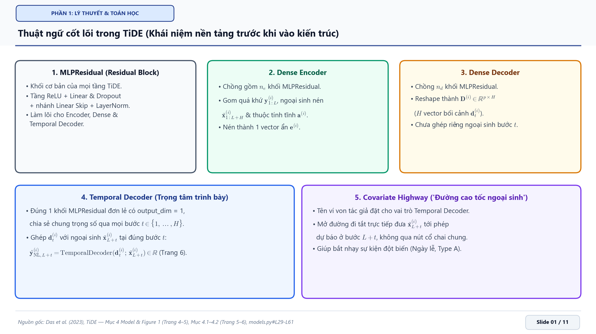
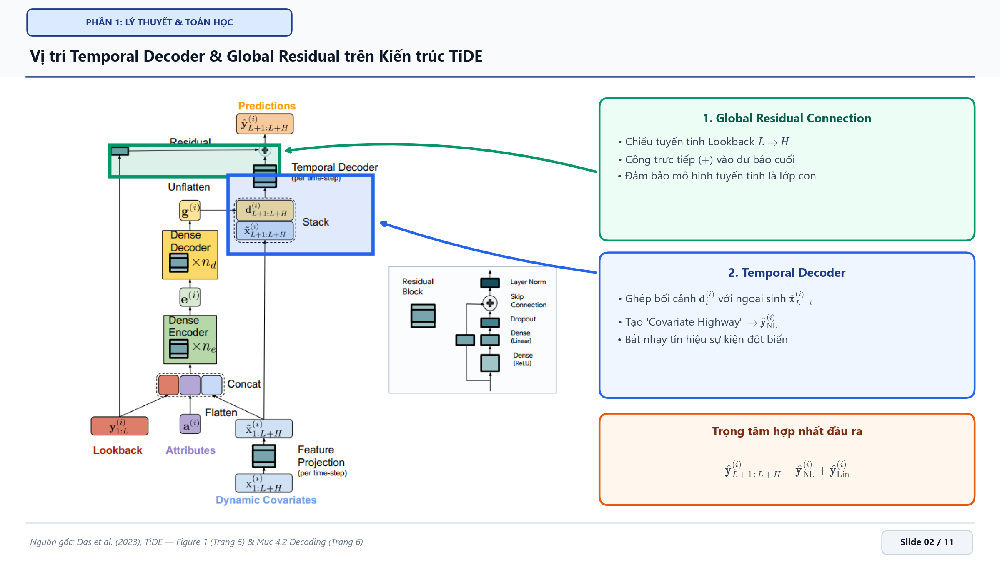
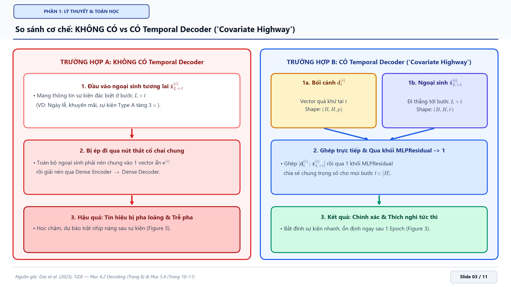
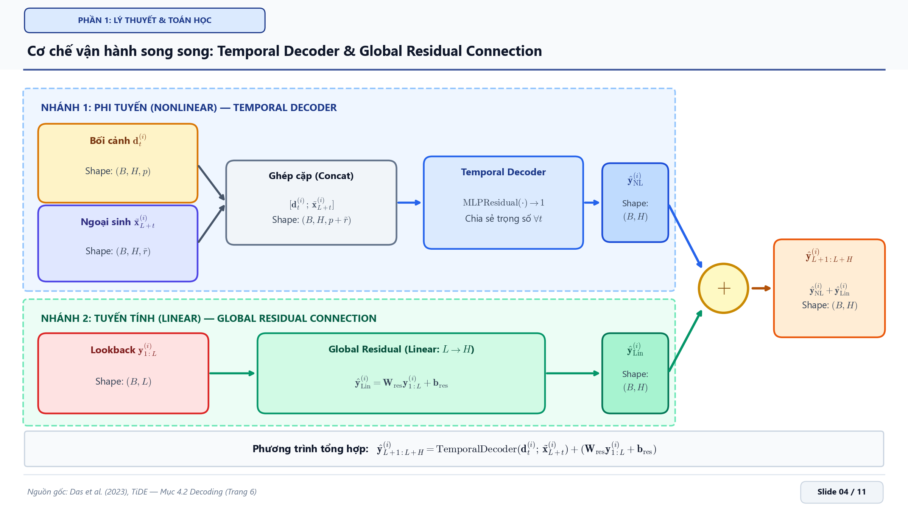
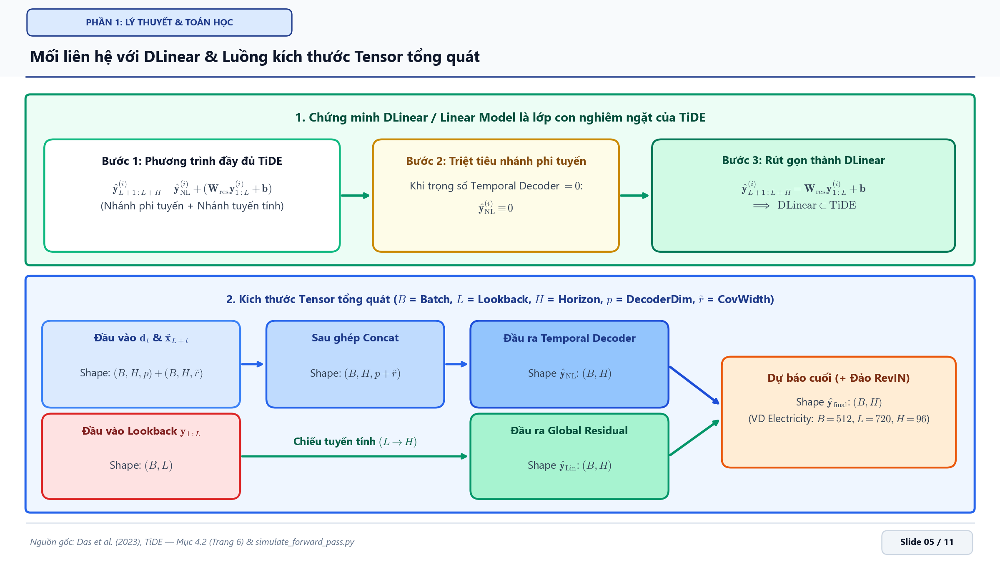

# SLIDE 01 (PHẦN 1): LÝ THUYẾT & TOÁN HỌC — TEMPORAL DECODER VÀ GLOBAL RESIDUAL CONNECTION

> [!NOTE]
> **Phạm vi trình bày của Slide 01 (Phần 1):** Không thuyết trình lại `Dense Encoder` hay `Dense Decoder` (phần đó của thành viên trước), mà tập trung hoàn toàn vào **hai cơ chế trực tiếp tạo ra dự báo cuối cùng**:
> 1. **Temporal Decoder** (Nhánh phi tuyến): Kết hợp $\mathbf{d}_t^{(i)}$ với *future covariates* $\tilde{\mathbf{x}}_{L+t}^{(i)}$ và lý do không dùng thẳng `Dense Decoder`.
> 2. **Global Residual Connection** (Nhánh tuyến tính): Ánh xạ *lookback* $\to$ *horizon*, cộng tổng hợp hai nhánh & chứng minh **DLinear là lớp con của TiDE**.

---

## 🖼️ Hình Ảnh & Sơ Đồ Minh Họa Đưa Lên Slide

### 1.0. Slide 01 / 11 — Bảng thuật ngữ cốt lõi (`MLPResidual`, `Dense Encoder`, `Dense Decoder`, `Temporal Decoder`, `Covariate Highway`)

### 1.1. Slide 02 / 11 — Phạm vi thuyết trình trên Figure 1 (Không trình bày phần bên dưới)

### 1.2. Slide 03 / 11 — So sánh 2 cột: KHÔNG CÓ vs CÓ Temporal Decoder ("Covariate Highway")

### 1.3. Slide 04 / 11 — Hai cơ chế song song trực tiếp tạo dự báo cuối cùng (đầy đủ Shape)

### 1.4. Slide 05 / 11 — Chứng minh mối liên hệ DLinear & Kích thước Tensor tổng quát

---

## 📋 Nội Dung Cụ Thể Trình Bày Trên Slide (Hiển thị cho khán giả)

### 0. Giải thích 5 thuật ngữ nền tảng (Slide 01 — Mở đầu)

* **`MLPResidual` (Residual Block — Hình 1, Trang 4–5):** Khối xây dựng cơ bản của mọi tầng trong TiDE, gồm 1 tầng ẩn ReLU $\to$ 1 tầng Linear + Dropout $\oplus$ nhánh tắt tuyến tính (`Skip Connection`) $\to$ chuẩn hóa `LayerNorm`. Dùng làm lõi cho `Feature Projection`, `Dense Encoder`, `Dense Decoder` và chính `Temporal Decoder` (`output_dim=1`).
* **`Dense Encoder` (Mục 4.1, Trang 5):** Chồng gồm $n_e$ khối `MLPResidual`, gom chung quá khứ $\mathbf{y}_{1:L}^{(i)}$, ngoại sinh đã nén $\tilde{\mathbf{x}}_{1:L+H}^{(i)}$ và thuộc tính tĩnh $\mathbf{a}^{(i)}$ để nén thành **1 vector ẩn duy nhất** $\mathbf{e}^{(i)}$.
* **`Dense Decoder` (Mục 4.2, Trang 6):** Chồng gồm $n_d$ khối `MLPResidual`, giải nén $\mathbf{e}^{(i)}$ ra kích thước $H \times p$ rồi `Reshape` thành $H$ vector bối cảnh $\mathbf{d}_t^{(i)} \in \mathbb{R}^p$ (chưa ghép riêng ngoại sinh từng bước $t$).
* **`Temporal Decoder` (Mục 4.2, Trang 6 — Trọng tâm):** Đúng **1 khối `MLPResidual` duy nhất** có `output_dim = 1` (chia sẻ trọng số $\forall t$), ghép trực tiếp $\mathbf{d}_t^{(i)}$ với $\tilde{\mathbf{x}}_{L+t}^{(i)}$ để xuất giá trị dự báo phi tuyến $\hat{\mathbf{y}}_{\mathrm{NL}, L+t}^{(i)}$.
* **`Covariate Highway` (Mục 4.2, Trang 6):** Đường cao tốc đi tắt mà `Temporal Decoder` mở cho biến ngoại sinh tương lai $\tilde{\mathbf{x}}_{L+t}^{(i)}$ nối thẳng tới dự báo tại đúng thời điểm $L+t$, tránh bị pha loãng qua nút thắt `Dense Encoder -> Dense Decoder`.

### 1. Phân biệt rõ các khối & Cơ chế Temporal Decoder ("Covariate Highway")

**1.1. Định nghĩa ranh giới nhiệm vụ (Để không nhầm lẫn với phần trước):**

* **Dense Encoder** *(bạn trước đã nói)*: Khối MLP nén toàn bộ quá khứ $\mathbf{y}_{1:L}^{(i)}$, ngoại sinh $\tilde{\mathbf{x}}_{1:L+H}^{(i)}$ và thuộc tính tĩnh $\mathbf{a}^{(i)}$ thành **1 vector ẩn chung** $\mathbf{e}^{(i)}$.
* **Dense Decoder** *(bạn trước đã nói)*: Khối MLP giải nén $\mathbf{e}^{(i)}$ thành $H$ vector bối cảnh quá khứ $\mathbf{d}_t^{(i)} \in \mathbb{R}^p$ cho từng bước tương lai $t \in \{1, \dots, H\}$.
* **Temporal Decoder** *(phần của mình)*: Là đúng **1 khối `MLPResidual` có đầu ra kích thước $1$** nằm ngay cổng ra, nhận trực tiếp cặp vector bối cảnh $\mathbf{d}_t^{(i)}$ ghép với biến ngoại sinh tương lai tại đúng bước $t$ ($\tilde{\mathbf{x}}_{L+t}^{(i)}$):

$$
\hat{\mathbf{y}}_{\mathrm{NL}, L+t}^{(i)} = \mathrm{TemporalDecoder}\Big(\big[ \mathbf{d}_t^{(i)} \; ; \; \tilde{\mathbf{x}}_{L+t}^{(i)} \big]\Big) \in \mathbb{R}, \quad \forall t \in \{1, 2, \dots, H\}
$$

**1.2. Vì sao TiDE bổ sung Temporal Decoder thay vì dùng trực tiếp đầu ra Dense Decoder?**

* Nếu bỏ Temporal Decoder (tức ép `Dense Decoder` tự đoán thẳng kết quả), toàn bộ thông tin về biến ngoại sinh tương lai $\tilde{\mathbf{x}}_{L+t}^{(i)}$ phải **đi vòng qua nút thắt cổ chai chung ở `Dense Encoder` $\to$ `Dense Decoder`**. Các sự kiện cục bộ đột ngột ở ngày $L+t$ (ví dụ: *Ngày của Mẹ* trong bán lẻ, đợt giảm giá, hoặc sự kiện tăng $3\times$) dễ bị pha loãng hoặc học rất chậm.
* Temporal Decoder mở một **đường cao tốc trực tiếp ("Covariate Highway")** đưa thẳng $\tilde{\mathbf{x}}_{L+t}^{(i)}$ tới phép dự báo $\hat{\mathbf{y}}_{\mathrm{NL}, L+t}^{(i)}$ tại đúng thời điểm đó (chia sẻ chung một bộ trọng số cho cả $H$ bước).

---

### 2. Cơ chế 2: Global Residual Connection & Mối liên hệ với DLinear

**2.1. Ánh xạ tuyến tính Lookback sang Horizon:**

Song song với nhánh trên, TiDE dùng **đúng 1 tầng Linear thuần túy** (không ReLU, không Dropout, không LayerNorm) chiếu thẳng chuỗi quá khứ $\mathbf{y}_{1:L}^{(i)}$ sang tương lai độ dài $H$:

$$
\hat{\mathbf{y}}_{\mathrm{Lin}, L+1:L+H}^{(i)} = \mathbf{W}_{\mathrm{res}} \cdot \mathbf{y}_{1:L}^{(i)} + \mathbf{b}_{\mathrm{res}} \in \mathbb{R}^H
$$

**2.2. Tổng hợp đầu ra Nonlinear và Linear tạo dự báo cuối cùng:**

Hai nhánh được cộng trực tiếp theo từng phần tử (và đảo chuẩn hóa RevIN về thang đo gốc nếu bật `transform=True`):

$$
\hat{\mathbf{y}}_{L+1:L+H}^{(i)} = \underbrace{\hat{\mathbf{y}}_{\mathrm{NL}, L+1:L+H}^{(i)}}_{\text{Temporal Decoder (Phi tuyến)}} + \underbrace{\hat{\mathbf{y}}_{\mathrm{Lin}, L+1:L+H}^{(i)}}_{\text{Global Residual (Tuyến tính)}}
$$

**2.3. Chứng minh mối liên hệ với DLinear (Zeng et al., 2023):**

* Khi toàn bộ trọng số của nhánh phi tuyến triệt tiêu ($\hat{\mathbf{y}}_{\mathrm{NL}}^{(i)} \equiv \mathbf{0}$), phương trình TiDE rút gọn chính xác thành mô hình tuyến tính thuần túy $\hat{\mathbf{y}}_{L+1:L+H}^{(i)} = \mathbf{W}_{\mathrm{res}} \mathbf{y}_{1:L}^{(i)} + \mathbf{b}_{\mathrm{res}}$.
* Điều này đảm bảo **mô hình tuyến tính (như DLinear) luôn là một tập con nghiêm ngặt của TiDE** ($\mathrm{DLinear} \subset \mathrm{TiDE}$): nhánh tuyến tính gánh phần xu hướng nền an toàn, còn Temporal Decoder chỉ cần học phần bù phi tuyến & sự kiện ngoại sinh.

---

### 3. Bảng kích thước Tensor tổng quát (Ký hiệu: $B$ = Batch, $L$ = Lookback, $H$ = Horizon, $p$ = DecoderDim, $\tilde{r}$ = CovWidth)

| Thành phần | Shape đầu vào | Phép biến đổi / Trung gian | Shape đầu ra |
| :--- | :--- | :--- | :--- |
| **Temporal Decoder** | $\mathbf{d}_t$: `Shape: (B, H, p)` $\tilde{\mathbf{x}}_{\mathrm{fut}}$: `Shape: (B, H, r_tilde)` | `Concat` $\to$ `Shape: (B, H, p + r_tilde)` $\to$ `MLPResidual(out=1)` | $\hat{\mathbf{y}}_{\mathrm{NL}}$: `Shape: (B, H)` |
| **Global Residual** | $\mathbf{y}_{\mathrm{norm}}$: `Shape: (B, L)` | Chiếu tuyến tính `Linear(L -> H)` | $\hat{\mathbf{y}}_{\mathrm{Lin}}$: `Shape: (B, H)` |
| **Tổng hợp cuối cùng** | $\hat{\mathbf{y}}_{\mathrm{NL}}, \hat{\mathbf{y}}_{\mathrm{Lin}}$: `Shape: (B, H)` | $\hat{\mathbf{y}}_{\mathrm{NL}} + \hat{\mathbf{y}}_{\mathrm{Lin}}$ (+ Đảo RevIN) | $\hat{\mathbf{y}}_{\mathrm{final}}$: `Shape: (B, H)` |

*(Ví dụ cấu hình chuẩn trên tập `Electricity`: $B = 512,\; L = 720,\; H = 96,\; p = 8,\; \tilde{r} = 4$).*

---

## 🎙️ Kịch Bản Lời Nói Thuyết Trình (Speaker Notes)

> "Xin chào thầy cô và các bạn. Nhìn lên Hình 1 của bài báo gốc, bạn trước đã trình bày phần bên dưới là Dense Encoder nén lịch sử và Dense Decoder tạo ra các vector bối cảnh $\mathbf{d}_t$. **Phần trình bày của em KHÔNG lặp lại phần dưới đó**, mà chỉ tập trung đúng vào **2 khối trên cùng** trực tiếp chốt ra dự báo cuối cùng: **Temporal Decoder** (khung xanh dương) và **Global Residual Connection** (khung xanh lá).
>
> Trước tiên, **Temporal Decoder là gì?** Nó là một khối `MLPResidual` duy nhất có đầu ra bằng $1$. Tại từng bước tương lai $t$, nó lấy vector bối cảnh $\mathbf{d}_t$ ghép trực tiếp với biến ngoại sinh tương lai $\tilde{\mathbf{x}}_{L+t}$ để tính ra một giá trị điều chỉnh phi tuyến $\hat{\mathbf{y}}_{\mathrm{NL}}$. Lý do phải thêm khối này mà không dùng thẳng đầu ra Dense Decoder là để tạo **'Covariate Highway'**: nếu bắt biến ngoại sinh đi vòng qua nút thắt Dense Encoder $\to$ Dense Decoder, tín hiệu sự kiện mạnh ở một ngày cụ thể (như Ngày của Mẹ hay ngày lễ) sẽ bị làm mờ đi.
>
> Song song với nó là **Global Residual Connection**: một tầng Linear thuần túy chiếu thẳng chuỗi quá khứ $\mathbf{y}_{1:L}$ sang $H$ bước tương lai $\hat{\mathbf{y}}_{\mathrm{Lin}}$. Sau cùng, TiDE **cộng trực tiếp hai nhánh lại**. Về mặt toán học, nếu nhánh phi tuyến bằng 0 thì TiDE trở thành chính xác một mô hình tuyến tính kiểu DLinear — đảm bảo DLinear luôn là một lớp con nằm gọn bên trong TiDE!"

---

> 📌 **Footer (Vị trí gốc đối chiếu trên Bài báo & Mã nguồn):**  
> **Bài báo:** Das et al. (2023), *Long-term Forecasting with TiDE: Time-series Dense Encoder* — **Figure 1 (Trang 5)** & **Mục 4.2 Decoding (Trang 6)** | **Repo gốc:** [`google-research/tide/models.py#L141-L155`](https://github.com/google-research/google-research/blob/master/tide/models.py#L141-L155)
