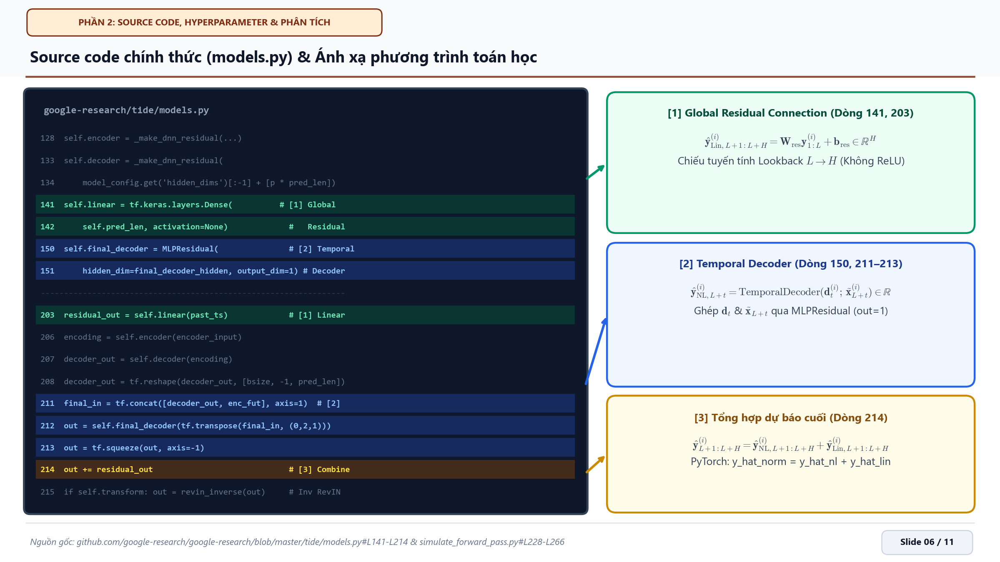

# SLIDE 02 (PHẦN 2): SOURCE CODE, HYPERPARAMETERS & PHÂN TÍCH ABLATION STUDY

> [!NOTE]
> **Mục tiêu Slide 02 (Phần 2):** Trình bày **Source code hiện thực tương ứng** (`models.py` & PyTorch); hệ thống hóa **cấu hình Hyperparameters chính thức trên 7 Benchmark Datasets** (Phụ lục B.3, Table 7 & Table 8, Trang 20–21); và phân tích vai trò thực chứng của **Temporal Decoder** và **Global Residual** qua hai thí nghiệm **Ablation Study** (Mục 5.4, Trang 10–11).

---

## 🖼️ Hình Ảnh & Sơ Đồ Minh Họa Đưa Lên Slide

### 2.1. Slide 06 / 11 — Source code chính thức (`models.py`) & Ánh xạ phương trình toán học



### 2.2. Slide 07 / 11 — Cấu hình Siêu tham số (Hyperparameters — Table 7 & Table 8, Trang 20–21)


### 2.3. Slide 08 / 11 — Ablation Study 1 (Figure 3 Trang 10–11): Vai trò Temporal Decoder


### 2.4. Slide 09 / 11 — Ablation Study 2 (Table 5 Trang 11): Vai trò Residual Connections (`Electricity`)


---

## 📋 Nội Dung Cụ Thể Trình Bày Trên Slide (Hiển thị cho khán giả)

### 1. Source Code hiện thực trong Repository gốc & Dự án

**Repo gốc Google Research (TensorFlow/Keras):** [`google-research/tide/models.py`](https://github.com/google-research/google-research/blob/master/tide/models.py)

```python
# --- TRONG TideModel.__init__ ---
# Global Residual Connection (Dòng 141-144)
self.linear = tf.keras.layers.Dense(self.pred_len, activation=None)

# Temporal Decoder (Dòng 150-155)
self.final_decoder = MLPResidual(
    hidden_dim=model_config.get('final_decoder_hidden'),
    output_dim=1, layer_norm=layer_norm, dropout_rate=dropout_rate
)

# --- TRONG TideModel.call ---
residual_out = self.linear(past_ts)                                  # Dòng 203: [B, H]
final_in = tf.concat([decoder_out, enc_fut], axis=1)                 # Dòng 211: [B, p + r_tilde, H]
out = self.final_decoder(tf.transpose(final_in, (0, 2, 1)))          # Dòng 212: [B, H, 1]
out = tf.squeeze(out, axis=-1)                                       # Dòng 213: [B, H]
out += residual_out                                                  # Dòng 214: [B, H]
```

**Code PyTorch đối chiếu trong dự án:** [`simulate_forward_pass.py#L232-L266`](../../../simulate_forward_pass.py#L232-L266)

```python
temp_in = torch.cat([D, x_proj[:, self.L :, :]], dim=-1)            # Dòng 232-235: [B, H, p + r_tilde]
y_hat_nl = self.temporal_decoder(temp_in).squeeze(-1)                # Dòng 238: [B, H]
y_hat_lin = self.global_skip(y_norm)                                 # Dòng 252: [B, H]
y_hat_norm = y_hat_nl + y_hat_lin                                    # Dòng 265: [B, H]
```

### 2. Cấu hình Siêu tham số (Hyperparameters — Phụ lục B.3, Table 7 & Table 8, Trang 20–21)

* **Nhóm tham số cố định chung (*Global Settings*):** Cửa sổ quá khứ $L = 720$, tầm dự báo $H \in \{96, 192, 336, 720\}$, kích thước batch `batchSize = 512`, độ rộng nén ngoại sinh `temporalWidth` ($\tilde{r}$) $= 4$, hàm mất mát MSE, bộ tối ưu Adam với lịch giảm Cosine LR Decay; bật/tắt `layerNorm`, `dropoutLevel` và `revIn` theo từng bộ dữ liệu.
* **Siêu tham số trực tiếp của 2 cơ chế trình bày:**
  * **Temporal Decoder:** Dùng 2 siêu tham số chính là `decoderOutputDim` ($p \in \{4, 8, 16, 32\}$) và `temporalDecoderHidden` (thực nghiệm chọn $\in \{16, 64, 128\}$). Chiều đầu vào tầng cuối cố định bằng $p + \tilde{r} = p + 4$.
  * **Global Residual Connection:** Không phát sinh siêu tham số ẩn; kích thước ma trận tuyến tính cố định hoàn toàn theo $(L, H) = (720, H)$.
* **Quy luật chọn cấu hình trên 7 Benchmark Datasets (Table 8, Trang 21):**
  * Các tập quy mô lớn nhiều chuỗi (`Traffic` 862 chuỗi, `Electricity` 321 chuỗi) đặt `temporalDecoderHidden = 64` với $p \in \{8, 16\}$.
  * Nhóm `ETT` (`ETTm1`, `ETTm2`, `ETTh1`, `ETTh2` — 7 biến trạm biến áp) thường tăng `temporalDecoderHidden = 128` hoặc tăng $p = 32$ (`ETTh2`). Tập `Weather` biến thiên mượt hơn chỉ cần `temporalDecoderHidden = 16`, $p = 8$.

### 3. Phân tích Ablation Study 1: Vai trò Temporal Decoder (Figure 3, Trang 10–11)

* **Thiết kế thí nghiệm:** Dữ liệu `Electricity` bán tổng hợp thêm sự kiện **Type A** (nhân biên độ chuỗi lên hệ số ngẫu nhiên trong $[3.0, 3.2]$ kéo dài $24\text{h}$) và **Type B** (giảm theo hệ số $[2.0, 2.2]$) tác động lên $80\%$ chuỗi, đánh giá chỉ sau **1 Epoch**.
* **Kết quả quan sát:**
  * **Trong khi xảy ra sự kiện Type A:** Bản có Temporal Decoder bám kịp biên độ tăng đột biến nhanh hơn nhờ đường cao tốc nối thẳng từ biến ngoại sinh chỉ báo sự kiện.
  * **Ngay sau khi sự kiện kết thúc (`Time > 200`):** Bản **không có Temporal Decoder (đường xanh lá) bị trật nhịp nặng (thrown off)** vì `Dense Encoder` chưa kịp điều chỉnh lại nhận thức về bối cảnh quá khứ; trong khi **bản có Temporal Decoder ổn định trở lại ngay lập tức** sau đúng 1 Epoch.

### 4. Phân tích Ablation Study 2: Vai trò Global Residual (Table 5 / Figure 5, Trang 11 — Xem Slide 09)

* **Nhận xét trực tiếp từ ảnh số liệu bài báo gốc (Trung bình 5 lần chạy trên `Electricity`):**
  * **Ở các tầm dự báo $H = 96 \to 336$:** Khi loại bỏ các kết nối thặng dư (`TiDE no res.`), cả MSE và MAE đều **tăng lên rõ rệt và có ý nghĩa thống kê** (đặc biệt tại $H=336$, MSE tăng từ `0.161` lên `0.172` tương đương tăng $+6.8\%$ sai số, MAE tăng từ `0.261` lên `0.274`).
  * **Tại tầm siêu dài $H = 720$:** Sai số hai bản tiệm cận nhau (`0.196` vs `0.196` MSE).
  * **Kết luận:** Kết nối thặng dư (trong đó có Global Residual) giúp mạng MLP giữ vững nền tảng tuyến tính và hội tụ chính xác hơn nhiều so với việc ép mạng sâu phải tự học lại phép chiếu thẳng từ đầu.
* **Giải thích thắc mắc *"Tại sao bài báo có 7 datasets nhưng chỉ show ra 1 (`Electricity`)?"*:**
  * Trong bài báo gốc (**Mục 5.4, Trang 11**), nhóm tác giả Google Research **chỉ thực hiện thí nghiệm bỏ Residual (`TiDE no res.`) trên đúng 1 tập đại diện là `Electricity`**.
  * 6 tập còn lại (`Traffic`, `Weather`, `ETTh1/2`, `ETTm1/2`) chỉ được công bố kết quả cho bản TiDE đầy đủ tại **Table 2 (Trang 8)** và **Table 5 Phụ lục (Trang 19)** chứ tác giả **không chạy** `TiDE (no res.)` trên 6 tập đó. *(Đây chính là khoảng trống thực nghiệm ta đề xuất mở rộng ở Phần 3!)*

### 5. Giới hạn tiềm ẩn của cơ chế tổng hợp hiện tại

1. **Cộng cứng tỷ lệ $1 : 1$ (`out += residual_out`):** Trọng số cố định ở mọi bước $t$ và mọi chuỗi $\implies$ dễ cộng thêm nhiễu phi tuyến vào vùng chuỗi đang vận động tuyến tính đều đặn.
2. **Chưa lọc xu hướng mượt cho nhánh tuyến tính:** Khác với DLinear (tách Trend/Seasonal bằng Moving Average), TiDE chiếu thẳng $\mathbf{y}_{1:L}$ thô qua `self.linear`, dễ bị ảnh hưởng nếu lịch sử chứa các điểm nhiễu gai (*outliers*).

---

## 🎙️ Kịch Bản Lời Nói Thuyết Trình (Speaker Notes)

> "Sang Phần 2 là Source Code, Hyperparameters và Phân tích Ablation Study. Trước hết trên Slide 06 là mã nguồn trích nguyên văn từ file `models.py` trong repo gốc Google Research ở các dòng 141 đến 214, đặt cạnh bản PyTorch của dự án mình — nhấn mạnh dòng 203 `residual_out`, dòng 211–213 `final_decoder`, và dòng 214 `out += residual_out`.
>
> Tiếp theo trên **Slide 07 là bảng cấu hình Hyperparameters chính thức (Table 8, Trang 21)** cho toàn bộ 7 tập benchmark. Trong đó `batchSize=512` và `temporalWidth=4` được giữ cố định; riêng phần Temporal Decoder của chúng ta chỉ điều chỉnh đúng 2 tham số là `decoderOutputDim` ($p \in \{8, 16, 32\}$) và `temporalDecoderHidden` ($16, 64, 128$), còn nhánh Global Residual không cần thêm bất kỳ hyperparameter nào vì ánh xạ cố định $L \to H$.
>
> Để chứng minh hai thành phần này thực sự thiết yếu, bài báo đưa ra 2 thí nghiệm Ablation Study ở Mục 5.4:
> 1. Với **Temporal Decoder** (**Slide 08**, Figure 3 Trang 10): Chỉ sau đúng 1 Epoch trên Electricity chèn sự kiện Type A gấp 3 lần biên độ, bản thiếu Temporal Decoder (đường xanh lá) bị trật nhịp vọt lên cao sau khi sự kiện kết thúc, còn bản đầy đủ xử lý mượt mà tức thì.
> 2. Với **Residual Connections** (**Slide 09**, Table 5 Trang 11): Khi bỏ kết nối thặng dư (`TiDE no res.`), sai số MSE/MAE ở các tầm dự báo 96 đến 336 đều tăng rõ rệt — ví dụ ở $H=336$, MSE tăng từ `0.161` lên `0.172` ($+6.8\%$).
>
> Tuy nhiên, nhìn lại dòng code 214 `out += residual_out`, ta phát hiện ra giới hạn **cộng cứng 1:1** — mở đường cho Phần 3 đề xuất cải tiến ngay sau đây."

---

> 📌 **Footer (Vị trí gốc đối chiếu trên Bài báo & Mã nguồn):**  
> **Bài báo:** Das et al. (2023), *TiDE* — **Phụ lục B.3 Table 7 & Table 8 (Trang 20–21)** & **Mục 5.4 Ablation Study, Figure 3 (Trang 10) & Table/Figure 5 (Trang 11)** | **Repo gốc:** [`google-research/tide/models.py#L141-L214`](https://github.com/google-research/google-research/blob/master/tide/models.py#L141-L214) & [`simulate_forward_pass.py#L228-L266`](../../../simulate_forward_pass.py#L228-L266)
